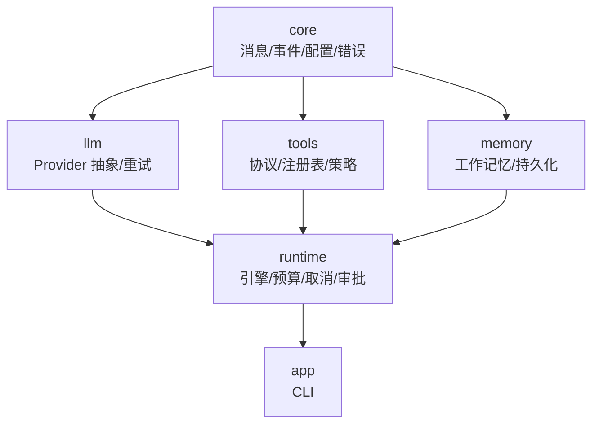
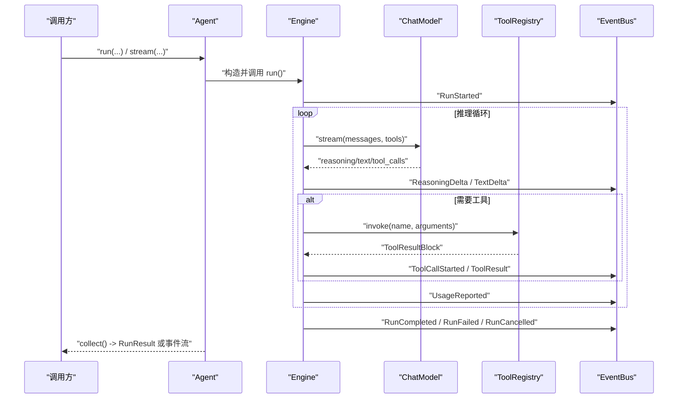
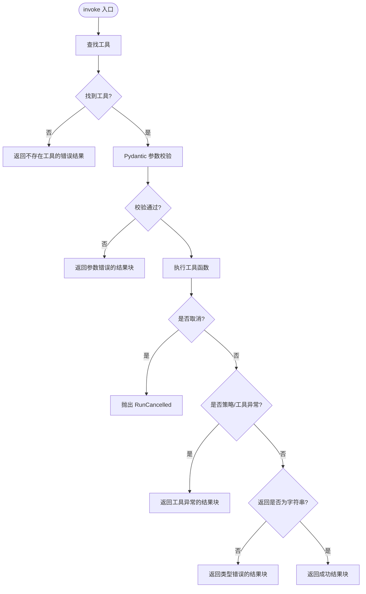
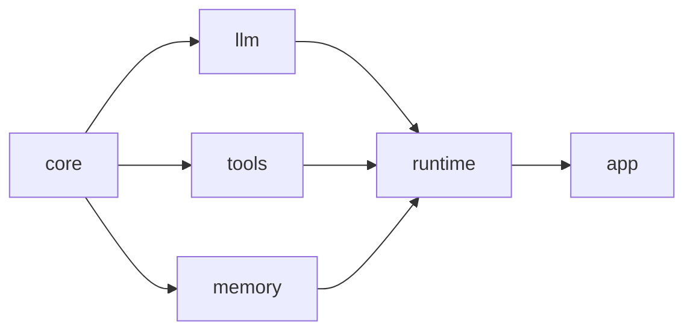

# API 参考

<cite>
**本文引用的文件**   
- [README.md](file://README.md)
- [__init__.py](file://src/agentkit/__init__.py)
- [agent.py](file://src/agentkit/runtime/agent.py)
- [engine.py](file://src/agentkit/runtime/engine.py)
- [registry.py](file://src/agentkit/tools/registry.py)
- [base.py](file://src/agentkit/tools/base.py)
- [config.py](file://src/agentkit/core/config.py)
- [types.py](file://src/agentkit/core/types.py)
- [events.py](file://src/agentkit/core/events.py)
- [cli.py](file://src/agentkit/app/cli.py)
</cite>

## 目录
1. [简介](#简介)
2. [项目结构](#项目结构)
3. [核心组件](#核心组件)
4. [架构总览](#架构总览)
5. [详细组件说明](#详细组件说明)
6. [依赖关系分析](#依赖关系分析)
7. [性能与行为特性](#性能与行为特性)
8. [故障排查](#故障排查)
9. [结论](#结论)
10. [附录：CLI 命令参考](#附录cli-命令参考)

## 简介
AgentKit 是一个从零实现的 Agent 开发框架，核心循环、工具层、记忆、评测和可观测性均为自研实现，不依赖 LangChain 等上层框架。当前版本已实现内核、流式输出、取消、预算、审批和工作记忆；服务化、可观测性和评测仍在规划中。

该文档聚焦公共 API：`Agent`、`ToolRegistry`、`Settings`、CLI 命令，以及运行时事件模型。所有接口说明均基于源码实现，便于保持文档与代码同步。

**章节来源**
- [README.md:1-99](file://README.md#L1-L99)

## 项目结构
仓库采用按职责分层组织：
- `core`：零依赖的消息模型、事件、错误、配置、用量。
- `llm`：Provider 抽象、流式归一化、重试策略。
- `tools`：工具协议、注册表、安全策略、内置工具。
- `memory`：工作记忆与 SQLite 持久化。
- `runtime`：引擎循环、事件总线、预算、取消、审批。
- `app`：CLI 入口（HTTP 服务在后续阶段）。

**图表来源**
- [README.md:53-68](file://README.md#L53-L68)

**章节来源**
- [README.md:53-68](file://README.md#L53-L68)

## 核心组件
本项目的公开 API 通过包根导出，支持惰性导入以保持轻量：
- `Agent`：把模型、工具、引擎组装起来的可运行门面。
- `ToolRegistry`：工具注册与管理容器。
- `tool`：装饰器形式的工具注册辅助。
- `Settings`：进程级配置类。
- `ChatModel`：LLM Provider 抽象。

这些符号由包根模块统一暴露，实际实现位于 `runtime.agent`、`tools.registry`、`core.config` 和 `llm.base`。

**章节来源**
- [__init__.py:1-45](file://src/agentkit/__init__.py#L1-L45)

## 架构总览
Agent 的运行流程以“引擎只产出事件”为核心设计：
- CLI、SSE、可观测、评测共享同一条事件流，避免返回值与回调双真相源。
- 工具参数使用 pydantic 校验，失败回灌给模型，让模型自我修正。
- 审批通道在工具执行前发出请求，客户端可在阻塞期间做出决定。
- 预算、取消、步数上限共同控制一次 run 的生命周期。

**图表来源**
- [engine.py:166-248](file://src/agentkit/runtime/engine.py#L166-L248)
- [engine.py:370-434](file://src/agentkit/runtime/engine.py#L370-L434)
- [registry.py:113-174](file://src/agentkit/tools/registry.py#L113-L174)
- [events.py:48-169](file://src/agentkit/core/events.py#L48-L169)

## 详细组件说明

### Agent 类
`Agent` 是面向用户的门面，负责把 `ChatModel`、`ToolRegistry`、工作区、系统提示词、步数、温度、token 上限、审批、预算、记忆等装配到 `Engine`，并提供流式与汇聚两种运行方式。

#### 构造函数参数
| 参数 | 类型 | 默认值 | 含义 |
| --- | --- | --- | --- |
| `model` | `ChatModel` | 必填 | LLM 适配器实例。 |
| `tools` | `ToolRegistry` | 必填 | 工具注册表。 |
| `workspace` | `Path` | 必填 | 工具读写的工作区根目录。 |
| `name` | `str` | `"agent"` | Agent 名称，用于事件标识。 |
| `system_prompt` | `str \| None` | `None` | 系统提示词；未提供时由引擎渲染默认提示词。 |
| `max_steps` | `int` | `15` | 最大推理步数。 |
| `temperature` | `float \| None` | `0.0` | 生成温度。 |
| `max_tokens` | `int \| None` | `None` | 单次回复的 token 上限。 |
| `approver` | `Approver \| None` | `None` | 审批通道；为 `None` 时，需要审批的动作会被拒绝。 |
| `budget` | `Budget \| None` | `None` | 预算对象，控制成本、token、时长。 |
| `memory` | `MemoryManager \| None` | `None` | 工作记忆管理器。 |
| `metadata` | `dict[str, str]` | `{}` | 元数据，可用于追踪。 |

#### 方法

##### `engine()`
- 作用：返回一个装配好的 `Engine` 实例。
- 返回值：`Engine`。
- 行为：将 `Agent` 的配置传递给 `Engine`，包括模型、工具、工作区、提示词、步数、温度、token 上限、预算、记忆。

##### `stream(user_input, *, history=None, run_id=None, session_id=None, cancellation=None, approver=None)`
- 作用：异步迭代运行事件。
- 参数：
  - `user_input`：用户输入文本。
  - `history`：可选的历史消息序列。
  - `run_id`：可选的 run 标识。
  - `session_id`：可选的会话标识，配合记忆管理器进行上下文持久化。
  - `cancellation`：可选的取消令牌。
  - `approver`：可选的审批通道，覆盖实例级别的 `approver`。
- 返回值：`AsyncIterator[RunEvent]`。
- 异常：内部异常被转换为终止事件；取消会抛出 `RunCancelled`。

##### `run(user_input, *, history=None, run_id=None, session_id=None, cancellation=None, approver=None)`
- 作用：运行一次任务并汇聚成最终结果。
- 参数：与 `stream` 相同。
- 返回值：`RunResult`。
- 异常：底层取消仍可能抛出 `RunCancelled`；其他异常通常被封装为 `RunResult.error`。

##### `aclose()`
- 作用：关闭底层模型连接。
- 返回值：`None`。

#### 使用示例
- 构建 Agent 并运行：
  - 通过 `build_agent(settings, workspace=..., tool_groups=[...])` 创建 Agent。
  - 调用 `await agent.run("统计 src 下有多少个 Python 文件")` 获取 `RunResult`。
- 消费事件流：
  - `async for event in agent.stream("..."): print(event.type, event)`。

**章节来源**
- [agent.py:38-116](file://src/agentkit/runtime/agent.py#L38-L116)
- [agent.py:143-175](file://src/agentkit/runtime/agent.py#L143-L175)

### ToolRegistry
`ToolRegistry` 管理一组工具，支持添加、移除、合并、查询和执行。它不持有全局状态，允许同一进程并存多套工具集，测试也不会互相污染。

#### 主要接口
| 方法 | 参数 | 返回值 | 行为 |
| --- | --- | --- | --- |
| `add(spec)` | `ToolSpec` | `ToolSpec` | 注册已有工具；重名抛 `ValueError`。 |
| `remove(name)` | `str` | `None` | 移除工具。 |
| `register(fn, **kwargs)` | `ContextAwareCallable`, 关键字参数 | `ToolSpec` | 从异步函数注册工具。 |
| `tool(**kwargs)` | 装饰器关键字参数 | 装饰器 | 装饰器形式注册工具并返回原函数。 |
| `merge(other, override=False)` | `ToolRegistry`, `bool` | `ToolRegistry` | 合并另一个注册表，返回新实例。 |
| `get(name)` | `str` | `ToolSpec \| None` | 按名称查询工具。 |
| `all()` | 无 | `list[ToolSpec]` | 列出所有工具。 |
| `names()` | 无 | `list[str]` | 列出工具名。 |
| `schemas()` | 无 | `list[ToolSchema]` | 生成 provider 中立的工具契约列表。 |
| `describe()` | 无 | `str` | 生成人类可读的工具清单。 |
| `invoke(name, arguments, ctx, tool_use_id="")` | `str`, `dict`, `ToolContext`, `str` | `ToolResultBlock` | 校验并执行工具，永不抛异常（取消除外），失败转为错误结果块。 |

#### 执行语义
- 参数校验失败：返回 `is_error=True` 的结果块，包含字段级错误信息，供模型自我修正。
- 策略拒绝或工具异常：返回 `is_error=True` 的结果块，包含异常摘要。
- 取消：唯一会向上抛出的异常，表示整个 run 应停止。
- 非字符串返回：视为工具实现缺陷，返回错误结果块。

**图表来源**
- [registry.py:113-174](file://src/agentkit/tools/registry.py#L113-L174)

**章节来源**
- [registry.py:33-174](file://src/agentkit/tools/registry.py#L33-L174)

### Settings 配置类
`Settings` 是进程级配置，优先级为环境变量 > `.env` > 默认值。它集中管理 LLM 连接、生成参数、运行时选项。

#### 属性定义
| 属性 | 类型 | 默认值 | 环境变量别名 | 含义 |
| --- | --- | --- | --- | --- |
| `api_key` | `str \| None` | `None` | `LLM_API_KEY` / `DEEPSEEK_API_KEY` | LLM API Key。 |
| `base_url` | `str` | DeepSeek 默认端点 | `LLM_BASE_URL` | OpenAI 兼容端点。 |
| `model` | `str` | `"deepseek-flash"` | `LLM_MODEL` | 模型 id。 |
| `temperature` | `float` | `0.0` | `LLM_TEMPERATURE` | 生成温度。 |
| `max_tokens` | `int \| None` | `None` | `LLM_MAX_TOKENS` | 单次回复输出上限。 |
| `request_timeout` | `float` | `120.0` | `LLM_TIMEOUT` | 请求超时秒数。 |
| `max_retries` | `int` | `3` | `LLM_MAX_RETRIES` | 总尝试次数（含首次）。 |
| `retry_base_delay` | `float` | `0.5` | `LLM_RETRY_BASE_DELAY` | 重试基础延迟。 |
| `retry_max_delay` | `float` | `30.0` | `LLM_RETRY_MAX_DELAY` | 重试最大延迟。 |
| `max_steps` | `int` | `15` | `AGENT_MAX_STEPS` | 最大推理步数。 |
| `workspace` | `Path` | 当前目录 | `AGENT_WORKSPACE` | 工具工作区根目录。 |

#### 方法
- `require_api_key()`：若未配置 API Key，抛出 `ConfigurationError`；否则返回 key。
- `resolved_workspace()`：返回工作区的绝对路径。
- `load_settings(**overrides)`：加载配置，忽略值为 `None` 的覆盖项。

**章节来源**
- [config.py:27-99](file://src/agentkit/core/config.py#L27-L99)

### CLI 命令
CLI 是事件流的一个消费者，负责解析参数、构建 Agent、渲染输出、管理会话。

#### 子命令
- `run`：执行一个任务。
- `chat`：交互式对话。
- `tools`：列出内置工具及其参数 schema。
- `sessions`：管理会话（`list`、`show`、`delete`）。

#### 通用参数
| 参数 | 类型 | 默认值 | 含义 |
| --- | --- | --- | --- |
| `-w`, `--workspace` | `Path` | 当前目录 | 工作区目录。 |
| `-m`, `--model` | `str` | 配置中的模型 | 覆盖模型 id。 |
| `-s`, `--max-steps` | `int` | 配置中的步数 | 最大步数。 |
| `--groups` | `str` | 全部内置分组 | 逗号分隔的工具分组。 |
| `--no-approve` | `flag` | 开启审批 | 关闭审批通道，需要审批的动作直接拒绝。 |
| `--max-cost` | `float` | 无 | 本次 run 的成本上限。 |
| `--max-tokens` | `int` | 无 | 本次 run 的输入+输出 token 上限。 |
| `--db` | `Path` | `.agentkit/sessions.db` | 会话数据库路径。 |
| `--show-reasoning` | `flag` | 仅计数 | 打印思维链内容。 |
| `-q`, `--quiet` | `flag` | 输出中间过程 | 只输出最终答复。 |

#### `run` 命令
- 位置参数：`prompt`（任务描述，支持多个片段拼接）。
- 额外参数：
  - `--session`：会话 id，续跑时使用。
  - `--json-events`：以 JSONL 输出事件流。

#### `chat` 命令
- 参数：
  - `--session`：会话 id（默认 `default`）。
- 交互模式：支持 `/new` 切换会话，`exit`/`quit`/`退出` 结束。

#### `sessions` 命令
- 动作：
  - `list`：列出会话。
  - `show <session_id>`：查看会话历史。
  - `delete <session_id>`：删除会话。

#### 退出码
- `0`：成功。
- `1`：运行失败。
- `2`：参数或配置错误。
- `130`：键盘中断。

**章节来源**
- [cli.py:35-113](file://src/agentkit/app/cli.py#L35-L113)
- [cli.py:283-323](file://src/agentkit/app/cli.py#L283-L323)
- [cli.py:329-363](file://src/agentkit/app/cli.py#L329-L363)
- [cli.py:366-410](file://src/agentkit/app/cli.py#L366-L410)
- [cli.py:412-483](file://src/agentkit/app/cli.py#L412-L483)
- [cli.py:486-517](file://src/agentkit/app/cli.py#L486-L517)

### 运行时事件模型
事件是 CLI、SSE、可观测、评测共享的唯一真相源。正常 run 的事件序列大致为：
- `RunStarted`
- `StepStarted(1)`
- `UsageReported(1)`
- `ToolCallStarted(read_file)` → `ToolResult(read_file)`
- `StepStarted(2)`
- `UsageReported(2)`
- `RunCompleted`

失败或取消时以 `RunFailed` / `RunCancelled` 收尾，两者互斥且必居其一。

#### 事件分类
- 生命周期：`RunStarted`、`StepStarted`、`RunCompleted`、`RunFailed`、`RunCancelled`。
- 模型输出：`ReasoningDelta`、`TextDelta`、`UsageReported`。
- 工具：`ToolCallStarted`、`ToolResult`。
- 审批：`ApprovalRequested`、`ApprovalResolved`。

**章节来源**
- [events.py:1-169](file://src/agentkit/core/events.py#L1-L169)

### 消息与内容块
内部消息模型采用内容块（content block）而非 provider 特定的 `tool_calls[]` + `role:"tool"`，以便在不同 Provider 之间无损转换。

#### 内容块类型
- `TextBlock`：普通文本。
- `ReasoningBlock`：思维链。
- `ToolUseBlock`：模型请求调用工具。
- `ToolResultBlock`：工具执行结果。

#### Message
- 角色：`system`、`user`、`assistant`。
- 工具结果属于 `user` 消息，并行工具调用的结果合并进同一条 `user` 消息。
- 提供构造方法：`Message.system`、`Message.user`、`Message.assistant`、`Message.from_tool_results`。
- 提供查询方法：`text()`、`reasoning_text()`、`tool_uses()`、`tool_results()`、`is_empty()`。

#### 配对不变量
`validate_conversation` 强制：
1. 每个 `tool_use` 必须在紧随其后的 `user` 消息中找到 `tool_result`。
2. 不允许孤儿 `tool_result`。
3. 并行调用的全部结果必须合并在同一条 `user` 消息里。

违反时抛出 `InvalidConversation`，并指出具体下标和 id。

**章节来源**
- [types.py:1-212](file://src/agentkit/core/types.py#L1-L212)

### 工具协议与上下文
工具协议要求工具暴露名字、描述、参数的 JSON Schema。参数 schema 从函数签名自动生成，第一个参数固定为 `ToolContext`，不参与 schema。

#### ToolContext
- `workspace`：工作区根目录。
- `run_id`：当前 run 的标识。
- `tool_use_id`：当前工具调用标识，用于审批关联。
- `approver`：审批通道。
- `state`：进程内共享状态。
- `request_approval(request)`：走审批通道，无通道时默认拒绝。
- `resolve(path)`：解析路径到工作区内，越界抛 `PathViolation`。
- `display_path(path)`：尽量用相对路径展示。

#### ToolSpec
- `name`、`description`、`args_model`、`fn`。
- `dangerous`：是否有副作用。
- `idempotent`：是否幂等。
- `json_schema()`：生成参数 JSON Schema。
- `schema()`：转成 provider 中立契约。
- `validate(arguments)`：校验参数，失败抛 `ToolValidationError`。
- `from_function(fn, ...)`：从异步函数构造工具。

**章节来源**
- [base.py:1-214](file://src/agentkit/tools/base.py#L1-L214)

## 依赖关系分析
依赖方向是单向的：
- `core` 零依赖。
- `llm`、`tools`、`observability` 只依赖 `core`。
- `memory` 依赖 `core`。
- `runtime` 依赖全部。
- `app` 只依赖 `runtime`。
- `tools` 绝不 import `runtime`（审批接口由 runtime 注入实现）。

**图表来源**
- [README.md:53-68](file://README.md#L53-L68)

**章节来源**
- [README.md:53-68](file://README.md#L53-L68)

## 性能与行为特性
- 引擎只 yield 类型化事件，避免“返回值 + 回调”的双真相源。
- 工具参数使用 pydantic 校验，失败回灌给模型，提升模型自我修正能力。
- 路径边界使用 `realpath` + `commonpath`，避免符号链接和路径前缀比较的安全问题。
- 命令安全采用三分裁决（拒绝 / 放行 / 转审批），默认不信任。
- 引擎事件经队列而非直接 yield，确保审批事件在工具阻塞期间送达客户端。
- 工具结果失败一律回灌而不中断 run，使模型能自我修正。
- 流式重试只在首个 chunk 之前允许，避免重复输出和计费。
- 记忆只做工作记忆 + 持久化，语义记忆/情节记忆不在当前范围。

**章节来源**
- [README.md:8-26](file://README.md#L8-L26)

## 故障排查
常见错误与处理：
- 未配置 API Key：`Settings.require_api_key()` 抛出 `ConfigurationError`。
- 工具参数非法：`ToolRegistry.invoke` 返回 `is_error=True` 的结果块，包含字段级错误信息。
- 策略拒绝：返回 `PolicyError` 摘要的错误结果块。
- 工具实现异常：捕获并返回错误结果块，避免吞掉异常。
- 非字符串返回：视为工具实现缺陷，返回类型错误结果块。
- 取消：唯一会向上抛出的异常，表示整个 run 应停止。
- 对话配对不一致：`validate_conversation` 抛出 `InvalidConversation`，指出具体下标和 id。
- 工作区无效：`build_agent` 检查工作区存在且为目录，否则抛 `NotADirectoryError`。

**章节来源**
- [config.py:79-88](file://src/agentkit/core/config.py#L79-L88)
- [registry.py:113-174](file://src/agentkit/tools/registry.py#L113-L174)
- [types.py:159-212](file://src/agentkit/core/types.py#L159-L212)
- [agent.py:156-160](file://src/agentkit/runtime/agent.py#L156-L160)

## 结论
AgentKit 通过“引擎只产出事件”的设计，统一了 CLI、SSE、可观测、评测的消费路径；通过 pydantic 参数校验与审批通道，提升了工具调用的安全性与可修正性；通过内容块消息模型，实现了跨 Provider 的可移植性。当前版本已具备完整的内核、流式、取消、预算、审批和工作记忆能力，后续将扩展服务化、可观测性与评测。

## 附录：CLI 命令参考

### `agentkit run`
- 用途：执行一个任务。
- 用法：
  - `uv run agentkit run "列出当前目录的文件，然后告诉我 README.md 有多少行"`
  - `uv run agentkit run "读一下 README" --session s1`
- 关键参数：
  - `prompt`：任务描述。
  - `--session`：会话 id。
  - `--json-events`：JSONL 输出事件流。
  - 通用参数见上文。

### `agentkit chat`
- 用途：交互式对话，同一会话内保持记忆。
- 用法：
  - `uv run agentkit chat`
- 关键参数：
  - `--session`：会话 id（默认 `default`）。
  - 通用参数见上文。

### `agentkit tools`
- 用途：列出内置工具及其参数 schema。
- 用法：
  - `uv run agentkit tools`

### `agentkit sessions`
- 用途：管理会话。
- 用法：
  - `uv run agentkit sessions list`
  - `uv run agentkit sessions show <session_id>`
  - `uv run agentkit sessions delete <session_id>`
- 关键参数：
  - `action`：`list`、`show`、`delete`。
  - `session_id`：会话 id（`show`、`delete` 需要）。
  - `--db`：会话数据库路径。

**章节来源**
- [README.md:28-51](file://README.md#L28-L51)
- [cli.py:35-113](file://src/agentkit/app/cli.py#L35-L113)
- [cli.py:486-517](file://src/agentkit/app/cli.py#L486-L517)