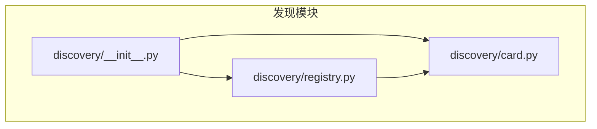
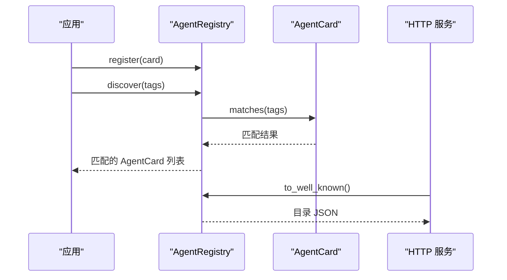
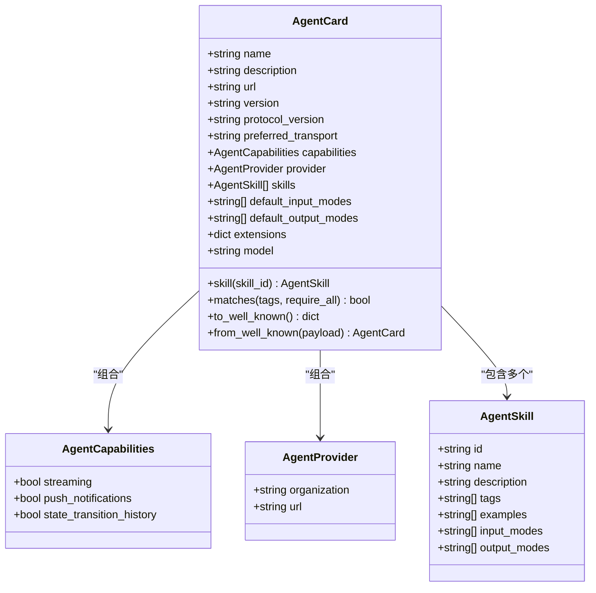
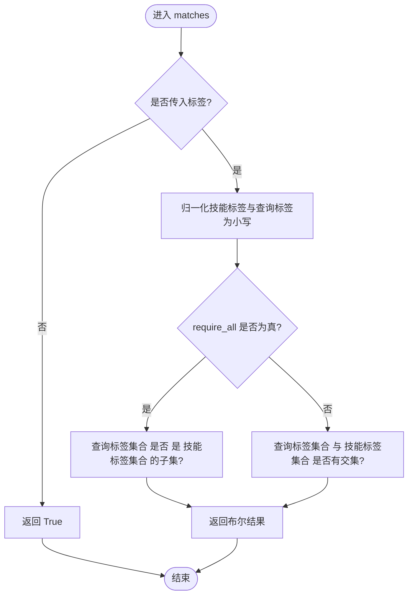
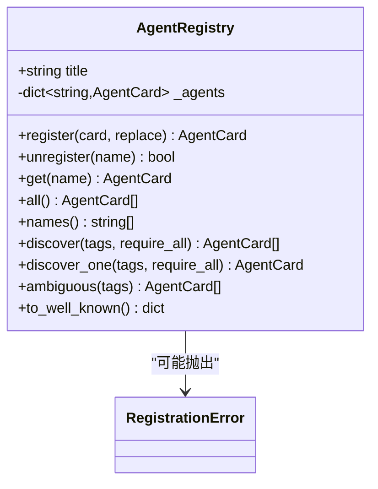
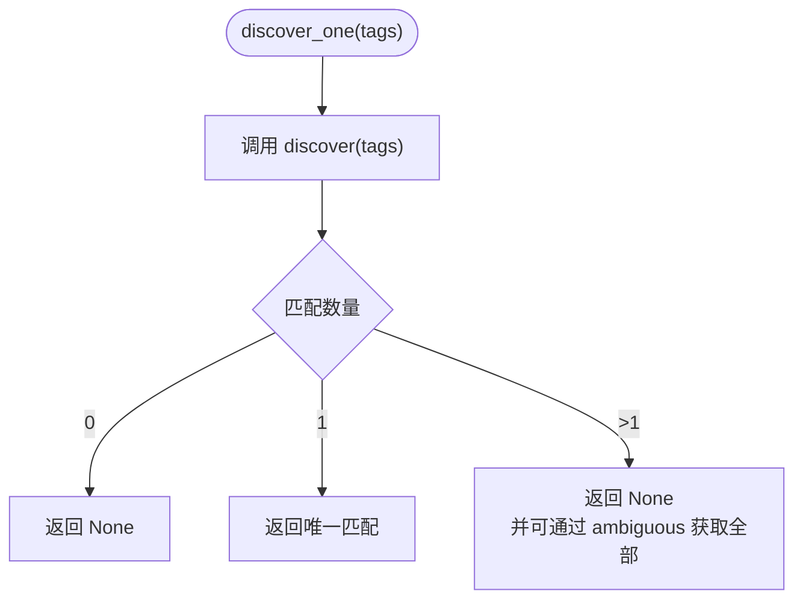

# Agent 发现机制

<cite>
**本文引用的文件**   
- [README.md](file://README.md)
- [__init__.py](file://src/agentkit/discovery/__init__.py)
- [card.py](file://src/agentkit/discovery/card.py)
- [registry.py](file://src/agentkit/discovery/registry.py)
- [test_discovery.py](file://tests/test_discovery.py)
</cite>

## 目录
1. [引言](#引言)
2. [项目结构中的发现模块](#项目结构中的发现模块)
3. [核心组件](#核心组件)
4. [架构总览](#架构总览)
5. [详细组件分析](#详细组件分析)
6. [依赖关系分析](#依赖关系分析)
7. [性能与复杂度](#性能与复杂度)
8. [常见问题排查](#常见问题排查)
9. [结论](#结论)

## 引言
本文件聚焦 AgentKit 的 **Agent 发现机制**。该机制基于 A2A（Agent2Agent）协议的 Agent Card，提供：
- 描述 Agent 能力的卡片模型；
- 进程内注册表，支持注册、管理、按标签发现；
- 将本地注册表序列化为 `/.well-known/agent-card.json` 风格的目录，供远端或控制台消费。

它不是分布式服务注册中心，而是“本地有哪些 Agent 可以被调用”的基础设施，配合 HTTP 服务暴露标准路径，让外部系统能发现当前进程提供的能力。

**章节来源**
- [README.md:131-146](file://README.md#L131-L146)

## 项目结构中的发现模块
在 AgentKit 中，发现相关代码集中在 `src/agentkit/discovery` 包下：
- `discovery/__init__.py`：对外暴露 AgentCard、AgentRegistry 等类型；
- `discovery/card.py`：定义 AgentCard、AgentSkill、AgentCapabilities、AgentProvider 等数据模型；
- `discovery/registry.py`：实现进程内注册表与发现逻辑。

**图表来源**
- [__init__.py:7-8](file://src/agentkit/discovery/__init__.py#L7-L8)
- [card.py:20-24](file://src/agentkit/discovery/card.py#L20-L24)
- [registry.py:20-22](file://src/agentkit/discovery/registry.py#L20-L22)

**章节来源**
- [__init__.py:1-18](file://src/agentkit/discovery/__init__.py#L1-L18)
- [card.py:1-24](file://src/agentkit/discovery/card.py#L1-L24)
- [registry.py:1-22](file://src/agentkit/discovery/registry.py#L1-L22)

## 核心组件
Agent 发现机制由两类核心对象组成：
- **卡片模型层**：描述一个 Agent 是谁、能提供什么能力、使用什么协议和传输方式；
- **注册表层**：维护进程内的 Agent 集合，并提供注册、查询、发现、序列化接口。

关键职责划分：
- `AgentCard` 负责“自述”，包括技能、能力开关、提供者信息、默认输入输出模式，以及与 A2A 协议兼容的序列化；
- `AgentRegistry` 负责“本地目录”，提供注册、注销、查找、按标签发现、歧义处理、以及整库导出。

**章节来源**
- [card.py:27-87](file://src/agentkit/discovery/card.py#L27-L87)
- [registry.py:29-35](file://src/agentkit/discovery/registry.py#L29-L35)

## 架构总览
从调用方视角，Agent 发现通常经历以下流程：
1. 应用启动时创建 `AgentRegistry`；
2. 构造若干 `AgentCard`，并通过 `register` 登记到注册表；
3. 业务侧通过 `discover` / `discover_one` 按标签查找可用 Agent；
4. HTTP 服务将注册表导出为 `to_well_known()`，对外暴露 `/.well-known/agent-card.json`。

**图表来源**
- [registry.py:39-52](file://src/agentkit/discovery/registry.py#L39-L52)
- [registry.py:80-103](file://src/agentkit/discovery/registry.py#L80-L103)
- [registry.py:107-113](file://src/agentkit/discovery/registry.py#L107-L113)
- [card.py:96-113](file://src/agentkit/discovery/card.py#L96-L113)
- [card.py:117-157](file://src/agentkit/discovery/card.py#L117-L157)

## 详细组件分析

### 卡片模型：AgentCard、AgentSkill、AgentCapabilities、AgentProvider
卡片模型对齐 A2A 协议，重点包括：
- `AgentProvider`：声明 Agent 的组织与提供方 URL；
- `AgentCapabilities`：声明是否支持流式、推送通知、状态迁移历史；
- `AgentSkill`：一项可被发现的技能，包含标签、示例、输入输出模式；
- `AgentCard`：聚合上述信息，并提供：
  - `skill(id)`：按 ID 查找技能；
  - `matches(*tags, require_all=False)`：按标签判断是否具备某项能力；
  - `to_well_known()`：转换为 A2A 风格字典；
  - `from_well_known(payload)`：从远端卡片反序列化。

**图表来源**
- [card.py:27-87](file://src/agentkit/discovery/card.py#L27-L87)
- [card.py:90-113](file://src/agentkit/discovery/card.py#L90-L113)
- [card.py:117-205](file://src/agentkit/discovery/card.py#L117-L205)

#### 标签匹配语义
`AgentCard.matches` 的核心规则是：
- 若未传入标签，则返回 True；
- 对技能标签与查询标签统一转为小写，避免大小写差异导致误判；
- 默认“任意匹配”：只要有一个标签命中即认为匹配；
- 当 `require_all=True` 时，要求所有查询标签都存在于技能标签集合中。

**图表来源**
- [card.py:96-113](file://src/agentkit/discovery/card.py#L96-L113)

**章节来源**
- [card.py:27-87](file://src/agentkit/discovery/card.py#L27-L87)
- [card.py:90-113](file://src/agentkit/discovery/card.py#L90-L113)
- [card.py:117-205](file://src/agentkit/discovery/card.py#L117-L205)

### 注册表：AgentRegistry 与 RegistrationError
注册表是一个进程内数据结构，主要能力包括：
- 注册：`register(card, replace=False)`，同名重复注册默认报错；
- 注销：`unregister(name)`；
- 管理：`get`、`all`、`names`、长度与迭代；
- 发现：`discover`、`discover_one`、`ambiguous`；
- 序列化：`to_well_known()` 输出目录结构。

**图表来源**
- [registry.py:25-35](file://src/agentkit/discovery/registry.py#L25-L35)
- [registry.py:39-113](file://src/agentkit/discovery/registry.py#L39-L113)

#### 注册与版本控制
- 默认拒绝静默覆盖：如果同名 Agent 已存在，会抛出 `RegistrationError`；
- 显式覆盖：传入 `replace=True` 才允许替换旧版本；
- 版本号用于区分不同版本的同一 Agent，便于调试与演进。

#### 发现与歧义处理
- `discover`：无标签时返回全部，有标签时按 `AgentCard.matches` 过滤；
- `discover_one`：只返回唯一匹配；若匹配到多个，返回 None，而不是随机挑选；
- `ambiguous`：返回所有匹配结果，帮助调用方做消歧决策。

**图表来源**
- [registry.py:80-103](file://src/agentkit/discovery/registry.py#L80-L103)

**章节来源**
- [registry.py:25-35](file://src/agentkit/discovery/registry.py#L25-L35)
- [registry.py:39-113](file://src/agentkit/discovery/registry.py#L39-L113)

### 与 A2A 协议的对接
卡片序列化采用 A2A 约定的字段命名风格，例如：
- `protocolVersion`；
- `preferredTransport`；
- `defaultInputModes` / `defaultOutputModes`；
- `capabilities.streaming`、`pushNotifications`、`stateTransitionHistory`；
- `skills[].inputModes` / `outputModes`。

同时，`from_well_known` 对未知字段保持宽容，保证客户端不会因为服务端新增字段而崩溃；但 `name` 是必需字段，缺失时会直接报错。

**章节来源**
- [card.py:117-157](file://src/agentkit/discovery/card.py#L117-L157)
- [card.py:159-205](file://src/agentkit/discovery/card.py#L159-L205)

## 依赖关系分析
发现模块内部依赖清晰且单向：
- `discovery/__init__.py` 仅重新导出 `card` 与 `registry` 中的公开类型；
- `registry.py` 依赖 `card.AgentCard`；
- `card.py` 不依赖 `registry.py`。

**图表来源**
- [__init__.py:7-8](file://src/agentkit/discovery/__init__.py#L7-L8)
- [registry.py:20-22](file://src/agentkit/discovery/registry.py#L20-L22)

**章节来源**
- [__init__.py:1-18](file://src/agentkit/discovery/__init__.py#L1-L18)
- [card.py:1-24](file://src/agentkit/discovery/card.py#L1-L24)
- [registry.py:1-22](file://src/agentkit/discovery/registry.py#L1-L22)

## 性能与复杂度
- 注册表底层使用字典存储 Agent，键为 Agent 名称，因此：
  - `register`、`get`、`unregister`、`__contains__` 平均时间复杂度接近 O(1)；
  - `all`、`names`、`__iter__` 需要遍历值，时间复杂度 O(n)；
  - `discover` 需要对每个 Agent 调用 `matches`，时间复杂度 O(n × s)，其中 s 为技能数量；
  - `discover_one` 先执行 `discover`，再判断匹配数量，整体仍受 `discover` 主导；
  - `to_well_known` 需要序列化所有卡片，时间复杂度 O(n)。
- 标签匹配本身是对技能标签集合进行小写归一化和集合操作，属于轻量计算；
- 该模块没有网络 I/O、锁竞争或复杂异步逻辑，性能瓶颈主要来自调用方的标签选择与 Agent 数量。

[本节为通用性能说明，不直接分析具体代码行]

## 常见问题排查

### 重复注册导致启动失败
现象：
- 启动时报错，提示某个 Agent 已经注册过；
- 日志中包含版本信息。

原因：
- 默认 `register` 不允许同名覆盖；
- 可能是初始化逻辑重复注册，或者部署时加载了多份相同名称的 Agent。

处理建议：
- 检查初始化顺序，确保同名 Agent 只注册一次；
- 如果确实要升级版本，显式传入 `replace=True`；
- 通过 `names()` 或 `to_well_known()` 查看当前注册表内容。

**章节来源**
- [registry.py:39-52](file://src/agentkit/discovery/registry.py#L39-L52)
- [test_discovery.py:112-123](file://tests/test_discovery.py#L112-L123)

### 发现不到任何 Agent
现象：
- `discover(tags)` 返回空列表；
- `discover_one(tags)` 返回 None。

可能原因：
- 没有注册任何 Agent；
- 标签拼写错误或大小写不一致；
- 使用了 `require_all=True`，但某个 Agent 的技能标签不完整。

处理建议：
- 先用 `discover()` 不带标签，确认是否列出全部 Agent；
- 检查 `AgentSkill.tags` 是否与查询标签一致；
- 暂时去掉 `require_all`，缩小问题范围。

**章节来源**
- [registry.py:80-90](file://src/agentkit/discovery/registry.py#L80-L90)
- [card.py:96-113](file://src/agentkit/discovery/card.py#L96-L113)
- [test_discovery.py:86-103](file://tests/test_discovery.py#L86-L103)

### 多个 Agent 匹配导致歧义
现象：
- `discover_one(tags)` 返回 None；
- 但 `discover(tags)` 返回多个结果。

原因：
- 设计上是“宁可不选，也不乱选”；
- 多个 Agent 具有相同标签时，调用方必须显式消歧。

处理建议：
- 使用 `ambiguous(tags)` 获取所有候选；
- 结合 `version`、`provider.url`、`model` 等字段进一步筛选；
- 给 Agent 起更精确的名称或增加更具体的标签。

**章节来源**
- [registry.py:92-103](file://src/agentkit/discovery/registry.py#L92-L103)
- [test_discovery.py:145-160](file://tests/test_discovery.py#L145-L160)

### 远端无法解析卡片
现象：
- 远端读取 `/.well-known/agent-card.json` 后出现字段缺失或格式异常。

可能原因：
- 缺少必需字段 `name`；
- 字段命名不符合 A2A 约定；
- 自定义扩展字段导致旧客户端无法识别。

处理建议：
- 使用 `AgentCard.to_well_known()` 生成标准结构；
- 新增字段放在 `extensions` 中；
- 使用 `from_well_known()` 测试兼容性。

**章节来源**
- [card.py:117-157](file://src/agentkit/discovery/card.py#L117-L157)
- [card.py:159-205](file://src/agentkit/discovery/card.py#L159-L205)
- [test_discovery.py:35-69](file://tests/test_discovery.py#L35-L69)

## 结论
AgentKit 的 Agent 发现机制以 A2A 协议为参考，用简洁的卡片模型表达 Agent 能力，并用进程内注册表实现“注册—管理—发现—导出”的完整闭环。其设计强调：
- 明确边界：不做分布式注册中心，专注本地发现；
- 安全默认：重复注册报错、歧义不盲选；
- 协议兼容：卡片序列化对齐 A2A，便于未来扩展；
- 可测试性：标签匹配、注册行为、歧义处理均有单测覆盖。

对于使用者而言，最关键的实践是：
- 为 Agent 编写准确的 `AgentSkill` 标签；
- 在启动阶段集中注册，避免重复；
- 在发现时优先使用 `discover_one`，并在歧义时借助 `ambiguous` 做业务级消歧；
- 对外暴露 `to_well_known()` 作为标准发现入口。

[本节为总结性内容，不直接分析具体代码行]