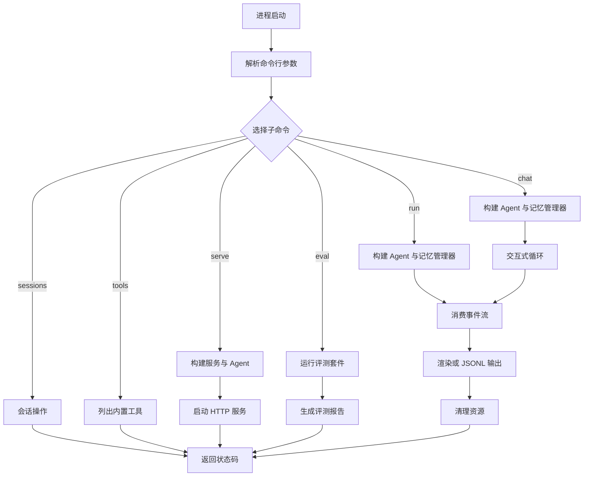
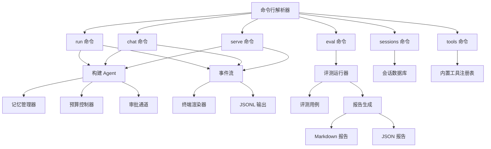

# CLI 接口

<cite>
**本文引用的文件**   
- [src/agentkit/app/cli.py](file://src/agentkit/app/cli.py)
- [src/agentkit/core/config.py](file://src/agentkit/core/config.py)
- [src/agentkit/runtime/approval.py](file://src/agentkit/runtime/approval.py)
- [src/agentkit/tools/builtin/__init__.py](file://src/agentkit/tools/builtin/__init__.py)
- [src/agentkit/evaluation/case.py](file://src/agentkit/evaluation/case.py)
- [src/agentkit/evaluation/report.py](file://src/agentkit/evaluation/report.py)
- [src/agentkit/evaluation/runner.py](file://src/agentkit/evaluation/runner.py)
- [eval_suites/fs_basic.jsonl](file://eval_suites/fs_basic.jsonl)
- [README.md](file://README.md)
</cite>

## 更新摘要
**已进行的更改**   
- 新增了 `agentkit eval` 评测命令的完整文档
- 更新了 `agentkit serve` 命令的详细使用说明
- 改进了帮助文本和参数说明
- 添加了评估套件和报告生成的详细说明
- 更新了命令总览和执行流程

## 目录
1. [简介](#简介)
2. [安装与入口](#安装与入口)
3. [全局选项](#全局选项)
4. [命令总览](#命令总览)
5. [命令详解](#命令详解)
6. [执行流程与返回状态码](#执行流程与返回状态码)
7. [环境变量与配置](#环境变量与配置)
8. [输出格式说明](#输出格式说明)
9. [错误处理与故障排查](#错误处理与故障排查)
10. [最佳实践](#最佳实践)
11. [附录：命令关系图](#附录命令关系图)

## 简介
本文件是 AgentKit 的命令行接口文档，覆盖以下命令：
- `agentkit run`：执行一次任务。
- `agentkit chat`：进入交互式对话，同一会话内保持记忆。
- `agentkit sessions`：管理本地会话记录。
- `agentkit tools`：列出内置工具及其参数 schema。
- `agentkit serve`：启动 HTTP 服务与 Web 控制台（作为 CLI 的一部分提供）。
- `agentkit eval`：运行评测套件并生成报告（新增功能）。

CLI 的设计目标是"事件消费者"：引擎只产出类型化事件，CLI、SSE 端点、评测运行器共享同一条流，因此更换前端不需要改动引擎。

**章节来源**
- [src/agentkit/app/cli.py:1-5](file://src/agentkit/app/cli.py#L1-L5)
- [README.md:28-51](file://README.md#L28-L51)

## 安装与入口
AgentKit 使用 `uv` 管理依赖和运行环境。典型步骤如下：
1. 同步依赖并创建虚拟环境。
2. 复制 `.env.example` 为 `.env`，填入模型 API Key。
3. 通过 `uv run agentkit --help` 查看帮助。
4. 直接运行具体命令，例如 `run`、`chat`、`sessions list`、`tools`、`eval`。

```bash
uv sync --extra dev
cp .env.example .env
uv run agentkit --help
uv run agentkit run "列出当前目录的文件"
uv run agentkit chat
uv run agentkit sessions list
uv run agentkit tools
uv run agentkit eval eval_suites --mode hermetic
```

**章节来源**
- [README.md:28-47](file://README.md#L28-L47)

## 全局选项
以下选项可被多个子命令复用，用于控制模型、工作区、工具分组、审批策略、预算、会话数据库等。

| 选项 | 类型 | 默认值 | 含义 |
| --- | --- | --- | --- |
| `-w`, `--workspace` | 路径 | 当前工作目录 | 设置工具可读写的工作区根目录。 |
| `-m`, `--model` | 字符串 | 由配置决定 | 覆盖模型 id。 |
| `-s`, `--max-steps` | 整数 | 由配置决定 | 限制 Agent 的最大步数。 |
| `--groups` | 逗号分隔字符串 | 全部内置工具 | 选择工具分组，可选值包括 `fs`、`search`、`shell`。 |
| `--no-approve` | 布尔开关 | 关闭时启用终端审批 | 关闭审批通道；需要审批的动作会被直接拒绝。 |
| `--max-cost` | 浮点数 | 不限制 | 本次 run 的成本上限。 |
| `--max-tokens` | 整数 | 不限制 | 本次 run 的输入加输出 token 上限。 |
| `--db` | 路径 | `.agentkit/sessions.db` | 会话数据库路径。 |
| `--show-reasoning` | 布尔开关 | 仅计数 | 把模型的思维链也打印出来。 |
| `-q`, `--quiet` | 布尔开关 | 正常模式 | 只输出最终答复，减少中间过程。 |

注意：
- `--groups` 的值必须是已知的内置分组之一；传入未知分组会立即退出并提示可用分组。
- `--no-approve` 不是"自动放行"，而是"拒绝所有需要审批的动作"。
- 服务端命令 `serve` 默认开启 `--no-approve`，因为服务端没有标准输入可读。

**章节来源**
- [src/agentkit/app/cli.py:53-87](file://src/agentkit/app/cli.py#L53-L87)
- [src/agentkit/app/cli.py:107-117](file://src/agentkit/app/cli.py#L107-L117)
- [src/agentkit/app/cli.py:284-294](file://src/agentkit/app/cli.py#L284-L294)
- [src/agentkit/tools/builtin/__init__.py:12-17](file://src/agentkit/tools/builtin/__init__.py#L12-L17)

## 命令总览
| 命令 | 用途 | 关键行为 |
| --- | --- | --- |
| `agentkit run` | 执行一次任务 | 支持流式事件、JSONL 输出、会话续跑。 |
| `agentkit chat` | 交互式对话 | 同一 `session_id` 下保持上下文。 |
| `agentkit sessions` | 管理会话 | 支持 `list`、`show`、`delete`。 |
| `agentkit tools` | 查看工具 | 打印内置工具名称、描述、副作用标记和参数 schema。 |
| `agentkit serve` | 启动服务 | 启动 FastAPI/Uvicorn 服务，暴露 Web 控制台与 Agent 卡片。 |
| `agentkit eval` | 运行评测 | 支持 hermetic/live 模式，生成 Markdown 和 JSON 报告。 |

**章节来源**
- [src/agentkit/app/cli.py:35-48](file://src/agentkit/app/cli.py#L35-L48)
- [src/agentkit/app/cli.py:550-580](file://src/agentkit/app/cli.py#L550-L580)

## 命令详解

### `agentkit run`
执行一个任务。适合脚本化调用、批处理、CI 场景。

#### 语法
```text
agentkit run <prompt ...> [选项]
```

#### 位置参数
| 参数 | 必填 | 含义 |
| --- | --- | --- |
| `prompt` | 是 | 任务描述，支持多个词，会自动拼接成完整 prompt。 |

#### 特有选项
| 选项 | 类型 | 默认值 | 含义 |
| --- | --- | --- | --- |
| `--session` | 字符串或空 | 空 | 指定会话 id；给出后会在该会话中续跑。 |
| `--json-events` | 布尔开关 | 关闭 | 将事件流以 JSONL 形式输出到标准输出。 |

#### 示例
```bash
uv run agentkit run "列出当前目录的文件，然后告诉我 README.md 有多少行"
uv run agentkit run "读一下 README" --session s1
uv run agentkit run "分析项目结构" --json-events > events.jsonl
uv run agentkit run "清理临时文件" --no-approve
```

#### 输出行为
- 非 `--json-events`：使用终端渲染器输出人类可读内容，包括任务开始、工具调用预览、工具结果、用量统计、完成摘要。
- `--json-events`：每个事件一行 JSON，便于管道处理。

**章节来源**
- [src/agentkit/app/cli.py:89-98](file://src/agentkit/app/cli.py#L89-L98)
- [src/agentkit/app/cli.py:343-377](file://src/agentkit/app/cli.py#L343-L377)
- [src/agentkit/app/cli.py:132-257](file://src/agentkit/app/cli.py#L132-L257)

### `agentkit chat`
进入交互式对话。整个会话共用一个 `session_id`，因此上下文可以延续。

#### 语法
```text
agentkit chat [选项]
```

#### 选项
| 选项 | 类型 | 默认值 | 含义 |
| --- | --- | --- | --- |
| `--session` | 字符串 | `default` | 会话 id。 |
| 其他全局选项 | 见全局选项表 | — | 工作区、模型、工具分组、审批、预算等。 |

#### 交互协议
- 每次输入一行问题。
- 输入 `exit`、`quit`、`退出` 退出程序。
- 输入 `/new` 切换到新会话，生成新的 `session_id`。
- 空行会被忽略。

#### 示例
```bash
uv run agentkit chat
uv run agentkit chat --session project_review
uv run agentkit chat --session default --no-approve
```

#### 输出行为
- 启动时会显示当前会话 id 和工作区。
- 每次提问都会消费事件流并渲染。
- 退出时打印告别信息。

**章节来源**
- [src/agentkit/app/cli.py:101-104](file://src/agentkit/app/cli.py#L101-L104)
- [src/agentkit/app/cli.py:380-424](file://src/agentkit/app/cli.py#L380-L424)

### `agentkit sessions`
管理本地会话记录。底层使用 SQLite 持久化的工作记忆。

#### 语法
```text
agentkit sessions [action] [session_id] [选项]
```

#### 子动作
| 子动作 | 是否必填 | 含义 |
| --- | --- | --- |
| `list` | 否，默认 | 列出所有会话。 |
| `show` | 是，需配合 `session_id` | 查看某个会话的消息历史。 |
| `delete` | 是，需配合 `session_id` | 删除某个会话。 |

#### 选项
| 选项 | 类型 | 默认值 | 含义 |
| --- | --- | --- | --- |
| `--db` | 路径 | `.agentkit/sessions.db` | 会话数据库路径。 |

#### 示例
```bash
uv run agentkit sessions list
uv run agentkit sessions show s1
uv run agentkit sessions delete s1
uv run agentkit sessions show s1 --db ./my_sessions.db
```

#### 输出行为
- `list`：打印会话 id、消息数量、最后更新时间。
- `show`：按序号打印角色和内容摘要；若消息包含工具调用或工具结果，则显示对应数量。
- `delete`：打印是否成功删除。

**章节来源**
- [src/agentkit/app/cli.py:120-126](file://src/agentkit/app/cli.py#L120-L126)
- [src/agentkit/app/cli.py:476-529](file://src/agentkit/app/cli.py#L476-L529)

### `agentkit tools`
列出内置工具及其参数 schema。

#### 语法
```text
agentkit tools
```

#### 输出内容
对每个内置工具，会打印：
- 工具名称。
- 副作用标记：有副作用、非幂等。
- 工具描述。
- 参数 schema（JSON）。

#### 示例
```bash
uv run agentkit tools
```

#### 注意事项
- 工具分组由 `BUILTIN_GROUPS` 定义，当前包括 `fs`、`search`、`shell`。
- `--groups` 可用于限制实际启用的工具分组，但 `tools` 命令本身展示的是默认注册表中的全部工具。

**章节来源**
- [src/agentkit/app/cli.py:532-547](file://src/agentkit/app/cli.py#L532-L547)
- [src/agentkit/tools/builtin/__init__.py:12-17](file://src/agentkit/tools/builtin/__init__.py#L12-L17)
- [src/agentkit/tools/builtin/__init__.py:20-40](file://src/agentkit/tools/builtin/__init__.py#L20-L40)

### `agentkit serve`
启动 HTTP 服务与 Web 控制台。

#### 语法
```text
agentkit serve [选项]
```

#### 选项
| 选项 | 类型 | 默认值 | 含义 |
| --- | --- | --- | --- |
| `--host` | 字符串 | `127.0.0.1` | 监听地址。 |
| `--port` | 整数 | `8000` | 端口。 |
| `--reload` | 布尔开关 | 关闭 | 开发模式下代码变更自动重启。 |
| 其他全局选项 | 见全局选项表 | — | 工作区、模型、工具分组、预算等。 |

#### 重要行为
- 服务端默认开启 `--no-approve`。
- 需要审批的动作会发出审批请求事件，客户端需要通过 API 提交决定。
- 未接入审批通道时，默认策略是拒绝，而不是偷偷放行。

#### 示例
```bash
uv run agentkit serve
uv run agentkit serve --host 0.0.0.0 --port 8080
uv run agentkit serve --model deepseek-v4-pro --workspace /data/workspace
```

#### 启动输出
启动后会打印：
- Web 控制台地址。
- Agent 卡片地址。
- 当前模型与工作区。
- trace 文件路径。

**章节来源**
- [src/agentkit/app/cli.py:107-117](file://src/agentkit/app/cli.py#L107-L117)
- [src/agentkit/app/cli.py:426-473](file://src/agentkit/app/cli.py#L426-L473)

### `agentkit eval`
运行评测套件并生成报告。这是唯一会产生真实 API 费用的命令。

#### 语法
```text
agentkit eval <suite> [选项]
```

#### 位置参数
| 参数 | 必填 | 含义 |
| --- | --- | --- |
| `suite` | 是 | 套件路径（`.jsonl` 文件或目录）。 |

#### 选项
| 选项 | 类型 | 默认值 | 含义 |
| --- | --- | --- | --- |
| `-n`, `--trials` | 整数 | `1` | 每个用例重复几次。 |
| `--mode` | 枚举 | `live` | 运行模式：`hermetic`（假模型回放）、`live`（真实调用）、`both`（两种都跑）。 |
| `-c`, `--concurrency` | 整数 | `3` | 并发数。 |
| `--out` | 路径 | `eval_reports` | 报告输出目录。 |
| `--tag` | 字符串数组 | 空 | 只跑带这个标签的用例。 |
| `--case` | 字符串数组 | 空 | 只跑指定 id 的用例。 |
| `--keep-workspaces` | 布尔开关 | 关闭 | 保留工作区便于排查。 |
| 其他全局选项 | 见全局选项表 | — | 工作区、模型、工具分组、预算等。 |

#### 运行模式
- **hermetic 模式**：使用假模型回放，不消耗 API，验证评测框架本身。
- **live 模式**：真实调用模型，会产生 API 费用。
- **both 模式**：同时运行两种模式。

#### 示例
```bash
# 运行评测框架自检（不花钱）
uv run agentkit eval eval_suites --mode hermetic

# 真实评测（会产生费用）
uv run agentkit eval eval_suites --mode live -n 5

# 同时运行两种模式
uv run agentkit eval eval_suites --mode both

# 只运行特定标签的用例
uv run agentkit eval eval_suites --tag fs --tag count

# 自定义输出目录
uv run agentkit eval eval_suites --out ./reports --mode hermetic
```

#### 输出行为
- 显示运行模式和用例数量。
- 实时显示评测进度。
- 生成 Markdown 和 JSON 格式的报告。
- 在终端中显示简要总结。

#### 报告内容
报告会包含：
- 核心指标（TSR、pass@k、pass^k、工具准确率等）。
- 逐用例结果。
- 失败归因分析。
- 详细失败信息。

**章节来源**
- [src/agentkit/app/cli.py:594-610](file://src/agentkit/app/cli.py#L594-L610)
- [src/agentkit/app/cli.py:612-680](file://src/agentkit/app/cli.py#L612-L680)
- [src/agentkit/evaluation/case.py:1-26](file://src/agentkit/evaluation/case.py#L1-L26)
- [src/agentkit/evaluation/report.py:28-150](file://src/agentkit/evaluation/report.py#L28-L150)

## 执行流程与返回状态码

### 通用执行流程
1. 解析命令行参数。
2. 根据命令选择处理器。
3. 加载配置并构建 Agent。
4. 消费事件流并渲染或序列化输出。
5. 清理资源，返回进程退出码。



**图表来源**
- [src/agentkit/app/cli.py:35-48](file://src/agentkit/app/cli.py#L35-L48)
- [src/agentkit/app/cli.py:297-337](file://src/agentkit/app/cli.py#L297-L337)
- [src/agentkit/app/cli.py:343-377](file://src/agentkit/app/cli.py#L343-L377)
- [src/agentkit/app/cli.py:380-424](file://src/agentkit/app/cli.py#L380-L424)
- [src/agentkit/app/cli.py:426-473](file://src/agentkit/app/cli.py#L426-L473)
- [src/agentkit/app/cli.py:476-547](file://src/agentkit/app/cli.py#L476-L547)
- [src/agentkit/app/cli.py:594-680](file://src/agentkit/app/cli.py#L594-L680)

### 返回状态码
| 状态码 | 含义 | 触发条件 |
| --- | --- | --- |
| `0` | 成功 | 任务正常完成、会话操作成功、工具列表打印成功、服务正常启动、评测通过。 |
| `1` | 业务失败 | 事件流中出现 `run_failed`、评测用例失败、没有匹配的用例。 |
| `2` | 参数或配置错误 | 未知工具分组、缺少必要参数、内部异常抛出。 |
| `130` | 用户中断 | 捕获到键盘中断。 |

#### `run` 的状态码细节
- 正常完成：返回 `0`。
- 事件流中出现失败事件：返回 `1`。
- 捕获 `AgentKitError`：返回 `2`。
- 捕获 `KeyboardInterrupt`：返回 `130`。

#### `sessions` 的状态码细节
- `list`：存在记录返回 `0`；无记录也返回 `0`。
- `show`：找到会话返回 `0`；没有找到返回 `1`。
- `delete`：删除成功返回 `0`；没找到返回 `1`。
- 缺少 `session_id`：返回 `2`。

#### `eval` 的状态码细节
- 所有用例通过：返回 `0`。
- hermetic 模式用例失败：返回 `1`（必须修复评测框架）。
- 没有匹配的用例：返回 `1`。
- 其他错误：返回 `2`。

**章节来源**
- [src/agentkit/app/cli.py:343-377](file://src/agentkit/app/cli.py#L343-L377)
- [src/agentkit/app/cli.py:476-529](file://src/agentkit/app/cli.py#L476-L529)
- [src/agentkit/app/cli.py:550-580](file://src/agentkit/app/cli.py#L550-L580)
- [src/agentkit/app/cli.py:612-680](file://src/agentkit/app/cli.py#L612-L680)

## 环境变量与配置

### 配置优先级
配置加载遵循以下优先级：
1. 环境变量。
2. `.env` 文件。
3. 默认值。

命令行参数会通过 `load_settings` 的覆盖参数注入，值为 `None` 的项会被忽略。

### 主要环境变量
| 环境变量 | 类型 | 默认值 | 含义 |
| --- | --- | --- | --- |
| `LLM_API_KEY` 或 `DEEPSEEK_API_KEY` | 字符串 | 空 | LLM API Key。缺失时会抛出配置错误。 |
| `LLM_BASE_URL` | 字符串 | DeepSeek 兼容端点 | OpenAI 兼容端点。 |
| `LLM_MODEL` | 字符串 | `deepseek-flash` | 模型 id。 |
| `LLM_TEMPERATURE` | 浮点数 | `0.0` | 温度。 |
| `LLM_MAX_TOKENS` | 整数或空 | 空 | 单次回复的输出上限。 |
| `LLM_TIMEOUT` | 浮点数 | `120.0` | 请求超时时间。 |
| `LLM_MAX_RETRIES` | 整数 | `3` | 总尝试次数。 |
| `LLM_RETRY_BASE_DELAY` | 浮点数 | `0.5` | 重试基础延迟。 |
| `LLM_RETRY_MAX_DELAY` | 浮点数 | `30.0` | 重试最大延迟。 |
| `AGENT_MAX_STEPS` | 整数 | `15` | Agent 最大步数。 |
| `AGENT_WORKSPACE` | 路径 | 当前工作目录 | 工具可读写的工作区根目录。 |

### 已知 Base URL
配置中包含一些已知的 OpenAI 兼容端点占位，例如 DeepSeek、通义千问、月之暗面、智谱 GLM。使用前应核对官方文档。

**章节来源**
- [src/agentkit/core/config.py:1-9](file://src/agentkit/core/config.py#L1-L9)
- [src/agentkit/core/config.py:18-24](file://src/agentkit/core/config.py#L18-L24)
- [src/agentkit/core/config.py:27-35](file://src/agentkit/core/config.py#L27-L35)
- [src/agentkit/core/config.py:37-77](file://src/agentkit/core/config.py#L37-L77)
- [src/agentkit/core/config.py:79-98](file://src/agentkit/core/config.py#L79-L98)

## 输出格式说明

### 终端渲染输出
当不使用 `--json-events` 时，CLI 使用 `ConsoleRenderer` 渲染事件流。

#### 主要事件渲染
| 事件类型 | 终端表现 |
| --- | --- |
| `run_started` | 打印 agent、model、任务描述和分隔线。 |
| `step_started` | 打印步骤编号。 |
| `reasoning_delta` | 可选打印思维链；默认只计数。 |
| `text_delta` | 增量打印正文，避免频繁换行。 |
| `tool_call_started` | 打印工具名和参数预览。 |
| `tool_result` | 打印结果或错误预览，以及耗时。 |
| `approval_requested` | 提示需要审批。 |
| `approval_resolved` | 显示批准或拒绝结果。 |
| `usage_reported` | 打印累计用量。 |
| `run_completed` | 打印最终答案和统计摘要。 |
| `run_failed` | 在标准错误输出失败原因。 |
| `run_cancelled` | 在标准错误输出取消原因。 |

#### 用量统计
用量统计包括：
- 输入 token。
- 输出 token。
- 缓存命中 token（如有）。
- 思维链字符数（如启用显示）。

#### 完成摘要
完成摘要包括：
- 步数。
- 耗时。
- 输入输出 token。
- 缓存命中。
- 成本（如果可用）。

**章节来源**
- [src/agentkit/app/cli.py:132-257](file://src/agentkit/app/cli.py#L132-L257)

### JSONL 事件输出
启用 `--json-events` 后，每个事件会以 JSON 形式输出一行。适合管道处理、日志收集、调试。

常见事件字段包括：
- `type`：事件类型。
- `agent`：agent 标识。
- `model`：模型标识。
- `input`：任务输入。
- `step`：步骤编号。
- `text`：文本增量或最终答案。
- `tool_name`：工具名称。
- `arguments`：工具参数。
- `content`：工具结果。
- `is_error`：是否为错误结果。
- `duration_ms`：耗时。
- `approved`：是否批准。
- `note`：备注。
- `usage`：用量对象。
- `cumulative`：累计用量。
- `cost`：成本。
- `currency`：货币单位。
- `error_type`：错误类型。
- `message`：错误消息。
- `reason`：取消原因。

**章节来源**
- [src/agentkit/app/cli.py:353-360](file://src/agentkit/app/cli.py#L353-L360)
- [src/agentkit/app/cli.py:157-224](file://src/agentkit/app/cli.py#L157-L224)

### 评测报告输出
`agentkit eval` 命令会生成两种格式的报告：

#### Markdown 报告
- 包含核心指标表格。
- 逐用例结果汇总。
- 失败归因分析。
- 详细失败信息。

#### JSON 报告
- 机器可读的结构化数据。
- 包含完整的评测结果和元数据。
- 适合自动化处理和集成。

#### 报告文件命名
- Markdown 报告：`{suite}_{mode}.md`
- JSON 报告：`{suite}_{mode}.json`

**章节来源**
- [src/agentkit/evaluation/report.py:28-150](file://src/agentkit/evaluation/report.py#L28-L150)

## 错误处理与故障排查

### 常见错误
| 现象 | 可能原因 | 处理方式 |
| --- | --- | --- |
| 提示未配置 API Key | 未设置 `LLM_API_KEY` 或 `DEEPSEEK_API_KEY` | 设置环境变量或写入 `.env`。 |
| 工具分组报错 | `--groups` 传入了未知分组 | 使用 `fs`、`search`、`shell`。 |
| 需要审批的动作被拒绝 | 使用了 `--no-approve` 或服务端未接入审批通道 | 交互场景手动批准；自动化场景通过 API 提交审批决定。 |
| 会话找不到 | 会话 id 不存在 | 先用 `sessions list` 确认。 |
| 中文乱码 | Windows 终端编码问题 | CLI 已尝试强制 UTF-8 标准输出；若仍异常，检查终端编码设置。 |
| 任务失败 | 模型返回失败事件或工具执行失败 | 查看 `run_failed` 事件或终端错误输出。 |
| 评测没有匹配用例 | 过滤条件太严格或套件路径错误 | 检查 `--tag`、`--case` 参数和套件路径。 |
| hermetic 模式失败 | 评测脚本或判据有误 | 检查用例的 script 字段和 checks 配置。 |

### 审批机制
审批通道有四种实现：
- `AutoApprover`：全部放行，仅适合本地开发。
- `DenyApprover`：全部拒绝，服务化安全默认值。
- `ConsoleApprover`：终端交互审批。
- `QueueApprover`：SSE 服务中等待外部决定。

CLI 默认使用 `ConsoleApprover`；`--no-approve` 会使用 `DenyApprover`。

**章节来源**
- [src/agentkit/core/config.py:79-88](file://src/agentkit/core/config.py#L79-L88)
- [src/agentkit/app/cli.py:284-294](file://src/agentkit/app/cli.py#L284-L294)
- [src/agentkit/app/cli.py:320-337](file://src/agentkit/app/cli.py#L320-L337)
- [src/agentkit/runtime/approval.py:35-57](file://src/agentkit/runtime/approval.py#L35-L57)
- [src/agentkit/runtime/approval.py:82-117](file://src/agentkit/runtime/approval.py#L82-L117)
- [src/agentkit/runtime/approval.py:120-167](file://src/agentkit/runtime/approval.py#L120-L167)

### 调试建议
- 使用 `--json-events` 获取完整事件流。
- 使用 `--show-reasoning` 查看思维链。
- 使用 `--quiet` 减少干扰输出。
- 使用 `--db` 指定独立会话数据库，避免污染默认会话。
- 使用 `--groups` 限制工具范围，降低安全风险。
- 在服务端场景中，确保通过 API 处理审批请求，不要依赖终端交互。
- 使用 `--keep-workspaces` 保留评测工作区进行调试。

**章节来源**
- [src/agentkit/app/cli.py:343-377](file://src/agentkit/app/cli.py#L343-L377)
- [src/agentkit/app/cli.py:426-473](file://src/agentkit/app/cli.py#L426-L473)
- [src/agentkit/app/cli.py:612-680](file://src/agentkit/app/cli.py#L612-L680)

## 最佳实践
1. **自动化任务优先使用 `run`**：结合 `--session` 保持上下文，结合 `--json-events` 做日志分析。
2. **生产环境禁用终端审批**：使用 `--no-approve` 或通过 API 接入审批通道。
3. **限制工具权限**：通过 `--groups` 只启用必要工具，例如只读场景禁用 `shell`。
4. **控制成本与 Token**：使用 `--max-cost` 和 `--max-tokens` 防止超额消耗。
5. **隔离会话数据**：使用 `--db` 为不同项目或环境分配独立数据库。
6. **调试时打开思维链**：使用 `--show-reasoning` 定位模型推理问题。
7. **服务化部署时固定 host/port**：明确监听地址和端口，避免冲突。
8. **先运行 hermetic 评测**：在 CI 中先运行 hermetic 模式验证评测框架，再运行 live 模式。
9. **合理使用评测过滤**：使用 `--tag` 和 `--case` 精确控制要运行的用例。
10. **定期生成评测报告**：将评测报告纳入版本管理和持续集成流程。

[本节为通用指导，不直接分析具体文件]

## 附录：命令关系图



**图表来源**
- [src/agentkit/app/cli.py:35-48](file://src/agentkit/app/cli.py#L35-L48)
- [src/agentkit/app/cli.py:297-337](file://src/agentkit/app/cli.py#L297-L337)
- [src/agentkit/app/cli.py:343-377](file://src/agentkit/app/cli.py#L343-L377)
- [src/agentkit/app/cli.py:380-424](file://src/agentkit/app/cli.py#L380-L424)
- [src/agentkit/app/cli.py:426-473](file://src/agentkit/app/cli.py#L426-L473)
- [src/agentkit/app/cli.py:476-547](file://src/agentkit/app/cli.py#L476-L547)
- [src/agentkit/app/cli.py:594-680](file://src/agentkit/app/cli.py#L594-L680)
- [src/agentkit/evaluation/runner.py:39-85](file://src/agentkit/evaluation/runner.py#L39-L85)
- [src/agentkit/evaluation/report.py:141-150](file://src/agentkit/evaluation/report.py#L141-L150)