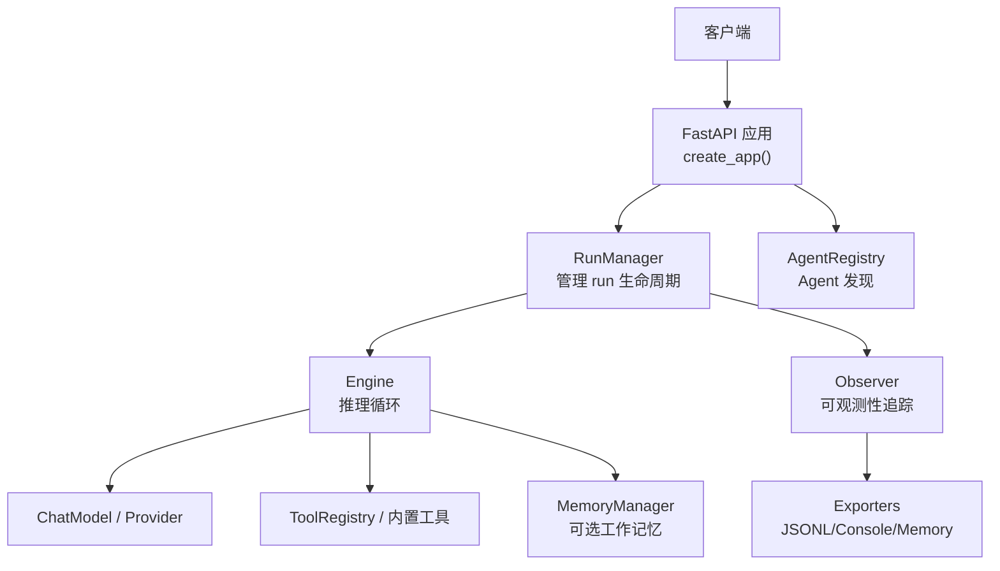
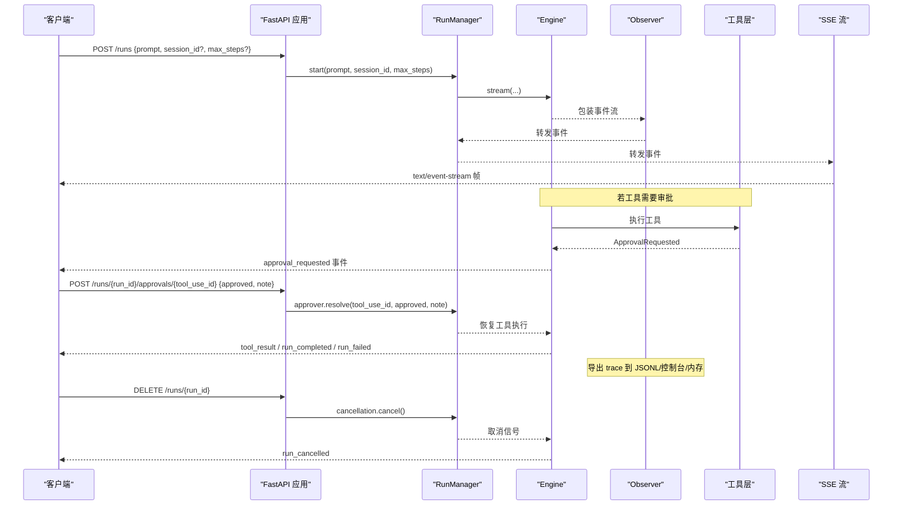

# HTTP API

<cite>
**本文引用的文件**   
- [src/agentkit/app/api.py](file://src/agentkit/app/api.py)
- [src/agentkit/core/events.py](file://src/agentkit/core/events.py)
- [src/agentkit/core/errors.py](file://src/agentkit/core/errors.py)
- [src/agentkit/core/types.py](file://src/agentkit/core/types.py)
- [src/agentkit/runtime/engine.py](file://src/agentkit/runtime/engine.py)
- [src/agentkit/runtime/approval.py](file://src/agentkit/runtime/approval.py)
- [src/agentkit/discovery/card.py](file://src/agentkit/discovery/card.py)
- [src/agentkit/observability/__init__.py](file://src/agentkit/observability/__init__.py)
- [src/agentkit/observability/exporters.py](file://src/agentkit/observability/exporters.py)
</cite>

## 更新摘要
**所做更改**   
- 更新了 SSE 流式处理章节，反映增强的断线重连和缓冲机制
- 扩展了审批工作流说明，包含新的异步处理和超时控制
- 新增可观测性集成章节，详细说明 trace 导出和监控系统
- 更新了发现系统部分，反映 A2A 协议的增强支持
- 完善了错误处理和状态码说明

## 目录
1. [简介](#简介)
2. [项目结构与服务入口](#项目结构与服务入口)
3. [核心组件](#核心组件)
4. [架构总览](#架构总览)
5. [RESTful 端点文档](#restful-端点文档)
6. [认证、速率限制与安全策略](#认证速率限制与安全策略)
7. [错误处理与状态码](#错误处理与状态码)
8. [客户端集成示例](#客户端集成示例)
9. [常见问题排查](#常见问题排查)
10. [性能与扩展建议](#性能与扩展建议)
11. [结论](#结论)

## 简介
本服务基于 FastAPI 暴露一组 RESTful 接口，用于启动、查询、取消 Agent 运行任务，并通过 Server-Sent Events（SSE）推送结构化事件。它还支持：
- 审批流程：对高危工具调用进行人工确认，支持异步处理和超时控制。
- Trace 查询：获取一次 run 的推理轨迹，支持多种导出格式。
- Agent 发现：通过 A2A 协议标准路径暴露能力卡片。
- 健康检查：返回模型信息与活跃任务数。
- 可观测性：完整的 trace 导出和监控系统集成。

当前仓库 README 将 SSE 服务列为 Phase 3 目标，但 `src/agentkit/app/api.py` 已实现完整的服务构造逻辑，因此本文以该实现为准进行说明。

## 项目结构与服务入口
HTTP 服务由 `create_app` 构建，内部注册路由、生命周期钩子、Run 管理器、Agent 注册表与健康检查等。

**图表来源**
- [src/agentkit/app/api.py:349-389](file://src/agentkit/app/api.py#L349-L389)
- [src/agentkit/runtime/engine.py:127-162](file://src/agentkit/runtime/engine.py#L127-L162)
- [src/agentkit/observability/__init__.py:43-90](file://src/agentkit/observability/__init__.py#L43-L90)

**章节来源**
- [README.md:53-68](file://README.md#L53-L68)
- [src/agentkit/app/api.py:349-389](file://src/agentkit/app/api.py#L349-L389)

## 核心组件
- `RunRequest`：发起 run 的请求体。
- `ApprovalBody`：提交审批决定的请求体。
- `RunState`：单个 run 的状态快照，包含事件缓冲、订阅者集合、取消令牌、审批队列等。
- `RunManager`：负责启动 run、广播事件、回收已结束 run、提供 SSE 订阅。
- `Engine`：驱动 tool-calling 推理循环，产出标准化事件流。
- `QueueApprover`：SSE 场景下的审批通道，等待客户端 POST 决定，支持超时控制。
- `AgentCard`：A2A 协议的能力描述对象，用于 `.well-known/agent-card.json` 和 `/agents` 列表。
- `Observer`：可观测性追踪器，将事件流转换为 trace 并支持多种导出格式。

**章节来源**
- [src/agentkit/app/api.py:54-118](file://src/agentkit/app/api.py#L54-L118)
- [src/agentkit/app/api.py:112-267](file://src/agentkit/app/api.py#L112-L267)
- [src/agentkit/runtime/engine.py:127-162](file://src/agentkit/runtime/engine.py#L127-L162)
- [src/agentkit/runtime/approval.py:120-167](file://src/agentkit/runtime/approval.py#L120-L167)
- [src/agentkit/discovery/card.py:62-87](file://src/agentkit/discovery/card.py#L62-L87)
- [src/agentkit/observability/__init__.py:43-90](file://src/agentkit/observability/__init__.py#L43-L90)

## 架构总览
下面的序列图展示一次典型 run 的生命周期：POST 创建 → SSE 拉取事件 → 可能触发审批 → 最终完成或失败，同时记录完整的 trace。

**图表来源**
- [src/agentkit/app/api.py:402-446](file://src/agentkit/app/api.py#L402-L446)
- [src/agentkit/app/api.py:458-474](file://src/agentkit/app/api.py#L458-L474)
- [src/agentkit/runtime/engine.py:250-368](file://src/agentkit/runtime/engine.py#L250-L368)
- [src/agentkit/runtime/approval.py:120-167](file://src/agentkit/runtime/approval.py#L120-L167)
- [src/agentkit/observability/__init__.py:69-90](file://src/agentkit/observability/__init__.py#L69-L90)

## RESTful 端点文档

### 通用约定
- 所有运行相关端点使用 `run_id` 标识一次任务。
- SSE 事件流为 `text/event-stream`，每条消息包含 `id`、`event`、`data`。
- 断线重连时可在 SSE URL 上附加 `from_seq=N` 续传。
- 默认无认证；生产部署应前置网关做鉴权与限流。

#### 1. 首页控制台
- **方法**: GET
- **路径**: `/`
- **响应类型**: HTML
- **用途**: 返回前端控制台页面（若打包缺失则返回 500）。
- **状态码**:
  - `200`: 成功返回控制台 HTML。
  - `500`: 控制台文件缺失。

**章节来源**
- [src/agentkit/app/api.py:393-398](file://src/agentkit/app/api.py#L393-L398)

#### 2. 启动运行
- **方法**: POST
- **路径**: `/runs`
- **请求体**:
  - `prompt`: 必填字符串，长度至少为 1。
  - `session_id`: 可选字符串，用于会话上下文持久化。
  - `max_steps`: 可选整数，覆盖引擎最大步数。
- **响应体**:
  - `run_id`: 本次任务的唯一 ID。
  - `events_url`: SSE 事件流地址，形如 `/runs/{run_id}/events`。
- **状态码**:
  - `200`: 成功创建 run。
  - `422`: 请求体验证失败（例如 `prompt` 为空）。

**章节来源**
- [src/agentkit/app/api.py:54-60](file://src/agentkit/app/api.py#L54-L60)
- [src/agentkit/app/api.py:402-407](file://src/agentkit/app/api.py#L402-L407)

#### 3. 查询运行状态
- **方法**: GET
- **路径**: `/runs/{run_id}`
- **路径参数**:
  - `run_id`: 必填字符串。
- **响应体**:
  - `run_id`: 任务 ID。
  - `finished`: 是否已结束。
  - `event_count`: 已产出事件数量。
  - `pending_approvals`: 待审批的工具调用 ID 列表。
  - `result`: 终止事件快照（如 `run_completed`、`run_failed`、`run_cancelled`），未结束时为 `null`。
- **状态码**:
  - `200`: 成功返回快照。
  - `404`: 不存在该 run。

**章节来源**
- [src/agentkit/app/api.py:100-109](file://src/agentkit/app/api.py#L100-L109)
- [src/agentkit/app/api.py:409-411](file://src/agentkit/app/api.py#L409-L411)
- [src/agentkit/app/api.py:509-513](file://src/agentkit/app/api.py#L509-L513)

#### 4. 订阅事件流（SSE）
- **方法**: GET
- **路径**: `/runs/{run_id}/events`
- **查询参数**:
  - `from_seq`: 可选整数，默认 0。从该序号之后回放并继续实时推送。
- **响应类型**: `text/event-stream`
- **事件格式**:
  - `id`: 单调递增序号。
  - `event`: 事件类型。
  - `data`: JSON 序列化后的事件对象。
- **常见事件类型**:
  - `run_started`
  - `step_started`
  - `usage_reported`
  - `reasoning_delta`
  - `text_delta`
  - `tool_call_started`
  - `tool_result`
  - `approval_requested`
  - `approval_resolved`
  - `run_completed`
  - `run_failed`
  - `run_cancelled`
- **状态码**:
  - `200`: 开始推送事件流。
  - `404`: run 不存在。

**更新** 增强了断线重连机制，支持浏览器原生 `EventSource` 的 `Last-Event-ID` 头自动续传。

**章节来源**
- [src/agentkit/app/api.py:413-438](file://src/agentkit/app/api.py#L413-L438)
- [src/agentkit/core/events.py:48-169](file://src/agentkit/core/events.py#L48-L169)
- [src/agentkit/app/api.py:516-524](file://src/agentkit/app/api.py#L516-L524)

#### 5. 取消运行
- **方法**: DELETE
- **路径**: `/runs/{run_id}`
- **响应体**:
  - `run_id`: 任务 ID。
  - `cancelled`: 是否成功取消。
  - `reason`: 当 run 已结束时的原因提示。
- **状态码**:
  - `200`: 成功返回取消结果。
  - `404`: run 不存在。

**章节来源**
- [src/agentkit/app/api.py:440-446](file://src/agentkit/app/api.py#L440-L446)
- [src/agentkit/app/api.py:509-513](file://src/agentkit/app/api.py#L509-L513)

#### 6. 查询 Trace
- **方法**: GET
- **路径**: `/runs/{run_id}/trace`
- **响应体**:
  - `run_id`: 任务 ID。
  - `ready`: 是否可返回 trace。
  - `trace`: 当 `ready=true` 时返回完整的推理轨迹字典。
- **状态码**:
  - `200`: 成功返回 trace 或就绪状态。
  - `404`: run 不存在。

**更新** 现在支持完整的 trace 导出，包括 JSONL 文件、控制台输出和内存存储。

**章节来源**
- [src/agentkit/app/api.py:448-454](file://src/agentkit/app/api.py#L448-L454)
- [src/agentkit/app/api.py:509-513](file://src/agentkit/app/api.py#L509-L513)
- [src/agentkit/observability/exporters.py:40-53](file://src/agentkit/observability/exporters.py#L40-L53)

#### 7. 提交审批决定
- **方法**: POST
- **路径**: `/runs/{run_id}/approvals/{tool_use_id}`
- **路径参数**:
  - `run_id`: 任务 ID。
  - `tool_use_id`: 待审批的工具调用 ID。
- **请求体**:
  - `approved`: 布尔值，是否批准。
  - `note`: 可选备注。
- **响应体**:
  - `run_id`: 任务 ID。
  - `tool_use_id`: 工具调用 ID。
  - `approved`: 提交的批准结果。
- **状态码**:
  - `200`: 成功提交审批。
  - `404`: 没有待审批项或 run 已结束。

**更新** 增强了审批超时控制，默认 300 秒超时后自动拒绝。

**章节来源**
- [src/agentkit/app/api.py:62-67](file://src/agentkit/app/api.py#L62-L67)
- [src/agentkit/app/api.py:458-469](file://src/agentkit/app/api.py#L458-L469)
- [src/agentkit/runtime/approval.py:120-167](file://src/agentkit/runtime/approval.py#L120-L167)

#### 8. 列出待审批项
- **方法**: GET
- **路径**: `/runs/{run_id}/approvals`
- **响应体**:
  - `run_id`: 任务 ID。
  - `pending`: 待审批的工具调用 ID 列表。
- **状态码**:
  - `200`: 成功返回待审批列表。
  - `404`: run 不存在。

**章节来源**
- [src/agentkit/app/api.py:471-474](file://src/agentkit/app/api.py#L471-L474)
- [src/agentkit/app/api.py:509-513](file://src/agentkit/app/api.py#L509-L513)

#### 9. A2A 能力发现
- **方法**: GET
- **路径**: `/.well-known/agent-card.json`
- **响应体**: A2A 协议的 Agent Card JSON，包含名称、版本、能力、技能、提供者信息等。
- **状态码**:
  - `200`: 成功返回卡片。

**更新** 改进了 A2A 协议支持，包括更详细的技能描述和扩展字段。

**章节来源**
- [src/agentkit/app/api.py:272-301](file://src/agentkit/app/api.py#L272-L301)
- [src/agentkit/discovery/card.py:115-155](file://src/agentkit/discovery/card.py#L115-L155)
- [src/agentkit/app/api.py:478-481](file://src/agentkit/app/api.py#L478-L481)

#### 10. 列出 Agent
- **方法**: GET
- **路径**: `/agents`
- **查询参数**:
  - `tag`: 可选字符串，按标签过滤。
- **响应体**:
  - `count`: 返回的 agent 数量。
  - `agents`: Agent Card 列表。
- **状态码**:
  - `200`: 成功返回列表。

**章节来源**
- [src/agentkit/app/api.py:483-489](file://src/agentkit/app/api.py#L483-L489)

#### 11. 查询指定 Agent
- **方法**: GET
- **路径**: `/agents/{name}`
- **路径参数**:
  - `name`: Agent 名称。
- **响应体**: 对应 Agent 的 Card JSON。
- **状态码**:
  - `200`: 成功返回。
  - `404`: 不存在该 name 的 agent。

**章节来源**
- [src/agentkit/app/api.py:491-496](file://src/agentkit/app/api.py#L491-L496)

#### 12. 健康检查
- **方法**: GET
- **路径**: `/healthz`
- **响应体**:
  - `status`: 固定为 `ok`。
  - `model`: 当前使用的模型标识。
  - `active_runs`: 当前未结束的任务数量。
- **状态码**:
  - `200`: 服务正常。

**章节来源**
- [src/agentkit/app/api.py:498-504](file://src/agentkit/app/api.py#L498-L504)

## 认证、速率限制与安全策略
- 认证机制：代码中未实现任何认证中间件或鉴权逻辑。生产环境应在反向代理或网关层增加认证（如 JWT、API Key）。
- 速率限制：代码中未实现速率限制。建议在网关层根据 IP、用户或 run 维度配置限流，避免滥用。
- 安全策略：
  - 工具调用受策略层控制，危险操作（写文件、执行命令）默认拒绝，需人工审批。
  - 路径边界通过 `realpath` + `commonpath` 校验，防止符号链接逃逸。
  - 命令安全采用"拒绝 / 放行 / 转审批"三分裁决，而非黑名单。
  - 审批超时控制确保不会无限期阻塞资源。

**章节来源**
- [src/agentkit/core/errors.py:91-104](file://src/agentkit/core/errors.py#L91-L104)
- [README.md:20-24](file://README.md#L20-L24)
- [src/agentkit/runtime/approval.py:46-57](file://src/agentkit/runtime/approval.py#L46-L57)
- [src/agentkit/runtime/approval.py:132-158](file://src/agentkit/runtime/approval.py#L132-L158)

## 错误处理与状态码
- 运行时错误被引擎捕获并转为终止事件（`run_failed`、`run_cancelled`），不会直接抛出到 HTTP 层。
- HTTP 层主要错误：
  - `404`：run 不存在、审批项不存在、agent 不存在。
  - `422`：请求体验证失败（Pydantic 自动处理）。
  - `500`：控制台文件缺失。
- 错误分类体系在 `core.errors` 中定义，区分可重试与不可重试错误，影响 LLM 调用层的重试策略。
- 新增的可观测性错误会被记录到 trace 中，便于问题诊断。

**更新** 增强了错误分类和可观测性支持。

**章节来源**
- [src/agentkit/app/api.py:464-468](file://src/agentkit/app/api.py#L464-L468)
- [src/agentkit/app/api.py:509-513](file://src/agentkit/app/api.py#L509-L513)
- [src/agentkit/core/errors.py:14-24](file://src/agentkit/core/errors.py#L14-L24)
- [src/agentkit/core/errors.py:34-64](file://src/agentkit/core/errors.py#L34-L64)
- [src/agentkit/runtime/engine.py:218-248](file://src/agentkit/runtime/engine.py#L218-L248)

## 客户端集成示例

### 启动 run 并消费 SSE
1. 调用 `POST /runs`，获得 `run_id` 与 `events_url`。
2. 连接 `GET /runs/{run_id}/events`，接收 `text/event-stream`。
3. 解析每条事件的 `type` 字段，处理文本增量、工具调用、审批请求等。
4. 若断线，使用最后收到的 `seq` 作为 `from_seq` 重新连接，或使用浏览器原生 `EventSource` 的 `Last-Event-ID` 机制。

**更新** 现在支持两种断线重连方式：手动 `from_seq` 参数和浏览器自动 `Last-Event-ID`。

**章节来源**
- [src/agentkit/app/api.py:402-407](file://src/agentkit/app/api.py#L402-L407)
- [src/agentkit/app/api.py:413-438](file://src/agentkit/app/api.py#L413-L438)
- [src/agentkit/core/events.py:48-169](file://src/agentkit/core/events.py#L48-L169)

### 处理审批流程
1. 收到 `approval_requested` 事件后，记录 `tool_use_id`。
2. 调用 `POST /runs/{run_id}/approvals/{tool_use_id}` 提交 `approved` 与可选 `note`。
3. 注意审批默认 300 秒超时，超时后会自动拒绝。
4. 继续消费事件，直到收到 `tool_result`、`run_completed` 或 `run_failed`。

**更新** 增加了审批超时控制和更详细的错误信息。

**章节来源**
- [src/agentkit/app/api.py:458-469](file://src/agentkit/app/api.py#L458-L469)
- [src/agentkit/runtime/approval.py:120-167](file://src/agentkit/runtime/approval.py#L120-L167)

### 查询状态与 Trace
- 定期调用 `GET /runs/{run_id}` 获取快照，判断 `finished` 与 `result`。
- 当 `GET /runs/{run_id}/trace` 返回 `ready=true` 时，拉取完整 trace 进行分析。
- Trace 数据可通过 JSONL 文件、控制台输出或内存存储进行进一步处理。

**更新** 增强了 trace 查询功能和多格式导出支持。

**章节来源**
- [src/agentkit/app/api.py:409-411](file://src/agentkit/app/api.py#L409-L411)
- [src/agentkit/app/api.py:448-454](file://src/agentkit/app/api.py#L448-L454)
- [src/agentkit/observability/exporters.py:40-53](file://src/agentkit/observability/exporters.py#L40-L53)

## 常见问题排查
- **SSE 事件不刷新**：检查代理服务器是否缓存了响应；服务端已设置 `Cache-Control: no-cache` 与 `X-Accel-Buffering: no`。
- **断线后事件丢失**：确保重连时携带 `from_seq`，或使用浏览器原生 `EventSource` 的 `Last-Event-ID` 机制。
- **审批卡住**：确认客户端已收到 `approval_requested` 并调用审批端点；检查 `tool_use_id` 是否正确；注意 300 秒超时限制。
- **run 一直未完成**：查看 `run_failed` 或 `run_cancelled` 事件中的 `error_type` 与 `message`。
- **Trace 不可用**：run 结束后 trace 才收敛，`ready=false` 表示尚未准备好；检查 trace 导出配置。
- **可观测性问题**：检查 observer 是否正确包装事件流，exporters 是否正常初始化。

**更新** 增加了审批超时和可观测性相关的故障排查指南。

**章节来源**
- [src/agentkit/app/api.py:413-438](file://src/agentkit/app/api.py#L413-L438)
- [src/agentkit/app/api.py:448-454](file://src/agentkit/app/api.py#L448-L454)
- [src/agentkit/runtime/engine.py:218-248](file://src/agentkit/runtime/engine.py#L218-L248)
- [src/agentkit/runtime/approval.py:132-158](file://src/agentkit/runtime/approval.py#L132-L158)

## 性能与扩展建议
- **内存回收**：`RunManager` 后台定时回收已结束且无订阅者的 run，避免长期驻留内存。
- **流式输出**：SSE 逐条推送事件，降低首字节延迟。
- **预算与步数**：通过 `max_steps` 与预算跟踪控制成本，避免无限循环。
- **可观测性优化**：
  - 选择合适的 exporter（JSONL 适合批量处理，Console 适合调试，Memory 适合测试）。
  - 合理配置 trace 导出频率，避免 I/O 瓶颈。
  - 使用 `capture_content=False` 减少内存占用。
- **扩展点**：
  - 在网关层添加认证与限流。
  - 替换 `QueueApprover` 为自定义审批实现。
  - 启用 `trace_dir` 导出 trace 到文件系统。
  - 自定义 Observer 和 exporters 以满足特定监控需求。

**更新** 新增了可观测性优化建议和扩展点。

**章节来源**
- [src/agentkit/app/api.py:123-162](file://src/agentkit/app/api.py#L123-L162)
- [src/agentkit/runtime/engine.py:250-368](file://src/agentkit/runtime/engine.py#L250-L368)
- [src/agentkit/observability/exporters.py:40-53](file://src/agentkit/observability/exporters.py#L40-L53)
- [src/agentkit/observability/__init__.py:49-67](file://src/agentkit/observability/__init__.py#L49-L67)

## 结论
本 HTTP API 提供了完整的 Agent 运行生命周期管理能力，结合增强的 SSE 事件流、改进的审批机制、完整的 trace 查询和可观测性集成，适合构建异步、可观测、可控制的 Agent 服务。生产部署时应补充认证、限流与监控，并根据业务需求调整审批策略与资源配额。新的可观测性系统提供了强大的调试和分析能力，帮助开发者更好地理解 Agent 的运行状态和行为模式。