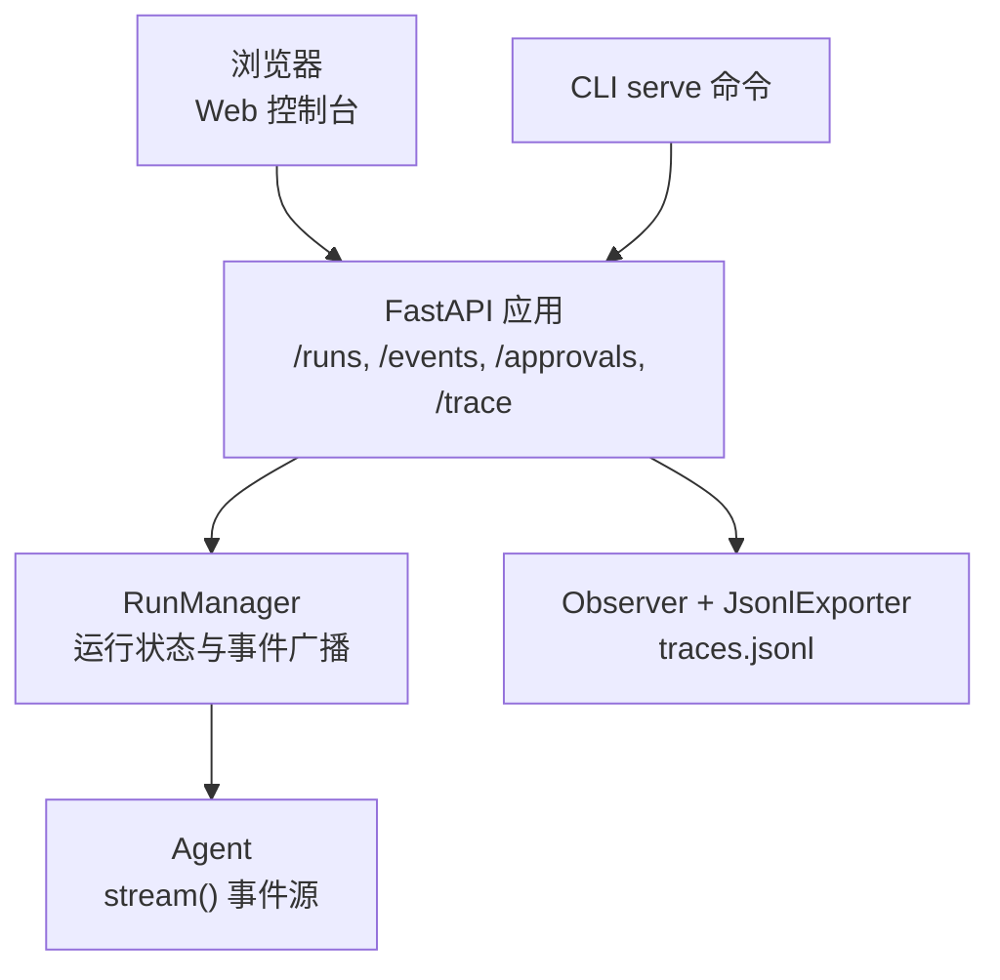
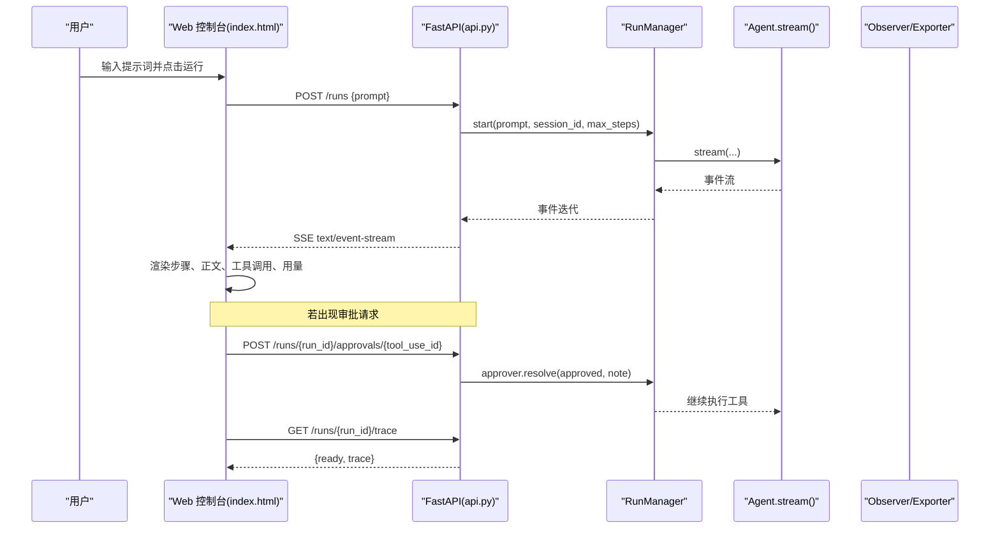
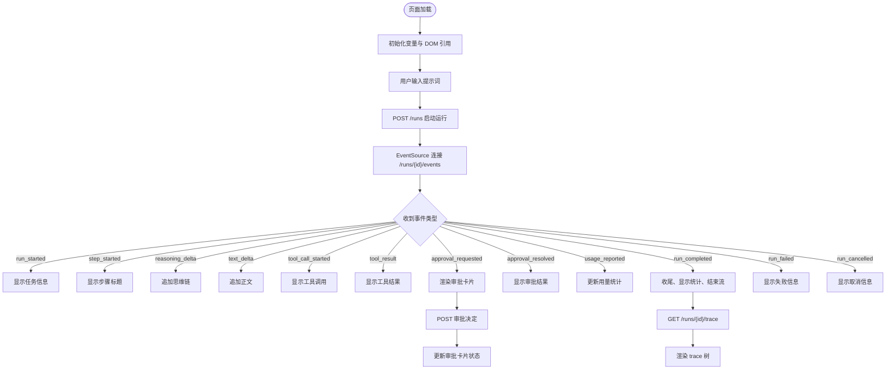
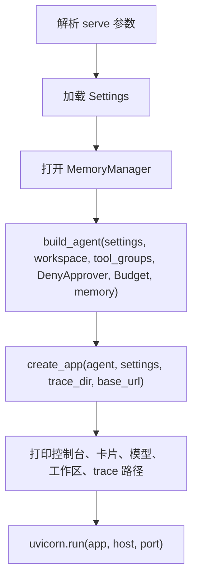
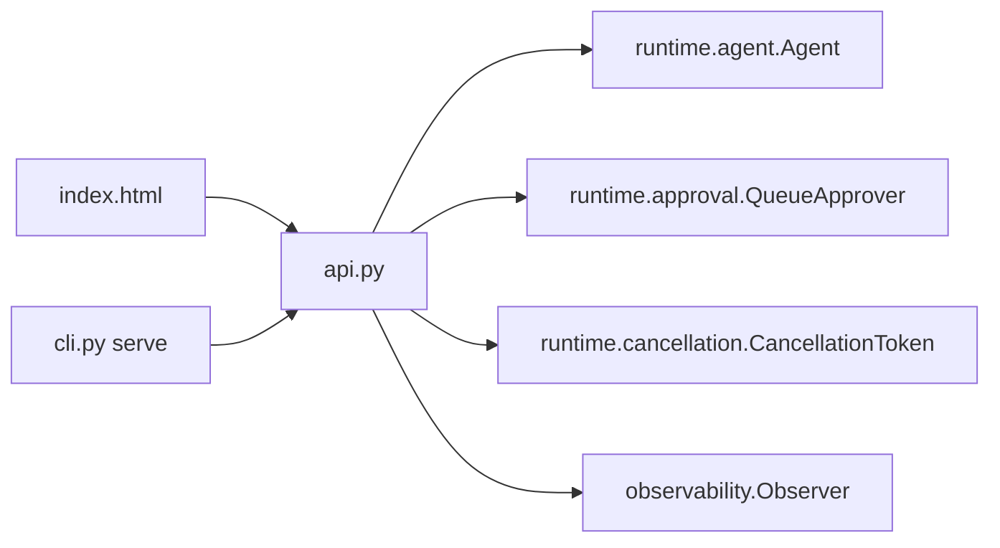

# Web 控制台

<cite>
**本文引用的文件**   
- [README.md](file://README.md)
- [index.html](file://src/agentkit/app/web/index.html)
- [api.py](file://src/agentkit/app/api.py)
- [cli.py](file://src/agentkit/app/cli.py)
- [test_api.py](file://tests/test_api.py)
</cite>

## 目录
1. [简介](#简介)
2. [项目结构](#项目结构)
3. [核心组件](#核心组件)
4. [架构总览](#架构总览)
5. [详细组件分析](#详细组件分析)
6. [依赖关系分析](#依赖关系分析)
7. [性能与可靠性](#性能与可靠性)
8. [故障排查](#故障排查)
9. [结论](#结论)

## 简介
Web 控制台是 AgentKit 的浏览器端交互界面，用于实时观察 Agent 的推理过程、工具调用、审批请求、用量统计与 trace 树。它通过 FastAPI 提供的 HTTP 接口启动一次运行，再通过 SSE（Server-Sent Events）订阅事件流；需要执行高危操作时，由用户在浏览器中批准或拒绝。

该控制台刻意采用单文件原生 JavaScript，不引入构建链和前端框架，以降低“克隆即可运行”的门槛，并把安全重点放在“模型输出绝不拼入 HTML”上。

**章节来源**
- [README.md:64-97](file://README.md#L64-L97)

## 项目结构
Web 控制台相关代码集中在 `app` 层：
- `src/agentkit/app/web/index.html`：浏览器端 UI、SSE 客户端、审批交互与 trace 渲染。
- `src/agentkit/app/api.py`：FastAPI 应用、运行生命周期、SSE 事件流、审批接口、trace 查询与 Agent 发现。
- `src/agentkit/app/cli.py`：命令行入口，其中 `serve` 子命令负责启动 HTTP 服务并注入 Agent、记忆、预算与 trace 目录。



**图表来源**
- [api.py:349-506](file://src/agentkit/app/api.py#L349-L506)
- [cli.py:427-474](file://src/agentkit/app/cli.py#L427-L474)

**章节来源**
- [api.py:349-506](file://src/agentkit/app/api.py#L349-L506)
- [cli.py:427-474](file://src/agentkit/app/cli.py#L427-L474)

## 核心组件
- **Web 控制台前端**：提供输入框、运行按钮、取消按钮、主消息区、侧边栏统计面板与 trace 树；使用原生 `EventSource` 连接 `/runs/{id}/events`。
- **HTTP API**：暴露控制台页面、运行启动、事件流、取消、审批、trace 与 Agent 卡片等端点。
- **RunManager**：管理活跃 run、回放历史事件、向 SSE 订阅者广播、回收已结束且无人监听的 run。
- **CLI serve**：构造 Agent、记忆、预算、DenyApprover，并启动 uvicorn 服务。

**章节来源**
- [index.html:184-495](file://src/agentkit/app/web/index.html#L184-L495)
- [api.py:72-267](file://src/agentkit/app/api.py#L72-L267)
- [cli.py:427-474](file://src/agentkit/app/cli.py#L427-L474)

## 架构总览
Web 控制台的端到端流程如下：用户输入任务后，前端发起 POST 创建运行；服务端立即返回 `run_id`，随后前端用 `EventSource` 订阅 SSE 事件；引擎产生的事件经 RunManager 广播给所有订阅者；当出现需要审批的工具调用时，前端弹出审批框并通过独立 POST 提交决定；运行结束后前端拉取 trace 树展示。



**图表来源**
- [index.html:433-495](file://src/agentkit/app/web/index.html#L433-L495)
- [api.py:402-454](file://src/agentkit/app/api.py#L402-L454)
- [api.py:458-474](file://src/agentkit/app/api.py#L458-L474)

## 详细组件分析

### Web 控制台前端
前端是一个自包含的单页应用，主要职责包括：
- 初始化 DOM 引用、事件源、当前运行 ID、答案节点与序列号。
- 渲染辅助函数：步骤标题、正文追加、思维链追加、工具调用块、通知、底部统计。
- 审批交互：渲染审批卡片，调用 `/runs/{run_id}/approvals/{tool_use_id}` 提交批准或拒绝。
- 事件分发：根据 `event.type` 处理 `run_started`、`step_started`、`reasoning_delta`、`text_delta`、`tool_call_started`、`tool_result`、`approval_requested`、`approval_resolved`、`usage_reported`、`run_completed`、`run_failed`、`run_cancelled`。
- 运行控制：POST `/runs` 启动运行，GET `/runs/{id}/events` 订阅 SSE，DELETE `/runs/{id}` 取消运行。
- Trace 渲染：运行结束后延迟拉取 `/runs/{run_id}/trace`，将 span 树格式化为缩进文本。

安全方面，前端明确避免使用 `innerHTML`、`outerHTML`、`insertAdjacentHTML` 与 `document.write`，所有来自模型或工具的文本都通过 `textContent` 写入，防止 XSS。



**图表来源**
- [index.html:184-495](file://src/agentkit/app/web/index.html#L184-L495)

**章节来源**
- [index.html:1-499](file://src/agentkit/app/web/index.html#L1-L499)
- [test_api.py:416-447](file://tests/test_api.py#L416-L447)

### HTTP API 与运行管理
API 层承担以下职责：
- 提供控制台页面路由 `/`，直接返回 `web/index.html`。
- 启动运行 `POST /runs`，调用 `RunManager.start`，返回 `run_id` 与事件 URL。
- 查询运行快照 `GET /runs/{run_id}`。
- 提供 SSE 事件流 `GET /runs/{run_id}/events`，支持 `from_seq` 断线续传。
- 取消运行 `DELETE /runs/{run_id}`。
- 获取 trace `GET /runs/{run_id}/trace`。
- 审批接口 `POST /runs/{run_id}/approvals/{tool_use_id}` 与 `GET /runs/{run_id}/approvals`。
- Agent 发现 `.well-known/agent-card.json`、`/agents`、`/agents/{name}`。
- 健康检查 `/healthz`。

`RunState` 保存运行 ID、取消令牌、审批队列、异步任务、已产出事件、SSE 订阅队列、完成事件与 observer。`RunManager` 负责后台回收已结束且无订阅者的 run，并在 `_pump` 中将 Agent 的事件流包装为 observer，再广播给所有订阅者。

```mermaid
classDiagram
class RunState {
+string run_id
+CancellationToken cancellation
+QueueApprover approver
+Task task
+list events
+set subscribers
+Event done
+Observer observer
+string error
+finished bool
+terminal_event() RunEvent
+snapshot() dict
}
class RunManager {
+Agent agent
+Path trace_dir
+dict runs
+start_reaper() void
+shutdown() void
+reap() int
+start(prompt, session_id, max_steps) RunState
+subscribe(state, from_seq) AsyncIterator
-_make_observer(run_id, session_id) Observer
-_pump(state, prompt, session_id, max_steps) void
}
class FastAPI {
+get "/" console()
+post "/runs" start_run()
+get "/runs/{run_id}" get_run()
+get "/runs/{run_id}/events" stream_events()
+delete "/runs/{run_id}" cancel_run()
+get "/runs/{run_id}/trace" get_trace()
+post "/runs/{run_id}/approvals/{tool_use_id}" resolve_approval()
+get "/runs/{run_id}/approvals" list_approvals()
+get "/.well-known/agent-card.json" well_known_card()
+get "/agents" list_agents()
+get "/agents/{name}" get_agent()
+get "/healthz" healthz()
}
RunManager --> RunState : "创建与管理"
FastAPI --> RunManager : "依赖"
```

**图表来源**
- [api.py:72-267](file://src/agentkit/app/api.py#L72-L267)
- [api.py:349-506](file://src/agentkit/app/api.py#L349-L506)

**章节来源**
- [api.py:54-110](file://src/agentkit/app/api.py#L54-L110)
- [api.py:112-267](file://src/agentkit/app/api.py#L112-L267)
- [api.py:349-506](file://src/agentkit/app/api.py#L349-L506)

### CLI serve 与服务启动
CLI 的 `serve` 子命令负责：
- 解析工作区、模型、最大步数等参数。
- 打开会话数据库并创建 `MemoryManager`。
- 使用 `build_agent` 构造 Agent，默认使用 `DenyApprover`，因为服务端没有终端审批通道。
- 设置 trace 目录，调用 `create_app` 创建 FastAPI 应用。
- 打印控制台地址、Agent 卡片地址、模型与工作区、trace 路径。
- 使用 uvicorn 启动服务。



**图表来源**
- [cli.py:427-474](file://src/agentkit/app/cli.py#L427-L474)

**章节来源**
- [cli.py:108-119](file://src/agentkit/app/cli.py#L108-L119)
- [cli.py:427-474](file://src/agentkit/app/cli.py#L427-L474)

## 依赖关系分析
Web 控制台依赖 FastAPI 提供的 HTTP 能力，同时依赖运行时模块中的 Agent、Approval、Cancellation、Observer 等组件。前端只关心事件语义，不关心后端实现细节；后端则把 Agent 的事件流统一封装成可订阅的异步迭代器。



**图表来源**
- [api.py:31-46](file://src/agentkit/app/api.py#L31-L46)
- [cli.py:427-474](file://src/agentkit/app/cli.py#L427-L474)

**章节来源**
- [api.py:31-46](file://src/agentkit/app/api.py#L31-L46)
- [cli.py:427-474](file://src/agentkit/app/cli.py#L427-L474)

## 性能与可靠性
- **SSE 断线续传**：每个事件带单调递增序号，客户端重连时可携带 `from_seq`，服务端回放缺失事件，避免重复或丢失。
- **后台回收**：RunManager 定期清理已结束且无订阅者的 run，防止长时间运行的服务内存持续增长。
- **事件缓冲**：已产出事件保存在 `RunState.events`，新订阅者可先回放历史事件再进入实时流。
- **取消隔离**：取消通过 `CancellationToken` 传播，不影响其他运行；SSE 断开不等于运行终止，需显式 DELETE。
- **trace 落盘**：Observer 在 run 结束时导出 trace，确保复盘数据可用。

**章节来源**
- [api.py:144-162](file://src/agentkit/app/api.py#L144-L162)
- [api.py:195-267](file://src/agentkit/app/api.py#L195-L267)
- [api.py:413-438](file://src/agentkit/app/api.py#L413-L438)

## 故障排查
常见问题与定位方式：
- **控制台页面无法访问**：确认 `/` 路由是否返回 `index.html`；若打包遗漏静态文件，会返回兜底错误页面。
- **SSE 事件不刷新**：检查浏览器网络面板中 `/runs/{id}/events` 是否为 `text/event-stream`，并确认 `from_seq` 是否正确传递。
- **审批无响应**：确认 `POST /runs/{run_id}/approvals/{tool_use_id}` 是否返回成功；若 tool_use_id 不存在或 run 已结束，会返回 404。
- **trace 未就绪**：运行尚未结束时 trace 树可能未收敛，前端会显示“trace 尚未就绪”，稍后再拉取。
- **模型输出未显示**：前端使用 `textContent` 渲染，不会因 innerHTML 被拦截而空白；若仍为空，检查事件类型是否为 `text_delta` 或 `run_completed`。
- **服务内存增长**：确认后台回收是否正常运行，以及是否有长期活跃的 SSE 订阅者未关闭。

**章节来源**
- [api.py:393-398](file://src/agentkit/app/api.py#L393-L398)
- [api.py:413-438](file://src/agentkit/app/api.py#L413-L438)
- [api.py:448-454](file://src/agentkit/app/api.py#L448-L454)
- [api.py:458-474](file://src/agentkit/app/api.py#L458-L474)
- [index.html:400-429](file://src/agentkit/app/web/index.html#L400-L429)

## 结论
Web 控制台以极简的前端实现配合清晰的 HTTP/SSE 接口，提供了完整的 Agent 运行可视化体验。其设计强调事件驱动、断线续传、审批隔离与 trace 可观测性，既适合本地调试，也适合作为外部系统集成入口。对于扩展而言，新增事件类型只需在前端事件分发与后端序列化之间保持一致，无需改动引擎核心。