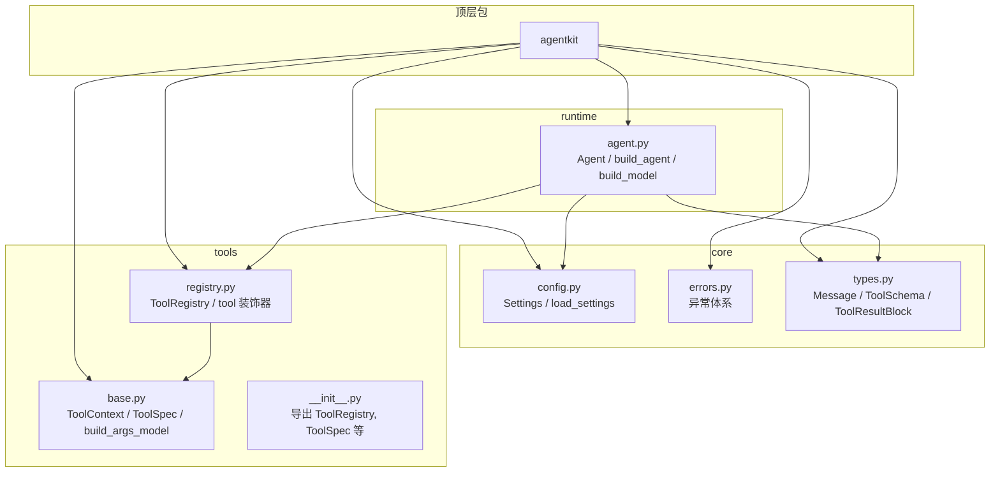
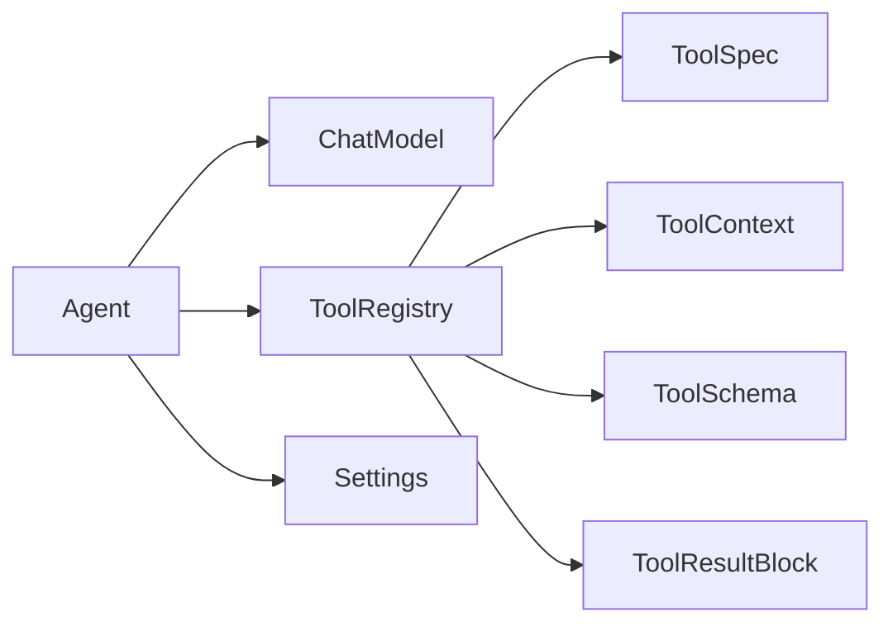

# 核心 API

<cite>
**本文引用的文件**   
- [src/agentkit/__init__.py](file://src/agentkit/__init__.py)
- [src/agentkit/runtime/agent.py](file://src/agentkit/runtime/agent.py)
- [src/agentkit/tools/__init__.py](file://src/agentkit/tools/__init__.py)
- [src/agentkit/tools/registry.py](file://src/agentkit/tools/registry.py)
- [src/agentkit/tools/base.py](file://src/agentkit/tools/base.py)
- [src/agentkit/core/config.py](file://src/agentkit/core/config.py)
- [src/agentkit/core/types.py](file://src/agentkit/core/types.py)
- [src/agentkit/core/errors.py](file://src/agentkit/core/errors.py)
</cite>

## 目录
1. [简介](#简介)
2. [项目结构](#项目结构)
3. [核心组件总览](#核心组件总览)
4. [架构概览](#架构概览)
5. [详细组件分析](#详细组件分析)
6. [依赖关系分析](#依赖关系分析)
7. [性能与行为特征](#性能与行为特征)
8. [故障排查指南](#故障排查指南)
9. [最佳实践](#最佳实践)
10. [结论](#结论)

## 简介
本文件面向使用者与维护者，聚焦 AgentKit 的公开核心 API：`Agent`、`ToolRegistry`、工具装饰器 `tool`、`Settings`，以及它们之间的协作方式。文档会说明每个类的构造参数、方法签名、返回值类型、异常处理机制，并给出完整的使用示例路径和最佳实践建议。所有描述均基于仓库源码实现，确保与代码保持同步。

## 项目结构
AgentKit 采用分层组织：
- `core`：配置、错误、消息与内容块等基础类型。
- `tools`：工具协议、注册表、内置工具与安全策略。
- `runtime`：把模型、工具、引擎组装为可运行的 `Agent`。
- `app`：命令行入口（不在本次核心 API 范围内）。

**图表来源**
- [src/agentkit/__init__.py:16-44](file://src/agentkit/__init__.py#L16-L44)
- [src/agentkit/core/config.py:27-99](file://src/agentkit/core/config.py#L27-L99)
- [src/agentkit/core/types.py:49-100](file://src/agentkit/core/types.py#L49-L100)
- [src/agentkit/tools/base.py:40-127](file://src/agentkit/tools/base.py#L40-L127)
- [src/agentkit/tools/registry.py:33-175](file://src/agentkit/tools/registry.py#L33-L175)
- [src/agentkit/runtime/agent.py:38-175](file://src/agentkit/runtime/agent.py#L38-L175)

**章节来源**
- [src/agentkit/__init__.py:1-44](file://src/agentkit/__init__.py#L1-L44)

## 核心组件总览
- `Settings`：进程级运行配置，支持环境变量与 `.env` 覆盖，提供 `require_api_key()` 等方法。
- `ToolRegistry`：工具容器，负责注册、查询、合并、执行工具；提供 `tool` 装饰器。
- `ToolSpec` / `ToolContext`：工具契约与执行上下文，由 `ToolRegistry` 在调用时注入。
- `Agent`：门面类，组合模型、工具、工作区等，暴露 `run`、`stream`、`aclose` 等接口。
- 辅助函数：`build_agent`、`build_model`、`load_settings`。

**章节来源**
- [src/agentkit/core/config.py:27-99](file://src/agentkit/core/config.py#L27-L99)
- [src/agentkit/tools/registry.py:33-175](file://src/agentkit/tools/registry.py#L33-L175)
- [src/agentkit/tools/base.py:40-214](file://src/agentkit/tools/base.py#L40-L214)
- [src/agentkit/runtime/agent.py:38-175](file://src/agentkit/runtime/agent.py#L38-L175)

## 架构概览
下图展示核心对象之间的关系：`Agent` 持有 `ChatModel` 与 `ToolRegistry`，并通过 `Engine` 驱动执行；`ToolRegistry` 管理 `ToolSpec`，并在执行时向工具注入 `ToolContext`。

```mermaid
classDiagram
class Settings {
+api_key : str|None
+base_url : str
+model : str
+temperature : float
+max_tokens : int|None
+request_timeout : float
+max_retries : int
+retry_base_delay : float
+retry_max_delay : float
+max_steps : int
+workspace : Path
+require_api_key() str
+resolved_workspace() Path
}
class ToolContext {
+workspace : Path
+run_id : str
+tool_use_id : str
+approver : Approver|None
+state : dict
+request_approval(request) bool
+resolve(path) Path
+display_path(path) str
}
class ToolSpec {
+name : str
+description : str
+args_model : BaseModel
+fn : ContextAwareCallable
+dangerous : bool
+idempotent : bool
+json_schema() dict
+schema() ToolSchema
+validate(arguments) BaseModel
+from_function(fn, name, description, dangerous, idempotent) ToolSpec
}
class ToolRegistry {
+add(spec) ToolSpec
+remove(name) void
+register(fn, **kwargs) ToolSpec
+tool(**kwargs) decorator
+merge(other, override) ToolRegistry
+get(name) ToolSpec|None
+all() ToolSpec[]
+names() str[]
+schemas() ToolSchema[]
+describe() str
+invoke(name, arguments, ctx, tool_use_id) ToolResultBlock
}
class Agent {
+model : ChatModel
+tools : ToolRegistry
+workspace : Path
+name : str
+system_prompt : str|None
+max_steps : int
+temperature : float|None
+max_tokens : int|None
+approver : Approver|None
+budget : Budget|None
+memory : MemoryManager|None
+metadata : dict
+engine() Engine
+stream(user_input, history, run_id, session_id, cancellation, approver) AsyncIterator[RunEvent]
+run(user_input, history, run_id, session_id, cancellation, approver) RunResult
+aclose() void
}
Agent --> ToolRegistry : "使用"
ToolRegistry --> ToolSpec : "管理"
ToolRegistry --> ToolContext : "注入"
```

**图表来源**
- [src/agentkit/core/config.py:27-99](file://src/agentkit/core/config.py#L27-L99)
- [src/agentkit/tools/base.py:40-214](file://src/agentkit/tools/base.py#L40-L214)
- [src/agentkit/tools/registry.py:33-175](file://src/agentkit/tools/registry.py#L33-L175)
- [src/agentkit/runtime/agent.py:38-175](file://src/agentkit/runtime/agent.py#L38-L175)

## 详细组件分析

### Settings（运行配置）
- 作用：集中管理 LLM 连接、重试、生成参数与工作区路径。
- 关键属性与方法：
  - `api_key`：LLM API Key，支持别名 `LLM_API_KEY` 或 `DEEPSEEK_API_KEY`。
  - `base_url`：OpenAI 兼容端点，默认指向 DeepSeek。
  - `model`：模型 ID，默认 `deepseek-flash`。
  - `temperature`、`max_tokens`、`request_timeout`、`max_retries`、`retry_base_delay`、`retry_max_delay`：生成与重试参数。
  - `max_steps`、`workspace`：运行时步数与工作区根目录。
  - `require_api_key()`：缺失时抛出 `ConfigurationError`。
  - `resolved_workspace()`：返回绝对路径的工作区。
- 加载方式：通过 `load_settings(**overrides)` 从环境变量、`.env` 与默认值构建。

典型用法参考：
- 初始化配置与获取 API Key：[src/agentkit/core/config.py:27-99](file://src/agentkit/core/config.py#L27-L99)
- 在 `build_model` 中读取配置：[src/agentkit/runtime/agent.py:118-140](file://src/agentkit/runtime/agent.py#L118-L140)

**章节来源**
- [src/agentkit/core/config.py:27-99](file://src/agentkit/core/config.py#L27-L99)
- [src/agentkit/runtime/agent.py:118-140](file://src/agentkit/runtime/agent.py#L118-L140)

### ToolRegistry（工具注册表）
- 作用：维护一组工具，提供注册、查询、合并、执行能力。
- 构造函数：
  - `__init__(tools: list[ToolSpec] | None = None)`：可选地传入初始工具列表。
- 注册相关：
  - `add(spec: ToolSpec) -> ToolSpec`：注册已构造的工具，重名抛 `ValueError`。
  - `remove(name: str) -> None`：按名称移除。
  - `register(fn: ContextAwareCallable, **kwargs) -> ToolSpec`：从异步函数注册工具。
  - `tool(**kwargs)`：装饰器，既注册又返回原函数。
  - `merge(other: ToolRegistry, *, override: bool = False) -> ToolRegistry`：合并另一个注册表，返回新实例。
- 查询相关：
  - `get(name: str) -> ToolSpec | None`
  - `all() -> list[ToolSpec]`
  - `names() -> list[str]`
  - `schemas() -> list[ToolSchema]`
  - `describe() -> str`
- 执行相关：
  - `async invoke(name: str, arguments: dict[str, Any], ctx: ToolContext, *, tool_use_id: str = "") -> ToolResultBlock`
    - 永不抛出业务异常（除取消），失败统一转为 `is_error=True` 的结果块。
    - 参数校验失败会回灌给模型，便于自我修正。
    - 捕获 `PolicyError`、`ToolError`、`AgentKitError` 及通用异常，包装为错误结果。
    - 若工具返回非字符串，也作为错误结果返回。

装饰器使用参考：
- 装饰器定义与示例注释：[src/agentkit/tools/registry.py:57-70](file://src/agentkit/tools/registry.py#L57-L70)

执行流程参考：
- 执行与异常处理逻辑：[src/agentkit/tools/registry.py:113-175](file://src/agentkit/tools/registry.py#L113-L175)

**章节来源**
- [src/agentkit/tools/registry.py:33-175](file://src/agentkit/tools/registry.py#L33-L175)

### ToolSpec 与 ToolContext（工具契约与上下文）
- `ToolSpec`：
  - 字段：`name`、`description`、`args_model`、`fn`、`dangerous`、`idempotent`。
  - 方法：
    - `json_schema() -> dict`：生成参数的 JSON Schema。
    - `schema() -> ToolSchema`：转为 provider 中立形式。
    - `validate(arguments: dict[str, Any]) -> BaseModel`：校验参数，失败抛 `ToolValidationError`。
    - `from_function(fn, name=None, description=None, dangerous=False, idempotent=True) -> ToolSpec`：从异步函数构造。
- `ToolContext`：
  - 字段：`workspace`、`run_id`、`tool_use_id`、`approver`、`state`。
  - 方法：
    - `request_approval(request) -> bool`：走审批通道，无通道则拒绝。
    - `resolve(path) -> Path`：解析到工作区内路径，越界抛 `PathViolation`。
    - `display_path(path) -> str`：尽量以相对工作区路径显示。

参数模型生成与约束参考：
- 从函数签名生成 Pydantic 参数模型：[src/agentkit/tools/base.py:94-127](file://src/agentkit/tools/base.py#L94-L127)
- `ToolSpec.from_function` 的描述与校验：[src/agentkit/tools/base.py:178-214](file://src/agentkit/tools/base.py#L178-L214)

**章节来源**
- [src/agentkit/tools/base.py:40-214](file://src/agentkit/tools/base.py#L40-L214)

### Agent（可运行门面）
- 作用：把模型、工具、工作区等组装起来，对外暴露 `run`、`stream`、`aclose`。
- 构造参数（dataclass 字段）：
  - `model: ChatModel`
  - `tools: ToolRegistry`
  - `workspace: Path`
  - `name: str = "agent"`
  - `system_prompt: str | None = None`
  - `max_steps: int = 15`
  - `temperature: float | None = 0.0`
  - `max_tokens: int | None = None`
  - `approver: Approver | None = None`
  - `budget: Budget | None = None`
  - `memory: MemoryManager | None = None`
  - `metadata: dict[str, str] = {}`
- 方法：
  - `engine() -> Engine`：创建引擎实例。
  - `stream(user_input, *, history=None, run_id=None, session_id=None, cancellation=None, approver=None) -> AsyncIterator[RunEvent]`：流式事件。
  - `run(user_input, *, history=None, run_id=None, session_id=None, cancellation=None, approver=None) -> RunResult`：汇聚结果。
  - `aclose() -> None`：关闭底层模型资源。
- 工厂函数：
  - `build_model(settings, *, on_retry=None) -> ChatModel`：根据 `Settings` 构造模型适配器。
  - `build_agent(settings=None, *, workspace=None, tools=None, tool_groups=None, **overrides) -> Agent`：按配置组装 Agent。

Agent 使用参考：
- 类定义与公共方法：[src/agentkit/runtime/agent.py:38-116](file://src/agentkit/runtime/agent.py#L38-L116)
- 工厂函数 `build_model`：[src/agentkit/runtime/agent.py:118-140](file://src/agentkit/runtime/agent.py#L118-L140)
- 工厂函数 `build_agent`：[src/agentkit/runtime/agent.py:143-175](file://src/agentkit/runtime/agent.py#L143-L175)

**章节来源**
- [src/agentkit/runtime/agent.py:38-175](file://src/agentkit/runtime/agent.py#L38-L175)

### 公开导出与入口
- 顶层包通过惰性导入导出 `Agent`、`ToolRegistry`、`tool`、`Settings`、`ChatModel`。
- 工具模块导出 `ToolRegistry`、`ToolSpec`、`ToolContext`、`build_args_model` 等。

入口参考：
- 顶层导出：[src/agentkit/__init__.py:16-44](file://src/agentkit/__init__.py#L16-L44)
- 工具模块导出：[src/agentkit/tools/__init__.py:1-32](file://src/agentkit/tools/__init__.py#L1-L32)

**章节来源**
- [src/agentkit/__init__.py:1-44](file://src/agentkit/__init__.py#L1-L44)
- [src/agentkit/tools/__init__.py:1-32](file://src/agentkit/tools/__init__.py#L1-L32)

## 依赖关系分析
- `Agent` 依赖 `ChatModel`、`ToolRegistry`、`Budget`、`MemoryManager`、`CancellationToken`、`Approver` 等运行时组件。
- `ToolRegistry` 依赖 `ToolSpec`、`ToolContext`、`ToolSchema`、`ToolResultBlock` 与错误类型。
- `Settings` 独立于运行时，仅依赖 pydantic-settings。
- 顶层包通过惰性导入避免引入重型依赖。

**图表来源**
- [src/agentkit/runtime/agent.py:38-175](file://src/agentkit/runtime/agent.py#L38-L175)
- [src/agentkit/tools/registry.py:33-175](file://src/agentkit/tools/registry.py#L33-L175)
- [src/agentkit/tools/base.py:40-214](file://src/agentkit/tools/base.py#L40-L214)
- [src/agentkit/core/types.py:49-100](file://src/agentkit/core/types.py#L49-L100)
- [src/agentkit/core/config.py:27-99](file://src/agentkit/core/config.py#L27-L99)

**章节来源**
- [src/agentkit/runtime/agent.py:38-175](file://src/agentkit/runtime/agent.py#L38-L175)
- [src/agentkit/tools/registry.py:33-175](file://src/agentkit/tools/registry.py#L33-L175)
- [src/agentkit/tools/base.py:40-214](file://src/agentkit/tools/base.py#L40-L214)
- [src/agentkit/core/types.py:49-100](file://src/agentkit/core/types.py#L49-L100)
- [src/agentkit/core/config.py:27-99](file://src/agentkit/core/config.py#L27-L99)

## 性能与行为特征
- `ToolRegistry.invoke` 保证不抛业务异常（取消除外），所有失败转为错误结果块，降低上层处理复杂度。
- 参数校验失败直接回灌给模型，利用原生 tool calling 的优势让模型自我修正。
- `ToolSpec.validate` 使用 Pydantic 校验，错误信息包含字段位置，便于定位问题。
- `Agent.stream` 与 `Agent.run` 共享执行路径，前者适合实时消费事件，后者聚合结果。

**章节来源**
- [src/agentkit/tools/registry.py:113-175](file://src/agentkit/tools/registry.py#L113-L175)
- [src/agentkit/tools/base.py:159-176](file://src/agentkit/tools/base.py#L159-L176)
- [src/agentkit/runtime/agent.py:72-116](file://src/agentkit/runtime/agent.py#L72-L116)

## 故障排查指南
常见异常与处理建议：
- `ConfigurationError`：未配置 API Key。检查环境变量 `LLM_API_KEY` 或 `.env` 中的 `DEEPSEEK_API_KEY`。
- `NotADirectoryError`：`build_agent` 发现工作区不是目录。确认 `workspace` 设置正确。
- `ValueError`：工具名重复。在 `ToolRegistry.add` 或 `register` 时显式改名或移除旧工具。
- `ToolValidationError`：工具参数不合法。查看错误信息中的字段位置，修正模型生成的参数。
- `PolicyError`、`PathViolation`、`CommandDenied`、`ApprovalDenied`：安全策略拦截。检查工作区路径、命令白名单与审批通道。
- `RunCancelled`：运行被取消。这是唯一会中断执行的异常，需在上层处理取消信号。
- `InvalidConversation`：消息序列违反配对不变量。检查 tool_use 与 tool_result 的配对与合并规则。

参考实现：
- 异常分类与重试标记：[src/agentkit/core/errors.py:14-132](file://src/agentkit/core/errors.py#L14-L132)
- 配置缺失报错：[src/agentkit/core/config.py:79-88](file://src/agentkit/core/config.py#L79-L88)
- 工作区目录校验：[src/agentkit/runtime/agent.py:158-160](file://src/agentkit/runtime/agent.py#L158-L160)
- 工具执行异常处理：[src/agentkit/tools/registry.py:142-175](file://src/agentkit/tools/registry.py#L142-L175)
- 对话配对校验：[src/agentkit/core/types.py:159-212](file://src/agentkit/core/types.py#L159-L212)

**章节来源**
- [src/agentkit/core/errors.py:14-132](file://src/agentkit/core/errors.py#L14-L132)
- [src/agentkit/core/config.py:79-88](file://src/agentkit/core/config.py#L79-L88)
- [src/agentkit/runtime/agent.py:158-160](file://src/agentkit/runtime/agent.py#L158-L160)
- [src/agentkit/tools/registry.py:142-175](file://src/agentkit/tools/registry.py#L142-L175)
- [src/agentkit/core/types.py:159-212](file://src/agentkit/core/types.py#L159-L212)

## 最佳实践
- 始终通过 `build_agent` 与 `load_settings` 初始化，避免硬编码模型与端点。
- 使用 `ToolRegistry.tool` 装饰器注册工具，并为每个工具提供清晰的描述与具名参数。
- 在工具中使用 `ToolContext.resolve` 访问工作区路径，避免越界访问。
- 对可能产生副作用的工具设置 `dangerous=True`，并结合审批通道控制执行。
- 对幂等工具设置 `idempotent=True`，以便在重放 checkpoint 时跳过重复执行。
- 在需要实时反馈的场景使用 `Agent.stream`，否则使用 `Agent.run`。
- 合理配置 `max_steps`、`temperature`、`max_tokens`、`request_timeout`、`max_retries` 等参数，平衡成本与质量。
- 使用 `ToolRegistry.merge` 组合不同权限或环境的工具集，测试时隔离用例。

参考实现：
- 工具装饰器与注册：[src/agentkit/tools/registry.py:53-70](file://src/agentkit/tools/registry.py#L53-L70)
- 工具上下文与路径解析：[src/agentkit/tools/base.py:40-74](file://src/agentkit/tools/base.py#L40-L74)
- 工具元数据与校验：[src/agentkit/tools/base.py:130-214](file://src/agentkit/tools/base.py#L130-L214)
- Agent 构建与参数覆盖：[src/agentkit/runtime/agent.py:143-175](file://src/agentkit/runtime/agent.py#L143-L175)

**章节来源**
- [src/agentkit/tools/registry.py:53-70](file://src/agentkit/tools/registry.py#L53-L70)
- [src/agentkit/tools/base.py:40-74](file://src/agentkit/tools/base.py#L40-L74)
- [src/agentkit/tools/base.py:130-214](file://src/agentkit/tools/base.py#L130-L214)
- [src/agentkit/runtime/agent.py:143-175](file://src/agentkit/runtime/agent.py#L143-L175)

## 结论
AgentKit 的核心 API 围绕 `Settings`、`ToolRegistry`、`ToolSpec`/`ToolContext` 与 `Agent` 展开。通过声明式配置与工具契约，框架将模型、工具与运行时解耦，并提供稳定的错误处理与可扩展性。遵循本文档的接口说明与最佳实践，可以快速搭建可靠的 Agent 应用，并确保与代码实现保持一致。