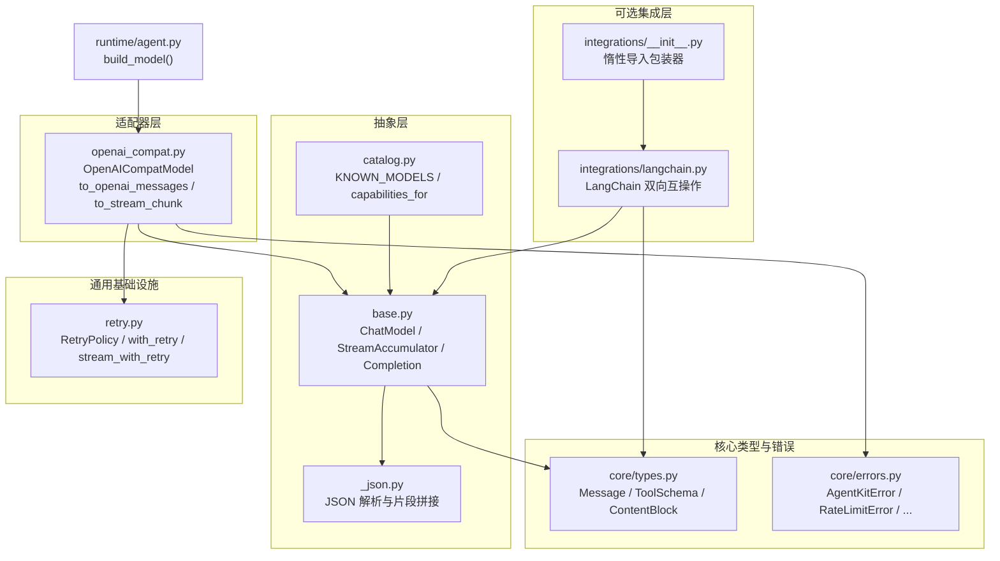
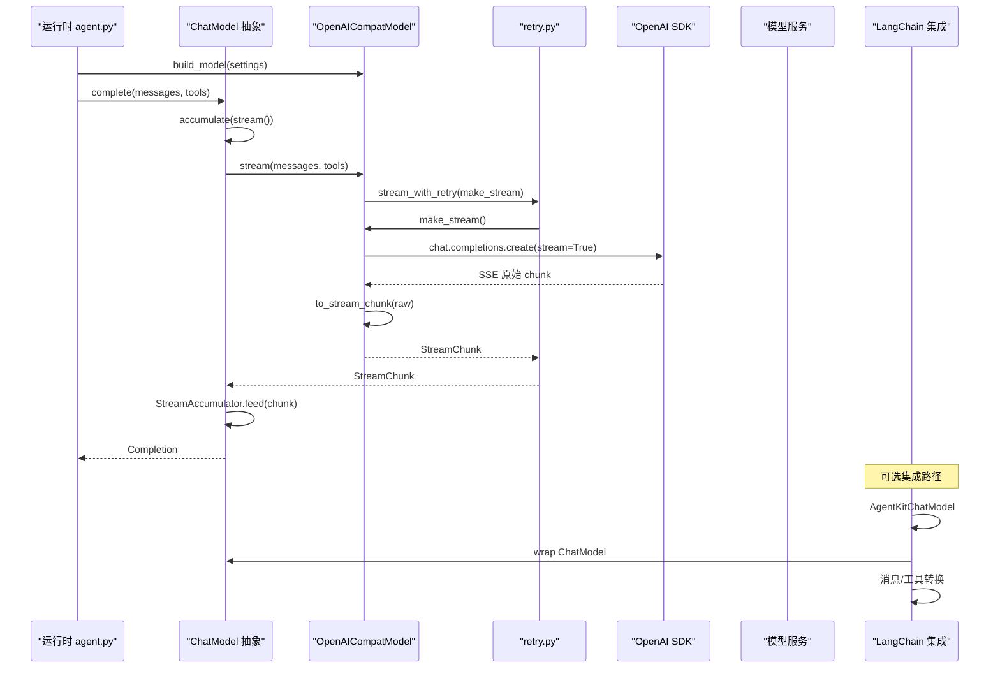
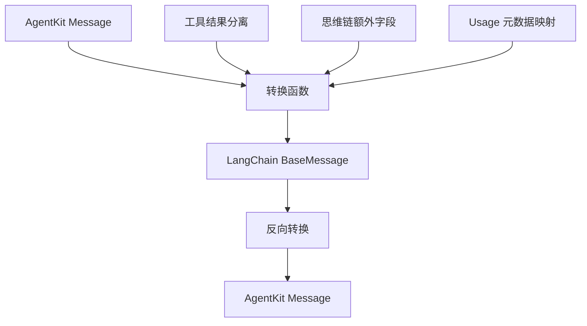
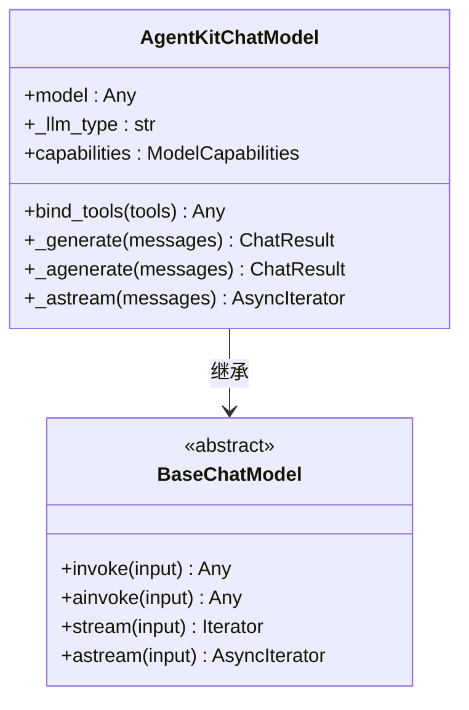
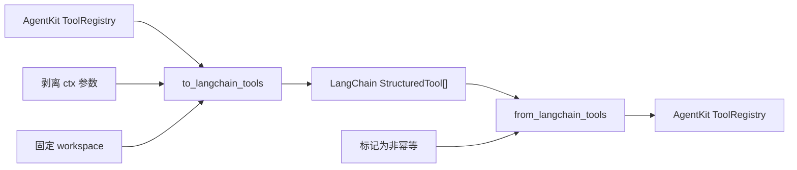
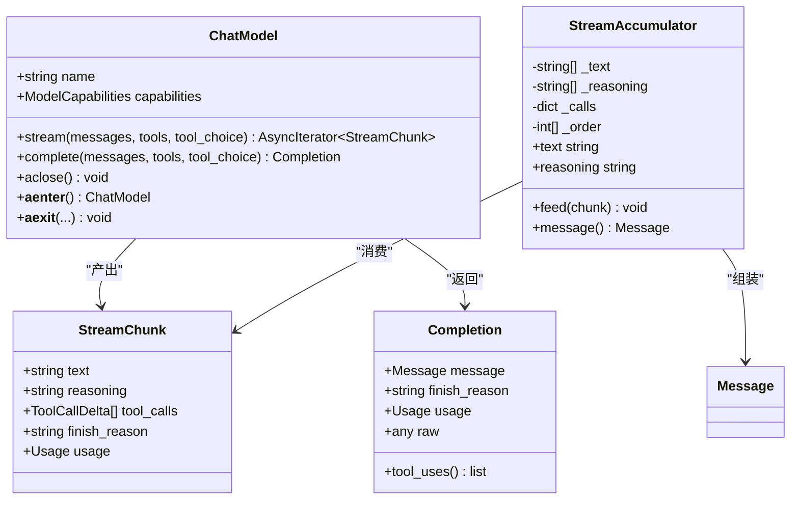
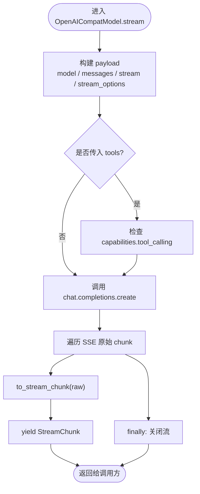
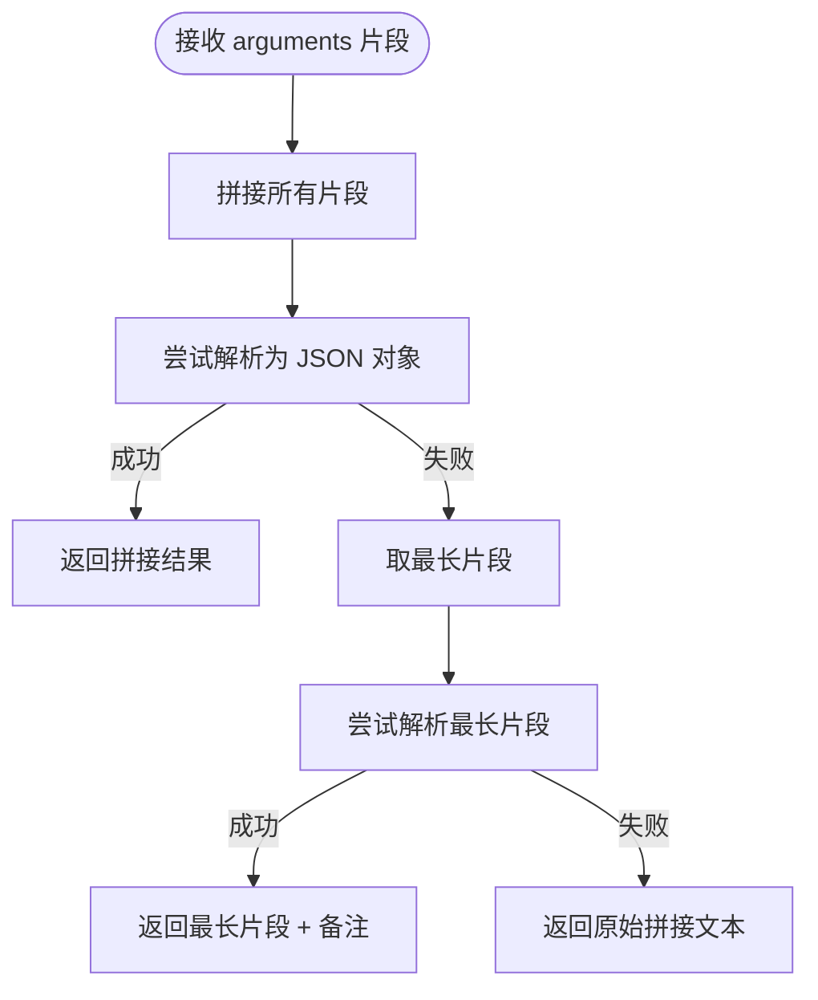
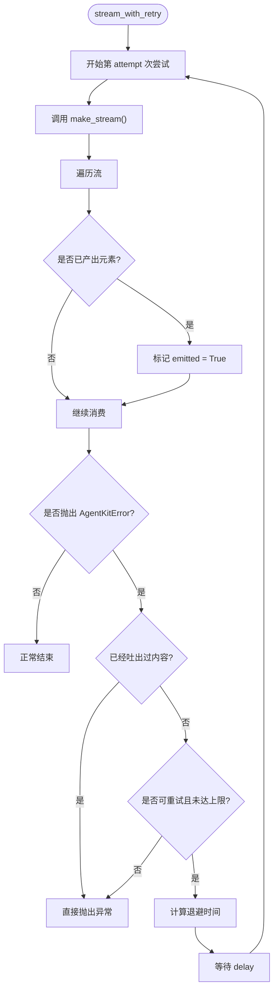
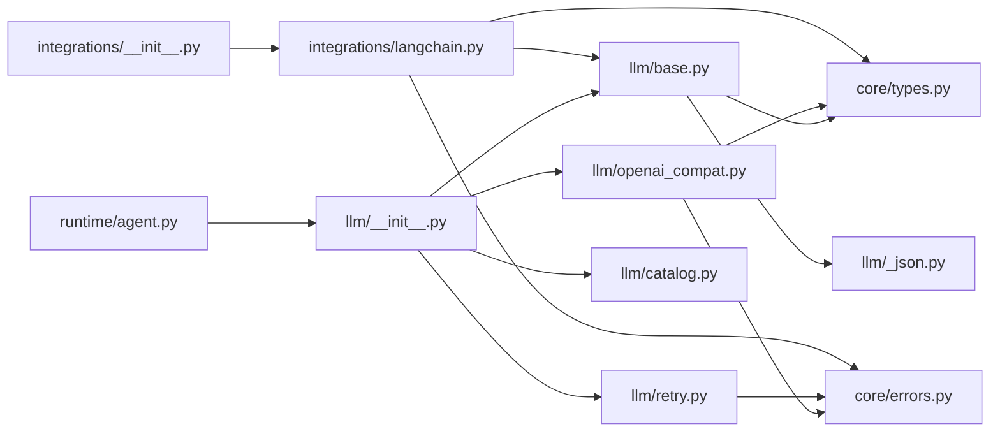

基于我对代码库的分析，我现在可以更新现有的 LLM 集成文档。主要变化是新增了 LangChain 生态的可选集成模块。让我创建更新后的文档：

<cite>
**本文引用的文件**   
- [README.md](file://README.md)
- [base.py](file://src/agentkit/llm/base.py)
- [openai_compat.py](file://src/agentkit/llm/openai_compat.py)
- [retry.py](file://src/agentkit/llm/retry.py)
- [_json.py](file://src/agentkit/llm/_json.py)
- [catalog.py](file://src/agentkit/llm/catalog.py)
- [__init__.py](file://src/agentkit/llm/__init__.py)
- [errors.py](file://src/agentkit/core/errors.py)
- [types.py](file://src/agentkit/core/types.py)
- [agent.py](file://src/agentkit/runtime/agent.py)
- [langchain.py](file://src/agentkit/integrations/langchain.py)
- [__init__.py](file://src/agentkit/integrations/__init__.py)
- [pyproject.toml](file://pyproject.toml)
- [langchain_interop.py](file://examples/langchain_interop.py)
- [test_langchain_integration.py](file://tests/test_langchain_integration.py)
</cite>

## 更新摘要
**已进行的更改**
- 新增 LangChain 生态集成模块文档
- 添加可选依赖安装说明（`uv sync --extra langchain`）
- 扩展架构图以包含 integrations 模块
- 新增 LangChain 双向互操作机制说明
- 添加工具转换和消息转换的详细文档
- 更新项目结构图以反映新的模块组织

## 目录
1. [引言](#引言)
2. [项目结构](#项目结构)
3. [核心组件](#核心组件)
4. [架构总览](#架构总览)
5. [LangChain 生态集成](#langchain-生态集成)
6. [详细组件分析](#详细组件分析)
7. [依赖关系分析](#依赖关系分析)
8. [性能与成本考量](#性能与成本考量)
9. [故障排查指南](#故障排查指南)
10. [结论](#结论)
11. [附录：自定义 Provider 开发指南](#附录自定义-provider-开发指南)

## 引言
本文件面向需要理解或扩展 AgentKit LLM 抽象层的开发者，目标是解释以下问题：
- ChatModel 接口如何统一不同模型服务。
- OpenAI 兼容适配器的消息、工具、流式响应归一化逻辑。
- JSON 参数解析、错误恢复与回灌机制。
- 重试策略、退避算法与流式重试边界。
- 能力目录与连接生命周期管理。
- **新增**：LangChain 生态的双向互操作机制。
- 如何基于现有设计新增 Anthropic 等 Provider。

AgentKit 的 LLM 层位于 `src/agentkit/llm`，向上暴露统一的 `ChatModel` 抽象；向下通过适配器对接具体 SDK。**新增的** `src/agentkit/integrations` 模块提供与其他框架生态的可选集成，当前支持 LangChain。运行时在 `runtime.agent.build_model` 中按配置构造适配器，并把重试策略、能力声明和回调注入进去。

**章节来源**
- [README.md:53-68](file://README.md#L53-L68)
- [agent.py:118-140](file://src/agentkit/runtime/agent.py#L118-L140)

## 项目结构
LLM 相关代码集中在 `src/agentkit/llm`，采用"抽象 + 适配器 + 通用基础设施"的分层组织。**新增的** `src/agentkit/integrations` 模块提供与其他框架生态的可选集成：



**图表来源**
- [base.py:1-17](file://src/agentkit/llm/base.py#L1-L17)
- [openai_compat.py:1-16](file://src/agentkit/llm/openai_compat.py#L1-L16)
- [retry.py:1-16](file://src/agentkit/llm/retry.py#L1-L16)
- [types.py:1-15](file://src/agentkit/core/types.py#L1-L15)
- [errors.py:1-9](file://src/agentkit/core/errors.py#L1-L9)
- [agent.py:118-140](file://src/agentkit/runtime/agent.py#L118-L140)
- [__init__.py:1-24](file://src/agentkit/integrations/__init__.py#L1-L24)
- [langchain.py:1-84](file://src/agentkit/integrations/langchain.py#L1-L84)

**章节来源**
- [README.md:53-68](file://README.md#L53-L68)
- [__init__.py:1-32](file://src/agentkit/llm/__init__.py#L1-L32)

## 核心组件
本节聚焦 LLM 抽象层的关键类型与职责划分。

### ChatModel 接口规范
`ChatModel` 是所有 Provider 适配器的基类，定义了两条关键路径：
- `stream(...)`: 返回异步迭代器，逐个产出已归一化的 `StreamChunk`。
- `complete(...)`: 默认实现消费整条流并汇聚为 `Completion`，保证非流式调用复用流式组装逻辑。

此外，`ChatModel` 提供上下文管理器协议（`aclose`、`__aenter__`、`__aexit__`），让上层可以安全释放底层连接。

| 成员 | 职责 | 是否必须覆盖 |
|---|---|---|
| `name` | 模型标识，例如 `deepseek-flash` | 是 |
| `capabilities` | 模型能力声明，控制并行工具调用、JSON 模式、思维链等 | 是 |
| `stream(...)` | 发起一次流式补全 | 是 |
| `complete(...)` | 完整补全结果 | 否，默认由 `accumulate` 实现 |
| `aclose()` | 关闭底层客户端或连接池 | 否，默认空实现 |

**章节来源**
- [base.py:213-264](file://src/agentkit/llm/base.py#L213-L264)

### 内部消息与工具契约
内部消息使用内容块模型，而不是直接绑定某个 Provider 的消息形状：

| 类型 | 作用 | 关键约束 |
|---|---|---|
| `TextBlock` | 普通文本 | 用于用户输入、助手回复正文 |
| `ReasoningBlock` | 思维链 | DeepSeek 要求多轮工具调用时原样回传 |
| `ToolUseBlock` | 请求工具调用 | 包含 `id`、`name`、`input`、可选 `raw_arguments` |
| `ToolResultBlock` | 工具执行结果 | 属于 user 消息，与 tool_use 配对 |
| `ToolSchema` | 对模型暴露的工具契约 | 参数为标准 JSON Schema |
| `Message` | 一条对话消息 | role 为 system/user/assistant |

这种设计让 Anthropic 的 content block 语义更自然，同时让 OpenAI 的扁平化工具调用格式也能通过转换函数映射。

**章节来源**
- [types.py:29-100](file://src/agentkit/core/types.py#L29-L100)
- [types.py:103-153](file://src/agentkit/core/types.py#L103-L153)

### 流式增量与累加器
`StreamChunk` 表示一个归一化后的流式增量，包含：
- 文本增量
- 思维链增量
- 工具调用增量列表
- finish_reason
- usage

`StreamAccumulator` 负责把多个 `StreamChunk` 合并成一条 assistant 消息，并处理三类 Provider 差异：
1. `id` / `name` 只在首个增量出现，后续为 None，不能做字符串拼接。
2. 并行工具调用靠 `index` 分组，不能按出现顺序简单拼接。
3. `usage` 可能只在最后一个 chunk 出现，也可能整条流都没有。

最终 `accumulate` 会调用 JSON 解析逻辑，把工具参数拼成结构化对象；如果无法解析，则保留原始参数字符串，作为可恢复错误回灌给模型。

**章节来源**
- [base.py:65-98](file://src/agentkit/llm/base.py#L65-L98)
- [base.py:115-210](file://src/agentkit/llm/base.py#L115-L210)

### 模型能力目录
`catalog.py` 维护已知模型的实测能力，包括上下文窗口、最大输出、是否支持并行工具调用、流式工具调用、JSON 模式、思维链、图像输入、流式 usage 等。未知模型走保守默认值，避免假设不存在的特性。

| 能力字段 | 默认行为 | 业务影响 |
|---|---|---|
| `parallel_tool_calls` | 未知模型为 False | 防止对不支持的模型发出多个 tool_use |
| `streaming_tool_calls` | 未知模型为 False | 避免假设流式工具调用 delta 语义 |
| `json_object` | 未知模型为 False | 不支持时走客户端校验 |
| `reasoning` | 未知模型为 False | 决定是否透传思维链 |
| `usage_in_stream` | 因模型而异 | 决定是否需要显式开启 `include_usage` |

**章节来源**
- [catalog.py:1-15](file://src/agentkit/llm/catalog.py#L1-L15)
- [catalog.py:25-82](file://src/agentkit/llm/catalog.py#L25-L82)

## 架构总览
下图展示从运行时到 LLM Provider 的调用链路，以及新增的 LangChain 集成路径：



**图表来源**
- [agent.py:118-140](file://src/agentkit/runtime/agent.py#L118-L140)
- [base.py:235-250](file://src/agentkit/llm/base.py#L235-L250)
- [openai_compat.py:339-383](file://src/agentkit/llm/openai_compat.py#L339-L383)
- [retry.py:109-143](file://src/agentkit/llm/retry.py#L109-L143)
- [langchain.py:209-364](file://src/agentkit/integrations/langchain.py#L209-L364)

## LangChain 生态集成

### 概述
AgentKit 提供了完整的 LangChain 生态集成，允许双向互操作：**既可以把 AgentKit 模型用作 LangChain 模型，也可以把 LangChain 工具接入 AgentKit**。这一层是可选依赖，通过 `uv sync --extra langchain` 安装。

### 安装与导入
```bash
uv sync --extra langchain
```

```python
from agentkit.integrations.langchain import (
    AgentKitChatModel,
    from_langchain_tools,
    to_langchain_messages,
    to_langchain_tools,
)
```

### 四个核心功能

| 函数/类 | 作用 | 方向 |
|---|---|---|
| `AgentKitChatModel` | 将 AgentKit 模型包装为 LangChain 的 `BaseChatModel` | AgentKit → LangChain |
| `to_langchain_tools` | 将 AgentKit 工具注册表转换为 LangChain `StructuredTool` 列表 | AgentKit → LangChain |
| `from_langchain_tools` | 将 LangChain 工具接入 AgentKit 注册表 | LangChain → AgentKit |
| `to_langchain_messages` / `from_langchain_messages` | 双向消息格式转换 | 双向 |

### 消息转换机制
消息转换处理三个关键的映射差异：

1. **工具结果的位置**：AgentKit 内部工具结果属于 user 消息的内容块，LangChain 使用独立的 `ToolMessage`。
2. **思维链处理**：LangChain 没有 reasoning 概念，私有信息放入 `additional_kwargs`。DeepSeek 的 `reasoning_content` 必须原样回传，否则多轮工具调用返回 400。
3. **Usage 子集语义**：LangChain 的 `usage_metadata` 将缓存输入 token 和推理 token 放在详细信息中，且它们是总数的子集。



**图表来源**
- [langchain.py:93-188](file://src/agentkit/integrations/langchain.py#L93-L188)

### 模型包装器
`AgentKitChatModel` 继承自 LangChain 的 `BaseChatModel`，提供完整的 LangChain 兼容性：

- **同步/异步支持**：自动检测事件循环状态，选择合适的执行方式
- **流式响应**：实现 `_astream` 方法，真正透传底层流式响应
- **工具绑定**：重写 `bind_tools` 方法，支持 LangChain 的标准工具接口
- **LCEL 管道**：完全兼容 LangChain Expression Language



**图表来源**
- [langchain.py:209-364](file://src/agentkit/integrations/langchain.py#L209-L364)

### 工具转换机制
工具转换处理两个重要的语义差异：

1. **上下文参数剥离**：AgentKit 工具的第一个参数是注入的 `ToolContext`，模型看不到它。转成 LangChain 工具时必须剥离这个参数。
2. **工作区固定**：上下文的工作区在转换时固定，不会被子调用时的 workspace 参数覆盖。



**图表来源**
- [langchain.py:447-552](file://src/agentkit/integrations/langchain.py#L447-L552)

### 使用示例
完整的 LangChain 互操作示例可以在 `examples/langchain_interop.py` 中找到，展示了：
- 将 AgentKit 模型作为 LangChain 模型使用
- 在 LCEL 管道中使用 AgentKit 模型
- 双向消息转换（含思维链）
- 将 LangChain 工具接入 AgentKit 注册表

**章节来源**
- [langchain.py:1-557](file://src/agentkit/integrations/langchain.py#L1-L557)
- [__init__.py:1-24](file://src/agentkit/integrations/__init__.py#L1-L24)
- [pyproject.toml:16-18](file://pyproject.toml#L16-L18)
- [langchain_interop.py:1-114](file://examples/langchain_interop.py#L1-L114)

## 详细组件分析

### ChatModel 抽象与流式优先设计
`ChatModel` 的设计原则是：**非流式调用由流式实现派生**。这样只有一条消息组装路径，避免"流式正确但非流式错误"的双真相源。代价是即使不需要流式也要走 SSE 解析，但换来的是维护成本更低、行为一致。



**图表来源**
- [base.py:41-98](file://src/agentkit/llm/base.py#L41-L98)
- [base.py:115-210](file://src/agentkit/llm/base.py#L115-L210)
- [base.py:213-264](file://src/agentkit/llm/base.py#L213-L264)

**章节来源**
- [base.py:1-17](file://src/agentkit/llm/base.py#L1-L17)
- [base.py:213-264](file://src/agentkit/llm/base.py#L213-L264)

### OpenAI 兼容适配器
`OpenAICompatModel` 是当前唯一实现的 Provider 适配器，覆盖 DeepSeek、Qwen、Kimi、GLM 等 OpenAI 兼容服务。它承担以下职责：

1. **内部消息转 OpenAI 消息**
   - `ToolResultBlock` 转为独立的 `role:"tool"` 消息。
   - `ToolUseBlock` 转为 `assistant.tool_calls[]`，参数序列化为字符串。
   - `ReasoningBlock` 映射到 `reasoning_content`，并在多轮工具调用中原样回传。

2. **OpenAI 响应转内部 StreamChunk**
   - 常规 chunk 取 `delta.content`、`delta.reasoning_content`、`delta.tool_calls[]`。
   - 只有 `usage` 的收尾 chunk 不能丢弃，因为 `choices` 为空。
   - `ToolCallDelta` 保持 `id` / `name` 为 None 的语义，交给累加器判断赋值还是追加。

3. **Usage 归一化**
   - 同时识别 OpenAI 系和 Anthropic 系的 token 命名。
   - 区分缓存命中与推理 token 的子集关系，避免重复计费。

4. **错误映射**
   - 将 OpenAI SDK 异常映射为 AgentKit 的错误分类。
   - 提取 `Retry-After` / `retry-after-ms` 头，供重试策略使用。

5. **连接生命周期**
   - 构造 `AsyncOpenAI` 时关闭 SDK 自带重试，避免与自定义重试相乘。
   - 流结束后在 finally 中关闭 SSE 流，防止连接池泄漏。



**图表来源**
- [openai_compat.py:56-120](file://src/agentkit/llm/openai_compat.py#L56-L120)
- [openai_compat.py:147-187](file://src/agentkit/llm/openai_compat.py#L147-L187)
- [openai_compat.py:309-387](file://src/agentkit/llm/openai_compat.py#L309-L387)

**章节来源**
- [openai_compat.py:1-16](file://src/agentkit/llm/openai_compat.py#L1-L16)
- [openai_compat.py:56-120](file://src/agentkit/llm/openai_compat.py#L56-L120)
- [openai_compat.py:147-187](file://src/agentkit/llm/openai_compat.py#L147-L187)
- [openai_compat.py:196-238](file://src/agentkit/llm/openai_compat.py#L196-L238)
- [openai_compat.py:244-303](file://src/agentkit/llm/openai_compat.py#L244-L303)
- [openai_compat.py:309-387](file://src/agentkit/llm/openai_compat.py#L309-L387)

### JSON 解析与错误恢复
工具参数解析被抽到 `_json.py`，原因是适配器和流式累加器都需要使用，放在任一侧都会造成反向依赖。

关键行为：
- `is_complete_json_object` 只接受完整的 JSON 对象，不接受任意合法 JSON 值。
- `parse_tool_arguments` 不抛异常，返回 `(参数字典, 无法解析的原文)`。
- `join_argument_fragments` 先尝试直接拼接，失败后尝试"最长片段"退路，以应对累积重发的 delta。

错误恢复策略是：**不把模型参数错误当成致命错误**，而是把原始参数字符串传给上层，让引擎把它作为一次参数校验失败回灌给模型，让模型自我修正。



**图表来源**
- [_json.py:13-23](file://src/agentkit/llm/_json.py#L13-L23)
- [_json.py:26-53](file://src/agentkit/llm/_json.py#L26-L53)
- [_json.py:56-82](file://src/agentkit/llm/_json.py#L56-L82)

**章节来源**
- [_json.py:1-5](file://src/agentkit/llm/_json.py#L1-L5)
- [_json.py:13-82](file://src/agentkit/llm/_json.py#L13-L82)

### 重试机制与流式重试边界
重试模块定义了三个重要规则：

1. **只重试值得重试的错误**
   - 依据 `AgentKitError.retryable` 标记，而不是猜测异常类型名。
   - 429、5xx、网络抖动可重试；400、401、403 不可重试。

2. **必须关闭 SDK 自带重试**
   - 自定义重试层与 SDK 重试叠加会导致实际次数相乘。
   - `OpenAICompatModel` 构造时设置 `max_retries=0`。

3. **流式请求只在第一个 chunk 之前允许重试**
   - 一旦已有 token 吐给调用方，中途断掉不能重试。
   - 原因：调用方已经看到的内容无法撤回，重来会造成重复输出和重复计费。



**图表来源**
- [retry.py:1-16](file://src/agentkit/llm/retry.py#L1-L16)
- [retry.py:36-76](file://src/agentkit/llm/retry.py#L36-L76)
- [retry.py:79-106](file://src/agentkit/llm/retry.py#L79-L106)
- [retry.py:109-143](file://src/agentkit/llm/retry.py#L109-L143)

**章节来源**
- [retry.py:1-16](file://src/agentkit/llm/retry.py#L1-L16)
- [retry.py:36-76](file://src/agentkit/llm/retry.py#L36-L76)
- [retry.py:79-143](file://src/agentkit/llm/retry.py#L79-L143)

### 错误分类与映射
AgentKit 的错误体系围绕"是否可重试"和"是否应中断 run"两个维度展开：

| 错误类型 | retryable | 典型场景 | 处理方式 |
|---|---:|---|---|
| `RateLimitError` | 是 | 429 限流 | 带 `Retry-After` 退避重试 |
| `TransientLLMError` | 是 | 5xx、超时、连接错误 | 指数退避 + jitter |
| `AuthenticationError` | 否 | 401/403 | 立即失败，提示配置问题 |
| `InvalidRequestError` | 否 | 400、上下文超长 | 裁剪历史或拒绝请求 |
| `ContextLengthExceeded` | 否 | 超出上下文窗口 | 裁剪历史，不是重试 |
| `ModelOutputError` | 否 | 工具参数非法 JSON | 回灌给模型自我修正 |

OpenAI 适配器负责把 SDK 异常映射到这些类型，并填充 `retry_after`。

**章节来源**
- [errors.py:1-65](file://src/agentkit/core/errors.py#L1-L65)
- [errors.py:126-132](file://src/agentkit/core/errors.py#L126-L132)
- [openai_compat.py:244-303](file://src/agentkit/llm/openai_compat.py#L244-L303)

### 连接池与资源管理
`OpenAICompatModel` 持有 `AsyncOpenAI` 客户端，并通过 `aclose` 关闭它。运行时 `Agent.aclose` 会调用模型的 `aclose`，确保应用退出或会话结束时释放连接。

另外，流式响应在 `finally` 中关闭 SSE 流，避免调用方提前取消或超预算时连接泄漏。

**章节来源**
- [openai_compat.py:309-337](file://src/agentkit/llm/openai_compat.py#L309-L337)
- [openai_compat.py:363-387](file://src/agentkit/llm/openai_compat.py#L363-L387)
- [agent.py:114-116](file://src/agentkit/runtime/agent.py#L114-L116)

## 依赖关系分析
LLM 层的依赖方向清晰，**新增的集成层**采用惰性导入策略，确保核心包不依赖外部框架：



**图表来源**
- [__init__.py:1-32](file://src/agentkit/llm/__init__.py#L1-L32)
- [agent.py:118-140](file://src/agentkit/runtime/agent.py#L118-L140)
- [base.py:21-28](file://src/agentkit/llm/base.py#L21-L28)
- [openai_compat.py:24-39](file://src/agentkit/llm/openai_compat.py#L24-L39)
- [retry.py:20-26](file://src/agentkit/llm/retry.py#L20-L26)
- [__init__.py:18-23](file://src/agentkit/integrations/__init__.py#L18-L23)
- [langchain.py:48-76](file://src/agentkit/integrations/langchain.py#L48-L76)

**章节来源**
- [__init__.py:1-32](file://src/agentkit/llm/__init__.py#L1-L32)
- [base.py:21-28](file://src/agentkit/llm/base.py#L21-L28)
- [openai_compat.py:24-39](file://src/agentkit/llm/openai_compat.py#L24-L39)
- [retry.py:20-26](file://src/agentkit/llm/retry.py#L20-L26)

## 性能与成本考量
- **流式优先**：`complete` 复用 `stream`，减少两条路径的实现差异，但会增加非流式调用的 SSE 解析开销。
- **Usage 归一化**：区分 `cached_tokens` 与 `prompt_tokens`、`reasoning_tokens` 与 `completion_tokens`，避免重复计费。
- **流式重试边界**：只在首个 chunk 前重试，避免重复输出和重复计费。
- **禁用 SDK 重试**：防止自定义重试与 SDK 重试相乘导致限流放大。
- **能力目录保守默认**：未知模型关闭并行工具调用和流式工具调用，避免假设错误导致的额外失败。
- **LangChain 集成零开销**：惰性导入确保不使用时不加载 LangChain 依赖。

[本节为通用指导，不直接分析具体文件]

## 故障排查指南
常见问题和对应定位点：

| 现象 | 可能原因 | 排查位置 |
|---|---|---|
| 流式输出重复 | 流式重试发生在已有内容之后 | [retry.py:109-143](file://src/agentkit/llm/retry.py#L109-L143) |
| 工具参数为空 | 模型返回了非 JSON 或累积重发片段 | [_json.py:26-82](file://src/agentkit/llm/_json.py#L26-L82) |
| 多次限流耗尽配额 | SDK 重试与自定义重试叠加 | [openai_compat.py:328-336](file://src/agentkit/llm/openai_compat.py#L328-L336) |
| 思维链导致 400 | 多轮工具调用未原样回传 reasoning | [openai_compat.py:93-96](file://src/agentkit/llm/openai_compat.py#L93-L96) |
| 连接泄漏 | 流提前中断未关闭 | [openai_compat.py:370-378](file://src/agentkit/llm/openai_compat.py#L370-L378) |
| 认证失败 | API Key 缺失或无效 | [errors.py:50-53](file://src/agentkit/core/errors.py#L50-L53) |
| 上下文超长 | 历史消息过长 | [errors.py:58-60](file://src/agentkit/core/errors.py#L58-L60) |
| LangChain 导入失败 | 未安装可选依赖 | [pyproject.toml:16-18](file://pyproject.toml#L16-L18) |
| 思维链丢失 | additional_kwargs 中的 reasoning_content 被过滤 | [langchain.py:116-118](file://src/agentkit/integrations/langchain.py#L116-L118) |
| 工具上下文错误 | workspace 参数在转换时被固定 | [langchain.py:459-464](file://src/agentkit/integrations/langchain.py#L459-L464) |

**章节来源**
- [retry.py:109-143](file://src/agentkit/llm/retry.py#L109-L143)
- [_json.py:26-82](file://src/agentkit/llm/_json.py#L26-L82)
- [openai_compat.py:93-96](file://src/agentkit/llm/openai_compat.py#L93-L96)
- [openai_compat.py:328-336](file://src/agentkit/llm/openai_compat.py#L328-L336)
- [openai_compat.py:370-378](file://src/agentkit/llm/openai_compat.py#L370-L378)
- [errors.py:50-60](file://src/agentkit/core/errors.py#L50-L60)
- [pyproject.toml:16-18](file://pyproject.toml#L16-L18)
- [langchain.py:116-118](file://src/agentkit/integrations/langchain.py#L116-L118)
- [langchain.py:459-464](file://src/agentkit/integrations/langchain.py#L459-L464)

## 结论
AgentKit 的 LLM 抽象层通过 `ChatModel` 统一了不同模型服务的调用方式，并以 OpenAI 兼容适配器作为当前主要实现。**新增的 LangChain 生态集成**进一步扩展了框架的互操作性，允许无缝接入现有的 LangChain 生态系统。其设计重点在于：
- 用内容块消息模型解耦 Provider 差异。
- 用流式优先保证消息组装一致性。
- 用能力目录避免对未知模型做危险假设。
- 用独立重试层控制可重试错误、退避策略和流式重试边界。
- 用 JSON 解析容错让模型参数错误成为可恢复流程的一部分。
- **新增**：用可选依赖和惰性导入实现框架无关的核心包，同时提供丰富的生态集成。

对于尚未实现的 Anthropic 原生 Provider，现有抽象已经预留了扩展空间：新增适配器只需实现 `stream`，并遵循内部消息、工具契约、错误分类和重试策略约定。**LangChain 集成层**则为框架互操作提供了完整的参考实现。

[本节为总结性内容，不直接分析具体文件]

## 附录：自定义 Provider 开发指南

### 目标
实现一个 Anthropic Provider 适配器，使其能够：
- 接收内部 `Message` 列表。
- 输出归一化的 `StreamChunk`。
- 正确处理工具调用、思维链、usage。
- 复用现有重试策略和错误分类。

### 步骤概览

1. **新建适配器类**
   - 继承 `ChatModel`。
   - 实现 `stream(...)`。
   - 如需优化，可覆盖 `complete(...)`。
   - 实现 `aclose()` 释放客户端。

2. **消息转换**
   - 将内部 `Message` 转换为 Anthropic 的 `messages` 格式。
   - 将 `ToolUseBlock` 转为 Anthropic 的 `tool_use` content block。
   - 将 `ToolResultBlock` 转为 Anthropic 的 `tool_result` content block。
   - 将 `ReasoningBlock` 映射到 Anthropic 的 `thinking` 或对应字段。

3. **响应转换**
   - 将 Anthropic 的流式响应转为 `StreamChunk`。
   - 处理 `content_block` 增量、`message_delta`、`usage`。
   - 注意 Anthropic 的 tool_call delta 语义可能与 OpenAI 不同。

4. **错误映射**
   - 将 Anthropic SDK 异常映射为 `AgentKitError` 子类。
   - 设置 `retryable` 和 `retry_after`。

5. **重试与连接管理**
   - 不要启用 SDK 自带重试，交由 `retry.py` 管理。
   - 在流结束后关闭连接。

6. **注册与构造**
   - 在 `runtime.agent.build_model` 中根据配置选择适配器。
   - 或通过工厂方法暴露新的 Provider。

### 生产环境考虑

| 关注点 | 建议 |
|---|---|
| 认证处理 | 从配置读取 API Key，失败时抛出 `ConfigurationError` 或 `AuthenticationError` |
| 速率限制 | 使用 `RateLimitError`，配合 `Retry-After` 退避 |
| 错误恢复 | 模型输出结构错误回灌给模型，认证/配置错误立即失败 |
| 流式重试 | 只在首个 chunk 前重试 |
| 连接池 | 每个模型实例持有客户端，应用退出时关闭 |
| 能力声明 | 使用 `ModelCapabilities` 描述新模型支持的特性 |
| 日志与观测 | 通过 `on_retry` 回调暴露重试事件 |
| 测试 | 使用假模型或脚本化模型隔离网络不确定性 |

### 与现有代码的衔接点

- 抽象接口：`ChatModel`、`StreamChunk`、`Completion`、`ModelCapabilities`
- 消息模型：`Message`、`ToolSchema`、`ContentBlock`
- 错误分类：`AgentKitError`、`RateLimitError`、`AuthenticationError`、`InvalidRequestError`
- 重试策略：`RetryPolicy`、`with_retry`、`stream_with_retry`
- 运行时构造：`runtime.agent.build_model`

### LangChain 集成开发参考

如果需要为新 Provider 添加 LangChain 集成，可以参考 `AgentKitChatModel` 的实现：

1. **消息转换**：实现双向消息格式转换函数
2. **模型包装**：继承 `BaseChatModel`，实现必要的接口方法
3. **工具转换**：处理工具签名和参数的双向转换
4. **错误处理**：映射 LangChain 异常到 AgentKit 错误类型

**章节来源**
- [base.py:213-264](file://src/agentkit/llm/base.py#L213-L264)
- [types.py:77-100](file://src/agentkit/core/types.py#L77-L100)
- [errors.py:14-65](file://src/agentkit/core/errors.py#L14-L65)
- [retry.py:36-76](file://src/agentkit/llm/retry.py#L36-L76)
- [agent.py:118-140](file://src/agentkit/runtime/agent.py#L118-L140)
- [langchain.py:209-364](file://src/agentkit/integrations/langchain.py#L209-L364)
</docs>