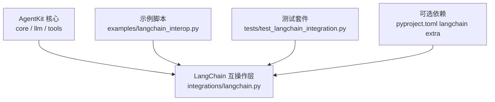
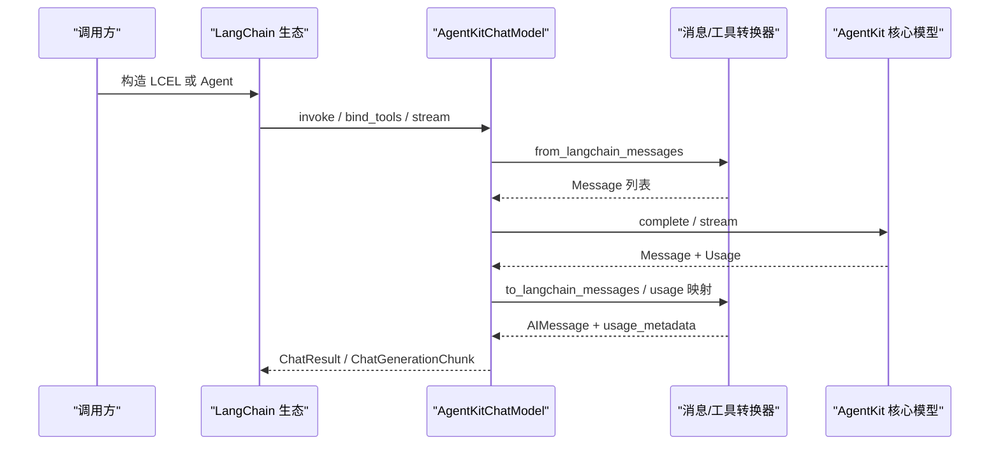
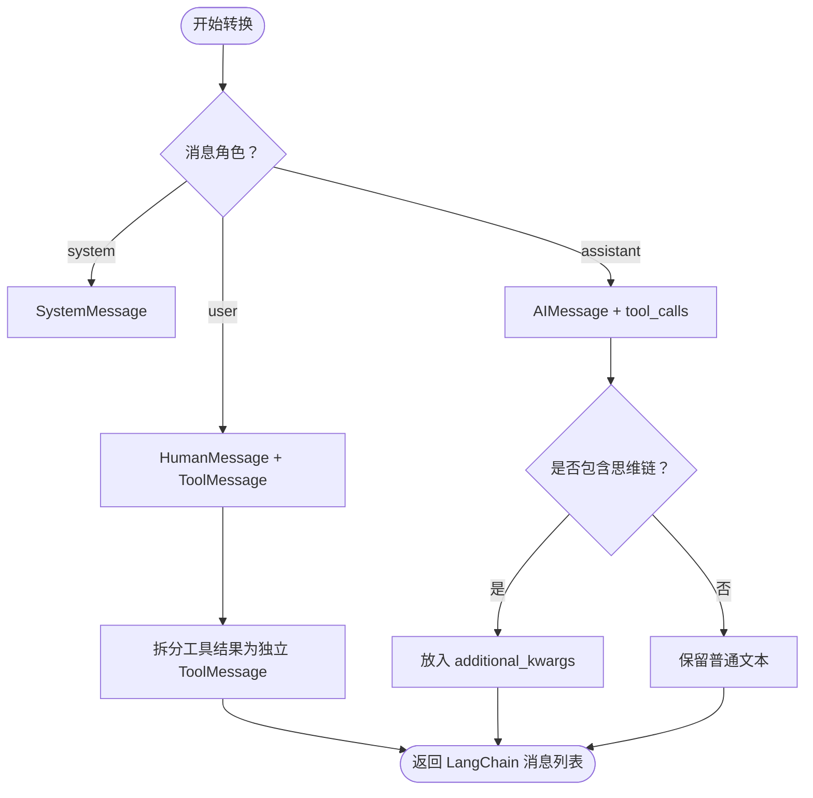
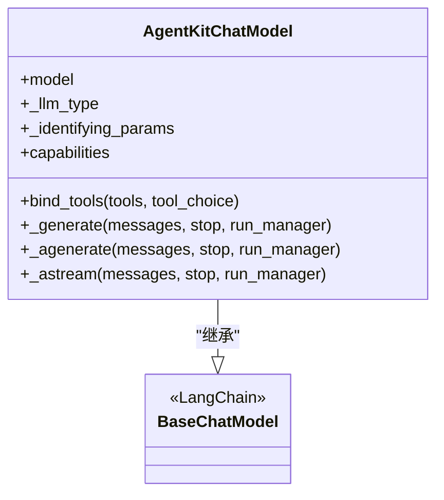
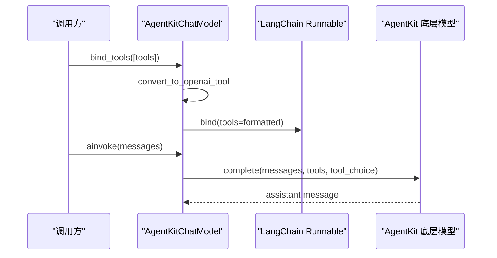
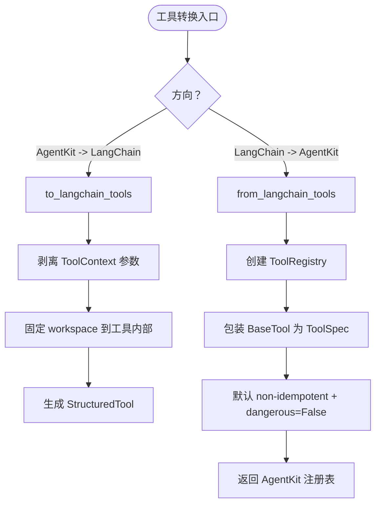
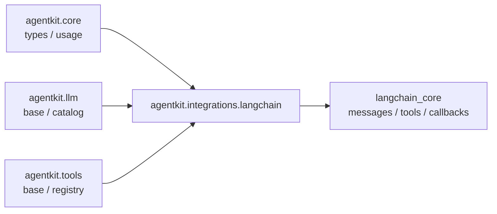

# LangChain 集成

<cite>
**本文引用的文件**   
- [pyproject.toml](file://pyproject.toml)
- [langchain.py](file://src/agentkit/integrations/langchain.py)
- [langchain_interop.py](file://examples/langchain_interop.py)
- [test_langchain_integration.py](file://tests/test_langchain_integration.py)
</cite>

## 目录
1. [引言](#引言)
2. [项目结构定位](#项目结构定位)
3. [核心组件总览](#核心组件总览)
4. [架构概览](#架构概览)
5. [详细组件分析](#详细组件分析)
6. [依赖关系分析](#依赖关系分析)
7. [性能与流式处理](#性能与流式处理)
8. [使用指南与最佳实践](#使用指南与最佳实践)
9. [故障排查](#故障排查)
10. [结论](#结论)

## 引言
本仓库提供了一个 AgentKit 框架，并额外实现了一个可选的 LangChain 互操作层。该互操作层的目标不是简单包装，而是把 AgentKit 的模型、工具、消息和用量统计与 LangChain 生态进行双向对齐：
- 把 AgentKit 的聊天模型暴露为 LangChain 的 `BaseChatModel`，从而进入 LCEL 管道、被 LangChain Agent 调用。
- 把 AgentKit 的工具注册表转成 LangChain 的 `StructuredTool`，同时支持把 LangChain 工具导入回 AgentKit 注册表。
- 在 AgentKit 的内容块消息与 LangChain 的消息之间做双向转换，重点处理工具调用、思维链、工具结果合并等结构性差异。
- 对用量统计做字段映射，保持“缓存是输入子集、推理是输出子集”的一致语义。

LangChain 是可选依赖；只有显式安装 `uv sync --extra langchain` 后，相关模块才会被引入。

**章节来源**
- [pyproject.toml:16-18](file://pyproject.toml#L16-L18)
- [langchain.py:1-39](file://src/agentkit/integrations/langchain.py#L1-L39)

## 项目结构定位
LangChain 集成位于 `src/agentkit/integrations/langchain.py`，示例脚本位于 `examples/langchain_interop.py`，测试位于 `tests/test_langchain_integration.py`。核心项目本身不依赖 LangChain，只在需要时通过可选依赖加载。

**图表来源**
- [pyproject.toml:16-18](file://pyproject.toml#L16-L18)
- [langchain.py:1-39](file://src/agentkit/integrations/langchain.py#L1-L39)
- [langchain_interop.py:1-35](file://examples/langchain_interop.py#L1-L35)
- [test_langchain_integration.py:1-40](file://tests/test_langchain_integration.py#L1-L40)

**章节来源**
- [pyproject.toml:1-18](file://pyproject.toml#L1-L18)
- [langchain.py:1-39](file://src/agentkit/integrations/langchain.py#L1-L39)

## 核心组件总览
LangChain 互操作层提供四个主要能力：

| 名称 | 作用 | 关键行为 |
|---|---|---|
| `AgentKitChatModel` | 把 AgentKit 的聊天模型包装成 LangChain 聊天模型 | 支持同步 `_generate`、异步 `_agenerate`、流式 `_astream`、工具绑定 `bind_tools` |
| `to_langchain_messages` | AgentKit 内容块消息 → LangChain 消息 | 工具结果拆成独立 `ToolMessage`，思维链放入 `additional_kwargs` |
| `from_langchain_messages` | LangChain 消息 → AgentKit 内容块消息 | 连续 `ToolMessage` 合并到一条 user 消息，恢复思维链 |
| `to_langchain_tools` / `from_langchain_tools` | 工具注册表双向转换 | 剥离注入的上下文参数，固定工作区路径，保守标记非幂等和非危险 |

这些函数共同构成“四个方向”的双向适配：
1. AgentKit 模型作为 LangChain 模型使用。
2. AgentKit 工具转为 LangChain 工具。
3. LangChain 工具导入 AgentKit 注册表。
4. 消息双向转换。

**章节来源**
- [langchain.py:6-39](file://src/agentkit/integrations/langchain.py#L6-L39)
- [langchain.py:78-84](file://src/agentkit/integrations/langchain.py#L78-L84)

## 架构概览
从调用视角看，LangChain 生态与 AgentKit 核心之间的交互分为三层：
- 外部调用方：LangChain 的 LCEL、Agent、回调系统。
- 适配层：`AgentKitChatModel` 及消息、工具转换函数。
- 内部核心：AgentKit 的 `Message`、`ToolSpec`、`ToolRegistry`、`Usage` 以及底层模型接口。

**图表来源**
- [langchain.py:209-364](file://src/agentkit/integrations/langchain.py#L209-L364)
- [langchain.py:93-188](file://src/agentkit/integrations/langchain.py#L93-L188)
- [langchain.py:400-441](file://src/agentkit/integrations/langchain.py#L400-L441)

**章节来源**
- [langchain.py:209-364](file://src/agentkit/integrations/langchain.py#L209-L364)

## 详细组件分析

### 消息双向转换
AgentKit 使用内容块消息模型，而 LangChain 使用角色化消息模型。两者在工具结果、思维链、content 结构上存在差异：

- 工具结果：AgentKit 中属于 user 消息的 content block；LangChain 中是独立的 `ToolMessage`。
- 思维链：AgentKit 有明确的 reasoning 概念；LangChain 没有原生 reasoning，适配层把它放进 `additional_kwargs["reasoning_content"]`。
- 反向转换：连续的 `ToolMessage` 必须合并成一条 user 消息，否则下一轮工具调用会因 tool_use 找不到配对 tool_result 而被拒绝。

**图表来源**
- [langchain.py:93-131](file://src/agentkit/integrations/langchain.py#L93-L131)
- [langchain.py:134-188](file://src/agentkit/integrations/langchain.py#L134-L188)

**章节来源**
- [langchain.py:93-131](file://src/agentkit/integrations/langchain.py#L93-L131)
- [langchain.py:134-188](file://src/agentkit/integrations/langchain.py#L134-L188)
- [test_langchain_integration.py:45-87](file://tests/test_langchain_integration.py#L45-L87)
- [test_langchain_integration.py:89-141](file://tests/test_langchain_integration.py#L89-L141)

### 聊天模型包装器
`AgentKitChatModel` 继承 LangChain 的 `BaseChatModel`，负责把 LangChain 的消息格式转换为 AgentKit 的内部消息，再调用底层模型的 `complete` 或 `stream`。

关键点：
- `_llm_type` 标识为 `agentkit`。
- `capabilities` 透传底层模型的模型能力。
- `bind_tools` 把工具统一转成 OpenAI 风格的 dict，并通过 `Runnable.bind` 挂到调用参数。
- 同步 `_generate` 要兼容“已在事件循环中”的场景，避免直接 `asyncio.run` 抛错。
- 异步 `_agenerate` 完成消息转换、工具 schema 提取、调用底层模型、构造 `ChatResult`。
- 流式 `_astream` 透传底层流式响应，并把思维链放入 chunk 的 `additional_kwargs`。

**图表来源**
- [langchain.py:209-364](file://src/agentkit/integrations/langchain.py#L209-L364)

**章节来源**
- [langchain.py:209-364](file://src/agentkit/integrations/langchain.py#L209-L364)
- [test_langchain_integration.py:178-218](file://tests/test_langchain_integration.py#L178-L218)

### 工具绑定与工具 schema 传递
`bind_tools` 的实现很薄：它不重新发明工具协议，而是把工具统一转成 OpenAI 风格的结构，然后交给 LangChain 的 `Runnable.bind`。真正重要的校验点是：绑定的工具 schema 必须能到达 AgentKit 的底层模型。

**图表来源**
- [langchain.py:245-267](file://src/agentkit/integrations/langchain.py#L245-L267)
- [langchain.py:303-331](file://src/agentkit/integrations/langchain.py#L303-L331)

**章节来源**
- [langchain.py:245-267](file://src/agentkit/integrations/langchain.py#L245-L267)
- [test_langchain_integration.py:220-253](file://tests/test_langchain_integration.py#L220-L253)

### 工具双向转换
工具转换有两个重要语义细节：

1. **AgentKit 工具的第一个参数是注入的 `ToolContext`**，模型看不到它。转成 LangChain 工具时必须剥离这个参数，并由转换时固定的 `workspace` 提供上下文来源。
2. **工作区路径在向外转换时被固定进工具内部**。往里转换时的 `workspace` 参数不能覆盖已经绑定的外层工作区，因此往返转换时要给两个方向传同一个值。

此外，从 LangChain 导入的工具默认标记为非幂等、非危险，这是安全策略：第三方工具的副作用不可信，不应假设幂等，也不应默认允许绕过审批。

**图表来源**
- [langchain.py:447-484](file://src/agentkit/integrations/langchain.py#L447-L484)
- [langchain.py:487-552](file://src/agentkit/integrations/langchain.py#L487-L552)

**章节来源**
- [langchain.py:447-484](file://src/agentkit/integrations/langchain.py#L447-L484)
- [langchain.py:487-552](file://src/agentkit/integrations/langchain.py#L487-L552)
- [test_langchain_integration.py:271-358](file://tests/test_langchain_integration.py#L271-L358)

### 用量统计映射
AgentKit 的 `Usage` 与 LangChain 的 `usage_metadata` 使用同一套“子集语义”，但字段名不同：
- 输入 token、输出 token、总 token。
- 缓存输入 token 映射到 `input_token_details.cache_read`。
- 推理 token 映射到 `output_token_details.reasoning`。

测试验证了这种映射是可逆且语义一致的。

**章节来源**
- [langchain.py:417-441](file://src/agentkit/integrations/langchain.py#L417-L441)
- [test_langchain_integration.py:395-411](file://tests/test_langchain_integration.py#L395-L411)

## 依赖关系分析
LangChain 集成层的设计强调“核心不依赖 LangChain”。只有在实际 import 该模块时，才引入 LangChain 相关类型。这样做的优点是：
- 核心包更小。
- 不需要 LangChain 的环境也能运行 AgentKit。
- 可选依赖清晰，用户按需安装。

**图表来源**
- [langchain.py:43-77](file://src/agentkit/integrations/langchain.py#L43-L77)
- [pyproject.toml:16-18](file://pyproject.toml#L16-L18)

**章节来源**
- [langchain.py:43-77](file://src/agentkit/integrations/langchain.py#L43-L77)
- [pyproject.toml:16-18](file://pyproject.toml#L16-L18)

## 性能与流式处理
适配层实现了真正的流式处理 `_astream`，而不是退化成“等完整响应后再一次性吐出”。这对用户体验很重要，尤其当底层模型本身就是流式时。

同步调用 `_generate` 做了特殊处理：如果调用方已经在事件循环中，不会直接 `asyncio.run`，而是用线程池执行异步协程，避免抛出难以理解的运行时错误。代价是一次线程切换，换来的是从任何调用环境都能使用。

**章节来源**
- [langchain.py:271-299](file://src/agentkit/integrations/langchain.py#L271-L299)
- [langchain.py:333-364](file://src/agentkit/integrations/langchain.py#L333-L364)
- [test_langchain_integration.py:196-218](file://tests/test_langchain_integration.py#L196-L218)

## 使用指南与最佳实践

### 安装方式
LangChain 是可选依赖，需要通过 extra 安装：
- 安装命令参考示例脚本注释中的说明。
- 安装后，才能 import `agentkit.integrations.langchain` 和相关示例。

**章节来源**
- [pyproject.toml:16-18](file://pyproject.toml#L16-L18)
- [langchain_interop.py:1-10](file://examples/langchain_interop.py#L1-L10)

### 把 AgentKit 模型当作 LangChain 模型使用
推荐流程：
1. 准备一个 AgentKit 模型实例。
2. 用 `AgentKitChatModel` 包装。
3. 把 AgentKit 工具注册表通过 `to_langchain_tools` 转成 LangChain 工具。
4. 使用 `bind_tools` 绑定工具，然后走 LangChain 的 `ainvoke`。
5. 如果需要多轮工具调用，执行工具后把结果封装为 `ToolMessage` 喂回模型。

示例脚本展示了这一完整流程，包括 LCEL 管道、消息双向转换、以及把 LangChain 工具导入 AgentKit。

**章节来源**
- [langchain_interop.py:37-114](file://examples/langchain_interop.py#L37-L114)
- [test_langchain_integration.py:364-393](file://tests/test_langchain_integration.py#L364-L393)

### 注意事项
- 思维链必须保留：`additional_kwargs["reasoning_content"]` 不能丢失，否则某些 provider 的多轮工具调用会失败。
- 工作区路径要一致：向外转换和向内转换时，如果希望工具访问相同目录，应传入相同的 `workspace`。
- 第三方工具默认不安全且不幂等：除非明确知道工具行为，不要随意设置 `dangerous=True` 或假设幂等。

**章节来源**
- [langchain.py:86-39](file://src/agentkit/integrations/langchain.py#L86-L39)
- [langchain.py:447-484](file://src/agentkit/integrations/langchain.py#L447-L484)
- [langchain.py:487-552](file://src/agentkit/integrations/langchain.py#L487-L552)
- [test_langchain_integration.py:304-358](file://tests/test_langchain_integration.py#L304-L358)

## 故障排查

| 现象 | 可能原因 | 建议处理 |
|---|---|---|
| 多轮工具调用时报错 | 思维链字段丢失 | 检查 `additional_kwargs["reasoning_content"]` 是否被保留 |
| 工具结果导致 API 拒绝 | 工具结果未合并或 tool_call_id 不匹配 | 确认 `from_langchain_messages` 已合并连续 `ToolMessage`，并保留 `tool_call_id` |
| 同步调用报错 | 在已有事件循环中调用了同步 API | 使用适配层的 `_generate`，它会在线程池中执行异步协程 |
| 工具执行路径不对 | 向外转换和内层转换使用了不同 `workspace` | 确保两个方向传入相同的工作区路径 |
| 第三方工具行为异常 | 工具默认非幂等、非危险 | 显式评估工具风险，必要时设置 `dangerous=True`，但不要盲目开启 |

**章节来源**
- [langchain.py:114-131](file://src/agentkit/integrations/langchain.py#L114-L131)
- [langchain.py:134-188](file://src/agentkit/integrations/langchain.py#L134-L188)
- [langchain.py:271-299](file://src/agentkit/integrations/langchain.py#L271-L299)
- [langchain.py:447-552](file://src/agentkit/integrations/langchain.py#L447-L552)
- [test_langchain_integration.py:97-123](file://tests/test_langchain_integration.py#L97-L123)
- [test_langchain_integration.py:333-358](file://tests/test_langchain_integration.py#L333-L358)

## 结论
LangChain 集成层是一个设计清晰的可选适配层。它没有污染核心依赖，也没有强行改变 AgentKit 的消息和工具抽象，而是通过消息转换、工具 schema 转换、用量映射和模型包装，让 AgentKit 能够自然融入 LangChain 生态。

对于使用者来说，最重要的三条原则是：
1. 保留思维链字段，避免 provider 多轮工具调用失败。
2. 工具转换时固定工作区，并确保往返转换使用一致路径。
3. 对第三方工具保持保守：默认非幂等、非危险，显式授权后才放开。

通过这些约束，AgentKit 既能保持自身抽象干净，又能获得 LangChain 生态的工具、管道和可观测性能力。