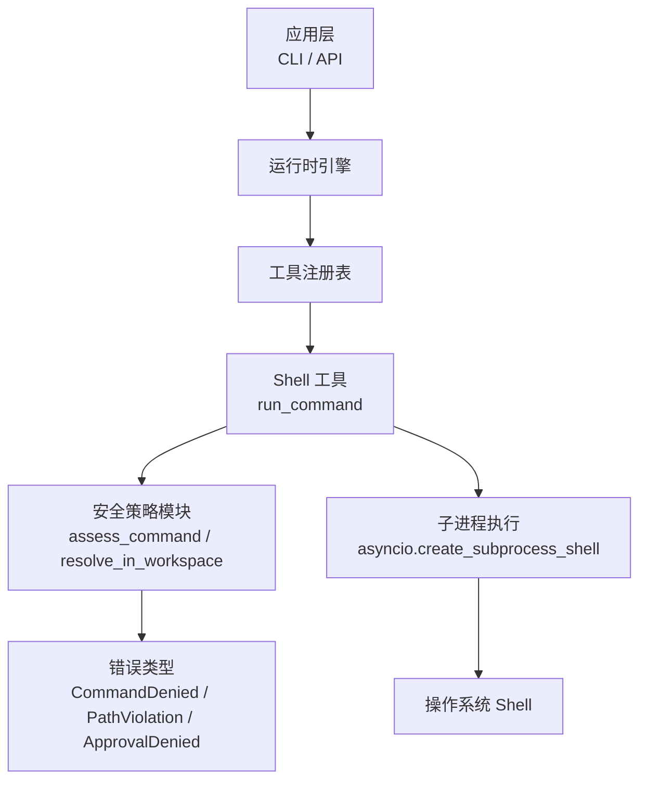
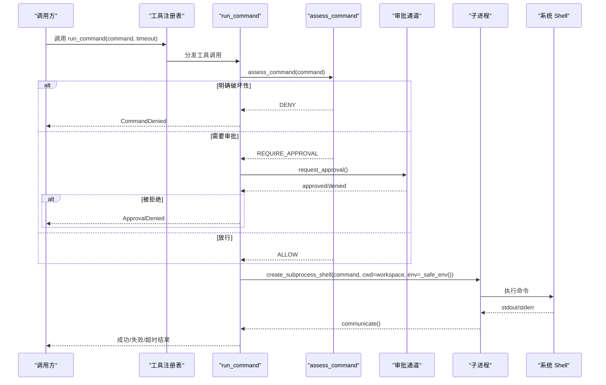
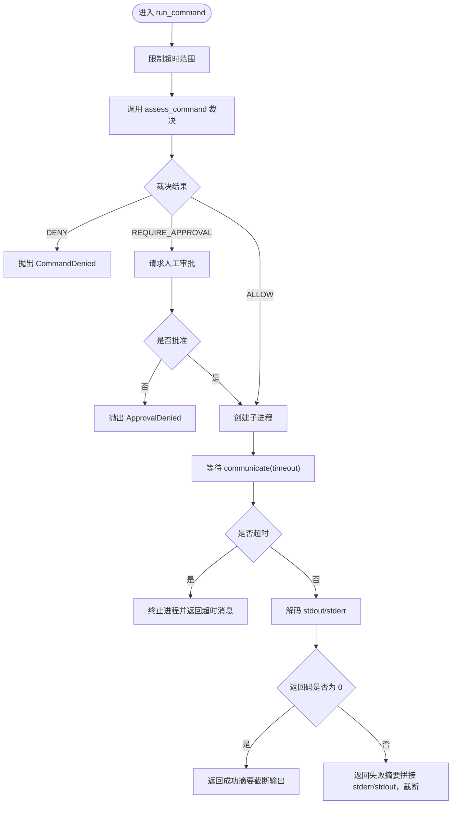
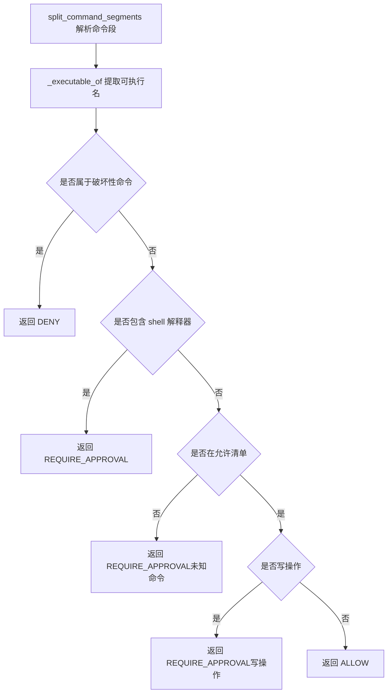
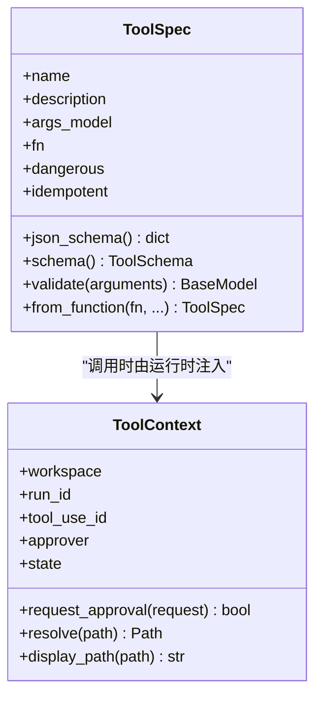
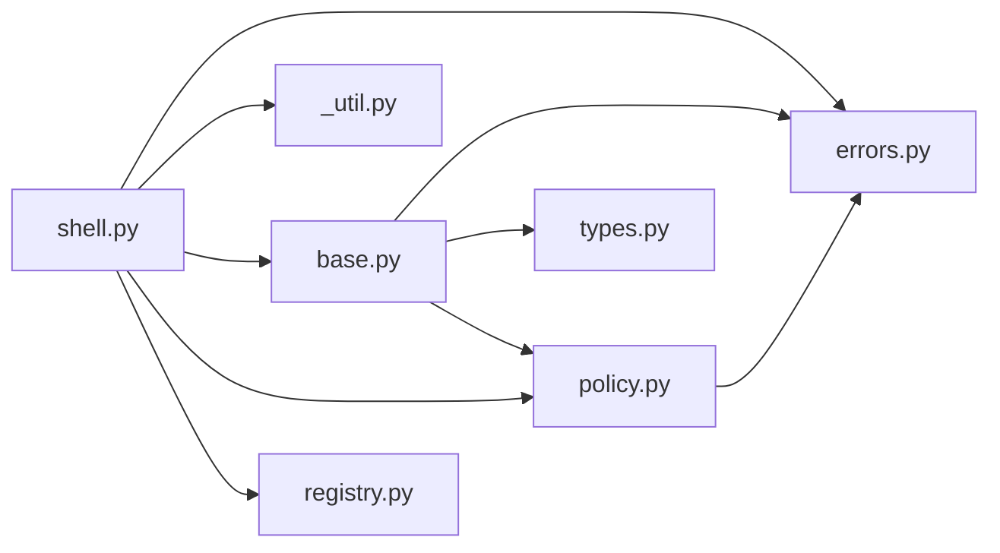

# Shell 工具

<cite>
**本文引用的文件**   
- [shell.py](file://src/agentkit/tools/builtin/shell.py)
- [policy.py](file://src/agentkit/tools/policy.py)
- [base.py](file://src/agentkit/tools/base.py)
- [errors.py](file://src/agentkit/core/errors.py)
- [__init__.py](file://src/agentkit/tools/builtin/__init__.py)
- [test_policy.py](file://tests/test_policy.py)
- [README.md](file://README.md)
</cite>

## 目录
1. [引言](#引言)
2. [项目结构](#项目结构)
3. [核心组件](#核心组件)
4. [架构总览](#架构总览)
5. [详细组件分析](#详细组件分析)
6. [依赖关系分析](#依赖关系分析)
7. [性能与资源限制](#性能与资源限制)
8. [故障排查指南](#故障排查指南)
9. [结论与安全最佳实践](#结论与安全最佳实践)
10. [附录：常用命令与配置示例](#附录常用命令与配置示例)

## 引言
本文聚焦 AgentKit 中“Shell 工具”的安全机制与命令执行环境，围绕以下目标展开：
- 命令白名单机制、危险命令过滤、路径验证
- 安全验证规则与三分裁决（拒绝 / 放行 / 转审批）
- 执行环境隔离策略（工作区目录、环境变量裁剪、子进程隔离）
- 参数解析、输出捕获、错误处理与超时控制
- 安全配置、常用命令用法、故障排查与安全最佳实践

该工具是工具集中风险最高的部分，因为“执行 shell 命令”本身天然存在注入面；因此设计重点不是试图用正则黑名单拦截所有危险写法，而是通过“执行前裁决 + 默认不信任 + 人工审批 + 容器级隔离”的组合来降低风险。

**章节来源**
- [README.md:1-26](file://README.md#L1-L26)

## 项目结构
Shell 工具相关代码主要分布在以下位置：
- 命令执行实现：`src/agentkit/tools/builtin/shell.py`
- 安全策略（路径边界、命令裁决、审批协议）：`src/agentkit/tools/policy.py`
- 工具上下文与参数模型生成：`src/agentkit/tools/base.py`
- 错误分类（含策略类错误）：`src/agentkit/core/errors.py`
- 内置工具注册入口：`src/agentkit/tools/builtin/__init__.py`
- 策略单元测试：`tests/test_policy.py`
- 项目说明与设计取舍：`README.md`

**图表来源**
- [shell.py:38-97](file://src/agentkit/tools/builtin/shell.py#L38-L97)
- [policy.py:94-119](file://src/agentkit/tools/policy.py#L94-L119)
- [policy.py:245-298](file://src/agentkit/tools/policy.py#L245-L298)
- [errors.py:91-105](file://src/agentkit/core/errors.py#L91-L105)

**章节来源**
- [shell.py:1-141](file://src/agentkit/tools/builtin/shell.py#L1-L141)
- [policy.py:1-305](file://src/agentkit/tools/policy.py#L1-L305)
- [base.py:40-76](file://src/agentkit/tools/base.py#L40-L76)
- [errors.py:69-105](file://src/agentkit/core/errors.py#L69-L105)
- [__init__.py:8-16](file://src/agentkit/tools/builtin/__init__.py#L8-L16)

## 核心组件
- Shell 命令执行函数：负责参数校验、安全裁决、子进程创建、超时终止、输出截断。
- 安全策略模块：提供路径边界检查、命令段拆分、可执行文件识别、允许清单与拒绝清单判断、写操作标记、管道到解释器的风险识别。
- 工具上下文：注入工作区路径、审批通道、调用标识等运行期信息。
- 错误体系：区分策略拒绝、路径越界、审批拒绝等语义化错误。

关键职责划分：
- `shell.py`：执行流程、超时控制、输出处理、环境变量裁剪。
- `policy.py`：安全规则、白名单/黑名单、路径校验、审批协议定义。
- `base.py`：工具参数 schema 生成、ToolContext 注入。
- `errors.py`：统一错误类型，便于上层重试与回灌。

**章节来源**
- [shell.py:32-97](file://src/agentkit/tools/builtin/shell.py#L32-L97)
- [policy.py:94-119](file://src/agentkit/tools/policy.py#L94-L119)
- [policy.py:143-178](file://src/agentkit/tools/policy.py#L143-L178)
- [policy.py:245-298](file://src/agentkit/tools/policy.py#L245-L298)
- [base.py:40-76](file://src/agentkit/tools/base.py#L40-L76)
- [errors.py:91-105](file://src/agentkit/core/errors.py#L91-L105)

## 架构总览
Shell 工具的调用链如下：
1. 运行时或 API 层调用工具注册表中的 `run_command`。
2. `run_command` 先对命令进行安全裁决：
   - 若为明确破坏性命令，直接拒绝。
   - 若包含 shell 解释器或未知命令，转人工审批。
   - 若为已知只读命令，直接放行。
   - 若为写操作命令，转人工审批。
3. 需要审批时，通过 `ToolContext.request_approval` 走审批通道；未配置审批通道则默认拒绝。
4. 审批通过后，使用 `asyncio.create_subprocess_shell` 在工作区目录下启动子进程，并传入裁剪后的环境变量。
5. 等待子进程完成，捕获 stdout/stderr，按返回码组装结果，并对输出做长度截断。
6. 超时则终止子进程并返回超时消息。

**图表来源**
- [shell.py:38-97](file://src/agentkit/tools/builtin/shell.py#L38-L97)
- [policy.py:245-298](file://src/agentkit/tools/policy.py#L245-L298)
- [base.py:57-66](file://src/agentkit/tools/base.py#L57-L66)

**章节来源**
- [shell.py:38-97](file://src/agentkit/tools/builtin/shell.py#L38-L97)
- [policy.py:245-298](file://src/agentkit/tools/policy.py#L245-L298)
- [base.py:57-66](file://src/agentkit/tools/base.py#L57-L66)

## 详细组件分析

### 命令执行流程：run_command
- 参数校验与超时约束：
  - 将超时限制在 `[1.0, MAX_TIMEOUT]` 范围内，避免过短或过长。
- 安全裁决：
  - 调用 `assess_command`，根据结果决定拒绝、审批或直接执行。
- 审批流程：
  - 构造 `ApprovalRequest`，通过 `ctx.request_approval` 请求审批。
  - 未配置审批通道时默认拒绝。
- 子进程执行：
  - 使用 `asyncio.create_subprocess_shell`，工作目录固定为 `ctx.workspace`。
  - 环境变量通过 `_safe_env()` 裁剪，避免凭据泄露。
- 输出处理：
  - 成功时返回带 exit code 的摘要，并截断输出。
  - 失败时拼接 stderr 与 stdout，并截断。
- 超时处理：
  - 捕获 `TimeoutError`，终止进程并返回超时消息。

**图表来源**
- [shell.py:38-97](file://src/agentkit/tools/builtin/shell.py#L38-L97)
- [shell.py:117-125](file://src/agentkit/tools/builtin/shell.py#L117-L125)

**章节来源**
- [shell.py:32-97](file://src/agentkit/tools/builtin/shell.py#L32-L97)
- [shell.py:117-125](file://src/agentkit/tools/builtin/shell.py#L117-L125)

### 安全策略：路径边界与命令裁决
- 路径边界：
  - 使用 `realpath` 解析符号链接与相对路径，再用 `commonpath` 判断是否在根工作区内。
  - 跨盘符或不在公共路径下时抛出 `PathViolation`。
- 命令裁决：
  - 将命令按 shell 操作符拆分为若干段，尊重引号。
  - 从每段提取实际可执行文件名，忽略环境变量赋值与前缀包装命令。
  - 明确破坏性命令直接拒绝。
  - 包含 shell 解释器（如 sh、bash、cmd、powershell）的命令一律转审批。
  - 不在允许清单且非写操作的未知命令转审批。
  - 写操作命令（rm、mv、cp、touch、mkdir 等）转审批。
  - 其余命令放行。

**图表来源**
- [policy.py:181-220](file://src/agentkit/tools/policy.py#L181-L220)
- [policy.py:223-242](file://src/agentkit/tools/policy.py#L223-L242)
- [policy.py:245-298](file://src/agentkit/tools/policy.py#L245-L298)

**章节来源**
- [policy.py:94-119](file://src/agentkit/tools/policy.py#L94-L119)
- [policy.py:143-178](file://src/agentkit/tools/policy.py#L143-L178)
- [policy.py:181-220](file://src/agentkit/tools/policy.py#L181-L220)
- [policy.py:223-242](file://src/agentkit/tools/policy.py#L223-L242)
- [policy.py:245-298](file://src/agentkit/tools/policy.py#L245-L298)

### 工具上下文与参数模型
- ToolContext：
  - 注入工作区路径、run_id、tool_use_id、审批通道、进程内共享状态。
  - `request_approval` 在未配置 approver 时默认拒绝。
  - `resolve` 基于 `resolve_in_workspace` 做路径边界校验。
- 参数模型生成：
  - 从异步函数签名自动生成 pydantic 模型，跳过第一个 ctx 参数。
  - 不支持可变参数，否则报错，防止 schema 与实现不一致。
  - 支持 `Annotated[T, "描述"]`，描述用于提示模型如何填写参数。

**图表来源**
- [base.py:40-76](file://src/agentkit/tools/base.py#L40-L76)
- [base.py:94-127](file://src/agentkit/tools/base.py#L94-L127)
- [base.py:130-214](file://src/agentkit/tools/base.py#L130-L214)

**章节来源**
- [base.py:40-76](file://src/agentkit/tools/base.py#L40-L76)
- [base.py:94-127](file://src/agentkit/tools/base.py#L94-L127)
- [base.py:130-214](file://src/agentkit/tools/base.py#L130-L214)

### 错误处理与分类
- 策略类错误：
  - `PathViolation`：路径越出工作区边界。
  - `CommandDenied`：命令被策略拒绝。
  - `ApprovalDenied`：需要审批的动作被拒绝或未配置审批通道。
- 工具执行错误：
  - `ToolExecutionError`：工具内部执行失败。
- 重试策略：
  - 仅当异常标记 `retryable=True` 时才考虑重试，避免无意义重试造成额外成本。

**章节来源**
- [errors.py:69-105](file://src/agentkit/core/errors.py#L69-L105)
- [errors.py:126-132](file://src/agentkit/core/errors.py#L126-L132)

## 依赖关系分析
- `shell.py` 依赖：
  - `core.errors`：`CommandDenied`、`ApprovalDenied`
  - `tools._util`：输出截断
  - `tools.base`：`ToolContext`
  - `tools.policy`：`ApprovalRequest`、`Verdict`、`assess_command`
  - `tools.registry`：工具注册
- `policy.py` 依赖：
  - `core.errors`：`CommandDenied`、`PathViolation`
- `base.py` 依赖：
  - `core.errors`：`ToolValidationError`
  - `core.types`：`ToolSchema`
  - `tools.policy`：`Approver`、`resolve_in_workspace`

**图表来源**
- [shell.py:18-28](file://src/agentkit/tools/builtin/shell.py#L18-L28)
- [policy.py:21-31](file://src/agentkit/tools/policy.py#L21-L31)
- [base.py:23-35](file://src/agentkit/tools/base.py#L23-L35)

**章节来源**
- [shell.py:18-28](file://src/agentkit/tools/builtin/shell.py#L18-L28)
- [policy.py:21-31](file://src/agentkit/tools/policy.py#L21-L31)
- [base.py:23-35](file://src/agentkit/tools/base.py#L23-L35)

## 性能与资源限制
- 超时控制：
  - 默认超时 60 秒，最大 600 秒，避免长时间占用资源。
  - 超时时主动终止子进程，并等待其退出。
- 输出截断：
  - 单条命令输出上限 10000 字符，避免大日志污染上下文。
- 环境变量裁剪：
  - 剥离敏感变量（API_KEY、TOKEN、SECRET、PASSWORD、CREDENTIAL），减少凭据泄露风险。
  - 设置 `PYTHONIOENCODING=utf-8`，保证编码一致性。
- 幂等性与副作用：
  - `run_command` 标记为 `dangerous=True`、`idempotent=False`，重放恢复时不能视为幂等。

**章节来源**
- [shell.py:32-35](file://src/agentkit/tools/builtin/shell.py#L32-L35)
- [shell.py:68-97](file://src/agentkit/tools/builtin/shell.py#L68-L97)
- [shell.py:100-114](file://src/agentkit/tools/builtin/shell.py#L100-L114)
- [shell.py:128-136](file://src/agentkit/tools/builtin/shell.py#L128-L136)

## 故障排查指南
常见问题与定位建议：
- 命令被拒绝：
  - 检查命令是否属于破坏性命令（如磁盘格式化、关机）。
  - 查看裁决原因，确认是否命中拒绝清单。
- 命令需要审批：
  - 检查是否包含 shell 解释器（sh、bash、cmd、powershell）。
  - 检查是否为写操作命令（rm、mv、cp、touch、mkdir）。
  - 检查是否为未知命令（不在允许清单）。
- 路径越界：
  - 检查路径是否解析后超出工作区根目录。
  - 注意符号链接与相对路径，确保最终真实路径仍在工作区内。
- 超时：
  - 调整超时时间，但注意不要超过最大限制。
  - 检查命令是否存在死循环或长时间 IO。
- 输出过大：
  - 输出会被截断，如需完整日志请导出到文件后再读取。
- 审批通道未配置：
  - 未配置 approver 时，需要审批的动作会默认拒绝。
  - 在非交互场景加 `--no-approve` 会直接拒绝所有需要审批的动作。

**章节来源**
- [policy.py:143-178](file://src/agentkit/tools/policy.py#L143-L178)
- [policy.py:245-298](file://src/agentkit/tools/policy.py#L245-L298)
- [shell.py:38-97](file://src/agentkit/tools/builtin/shell.py#L38-L97)
- [README.md:49-51](file://README.md#L49-L51)

## 结论与安全最佳实践
- 安全设计原则：
  - 默认不信任：看不明白的命令一律转审批。
  - 明确破坏性命令直接拒绝，不提供审批通道。
  - 写操作命令需人工确认。
  - 管道到 shell 解释器视为远程代码执行风险，必须审批。
- 执行环境隔离：
  - 子进程工作目录固定为工作区根目录。
  - 环境变量裁剪，避免凭据泄露。
  - 真正的隔离应依赖容器，本实现为纵深防御一层。
- 参数与输出：
  - 参数通过 pydantic 校验，错误信息指名字段，便于模型自我修正。
  - 输出截断，避免上下文爆炸。
- 最佳实践：
  - 尽量使用允许清单内的只读命令。
  - 写操作命令务必经过审批。
  - 避免在命令中拼接用户输入，必要时走审批通道。
  - 在生产环境中配合容器与权限最小化策略。

**章节来源**
- [README.md:21-25](file://README.md#L21-L25)
- [shell.py:3-14](file://src/agentkit/tools/builtin/shell.py#L3-L14)
- [policy.py:1-19](file://src/agentkit/tools/policy.py#L1-L19)

## 附录：常用命令与配置示例
- 常用只读命令（通常可直接放行）：
  - 文件查看：ls、dir、cat、type、head、tail、wc、file、stat、find、grep、rg、fd、tree、pwd、du、df
  - 文本处理：sort、uniq、cut、tr、sed、awk、diff、column
  - 开发工具：python、python3、py、pip、uv、pytest、ruff、mypy、node、npm、pnpm、yarn、make、just、git、gh
- 写操作命令（通常需要审批）：
  - mkdir、touch、cp、mv、rmdir、rm、del、tee
- 危险命令（直接拒绝）：
  - mkfs、mkfs.ext4、mkfs.xfs、diskpart、format、shutdown、reboot、halt、poweroff、fdisk、parted
- 配置建议：
  - 在允许清单中添加团队常用工具，减少不必要的审批。
  - 保持拒绝清单尽可能短，仅包含明确破坏性命令。
  - 在生产环境中启用容器隔离与最小权限原则。

**章节来源**
- [policy.py:143-178](file://src/agentkit/tools/policy.py#L143-L178)
- [test_policy.py:103-172](file://tests/test_policy.py#L103-L172)