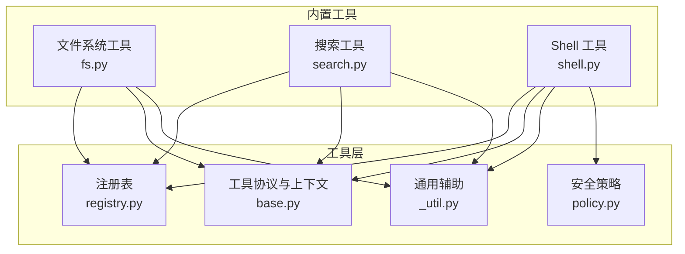
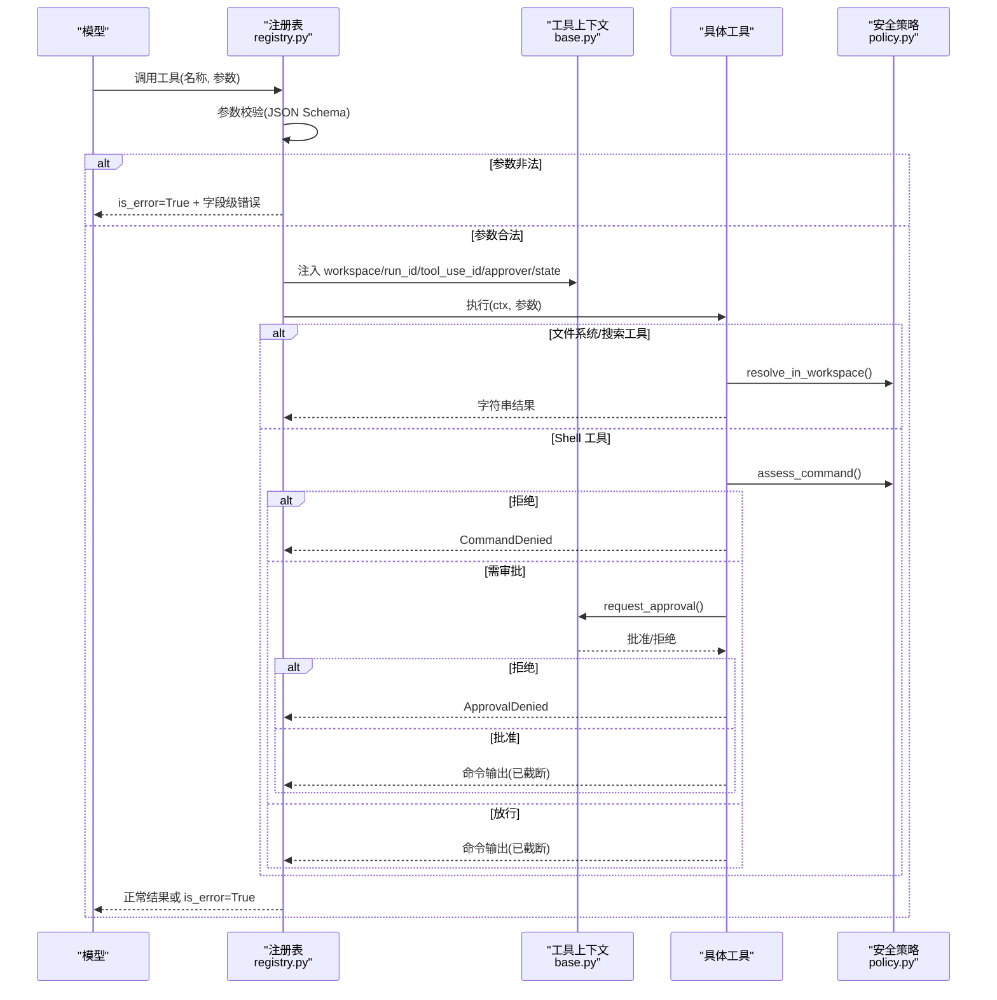
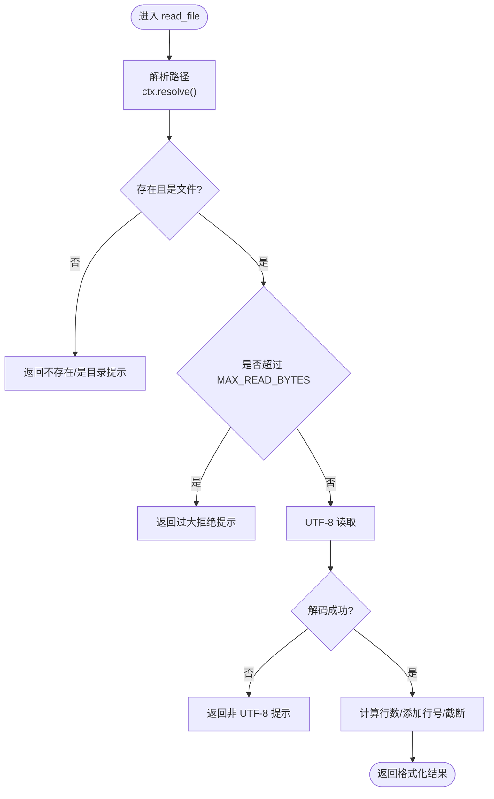
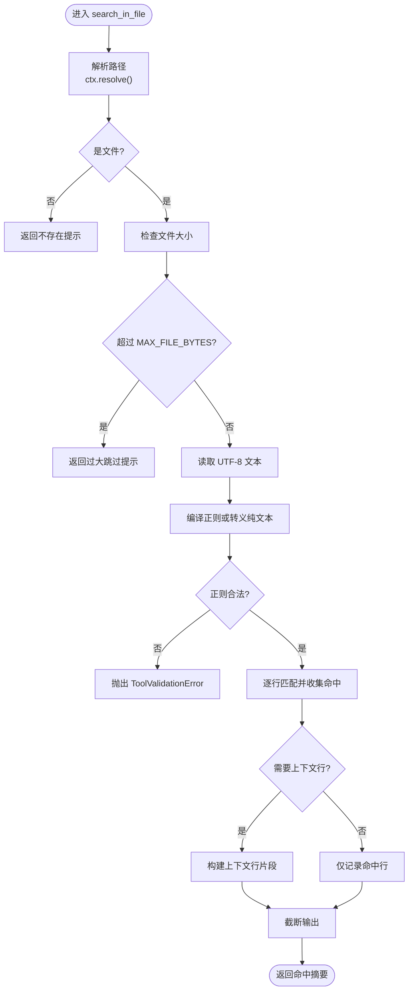
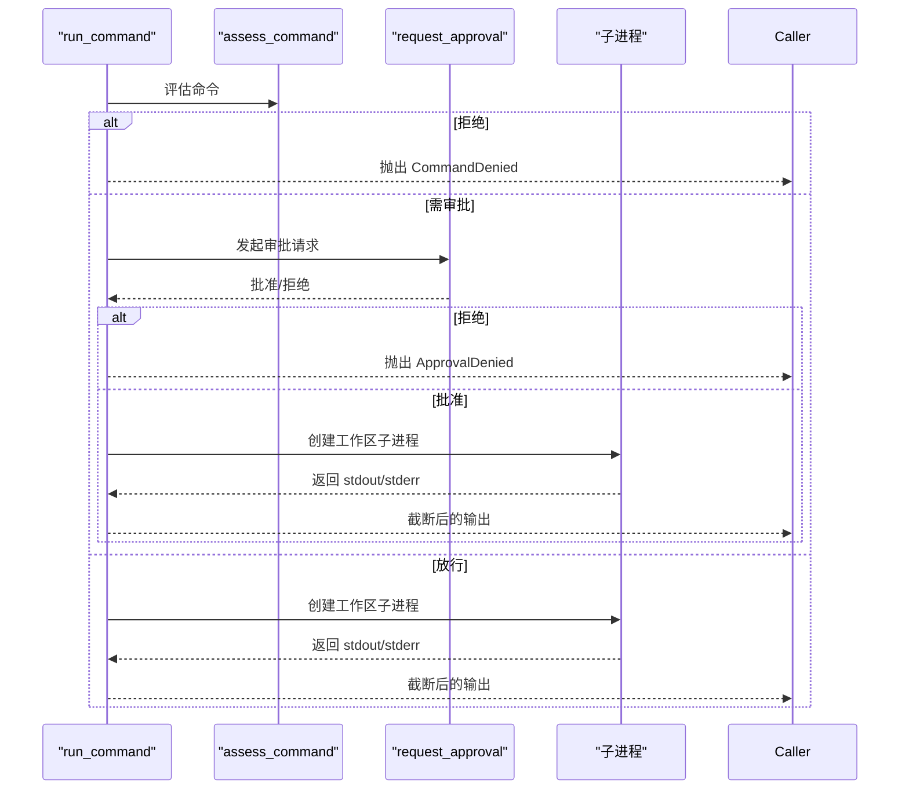
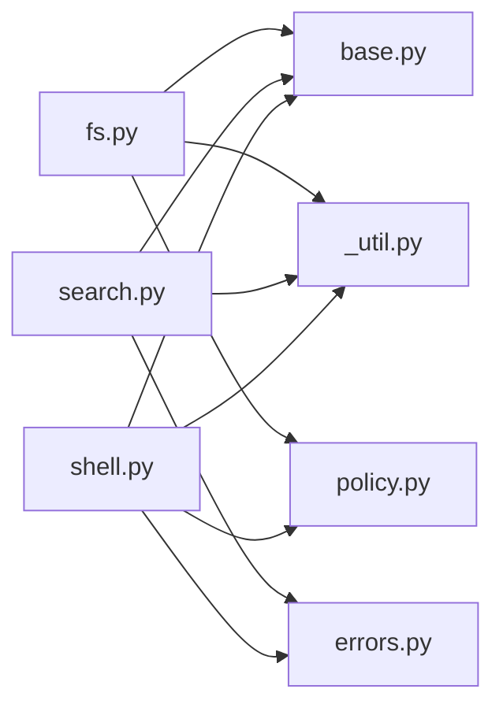

# 内置工具集

<cite>
**本文引用的文件**   
- [fs.py](file://src/agentkit/tools/builtin/fs.py)
- [search.py](file://src/agentkit/tools/builtin/search.py)
- [shell.py](file://src/agentkit/tools/builtin/shell.py)
- [base.py](file://src/agentkit/tools/base.py)
- [registry.py](file://src/agentkit/tools/registry.py)
- [_util.py](file://src/agentkit/tools/_util.py)
- [policy.py](file://src/agentkit/tools/policy.py)
- [errors.py](file://src/agentkit/core/errors.py)
- [README.md](file://README.md)
</cite>

## 目录
1. [引言](#引言)
2. [项目结构](#项目结构)
3. [核心组件](#核心组件)
4. [架构总览](#架构总览)
5. [详细组件分析](#详细组件分析)
6. [依赖关系分析](#依赖关系分析)
7. [性能与容量限制](#性能与容量限制)
8. [故障排查指南](#故障排查指南)
9. [结论](#结论)

## 引言
AgentKit 的内置工具集围绕“安全、可审计、对模型友好”的目标设计，提供三类常用能力：
- 文件系统工具：读取、写入、列出目录，附带路径边界校验与大文件保护。
- 搜索工具：单文件内容搜索与按模式查找文件，支持正则与纯文本匹配、上下文行展示、结果截断。
- Shell 工具：在工作区中执行命令，采用三分裁决（拒绝/放行/转审批）、环境变量裁剪、超时终止与输出过滤。

这些工具通过统一的注册表与参数校验机制暴露给模型，错误以“回灌”形式返回，让模型能自我修正调用方式。

**章节来源**
- [README.md:1-26](file://README.md#L1-L26)

## 项目结构
AgentKit 的工具层位于 `src/agentkit/tools`，其中 `builtin` 子包提供内置实现；`base` 定义工具协议与上下文；`registry` 负责注册与执行；`policy` 提供路径与命令安全策略；`_util` 提供通用辅助函数。

**图表来源**
- [registry.py:33-100](file://src/agentkit/tools/registry.py#L33-L100)
- [base.py:40-76](file://src/agentkit/tools/base.py#L40-L76)
- [policy.py:94-119](file://src/agentkit/tools/policy.py#L94-L119)
- [fs.py:128-137](file://src/agentkit/tools/builtin/fs.py#L128-L137)
- [search.py:142-145](file://src/agentkit/tools/builtin/search.py#L142-L145)
- [shell.py:128-136](file://src/agentkit/tools/builtin/shell.py#L128-L136)

**章节来源**
- [README.md:53-68](file://README.md#L53-L68)

## 核心组件
- 工具上下文 `ToolContext`：注入工作区根、运行 ID、工具调用 ID、审批通道与进程内共享状态；提供路径解析与显示路径方法。
- 工具规格 `ToolSpec`：从异步函数自动推导 JSON Schema，封装描述、参数模型、执行函数与副作用标记。
- 工具注册表 `ToolRegistry`：注册、查询、合并工具；统一执行入口 `invoke`，将异常转换为带 `is_error` 的结果块回灌给模型。
- 安全策略 `policy`：路径边界校验与命令三分裁决，提供审批请求/决策协议。
- 通用辅助 `_util`：输出截断、人类可读大小、行号格式化。

**章节来源**
- [base.py:40-76](file://src/agentkit/tools/base.py#L40-L76)
- [base.py:94-127](file://src/agentkit/tools/base.py#L94-L127)
- [base.py:130-213](file://src/agentkit/tools/base.py#L130-L213)
- [registry.py:33-100](file://src/agentkit/tools/registry.py#L33-L100)
- [registry.py:113-174](file://src/agentkit/tools/registry.py#L113-L174)
- [policy.py:49-88](file://src/agentkit/tools/policy.py#L49-L88)
- [policy.py:94-119](file://src/agentkit/tools/policy.py#L94-L119)
- [policy.py:245-298](file://src/agentkit/tools/policy.py#L245-L298)
- [_util.py:15-50](file://src/agentkit/tools/_util.py#L15-L50)

## 架构总览
下图展示了模型调用工具时的端到端流程：注册表负责参数校验与异常归一化；文件系统与搜索工具依赖路径解析与输出截断；Shell 工具在执行业务逻辑前进行命令裁决与环境隔离。

**图表来源**
- [registry.py:113-174](file://src/agentkit/tools/registry.py#L113-L174)
- [base.py:40-76](file://src/agentkit/tools/base.py#L40-L76)
- [policy.py:94-119](file://src/agentkit/tools/policy.py#L94-L119)
- [policy.py:245-298](file://src/agentkit/tools/policy.py#L245-L298)
- [shell.py:38-97](file://src/agentkit/tools/builtin/shell.py#L38-L97)

## 详细组件分析

### 文件系统工具
功能概览：
- 读取文件：UTF-8 解码、大文件上限、二进制检测、可选行号、头尾保留式截断。
- 写入文件：自动创建父目录、覆盖写入、换行符保留、写入统计。
- 列出目录：非递归/递归、跳过噪音目录、条目数上限、文件大小人类可读。

关键安全机制：
- 所有路径通过 `ctx.resolve()` 解析为工作区内真实路径，越界抛 `PathViolation`。
- 大文件读取上限 `MAX_READ_BYTES`，避免撑爆上下文。
- 递归列表时跳过 `.git`、`__pycache__`、`.venv`、`node_modules` 等目录。

使用示例（说明性）：
- 读取相对路径文件并带行号：适用于定位代码位置。
- 写入新文件或覆盖已有文件：适合生成配置或补丁。
- 列出当前目录或递归扫描：配合 `max_entries` 控制输出规模。

参数说明：
- `read_file(file_path, with_line_numbers)`
- `write_file(file_path, content)`
- `list_directory(path, recursive, max_entries)`

错误处理：
- 文件不存在、是目录、过大、非 UTF-8、系统 IO 错误均返回明确信息。
- 路径越界由注册表统一转为 `is_error=True` 的结果块。

性能建议：
- 优先用搜索工具定位片段，再按需读取小范围。
- 递归列出目录时谨慎开启，设置合理的 `max_entries`。

**图表来源**
- [fs.py:19-49](file://src/agentkit/tools/builtin/fs.py#L19-L49)
- [policy.py:94-119](file://src/agentkit/tools/policy.py#L94-L119)

**章节来源**
- [fs.py:19-49](file://src/agentkit/tools/builtin/fs.py#L19-L49)
- [fs.py:52-71](file://src/agentkit/tools/builtin/fs.py#L52-L71)
- [fs.py:74-125](file://src/agentkit/tools/builtin/fs.py#L74-L125)
- [fs.py:128-137](file://src/agentkit/tools/builtin/fs.py#L128-L137)
- [_util.py:15-50](file://src/agentkit/tools/_util.py#L15-L50)

### 搜索工具
功能概览：
- 单文件内容搜索：支持正则与纯文本匹配、忽略大小写、上下文行展示、命中数量与结果截断。
- 按模式查找文件：自定义起点目录、文件名或相对路径模式、自动跳过噪音目录、结果上限。

实现要点：
- 单文件搜索大小上限 `MAX_FILE_BYTES`，防止超大压缩资源卡死正则。
- 正则非法时抛出 `ToolValidationError`，走参数校验失败的回灌路径。
- 文件查找使用自实现的 `_safe_glob`，在目录层剪枝，避免遍历 `.venv`、`node_modules` 等。

使用示例（说明性）：
- 在指定文件中搜索关键字或正则表达式，并显示前后若干行上下文。
- 在项目根目录下查找符合模式的 Python 测试文件。

参数说明：
- `search_in_file(pattern, file_path, literal, context_lines, max_matches)`
- `find_files(pattern, path, max_results)`

错误处理：
- 文件不存在、过大、无法读取、正则非法均给出明确反馈。
- 未找到匹配时返回空结果提示。

性能建议：
- 先用 `find_files` 缩小范围，再用 `search_in_file` 精准定位。
- 合理设置 `context_lines` 与 `max_matches`，避免输出膨胀。

**图表来源**
- [search.py:25-88](file://src/agentkit/tools/builtin/search.py#L25-L88)
- [search.py:91-117](file://src/agentkit/tools/builtin/search.py#L91-L117)

**章节来源**
- [search.py:25-88](file://src/agentkit/tools/builtin/search.py#L25-L88)
- [search.py:91-117](file://src/agentkit/tools/builtin/search.py#L91-L117)
- [search.py:120-139](file://src/agentkit/tools/builtin/search.py#L120-L139)
- [search.py:142-145](file://src/agentkit/tools/builtin/search.py#L142-L145)

### Shell 工具
功能概览：
- 在工作区执行 shell 命令，返回 stdout/stderr 输出。
- 命令先经安全裁决：明确破坏性直接拒绝，未知命令转人工审批，允许清单内的只读命令放行。
- 执行环境隔离：限定工作区目录、裁剪敏感环境变量、保证编码行为一致。
- 超时保护：默认超时与最大超时限制，超时后终止进程。
- 输出过滤：stdout/stderr 统一 UTF-8 解码，超长输出截断。

安全措施详解：
- 命令白名单：`DEFAULT_ALLOWED_EXECUTABLES` 包含常见查看、开发、基础文件操作命令。
- 黑名单：`DENIED_EXECUTABLES` 包含磁盘格式化、关机、分区等高危命令。
- 管道到 shell 解释器：视为远程代码执行风险，一律转审批。
- 写操作命令：即便在白名单内，也要求审批。
- 环境变量裁剪：移除含 API_KEY/TOKEN/SECRET/PASSWORD/CREDENTIAL 等关键词的环境变量。

使用示例（说明性）：
- 列出当前目录文件、查看日志尾部、运行测试套件。
- 执行未知命令时触发审批流程，人工确认后执行。

参数说明：
- `run_command(command, timeout)`

错误处理：
- 命令被拒绝：抛出 `CommandDenied`。
- 审批被拒：抛出 `ApprovalDenied`。
- 启动失败、超时、非零退出码：返回结构化错误信息。

性能建议：
- 尽量使用允许清单内的只读命令组合完成分析任务。
- 合理设置 `timeout`，避免长时间阻塞。
- 关注输出截断阈值，必要时分步获取结果。

**图表来源**
- [shell.py:38-97](file://src/agentkit/tools/builtin/shell.py#L38-L97)
- [policy.py:245-298](file://src/agentkit/tools/policy.py#L245-L298)

**章节来源**
- [shell.py:38-97](file://src/agentkit/tools/builtin/shell.py#L38-L97)
- [shell.py:100-114](file://src/agentkit/tools/builtin/shell.py#L100-L114)
- [shell.py:117-125](file://src/agentkit/tools/builtin/shell.py#L117-L125)
- [shell.py:128-136](file://src/agentkit/tools/builtin/shell.py#L128-L136)
- [policy.py:143-176](file://src/agentkit/tools/policy.py#L143-L176)
- [policy.py:245-298](file://src/agentkit/tools/policy.py#L245-L298)

## 依赖关系分析
- 文件系统与搜索工具依赖：
  - `ToolContext` 提供工作区路径解析与显示路径。
  - `_util` 提供输出截断、人类可读大小、行号格式化。
  - `policy.resolve_in_workspace` 确保路径不越界。
- Shell 工具额外依赖：
  - `policy.assess_command` 进行命令三分裁决。
  - `ToolContext.request_approval` 接入审批通道。
  - `core.errors` 中的 `CommandDenied`、`ApprovalDenied` 等错误类型。

**图表来源**
- [fs.py:1-11](file://src/agentkit/tools/builtin/fs.py#L1-L11)
- [search.py:1-11](file://src/agentkit/tools/builtin/search.py#L1-L11)
- [shell.py:1-29](file://src/agentkit/tools/builtin/shell.py#L1-L29)
- [base.py:1-36](file://src/agentkit/tools/base.py#L1-L36)
- [_util.py:1-5](file://src/agentkit/tools/_util.py#L1-L5)
- [policy.py:1-31](file://src/agentkit/tools/policy.py#L1-L31)
- [errors.py:66-104](file://src/agentkit/core/errors.py#L66-L104)

**章节来源**
- [fs.py:1-11](file://src/agentkit/tools/builtin/fs.py#L1-L11)
- [search.py:1-11](file://src/agentkit/tools/builtin/search.py#L1-L11)
- [shell.py:1-29](file://src/agentkit/tools/builtin/shell.py#L1-L29)

## 性能与容量限制
- 文件读取上限：`MAX_READ_BYTES = 2MB`，超出则拒绝读取，建议使用搜索工具定位片段。
- 单文件搜索上限：`MAX_FILE_BYTES = 5MB`，避免超大压缩资源导致正则卡顿。
- 输出截断：默认 `DEFAULT_OUTPUT_LIMIT = 12000` 字符，保留头部与尾部，中间标注省略量。
- Shell 输出上限：`MAX_OUTPUT_CHARS = 10000`，避免编译日志等长输出塞满上下文。
- 目录列举上限：`max_entries` 控制单次输出条目数，递归扫描需谨慎。
- 超时保护：Shell 命令默认超时 60 秒，最大不超过 600 秒。

优化建议：
- 优先使用搜索工具缩小范围，再按需读取小片段。
- 合理设置 `context_lines`、`max_matches`、`max_results`、`max_entries`。
- 对 Shell 命令设置合适的 `timeout`，避免长时间阻塞。
- 利用 `with_line_numbers` 便于引用具体位置，但注意增加输出体积。

**章节来源**
- [fs.py:15-16](file://src/agentkit/tools/builtin/fs.py#L15-L16)
- [search.py:21-22](file://src/agentkit/tools/builtin/search.py#L21-L22)
- [_util.py:7-12](file://src/agentkit/tools/_util.py#L7-L12)
- [_util.py:15-32](file://src/agentkit/tools/_util.py#L15-L32)
- [shell.py:32-35](file://src/agentkit/tools/builtin/shell.py#L32-L35)

## 故障排查指南
常见问题与处理：
- 路径越界：
  - 现象：调用文件系统工具时报错或返回“路径不在工作区内”。
  - 原因：目标路径解析后不在工作区根下，可能涉及符号链接或跨盘符。
  - 处理：确认相对路径是否正确，避免使用绝对路径或上级目录跳转。
- 文件过大：
  - 现象：读取或搜索提示“文件过大”。
  - 原因：超过对应上限（读取 2MB，搜索 5MB）。
  - 处理：改用搜索工具定位片段，或分块处理。
- 正则非法：
  - 现象：搜索工具报“正则表达式不合法”。
  - 原因：传入的正则语法错误。
  - 处理：启用 `literal=true` 进行纯文本匹配，或修正正则语法。
- 命令被拒绝：
  - 现象：Shell 工具报“命令被拒绝”。
  - 原因：命令属于黑名单或包含 shell 解释器。
  - 处理：改用允许清单内的命令，或通过审批流程执行。
- 审批被拒：
  - 现象：Shell 工具报“命令未经批准”。
  - 原因：审批通道未开启或被人工拒绝。
  - 处理：调整命令使其落入允许清单，或在交互场景中获得批准。
- 输出过长：
  - 现象：结果被截断，出现“中间省略”提示。
  - 原因：超过默认输出限制。
  - 处理：分步获取结果，或使用更精确的搜索条件。

相关错误类型：
- `ToolValidationError`：参数不合法，模型可据此自我修正。
- `PathViolation`：路径越出工作区边界。
- `CommandDenied`：命令被策略拒绝。
- `ApprovalDenied`：需要人工审批的动作被拒绝或超时。

**章节来源**
- [errors.py:77-104](file://src/agentkit/core/errors.py#L77-L104)
- [registry.py:142-162](file://src/agentkit/tools/registry.py#L142-L162)
- [search.py:51-58](file://src/agentkit/tools/builtin/search.py#L51-L58)
- [shell.py:46-66](file://src/agentkit/tools/builtin/shell.py#L46-L66)

## 结论
AgentKit 的内置工具集以“安全优先、模型友好”为核心原则：
- 文件系统工具提供稳健的路径边界保护与大文件防护，结合行号与截断提升可用性。
- 搜索工具兼顾灵活性与性能，支持正则与纯文本匹配，并通过目录剪枝与结果上限控制开销。
- Shell 工具采用三分裁决、环境变量裁剪、超时终止与输出过滤，显著降低命令执行风险。
- 统一的注册表与参数校验机制确保错误可回灌、模型可自我修正。

在实际使用中，建议优先选择只读、允许清单内的命令与搜索工具，必要时通过审批流程执行写操作或未知命令，以获得最佳的安全性与可维护性。