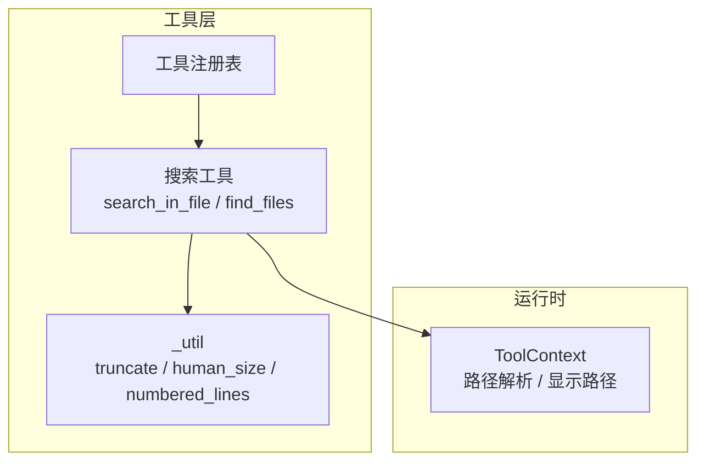
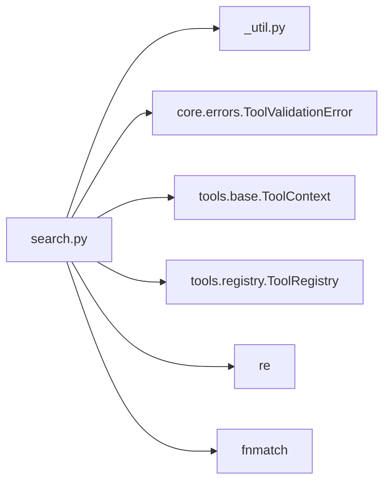

# 搜索工具

<cite>
**本文引用的文件**   
- [search.py](file://src/agentkit/tools/builtin/search.py)
- [_util.py](file://src/agentkit/tools/_util.py)
- [test_tools.py](file://tests/test_tools.py)
- [README.md](file://README.md)
</cite>

## 目录
1. [简介](#简介)
2. [项目结构中的搜索模块](#项目结构中的搜索模块)
3. [核心组件](#核心组件)
4. [架构总览](#架构总览)
5. [详细组件分析](#详细组件分析)
6. [依赖关系分析](#依赖关系分析)
7. [性能与可扩展性](#性能与可扩展性)
8. [故障排查指南](#故障排查指南)
9. [结论](#结论)
10. [附录：搜索语法与实践建议](#附录搜索语法与实践建议)

## 简介
本文件面向 AgentKit 的“搜索工具”，重点说明 `search_in_file` 的实现原理、功能特性与使用方式。该工具用于在单个文件中按模式搜索内容，支持正则表达式与纯文本匹配，可展示命中行及其上下文窗口，并对结果进行截断输出，避免把超大结果塞入模型上下文。

此外，搜索模块还提供 `find_files`，用于在工作区中按文件名模式递归查找文件，并自动跳过常见噪声目录（如 `.venv`、`node_modules`）。

## 项目结构中的搜索模块
搜索工具位于内置工具包下，通过工具注册表对外暴露。其关键位置如下：
- 实现文件：`src/agentkit/tools/builtin/search.py`
- 通用工具函数：`src/agentkit/tools/_util.py`
- 测试用例：`tests/test_tools.py`
- 项目整体说明：`README.md`

**图表来源**
- [search.py:1-146](file://src/agentkit/tools/builtin/search.py#L1-L146)
- [_util.py:1-51](file://src/agentkit/tools/_util.py#L1-L51)

**章节来源**
- [search.py:1-146](file://src/agentkit/tools/builtin/search.py#L1-L146)
- [_util.py:1-51](file://src/agentkit/tools/_util.py#L1-L51)
- [README.md:53-68](file://README.md#L53-L68)

## 核心组件
- `search_in_file`：在指定文件中按模式搜索，返回带行号的命中结果，可选上下文行展示。
- `find_files`：按文件名模式递归查找工作区中的文件，自动跳过噪声目录。
- `_safe_glob`：内部实现的递归 glob，控制遍历深度和剪枝策略。
- 辅助函数：`truncate`、`human_size`，分别负责超长结果截断和文件大小格式化。

**章节来源**
- [search.py:25-88](file://src/agentkit/tools/builtin/search.py#L25-L88)
- [search.py:91-139](file://src/agentkit/tools/builtin/search.py#L91-L139)
- [_util.py:15-42](file://src/agentkit/tools/_util.py#L15-L42)

## 架构总览
搜索工具的调用链路从工具注册表开始，经由 `ToolContext` 解析路径，再进入具体搜索逻辑。最终结果通过 `_util.truncate` 做长度限制，保证不会撑爆模型上下文。

**图表来源**
- [search.py:25-88](file://src/agentkit/tools/builtin/search.py#L25-L88)
- [_util.py:15-32](file://src/agentkit/tools/_util.py#L15-L32)

## 详细组件分析

### `search_in_file`：单文件内容搜索机制
`search_in_file` 是搜索工具的核心函数，负责以下流程：
1. 路径解析与存在性校验。
2. 文件大小上限检查，防止大文件导致内存或正则性能问题。
3. 以 UTF-8 编码读取文件内容。
4. 根据 `literal` 参数决定将 `pattern` 作为正则表达式还是纯文本。
5. 逐行扫描并使用正则匹配。
6. 可选地展示命中行上下文的若干行。
7. 统计命中总数，并按 `max_matches` 限制返回条数。
8. 对最终结果进行截断，避免过长输出。

**图表来源**
- [search.py:25-88](file://src/agentkit/tools/builtin/search.py#L25-L88)

#### 支持的搜索模式与匹配算法
- 默认模式：正则表达式，忽略大小写（`re.IGNORECASE`）。
- 字面量模式：当 `literal=true` 时，使用 `re.escape(pattern)` 将模式转为纯文本匹配，避免特殊字符被解释为正则元字符。
- 错误处理：若正则不合法，抛出 `ToolValidationError`，让上层走参数校验失败的回灌路径，便于模型自我修正。

#### 上下文窗口展示
- 当 `context_lines > 0` 时，每条命中的前后各展示若干行。
- 命中行用特殊标记区分，其他上下文行正常显示。
- 如果上下文范围超出文件末尾，会追加省略提示。

#### 结果排序与截断
- 命中顺序按文件行号顺序出现。
- `max_matches` 限制实际返回的命中条目数量；若命中总数大于返回条数且未开启上下文，会在头部提示“只显示前 N 处”。
- 最终结果通过 `truncate` 做头尾保留式截断，中间标注省略字符数，避免上下文溢出。

**章节来源**
- [search.py:25-88](file://src/agentkit/tools/builtin/search.py#L25-L88)
- [_util.py:15-32](file://src/agentkit/tools/_util.py#L15-L32)

### `find_files`：按文件名模式递归查找
`find_files` 基于内部 `_safe_glob` 实现，具有以下特点：
- 支持文件名或相对路径的模式匹配（例如 `*.py`、`src/**/test_*.py`）。
- 自动跳过噪声目录集合 `SKIP_DIRS`，避免遍历 `.venv`、`node_modules` 等目录。
- 使用栈式遍历，遇到权限或系统异常时跳过当前目录。
- 结果数量受 `max_results` 限制，并在头部提示可能不完整。

**图表来源**
- [search.py:91-139](file://src/agentkit/tools/builtin/search.py#L91-L139)

**章节来源**
- [search.py:91-139](file://src/agentkit/tools/builtin/search.py#L91-L139)

### 辅助函数与工具
- `truncate`：超长文本的头尾保留式截断，中间标注省略字符数。
- `human_size`：将字节数格式化为人类可读的单位（B/KB/MB/GB）。
- `numbered_lines`：为文本添加行号（搜索工具未直接使用，但属于同一工具库能力）。

**章节来源**
- [_util.py:15-50](file://src/agentkit/tools/_util.py#L15-L50)

## 依赖关系分析
搜索工具依赖以下组件：
- `ToolContext`：提供路径解析与显示路径的能力。
- `ToolValidationError`：用于参数非法时的错误回灌。
- `_util`：提供输出截断与单位转换。
- `fnmatch`：用于文件名模式匹配。
- `re`：用于正则表达式匹配。

**图表来源**
- [search.py:1-146](file://src/agentkit/tools/builtin/search.py#L1-L146)
- [_util.py:1-51](file://src/agentkit/tools/_util.py#L1-L51)

**章节来源**
- [search.py:1-146](file://src/agentkit/tools/builtin/search.py#L1-L146)
- [_util.py:1-51](file://src/agentkit/tools/_util.py#L1-L51)

## 性能与可扩展性
- 文件大小上限：单文件超过 `MAX_FILE_BYTES`（约 5 MB）直接跳过搜索，避免大文件导致的内存占用与正则性能问题。
- 逐行扫描：使用 `text.splitlines()` 后逐行匹配，减少一次性处理超大字符串的风险。
- 命中数量限制：`max_matches` 控制返回命中条目数量，避免结果膨胀。
- 输出截断：`truncate` 确保最终输出不超过默认字符上限，保护模型上下文。
- 噪声目录剪枝：`find_files` 通过 `SKIP_DIRS` 跳过常见噪声目录，显著降低递归遍历成本。

优化建议：
- 对于超大日志或二进制资源文件，优先使用系统级 `grep`（例如通过 `run_command`），而不是 Python 正则。
- 使用精确的正则表达式，避免回溯爆炸（例如避免嵌套量词、过度贪婪匹配）。
- 合理设置 `context_lines`，仅在需要上下文时启用，以减少输出体积。
- 使用 `literal=true` 搜索包含正则元字符的字面量字符串，避免误匹配与额外开销。

**章节来源**
- [search.py:21-22](file://src/agentkit/tools/builtin/search.py#L21-L22)
- [search.py:39-44](file://src/agentkit/tools/builtin/search.py#L39-L44)
- [search.py:60-88](file://src/agentkit/tools/builtin/search.py#L60-L88)
- [_util.py:7-12](file://src/agentkit/tools/_util.py#L7-L12)

## 故障排查指南
常见问题与定位方法：
- “文件不存在”：确认 `file_path` 是否相对于工作区正确，必要时先用 `list_directory` 查看目录结构。
- “文件过大，跳过搜索”：文件超过 5 MB，改用系统级 `grep` 或通过命令工具处理。
- “无法读取文件”：可能是编码非 UTF-8 或权限不足，先确认文件编码与访问权限。
- “正则表达式不合法”：检查 `pattern` 是否为合法正则；若本意是字面量匹配，请设置 `literal=true`。
- “没有命中”：确认模式是否正确、大小写是否敏感（默认忽略大小写）、目标文件是否确实包含匹配内容。

测试覆盖要点：
- 基本命中与命中计数。
- 字面量模式正确处理正则元字符。
- 非法正则返回错误并提示使用 `literal`。
- 文件查找模式匹配多个文件。

**章节来源**
- [search.py:36-58](file://src/agentkit/tools/builtin/search.py#L36-L58)
- [test_tools.py:253-286](file://tests/test_tools.py#L253-L286)

## 结论
搜索工具围绕 `search_in_file` 提供了稳定、可控的单文件内容搜索能力，结合 `find_files` 完成工作区文件发现。其设计强调：
- 安全性：路径边界由 `ToolContext` 管理，避免越界访问。
- 健壮性：对大文件、非法正则、读取异常进行明确处理。
- 性能：文件大小上限、命中数量限制、输出截断与噪声目录剪枝共同保障效率。
- 可用性：上下文窗口与行号展示帮助快速定位问题。

在实际使用中，建议优先选择精确的正则表达式，合理使用 `literal` 与 `context_lines`，并结合 `find_files` 缩小搜索范围，以获得最佳体验。

## 附录：搜索语法与实践建议

### 搜索语法示例
- 正则表达式（默认）：适用于灵活的模式匹配，如单词边界、分组、字符类、量词等。
- 字面量匹配（`literal=true`）：适用于包含正则元字符的固定字符串，如 `a.b`、`(error)`、`[path]`。
- 忽略大小写：默认启用，无需额外标志。

实践建议：
- 小片段精确匹配：优先使用 `literal=true`，避免误匹配与正则开销。
- 复杂模式：使用简洁的正则表达式，避免回溯爆炸。
- 大文件：优先使用系统级 `grep`，Python 正则不适合处理超大或二进制文件。
- 上下文展示：仅在调试或定位问题时启用 `context_lines`，减少输出体积。
- 命中数量：合理设置 `max_matches`，避免结果过多影响阅读与上下文占用。

**章节来源**
- [search.py:25-88](file://src/agentkit/tools/builtin/search.py#L25-L88)
- [test_tools.py:260-281](file://tests/test_tools.py#L260-L281)