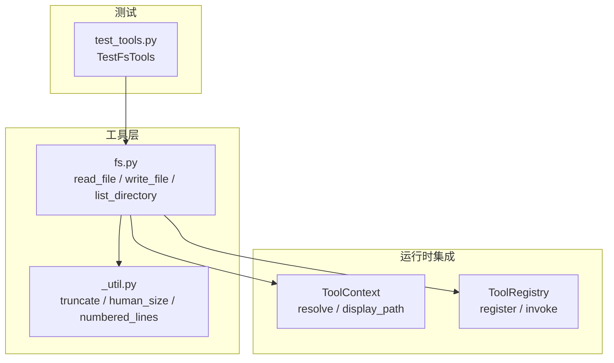
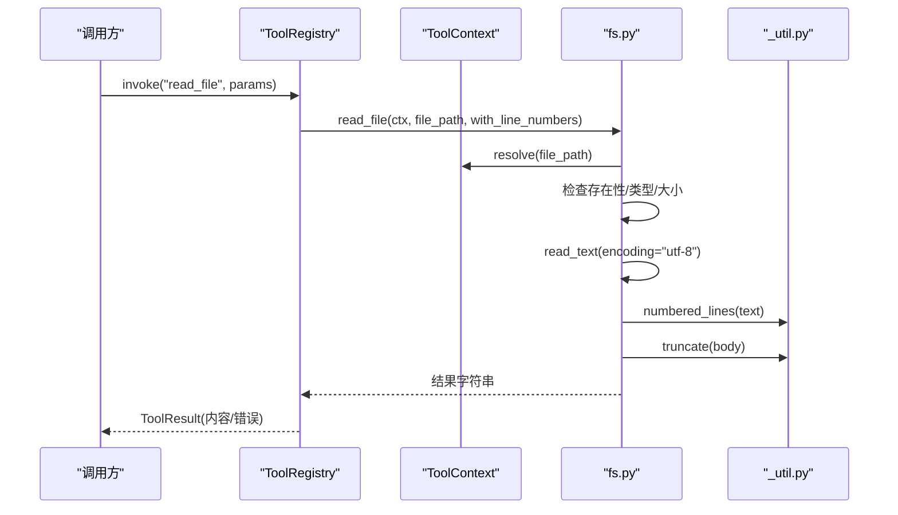
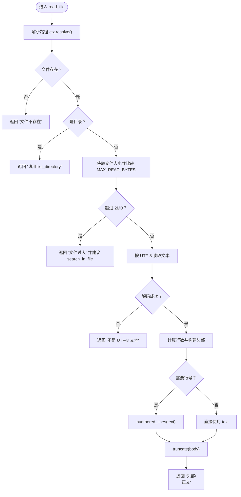
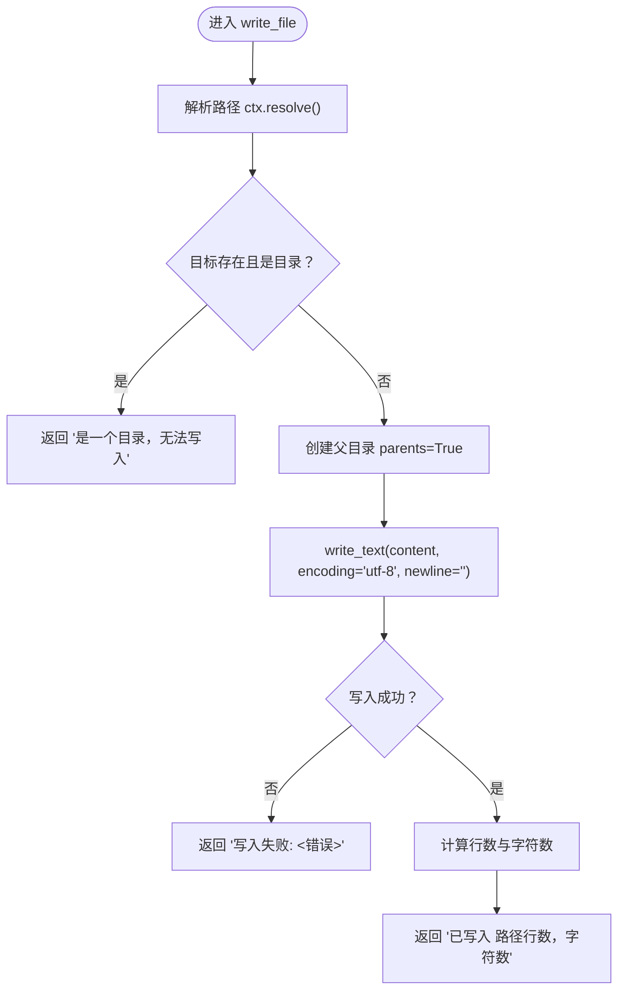
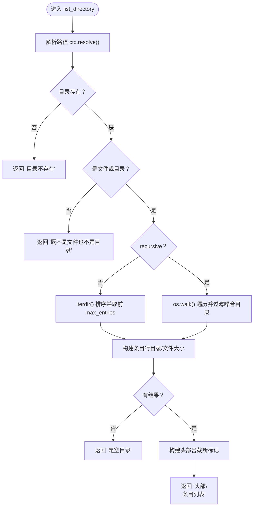
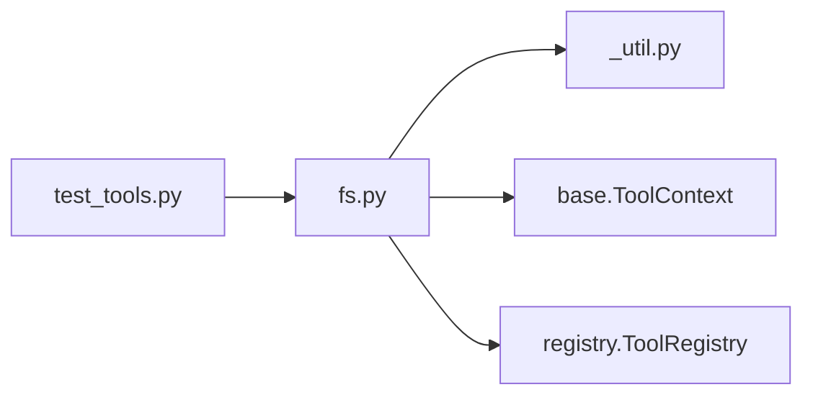

# 文件系统工具

<cite>
**本文引用的文件**   
- [fs.py](file://src/agentkit/tools/builtin/fs.py)
- [_util.py](file://src/agentkit/tools/_util.py)
- [test_tools.py](file://tests/test_tools.py)
- [README.md](file://README.md)
</cite>

## 目录
1. [简介](#简介)
2. [项目结构](#项目结构)
3. [核心组件](#核心组件)
4. [架构总览](#架构总览)
5. [详细组件分析](#详细组件分析)
6. [依赖关系分析](#依赖关系分析)
7. [性能考虑](#性能考虑)
8. [故障排查指南](#故障排查指南)
9. [结论](#结论)

## 简介
本文件面向 AgentKit 的“文件系统工具”实现，聚焦三个内置函数：
- read_file：读取工作区内的文本文件，支持行号、大小限制与 UTF-8 校验。
- write_file：覆盖写入文本文件，自动创建父目录，保留换行符并返回统计信息。
- list_directory：列出目录条目，支持递归遍历、噪音目录过滤、文件大小显示与结果截断。

这些工具通过工具注册表暴露给上层引擎，参数由类型注解描述，错误以可读字符串形式回灌给模型，而不是直接抛出异常中断运行。

**章节来源**
- [README.md:1-26](file://README.md#L1-L26)

## 项目结构
文件系统工具位于 `src/agentkit/tools/builtin/fs.py`，依赖工具层通用辅助函数 `_util.py`，并通过 `ToolContext` 和 `ToolRegistry` 与运行时集成。测试用例集中在 `tests/test_tools.py` 中。

**图表来源**
- [fs.py:1-138](file://src/agentkit/tools/builtin/fs.py#L1-L138)
- [_util.py:1-51](file://src/agentkit/tools/_util.py#L1-L51)
- [test_tools.py:206-252](file://tests/test_tools.py#L206-L252)

**章节来源**
- [fs.py:1-138](file://src/agentkit/tools/builtin/fs.py#L1-L138)
- [_util.py:1-51](file://src/agentkit/tools/_util.py#L1-L51)
- [test_tools.py:206-252](file://tests/test_tools.py#L206-L252)

## 核心组件
- read_file：路径解析 → 存在性与类型检查 → 大小上限检查 → UTF-8 解码 → 行号生成 → 输出截断。
- write_file：路径解析 → 目标为目录保护 → 自动创建父目录 → UTF-8 写入（保留换行）→ 统计行数与字符数。
- list_directory：路径解析 → 存在性与类型检查 → 非递归或递归遍历 → 噪音目录过滤 → 文件大小格式化 → 结果截断。

**章节来源**
- [fs.py:19-49](file://src/agentkit/tools/builtin/fs.py#L19-L49)
- [fs.py:52-71](file://src/agentkit/tools/builtin/fs.py#L52-L71)
- [fs.py:74-125](file://src/agentkit/tools/builtin/fs.py#L74-L125)

## 架构总览
文件系统工具在调用链中的位置如下：

**图表来源**
- [fs.py:19-49](file://src/agentkit/tools/builtin/fs.py#L19-L49)
- [_util.py:15-32](file://src/agentkit/tools/_util.py#L15-L32)
- [_util.py:45-50](file://src/agentkit/tools/_util.py#L45-L50)

## 详细组件分析

### read_file：文件读取机制
- 路径解析与安全边界
  - 使用 `ctx.resolve(file_path)` 将相对路径解析到工作区内；越界会触发路径违规，由注册表转为错误结果。
  - 若目标不存在，返回“文件不存在”提示；若目标是目录，提示改用 `list_directory`。
- 大小限制
  - 常量 `MAX_READ_BYTES = 2 * 1024 * 1024`（约 2MB），超过则拒绝读取并建议改用搜索定位片段。
- 编码处理
  - 使用 UTF-8 解码；遇到 `UnicodeDecodeError` 时返回“不是 UTF-8 文本（可能是二进制文件）”。
  - 其他 I/O 错误统一捕获为“读取失败: <具体错误>”。
- 行号显示
  - 默认开启行号，借助 `numbered_lines` 为每行添加对齐的行号，便于引用具体位置。
- 文本截断策略
  - 最终输出经 `truncate` 进行头尾保留式截断，默认上限 `DEFAULT_OUTPUT_LIMIT = 12_000` 字符；中间省略部分会明确标注省略字符数和原文总长度，避免上下文被大文件撑爆。
- 返回值
  - 包含文件路径、行数和人类可读大小的头部，以及可选行号化的正文与截断标记。

**图表来源**
- [fs.py:19-49](file://src/agentkit/tools/builtin/fs.py#L19-L49)
- [_util.py:15-32](file://src/agentkit/tools/_util.py#L15-L32)
- [_util.py:45-50](file://src/agentkit/tools/_util.py#L45-L50)

**章节来源**
- [fs.py:15-49](file://src/agentkit/tools/builtin/fs.py#L15-L49)
- [_util.py:7-32](file://src/agentkit/tools/_util.py#L7-L32)
- [_util.py:45-50](file://src/agentkit/tools/_util.py#L45-L50)
- [test_tools.py:207-222](file://tests/test_tools.py#L207-L222)

#### 参数说明
- file_path：相对于工作区的文件路径，例如 `README.md` 或 `src/app.py`。
- with_line_numbers：是否给每行加行号，默认 `True`。

#### 使用示例
- 读取当前工作区根下的 `hello.txt`，并带上行号。
- 读取 `src/app.py`，关闭行号以减少输出体积。

#### 错误处理场景
- 文件不存在：返回业务性失败消息，不中断运行。
- 目标是目录：提示改用 `list_directory`。
- 超出工作区：由注册表包装为错误结果，内容包含“越出工作区”。
- 文件过大：超过 2MB 拒绝读取。
- 非 UTF-8：提示可能为二进制文件。
- I/O 错误：返回“读取失败: <具体错误>”。

#### 安全考虑
- 所有路径必须通过 `ctx.resolve()` 解析，防止符号链接或相对路径逃逸工作区。
- 对超大文件和二进制文件进行防护，避免上下文被撑爆。

### write_file：写入逻辑
- 路径解析与目录保护
  - 使用 `ctx.resolve(file_path)` 解析路径；如果目标是已存在的目录，返回“无法写入”提示。
- 目录自动创建
  - 使用 `path.parent.mkdir(parents=True, exist_ok=True)` 自动创建缺失的父目录。
- 换行符处理
  - 使用 `newline=""` 写入，保留调用方传入的换行符，不做平台转换。
- 编码与错误处理
  - 使用 UTF-8 编码写入；I/O 错误统一捕获为“写入失败: <具体错误>”。
- 统计信息返回
  - 根据 `\n` 数量计算行数，并返回写入路径、行数和字符数。

**图表来源**
- [fs.py:52-71](file://src/agentkit/tools/builtin/fs.py#L52-L71)

**章节来源**
- [fs.py:52-71](file://src/agentkit/tools/builtin/fs.py#L52-L71)
- [test_tools.py:224-238](file://tests/test_tools.py#L224-L238)

#### 参数说明
- file_path：相对于工作区的文件路径；父目录不存在时会自动创建。
- content：要写入的完整内容；会覆盖文件原有内容。

#### 使用示例
- 写入 `new/out.txt`，内容为多行文本。
- 覆盖已有文件，确保换行符原样保留。

#### 错误处理场景
- 目标是目录：返回“是一个目录，无法写入”。
- 越出工作区：由注册表包装为错误结果，内容包含“越出工作区”。
- I/O 错误：返回“写入失败: <具体错误>”。

#### 安全考虑
- 路径必须在工作区内；写操作标记为 `dangerous=True`，可参与审批流程。
- 幂等标记 `idempotent=True`，便于幂等键生成与重试控制。

### list_directory：目录遍历算法
- 路径解析与类型检查
  - 使用 `ctx.resolve(path)` 解析路径；若不存在或既不是文件也不是目录，返回相应提示。
- 非递归模式
  - 使用 `directory.iterdir()` 排序后枚举，最多取 `max_entries` 项；目录显示为 `[目录] name/`，文件显示名称与人类可读大小。
- 递归模式
  - 使用 `os.walk(directory)` 遍历子树；过滤噪音目录 `.git`、`__pycache__`、`.venv`、`node_modules`；对每个文件显示相对路径与大小。
- 结果截断机制
  - 当条目数超过 `max_entries`（默认 200）时，设置 `truncated = True`，并在头部附加“（已截断）”提示。
- 空目录处理
  - 若无任何条目，返回“是空目录”。

**图表来源**
- [fs.py:74-125](file://src/agentkit/tools/builtin/fs.py#L74-L125)

**章节来源**
- [fs.py:74-125](file://src/agentkit/tools/builtin/fs.py#L74-L125)
- [test_tools.py:240-251](file://tests/test_tools.py#L240-L251)

#### 参数说明
- path：目录路径，相对于工作区；默认 `"."`。
- recursive：是否递归列出子目录；大目录慎用，默认 `False`。
- max_entries：最多列出多少个条目；默认 `200`。

#### 使用示例
- 列出当前目录的文件与子目录。
- 递归列出，但注意大目录可能导致大量输出；可通过 `max_entries` 控制。

#### 错误处理场景
- 目录不存在：返回“目录不存在”。
- 目标既不是文件也不是目录：返回相应提示。
- 噪音目录：递归模式下自动跳过 `.git`、`__pycache__`、`.venv`、`node_modules`。

#### 安全考虑
- 路径必须在工作区内；递归遍历需警惕大目录导致输出膨胀。
- 结果截断避免上下文被过多条目撑满。

## 依赖关系分析
- fs.py 依赖：
  - `_util.py`：提供 `human_size`、`numbered_lines`、`truncate`。
  - `base.ToolContext`：提供 `resolve`、`display_path`。
  - `registry.ToolRegistry`：用于工具注册。
- 测试依赖：
  - `tests/test_tools.py` 验证读、写、列目录行为，包括越界保护、噪音目录过滤等。

**图表来源**
- [fs.py:1-12](file://src/agentkit/tools/builtin/fs.py#L1-L12)
- [_util.py:1-5](file://src/agentkit/tools/_util.py#L1-L5)
- [test_tools.py:206-252](file://tests/test_tools.py#L206-L252)

**章节来源**
- [fs.py:1-12](file://src/agentkit/tools/builtin/fs.py#L1-L12)
- [_util.py:1-5](file://src/agentkit/tools/_util.py#L1-L5)
- [test_tools.py:206-252](file://tests/test_tools.py#L206-L252)

## 性能考虑
- 读取限制
  - `MAX_READ_BYTES = 2MB`，避免加载超大文件占用上下文。
- 输出截断
  - `DEFAULT_OUTPUT_LIMIT = 12,000` 字符，采用头尾保留式截断，减少中间冗余。
- 行号生成
  - `numbered_lines` 基于 `splitlines` 与计数，时间复杂度线性于文本长度。
- 目录遍历
  - 非递归模式使用 `iterdir()` 排序；递归模式使用 `os.walk()`，并对噪音目录进行过滤，降低无关输出。
- 文件大小显示
  - `human_size` 将字节转换为 B/KB/MB/GB，时间复杂度常数级。

[本节为一般性指导，不直接分析具体代码行]

## 故障排查指南
- “越出工作区”
  - 原因：路径解析后不在工作区内。
  - 处理：检查相对路径是否正确，避免 `../` 逃逸。
- “文件不存在”
  - 原因：目标路径无对应文件。
  - 处理：确认文件名与工作区路径。
- “是一个目录，无法写入”
  - 原因：目标是目录而非文件。
  - 处理：修正路径为具体文件。
- “不是 UTF-8 文本”
  - 原因：文件编码非 UTF-8（常见于二进制）。
  - 处理：改用二进制工具或先转码。
- “文件过大”
  - 原因：超过 2MB。
  - 处理：使用 `search_in_file` 定位所需片段。
- “写入失败”
  - 原因：权限不足、磁盘空间不足或路径非法。
  - 处理：检查系统权限与磁盘状态。
- “目录不存在”
  - 原因：目标目录不存在。
  - 处理：先创建目录或使用绝对路径。

**章节来源**
- [fs.py:25-49](file://src/agentkit/tools/builtin/fs.py#L25-L49)
- [fs.py:58-71](file://src/agentkit/tools/builtin/fs.py#L58-L71)
- [fs.py:81-125](file://src/agentkit/tools/builtin/fs.py#L81-L125)
- [test_tools.py:212-238](file://tests/test_tools.py#L212-L238)

## 结论
文件系统工具围绕安全、可控与可观测三大原则设计：
- 安全：路径强制解析到工作区，越界即拒；写操作标记危险并可审批。
- 可控：大小限制、输出截断、噪音目录过滤，避免上下文爆炸。
- 可观测：返回结构化的人类可读结果，便于模型自我修正与调试。

通过 `read_file`、`write_file`、`list_directory` 的组合，Agent 可以安全地浏览、检索与编辑工作区内的文本资源，同时保持对上下文大小与系统资源的严格控制。