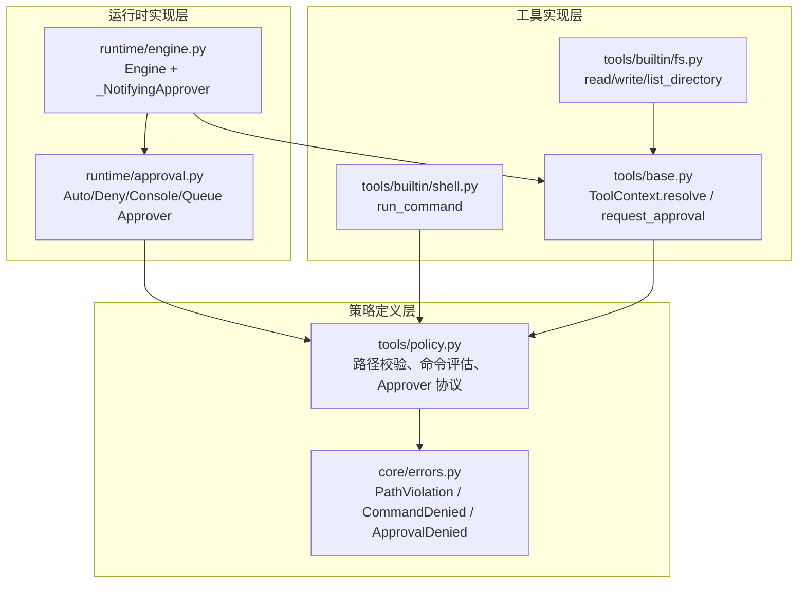
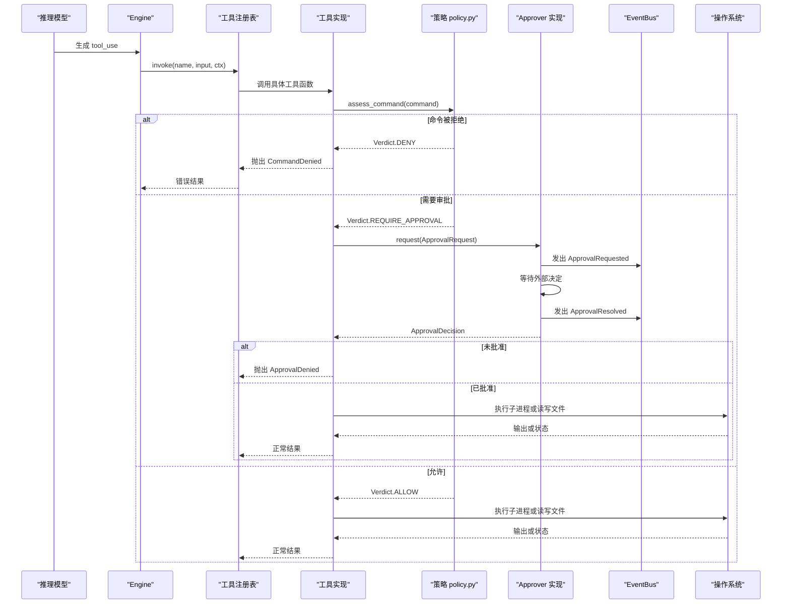
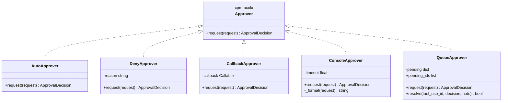
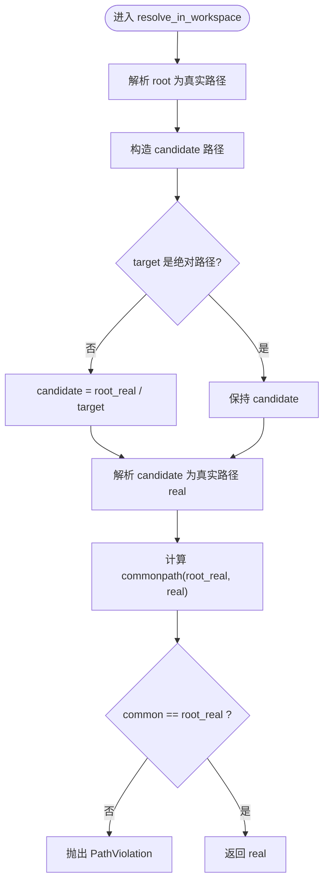
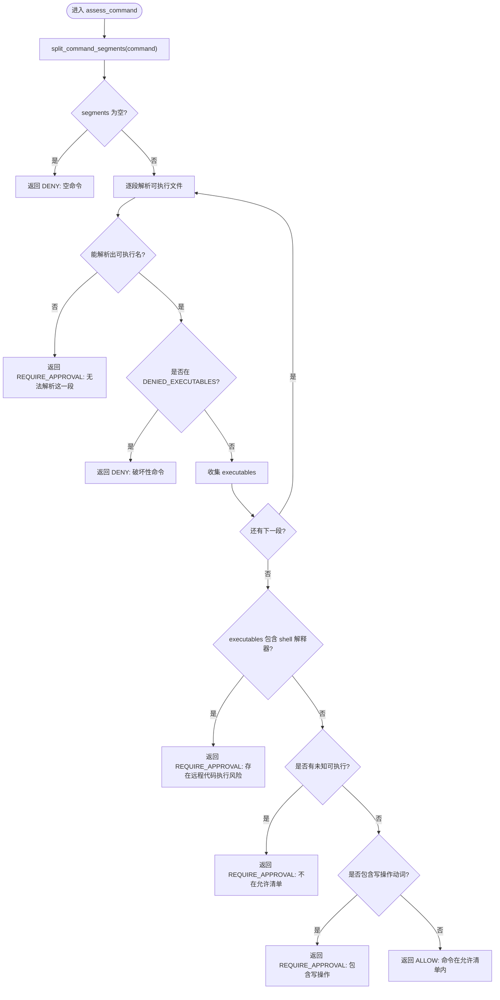
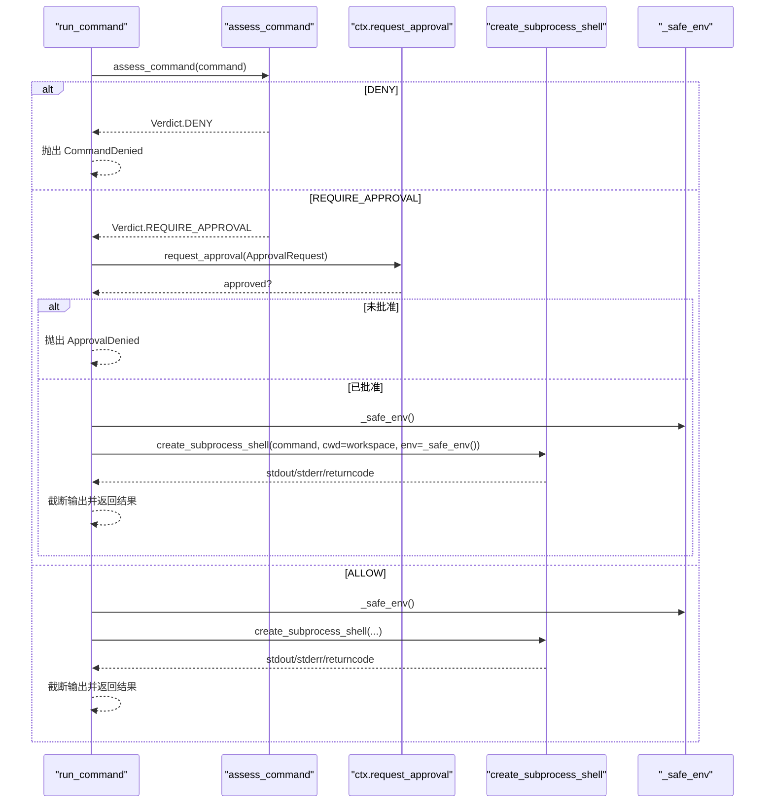
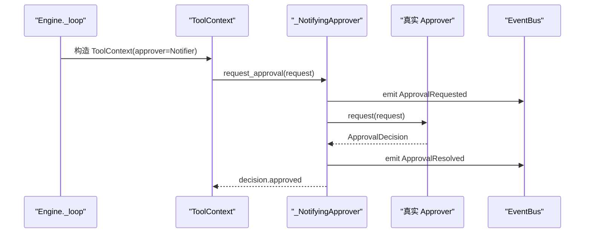
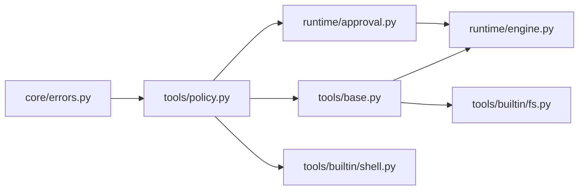

# 安全策略与审批机制

<cite>
**本文引用的文件**   
- [policy.py](file://src/agentkit/tools/policy.py)
- [approval.py](file://src/agentkit/runtime/approval.py)
- [base.py](file://src/agentkit/tools/base.py)
- [shell.py](file://src/agentkit/tools/builtin/shell.py)
- [fs.py](file://src/agentkit/tools/builtin/fs.py)
- [engine.py](file://src/agentkit/runtime/engine.py)
- [errors.py](file://src/agentkit/core/errors.py)
- [test_policy.py](file://tests/test_policy.py)
</cite>

## 目录
1. [引言](#引言)
2. [项目结构与安全边界](#项目结构与安全边界)
3. [核心组件总览](#核心组件总览)
4. [架构概览](#架构概览)
5. [详细组件分析](#详细组件分析)
6. [依赖关系分析](#依赖关系分析)
7. [性能与可观测性](#性能与可观测性)
8. [故障排查指南](#故障排查指南)
9. [结论](#结论)
10. [附录：自定义安全策略开发指南](#附录自定义安全策略开发指南)

## 引言
本文件聚焦工具系统的安全策略框架与审批机制，目标是帮助开发者理解并扩展以下能力：
- Approver 接口的设计理念、实现要求与默认行为。
- 三分裁决（拒绝 / 放行 / 转审批）的命令评估流程。
- 路径安全验证机制，包括工作区边界检查、符号链接防护、路径遍历攻击防护。
- Shell 命令白名单过滤与执行环境隔离。
- 如何基于现有协议开发自定义安全策略，包括权限模型设计、审计日志记录与安全事件监控的最佳实践。

该机制的核心思想是“默认不信任”：看不明白的路径和命令一律保守处理；明确破坏性的操作直接拒绝；其余需要人工或外部系统确认后再执行。

## 项目结构与安全边界
安全相关代码分布在三个层次：
- 策略定义层：`tools/policy.py` 定义路径校验、命令评估、审批协议与数据结构。
- 运行时实现层：`runtime/approval.py` 提供多种 Approver 实现；`runtime/engine.py` 把审批事件接入引擎。
- 工具实现层：`tools/builtin/shell.py` 与 `tools/builtin/fs.py` 在调用实际系统资源前走策略校验。

**图表来源**
- [policy.py:46-119](file://src/agentkit/tools/policy.py#L46-L119)
- [approval.py:35-167](file://src/agentkit/runtime/approval.py#L35-L167)
- [engine.py:96-124](file://src/agentkit/runtime/engine.py#L96-L124)
- [shell.py:38-97](file://src/agentkit/tools/builtin/shell.py#L38-L97)
- [fs.py:19-71](file://src/agentkit/tools/builtin/fs.py#L19-L71)
- [base.py:40-74](file://src/agentkit/tools/base.py#L40-L74)
- [errors.py:91-104](file://src/agentkit/core/errors.py#L91-L104)

**章节来源**
- [policy.py:1-44](file://src/agentkit/tools/policy.py#L1-L44)
- [approval.py:1-33](file://src/agentkit/runtime/approval.py#L1-L33)
- [engine.py:1-16](file://src/agentkit/runtime/engine.py#L1-L16)

## 核心组件总览
- **Approver 协议**：定义异步审批接口，让工具层只依赖协议而不依赖运行时实现。
- **ApprovalRequest / ApprovalDecision**：描述待审批动作与审批结果。
- **resolve_in_workspace**：工作区路径解析与越界保护。
- **assess_command / split_command_segments**：命令分段解析与三分裁决。
- **ToolContext**：注入工作区、审批通道、tool_use_id，并提供 resolve 与 request_approval。
- **Shell 工具 run_command**：先评估命令，再根据裁决决定拒绝、转审批或直接执行。
- **文件系统工具**：通过 ToolContext.resolve 强制走路径边界检查。
- **Engine._NotifyingApprover**：把审批请求与结果包装成事件，支持 SSE 等外部交互。

**章节来源**
- [policy.py:49-88](file://src/agentkit/tools/policy.py#L49-L88)
- [policy.py:94-119](file://src/agentkit/tools/policy.py#L94-L119)
- [policy.py:125-298](file://src/agentkit/tools/policy.py#L125-L298)
- [base.py:40-74](file://src/agentkit/tools/base.py#L40-L74)
- [shell.py:38-97](file://src/agentkit/tools/builtin/shell.py#L38-L97)
- [fs.py:19-71](file://src/agentkit/tools/builtin/fs.py#L19-L71)
- [engine.py:96-124](file://src/agentkit/runtime/engine.py#L96-L124)

## 架构概览
整体安全流程可以理解为“工具调用 → 策略评估 → 审批通道 → 执行或拒绝”。

**图表来源**
- [engine.py:342-368](file://src/agentkit/runtime/engine.py#L342-L368)
- [shell.py:46-97](file://src/agentkit/tools/builtin/shell.py#L46-L97)
- [policy.py:245-298](file://src/agentkit/tools/policy.py#L245-L298)
- [approval.py:120-167](file://src/agentkit/runtime/approval.py#L120-L167)
- [engine.py:96-124](file://src/agentkit/runtime/engine.py#L96-L124)

## 详细组件分析

### Approver 接口与实现
Approver 是一个 Protocol，只暴露一个异步方法 `request`，接收 `ApprovalRequest` 并返回 `ApprovalDecision`。这样工具层只需要知道“有审批通道”，不需要关心是终端提问、SSE 队列还是自动放行。

四种内置实现对应不同部署形态：
- **AutoApprover**：全部放行，仅适合本地开发，生产使用会关闭安全策略。
- **DenyApprover**：服务化默认值，无人看管时全部拒绝。
- **CallbackApprover**：把同步或异步回调包装成 Approver。
- **ConsoleApprover**：终端交互式提问，超时默认拒绝。
- **QueueApprover**：用 asyncio.Future 等待外部 POST 决定，适合 SSE 场景。

**图表来源**
- [policy.py:77-88](file://src/agentkit/tools/policy.py#L77-L88)
- [approval.py:35-167](file://src/agentkit/runtime/approval.py#L35-L167)

关键设计要点：
- 没有审批通道时，`ToolContext.request_approval` 默认返回 False，即“默认拒绝”。
- QueueApprover 用 `tool_use_id` 关联一次运行中的多个待审批动作。
- ConsoleApprover 的超时和空输入都按拒绝处理，避免误敲回车导致写操作放行。
- Engine 通过 `_NotifyingApprover` 把审批请求和结果包装成事件，便于 SSE 客户端看到并响应。

**章节来源**
- [policy.py:49-88](file://src/agentkit/tools/policy.py#L49-L88)
- [approval.py:35-167](file://src/agentkit/runtime/approval.py#L35-L167)
- [base.py:57-62](file://src/agentkit/tools/base.py#L57-L62)
- [engine.py:96-124](file://src/agentkit/runtime/engine.py#L96-L124)

### 路径安全验证机制
路径验证的核心是 `resolve_in_workspace(root, target)`，它解决旧实现中两个真实漏洞：
1. 旧实现用 `abspath` + `startswith`，不解析符号链接，工作区内 symlink 指向系统目录仍可写入。
2. 字符串前缀比较不严谨，例如 `C:\foo` 是 `C:\foobar` 的前缀，但不是父子关系。

新实现的关键步骤：
- 对根路径和目标路径都使用 `os.path.realpath` 解析符号链接和相对路径。
- 使用 `os.path.commonpath` 判断目标是否真的在工作区根路径之下。
- 跨盘符或不在公共路径下时抛出 `PathViolation`。
- 返回的是已解析的真实路径，调用方直接使用，避免 TOCTOU 窗口。

**图表来源**
- [policy.py:94-119](file://src/agentkit/tools/policy.py#L94-L119)

文件系统工具通过 `ToolContext.resolve` 统一调用该函数：
- `read_file`、`write_file`、`list_directory` 都先调用 `ctx.resolve(path)`。
- 如果路径越界，异常会被注册表转为错误结果，而不是静默失败。

**章节来源**
- [policy.py:94-119](file://src/agentkit/tools/policy.py#L94-L119)
- [base.py:64-66](file://src/agentkit/tools/base.py#L64-L66)
- [fs.py:19-71](file://src/agentkit/tools/builtin/fs.py#L19-L71)
- [test_policy.py:24-83](file://tests/test_policy.py#L24-L83)

### 命令评估系统与三分裁决
命令评估采用“三分裁决”：
- **ALLOW**：命令在允许清单内，且不是 shell 解释器管道，也不是写操作。
- **DENY**：命令属于明确具有破坏性的操作，不提供审批通道。
- **REQUIRE_APPROVAL**：无法解析、未知可执行、包含 shell 解释器、包含写操作，或不在允许清单内。

**图表来源**
- [policy.py:181-298](file://src/agentkit/tools/policy.py#L181-L298)

重要细节：
- `split_command_segments` 尊重引号，避免把 `echo "rm -rf /"` 误判为危险命令。
- `_executable_of` 剥离环境变量赋值和前缀包装命令（如 `sudo`、`env`）。
- 管道到 shell 解释器被视为远程代码执行典型路径，永远转审批。
- 写操作动词即使不在黑名单，也要求审批，因为路径边界只能限制位置，不能证明内容安全。
- `enforce_command` 只在 DENY 时抛错，REQUIRE_APPROVAL 由调用方处理。

**章节来源**
- [policy.py:125-179](file://src/agentkit/tools/policy.py#L125-L179)
- [policy.py:181-298](file://src/agentkit/tools/policy.py#L181-L298)
- [test_policy.py:85-173](file://tests/test_policy.py#L85-L173)

### Shell 命令执行与环境隔离
`run_command` 是风险最高的工具之一，其安全模型如下：
1. 先调用 `assess_command` 做三分裁决。
2. DENY 直接抛出 `CommandDenied`。
3. REQUIRE_APPROVAL 通过 `ctx.request_approval` 走审批通道。
4. 批准后使用 `asyncio.create_subprocess_shell` 执行，工作区设为 `ctx.workspace`。
5. 输出截断，超时终止进程。
6. 环境变量经过 `_safe_env` 裁剪，移除明显凭据类变量。

**图表来源**
- [shell.py:38-97](file://src/agentkit/tools/builtin/shell.py#L38-L97)
- [shell.py:100-114](file://src/agentkit/tools/builtin/shell.py#L100-L114)

需要注意：
- 允许清单不是沙箱。例如 `python -c '...'` 可以被允许，但真正隔离要靠容器。
- 超时后 `_terminate` 会尝试 kill 并等待进程退出。
- 输出上限防止编译日志撑爆上下文。

**章节来源**
- [shell.py:38-97](file://src/agentkit/tools/builtin/shell.py#L38-L97)
- [shell.py:100-125](file://src/agentkit/tools/builtin/shell.py#L100-L125)
- [errors.py:99-104](file://src/agentkit/core/errors.py#L99-L104)

### 文件系统工具与路径边界的结合
文件系统工具本身不负责路径安全检查，而是委托给 `ToolContext.resolve`：
- `read_file`：读取文本文件，超大文件截断，非 UTF-8 报错。
- `write_file`：创建父目录并写入内容，标记为 dangerous 但 idempotent。
- `list_directory`：列出目录，递归时跳过噪音目录，限制条目数。

这些工具的错误通常以字符串形式返回，而路径越界会通过 `PathViolation` 向上抛出，由上层统一处理。

**章节来源**
- [fs.py:19-138](file://src/agentkit/tools/builtin/fs.py#L19-L138)
- [base.py:64-66](file://src/agentkit/tools/base.py#L64-L66)

### 引擎与审批事件的集成
Engine 在执行工具前构造 `ToolContext`，并把传入的 Approver 包一层 `_NotifyingApprover`。这个包装器会在审批前后向 EventBus 发送 `ApprovalRequested` 和 `ApprovalResolved` 事件，使 SSE 客户端能在工具阻塞期间看到请求并回复。

**图表来源**
- [engine.py:264-268](file://src/agentkit/runtime/engine.py#L264-L268)
- [engine.py:96-124](file://src/agentkit/runtime/engine.py#L96-L124)
- [base.py:57-62](file://src/agentkit/tools/base.py#L57-L62)

**章节来源**
- [engine.py:264-268](file://src/agentkit/runtime/engine.py#L264-L268)
- [engine.py:96-124](file://src/agentkit/runtime/engine.py#L96-L124)

## 依赖关系分析
依赖方向遵循“工具层不依赖运行时”的原则：
- `tools/policy.py` 只依赖 `core/errors.py`。
- `runtime/approval.py` 依赖 `tools/policy.py`。
- `runtime/engine.py` 依赖 `tools/policy.py`、`tools/base.py`、`runtime/bus.py` 等。
- `tools/builtin/shell.py` 依赖 `tools/policy.py` 和 `core/errors.py`。
- `tools/builtin/fs.py` 依赖 `tools/base.py`。

**图表来源**
- [policy.py:31-43](file://src/agentkit/tools/policy.py#L31-L43)
- [approval.py:24-32](file://src/agentkit/runtime/approval.py#L24-L32)
- [shell.py:24-28](file://src/agentkit/tools/builtin/shell.py#L24-L28)
- [fs.py:9-13](file://src/agentkit/tools/builtin/fs.py#L9-L13)
- [engine.py:54-56](file://src/agentkit/runtime/engine.py#L54-L56)

**章节来源**
- [policy.py:31-43](file://src/agentkit/tools/policy.py#L31-L43)
- [approval.py:24-32](file://src/agentkit/runtime/approval.py#L24-L32)
- [shell.py:24-28](file://src/agentkit/tools/builtin/shell.py#L24-L28)
- [fs.py:9-13](file://src/agentkit/tools/builtin/fs.py#L9-L13)
- [engine.py:54-56](file://src/agentkit/runtime/engine.py#L54-L56)

## 性能与可观测性
- 路径校验使用标准库路径函数，复杂度低，主要开销在文件系统解析。
- 命令评估按段解析，避免对整个命令串做复杂正则，同时保留保守策略。
- Shell 输出截断防止大日志影响上下文。
- 审批事件通过 EventBus 流式推送，避免阻塞 UI 或 HTTP 连接。
- 超时控制防止子进程长期占用资源。

建议的可观测性增强点：
- 在 `_NotifyingApprover` 中记录审批耗时。
- 在 `assess_command` 中记录 executables 列表用于审计。
- 在 `resolve_in_workspace` 中记录被拒绝的路径和解析结果。
- 在 Shell 工具中记录命令、退出码、输出长度和是否超时。

[本节为通用指导，不直接分析具体文件]

## 故障排查指南
常见安全问题与排查方式：
- **路径越界**：检查是否使用了 `ctx.resolve`，查看 `PathViolation` 消息中的解析后路径和工作区根。
- **命令被拒绝**：查看 `CommandDenied` 的原因，确认命令是否属于破坏性清单。
- **命令需要审批但未收到决定**：检查 Approver 实现，尤其是 QueueApprover 的 `resolve` 是否被调用。
- **审批超时**：ConsoleApprover 默认超时后会拒绝；QueueApprover 需要外部系统及时 resolve。
- **环境变量泄漏**：确认 `_safe_env` 是否正确过滤敏感变量，必要时扩大过滤规则。
- **允许清单过宽**：如果大量命令被放行，审查 `DEFAULT_ALLOWED_EXECUTABLES` 和自定义 allowed 集合。

**章节来源**
- [errors.py:91-104](file://src/agentkit/core/errors.py#L91-L104)
- [approval.py:89-107](file://src/agentkit/runtime/approval.py#L89-L107)
- [approval.py:139-167](file://src/agentkit/runtime/approval.py#L139-L167)
- [shell.py:100-114](file://src/agentkit/tools/builtin/shell.py#L100-L114)
- [policy.py:146-169](file://src/agentkit/tools/policy.py#L146-L169)

## 结论
该安全策略框架通过“默认不信任”的设计，将路径边界、命令白名单、三分裁决与审批通道组合起来，形成多层防御：
- 路径层阻止越界访问和符号链接逃逸。
- 命令层区分明确破坏、已知安全和需要审批的操作。
- 审批层提供灵活的外部决策能力，适配本地、CLI、SSE 等多种部署形态。
- 执行层通过工作区、环境变量裁剪和超时控制降低风险面。

对于生产环境，建议：
- 默认使用 DenyApprover 或 QueueApprover。
- 严格维护允许清单，定期审计未知命令。
- 在容器环境中运行 Shell 工具，不要依赖允许清单作为唯一隔离手段。
- 完善审计日志和安全事件监控，覆盖路径拒绝、命令裁决、审批结果和执行结果。

[本节为总结性内容，不直接分析具体文件]

## 附录：自定义安全策略开发指南

### 自定义 Approver 的实现要求
- 实现 `Approver` 协议的 `request` 方法。
- 接收 `ApprovalRequest`，返回 `ApprovalDecision`。
- 如果是异步实现，确保不会阻塞事件循环；如果是同步回调，使用 `CallbackApprover` 包装。
- 对于外部系统（如 Webhook、数据库、消息队列），建议使用类似 `QueueApprover` 的模式，用 `tool_use_id` 关联请求与决定。

最佳实践：
- 所有拒绝必须带原因，便于审计和用户提示。
- 对超时、取消、重试进行明确处理。
- 记录审批请求和决定的时间戳、来源、工具名、参数摘要。

**章节来源**
- [policy.py:77-88](file://src/agentkit/tools/policy.py#L77-L88)
- [approval.py:60-80](file://src/agentkit/runtime/approval.py#L60-L80)
- [approval.py:120-167](file://src/agentkit/runtime/approval.py#L120-L167)

### 权限模型设计建议
- 最小权限原则：只允许必要的工具、命令和工作区路径。
- 角色分离：读操作可放宽，写操作必须审批。
- 环境隔离：不同会话或租户使用不同工作区和环境变量。
- 动态策略：根据用户角色、工具危险度、命令类型动态调整裁决。

### 审计日志记录
建议在以下位置记录审计信息：
- `resolve_in_workspace`：记录原始路径、解析后路径、是否越界。
- `assess_command`：记录命令、分段、可执行列表、裁决结果。
- `_NotifyingApprover`：记录审批请求和结果事件。
- `run_command`：记录命令、退出码、输出长度、是否超时。
- 文件系统工具：记录文件路径、操作类型、文件大小、是否成功。

### 安全事件监控
建议监控指标：
- 路径越界次数。
- 命令被拒绝次数。
- 需要审批的请求数量与平均审批时长。
- 审批通过率与拒绝率。
- Shell 命令超时次数。
- 未知可执行命令数量。

这些指标可以帮助发现模型滥用、策略过宽或外部审批系统异常。

[本节为通用指导，不直接分析具体文件]