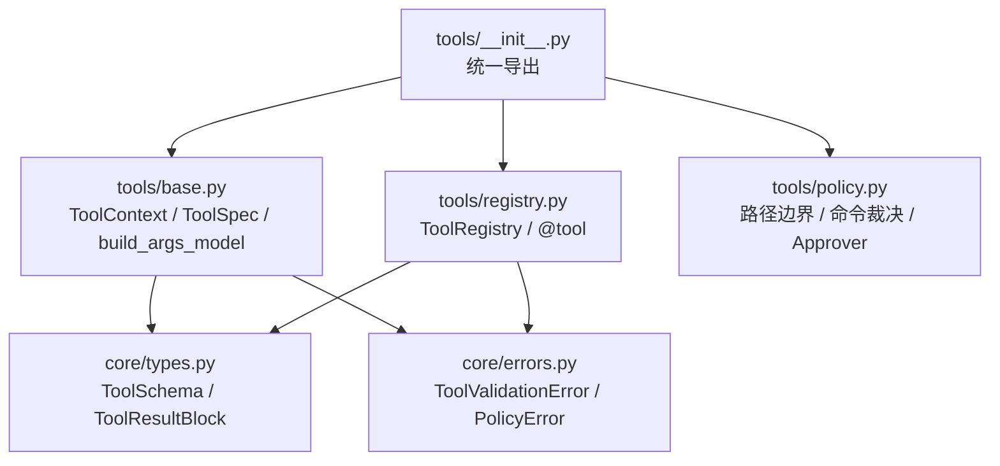
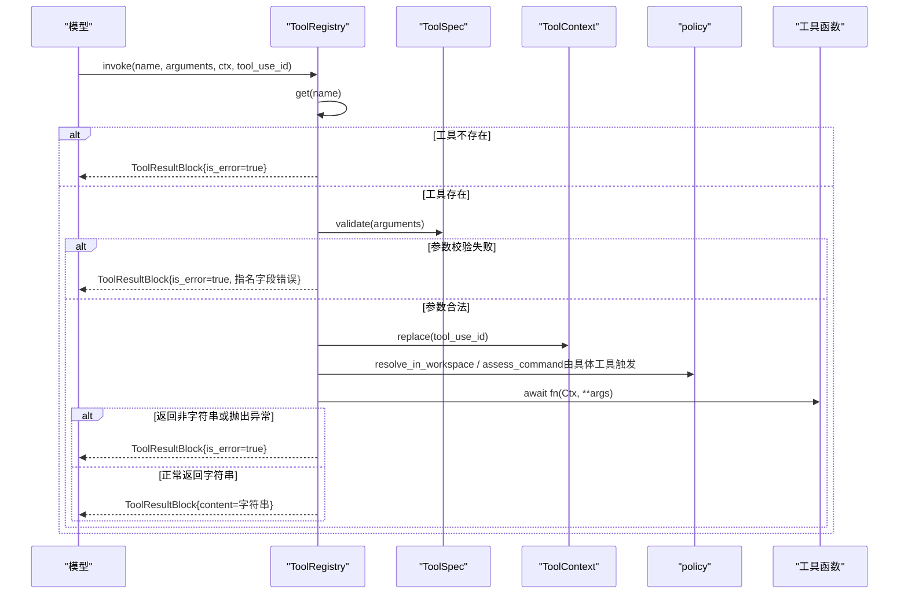
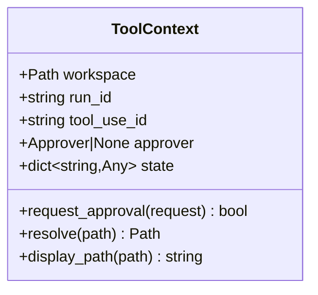
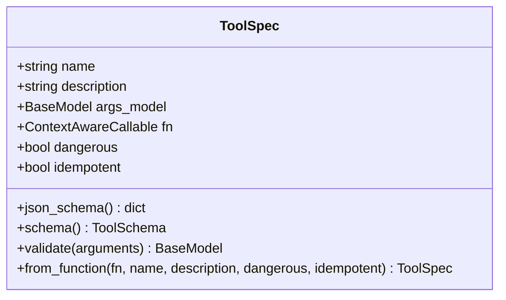
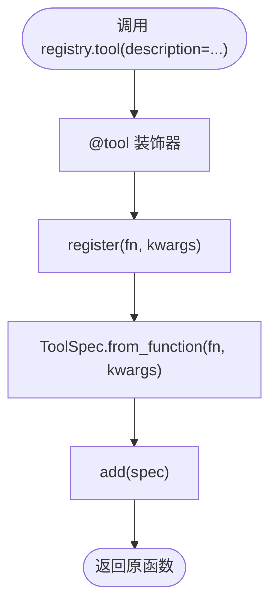
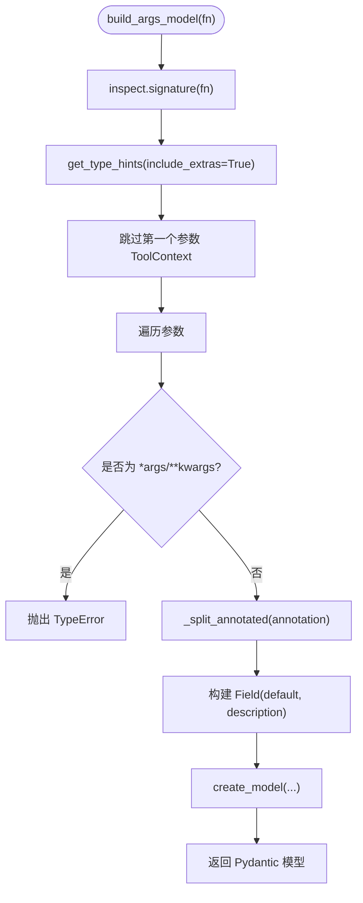
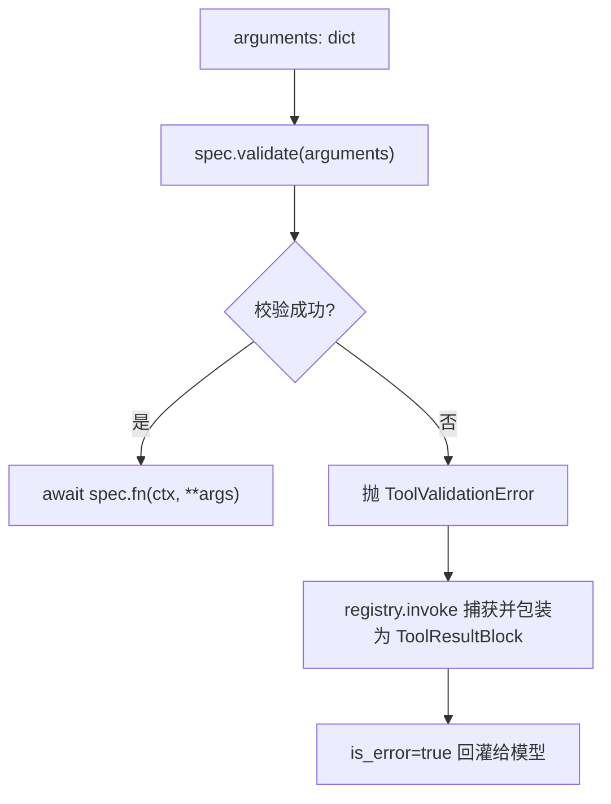
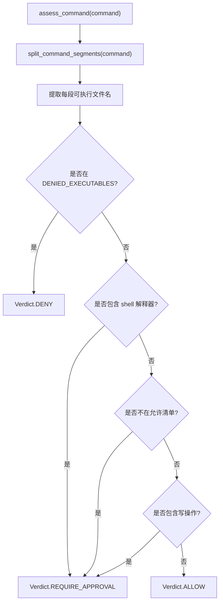
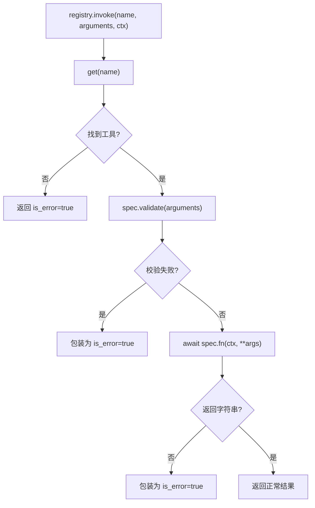
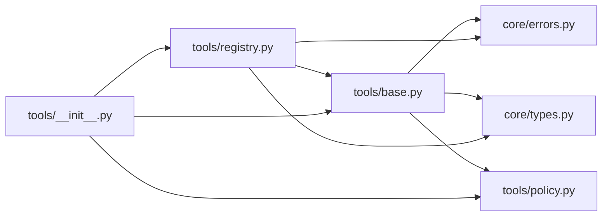

# 工具协议与核心概念

<cite>
**本文引用的文件**   
- [src/agentkit/tools/base.py](file://src/agentkit/tools/base.py)
- [src/agentkit/tools/registry.py](file://src/agentkit/tools/registry.py)
- [src/agentkit/tools/__init__.py](file://src/agentkit/tools/__init__.py)
- [src/agentkit/tools/policy.py](file://src/agentkit/tools/policy.py)
- [src/agentkit/core/types.py](file://src/agentkit/core/types.py)
- [src/agentkit/core/errors.py](file://src/agentkit/core/errors.py)
- [tests/test_tools.py](file://tests/test_tools.py)
</cite>

## 目录
1. [引言](#引言)
2. [项目结构定位](#项目结构定位)
3. [核心组件总览](#核心组件总览)
4. [架构概览](#架构概览)
5. [详细组件分析](#详细组件分析)
6. [依赖关系分析](#依赖关系分析)
7. [性能与可观测性](#性能与可观测性)
8. [故障排查指南](#故障排查指南)
9. [结论](#结论)
10. [附录：自定义工具开发清单](#附录自定义工具开发清单)

## 引言
AgentKit 的工具系统围绕“声明式函数 + 自动参数校验 + 安全策略 + 错误回灌”展开。开发者只需要写一个异步函数，系统就能自动生成模型可用的 JSON Schema、执行参数校验、把失败信息回灌给模型，并在需要时走审批通道。本文聚焦以下目标：
- 解释 ToolContext 上下文对象的作用和生命周期。
- 说明 @tool 装饰器的工作原理。
- 阐述从函数签名自动生成 JSON Schema 的机制。
- 详细说明 Annotated 类型注解的使用方式、参数校验流程、错误回灌机制。
- 给出 ToolSpec 数据类的完整定义，并解释 dangerous 和 idempotent 标记。
- 提供自定义工具开发的完整示例与最佳实践。

## 项目结构定位
工具协议相关代码集中在 `src/agentkit/tools` 下，核心由三个层次组成：
- 协议层：ToolContext、ToolSpec、build_args_model。
- 注册与执行层：ToolRegistry、@tool 装饰器、invoke 调用流。
- 安全策略层：路径边界、命令裁决、Approver 审批协议。

**图表来源**
- [src/agentkit/tools/__init__.py:1-32](file://src/agentkit/tools/__init__.py#L1-L32)
- [src/agentkit/tools/base.py:1-214](file://src/agentkit/tools/base.py#L1-L214)
- [src/agentkit/tools/registry.py:1-175](file://src/agentkit/tools/registry.py#L1-L175)
- [src/agentkit/tools/policy.py:1-305](file://src/agentkit/tools/policy.py#L1-L305)
- [src/agentkit/core/types.py:1-212](file://src/agentkit/core/types.py#L1-L212)
- [src/agentkit/core/errors.py:1-132](file://src/agentkit/core/errors.py#L1-L132)

**章节来源**
- [src/agentkit/tools/__init__.py:1-32](file://src/agentkit/tools/__init__.py#L1-L32)

## 核心组件总览
- ToolContext：工具执行时的上下文，包含工作区路径、run_id、tool_use_id、approver、进程内共享 state。
- ToolSpec：工具的完整描述，包括名称、描述、参数模型、函数引用、dangerous 和 idempotent 标记。
- build_args_model：从函数签名生成 Pydantic 参数模型，并据此产出 JSON Schema。
- ToolRegistry：工具注册表，提供 add/register/tool/schemas/invoke 等能力。
- policy：路径解析、命令裁决、Approver 审批协议。
- core.types.ToolSchema：provider 中立的工具契约，用于 OpenAI/Anthropic/Gemini 等适配层转换。
- core.errors：统一的异常分类，决定哪些错误可以重试、哪些应回灌给模型。

**章节来源**
- [src/agentkit/tools/base.py:40-214](file://src/agentkit/tools/base.py#L40-L214)
- [src/agentkit/tools/registry.py:33-175](file://src/agentkit/tools/registry.py#L33-L175)
- [src/agentkit/tools/policy.py:46-305](file://src/agentkit/tools/policy.py#L46-L305)
- [src/agentkit/core/types.py:77-100](file://src/agentkit/core/types.py#L77-L100)
- [src/agentkit/core/errors.py:69-104](file://src/agentkit/core/errors.py#L69-L104)

## 架构概览
下图展示一次工具调用的端到端流程：模型请求 tool_use → 注册表查找工具 → 参数校验 → 构造 ToolContext → 可选审批 → 执行函数 → 结果封装为 ToolResultBlock → 回灌给模型。

**图表来源**
- [src/agentkit/tools/registry.py:113-175](file://src/agentkit/tools/registry.py#L113-L175)
- [src/agentkit/tools/base.py:159-176](file://src/agentkit/tools/base.py#L159-L176)
- [src/agentkit/tools/policy.py:94-119](file://src/agentkit/tools/policy.py#L94-L119)
- [src/agentkit/core/types.py:62-69](file://src/agentkit/core/types.py#L62-L69)

## 详细组件分析

### ToolContext：上下文对象与作用域
ToolContext 是工具函数的第一个固定参数，代表工具执行时的运行环境。它不是模型传入的参数，因此不会进入 JSON Schema。其关键职责包括：
- workspace：工具可读写的工作区根目录。
- run_id：当前 run 的标识，便于日志关联。
- tool_use_id：本次工具调用的唯一标识，用于审批关联和结果配对。
- approver：审批通道；None 表示没有通道，此时需要审批的动作默认拒绝。
- state：进程内共享状态字典，刻意保留为显式字段，避免引入模块级全局变量。
- request_approval：通过 approver 发起审批，无 approver 时直接返回 False。
- resolve：将相对路径解析为工作区内真实路径，越界抛 PathViolation。
- display_path：尽量用相对工作区的路径展示，提升日志可读性。

**图表来源**
- [src/agentkit/tools/base.py:40-76](file://src/agentkit/tools/base.py#L40-L76)
- [src/agentkit/tools/policy.py:77-88](file://src/agentkit/tools/policy.py#L77-L88)

**章节来源**
- [src/agentkit/tools/base.py:40-76](file://src/agentkit/tools/base.py#L40-L76)

### ToolSpec：工具描述与元数据
ToolSpec 是一个 dataclass，封装了工具对外的完整描述：
- name：工具名。
- description：工具描述，优先取显式传入值，其次取 docstring 第一行。
- args_model：Pydantic 参数模型，由 build_args_model 生成。
- fn：异步函数引用，必须是 async def。
- dangerous：是否产生副作用，影响 Phase 2 审批与幂等键。
- idempotent：相同入参重复执行是否安全，重放 checkpoint 时可跳过。
- json_schema：基于 args_model 生成 JSON Schema，去除冗余 title。
- schema：转为 provider 中立的 ToolSchema。
- validate：使用 Pydantic 校验参数，失败抛 ToolValidationError，错误信息指名字段。
- from_function：从异步函数构造 ToolSpec，强制要求描述和异步函数。

**图表来源**
- [src/agentkit/tools/base.py:130-214](file://src/agentkit/tools/base.py#L130-L214)
- [src/agentkit/core/types.py:77-100](file://src/agentkit/core/types.py#L77-L100)

**章节来源**
- [src/agentkit/tools/base.py:130-214](file://src/agentkit/tools/base.py#L130-L214)

### @tool 装饰器与注册表
ToolRegistry.tool 是一个装饰器，既注册工具又返回原函数，方便在类方法或模块顶部声明工具。内部逻辑：
- decorator(fn)：调用 self.register(fn, **kwargs)。
- register(fn, **kwargs)：调用 ToolSpec.from_function(fn, **kwargs)，然后 add(spec)。
- add(spec)：检查重复名，存入 _tools 字典。
- merge(other, override=False)：合并另一个注册表，不修改双方。
- schemas()：返回所有工具的 ToolSchema 列表。
- describe()：生成人类可读的工具清单。

**图表来源**
- [src/agentkit/tools/registry.py:53-70](file://src/agentkit/tools/registry.py#L53-L70)
- [src/agentkit/tools/base.py:178-214](file://src/agentkit/tools/base.py#L178-L214)

**章节来源**
- [src/agentkit/tools/registry.py:33-110](file://src/agentkit/tools/registry.py#L33-L110)

### 从函数签名自动生成 JSON Schema
build_args_model 的核心流程：
- 使用 inspect.signature 获取函数签名。
- 使用 get_type_hints(include_extras=True) 解析 Annotated 描述。
- 跳过第一个参数（ToolContext）。
- 不支持 *args/**kwargs，遇到可变参数直接报错。
- 对每个参数提取基础类型和 Annotated 描述，构建 Pydantic Field。
- 使用 create_model 动态生成参数模型。
- ToolSpec.json_schema 调用 args_model.model_json_schema()，去除顶层 title。

**图表来源**
- [src/agentkit/tools/base.py:79-127](file://src/agentkit/tools/base.py#L79-L127)
- [src/agentkit/tools/base.py:144-149](file://src/agentkit/tools/base.py#L144-L149)

**章节来源**
- [src/agentkit/tools/base.py:79-127](file://src/agentkit/tools/base.py#L79-L127)

### Annotated 类型注解与参数校验
- Annotated[str, "描述"]：字符串作为字段 description，帮助模型理解参数含义。
- 支持默认值：如 count: int = 3，会出现在 schema 的 default 字段。
- 必填字段：没有默认值的参数会被标记为 required。
- 校验失败：ToolSpec.validate 捕获 Pydantic ValidationError，组装指名字段的错误信息，并抛 ToolValidationError。
- 错误回灌：ToolRegistry.invoke 捕获 ToolError，将其转换为 is_error=true 的 ToolResultBlock，让模型自我修正。

**图表来源**
- [src/agentkit/tools/base.py:159-176](file://src/agentkit/tools/base.py#L159-L176)
- [src/agentkit/tools/registry.py:142-146](file://src/agentkit/tools/registry.py#L142-L146)

**章节来源**
- [src/agentkit/tools/base.py:159-176](file://src/agentkit/tools/base.py#L159-L176)
- [src/agentkit/tools/registry.py:142-146](file://src/agentkit/tools/registry.py#L142-L146)

### 危险性与幂等性标记
- dangerous：标记工具是否会产生副作用。例如写文件、执行命令通常设为 True，用于审批与审计。
- idempotent：标记相同入参重复执行是否安全。例如读文件是幂等的，写文件通常不是。重放 checkpoint 时可跳过幂等工具。
- 内置工具示例：write_file 和 run_command 被标记为 dangerous；run_command 还标记为非幂等。

**章节来源**
- [src/agentkit/tools/base.py:139-142](file://src/agentkit/tools/base.py#L139-L142)
- [tests/test_tools.py:198-204](file://tests/test_tools.py#L198-L204)

### 安全策略：路径边界与命令裁决
- resolve_in_workspace：使用 realpath 解析符号链接与 ..，再用 commonpath 判断是否在 workspace 内；越界抛 PathViolation。
- assess_command：三分裁决——明确破坏性命令拒绝，已知安全命令放行，其余转人工审批。
- split_command_segments：按 shell 操作符拆分命令，尊重引号，保守启发式。
- enforce_command：裁决为 DENY 时抛 CommandDenied。

**图表来源**
- [src/agentkit/tools/policy.py:181-298](file://src/agentkit/tools/policy.py#L181-L298)

**章节来源**
- [src/agentkit/tools/policy.py:94-119](file://src/agentkit/tools/policy.py#L94-L119)
- [src/agentkit/tools/policy.py:181-298](file://src/agentkit/tools/policy.py#L181-L298)

### 错误回灌机制
ToolRegistry.invoke 的设计原则是“永不抛异常（取消除外）”，所有失败都变成 ToolResultBlock 回灌给模型：
- 工具不存在：返回 is_error=true，内容列出可用工具。
- 参数校验失败：捕获 ToolValidationError，返回 is_error=true，内容包含指名字段错误。
- 执行异常：捕获 PolicyError、ToolError、AgentKitError 与普通 Exception，统一包装为 is_error=true。
- 返回值非字符串：视为工具实现缺陷，返回 is_error=true。
- RunCancelled：向上抛出，表示整个 run 应停止。

**图表来源**
- [src/agentkit/tools/registry.py:113-175](file://src/agentkit/tools/registry.py#L113-L175)

**章节来源**
- [src/agentkit/tools/registry.py:113-175](file://src/agentkit/tools/registry.py#L113-L175)

## 依赖关系分析
- tools.base 依赖 core.errors 与 core.types，以及 tools.policy。
- tools.registry 依赖 core.errors、core.types 与 tools.base。
- tools.__init__ 统一导出 base、builtin、policy、registry。
- builtin 工具组通过 register_builtin_tools 按需启用 fs/search/shell。

**图表来源**
- [src/agentkit/tools/base.py:23-36](file://src/agentkit/tools/base.py#L23-L36)
- [src/agentkit/tools/registry.py:21-28](file://src/agentkit/tools/registry.py#L21-L28)
- [src/agentkit/tools/__init__.py:7-16](file://src/agentkit/tools/__init__.py#L7-L16)

**章节来源**
- [src/agentkit/tools/base.py:23-36](file://src/agentkit/tools/base.py#L23-L36)
- [src/agentkit/tools/registry.py:21-28](file://src/agentkit/tools/registry.py#L21-L28)
- [src/agentkit/tools/__init__.py:7-16](file://src/agentkit/tools/__init__.py#L7-L16)

## 性能与可观测性
- 注册表 invoke 使用 perf_counter 记录耗时，但实际耗时由 engine 层记录，这里保证不吞异常。
- 输出截断：内置工具使用 truncate 限制单个工具结果的字符上限，避免上下文爆炸。
- 日志友好：ToolContext.display_path 尽量显示相对路径，便于阅读。
- 并发安全：ToolContext.state 是显式字段，避免模块级全局变量导致的并发问题。

**章节来源**
- [src/agentkit/tools/registry.py:126-174](file://src/agentkit/tools/registry.py#L126-L174)
- [src/agentkit/tools/_util.py:7-32](file://src/agentkit/tools/_util.py#L7-L32)
- [src/agentkit/tools/base.py:68-73](file://src/agentkit/tools/base.py#L68-L73)

## 故障排查指南
常见错误与处理建议：
- 工具名重复：注册时 raise ValueError，需显式改名或移除旧工具。
- 可变参数不被支持：build_args_model 对 *args/**kwargs 直接报错，改为具名参数。
- 缺少描述：ToolSpec.from_function 要求描述，否则 raise ValueError。
- 同步函数被注册：必须使用 async def，否则会 raise TypeError。
- 参数类型不匹配：ToolSpec.validate 返回指名字段错误，模型可自我修正。
- 路径越界：resolve_in_workspace 抛 PathViolation，工具应捕获并返回业务错误。
- 命令被拒绝：assess_command 可能返回 DENY，enforce_command 抛 CommandDenied。
- 审批未通过：Approver.request 返回 ApprovalDecision(approved=False)，工具应返回未经批准错误。

**章节来源**
- [src/agentkit/tools/registry.py:43-48](file://src/agentkit/tools/registry.py#L43-L48)
- [src/agentkit/tools/base.py:112-116](file://src/agentkit/tools/base.py#L112-L116)
- [src/agentkit/tools/base.py:193-204](file://src/agentkit/tools/base.py#L193-L204)
- [src/agentkit/tools/base.py:159-176](file://src/agentkit/tools/base.py#L159-L176)
- [src/agentkit/tools/policy.py:94-119](file://src/agentkit/tools/policy.py#L94-L119)
- [src/agentkit/tools/policy.py:301-305](file://src/agentkit/tools/policy.py#L301-L305)

## 结论
AgentKit 的工具系统通过 ToolContext 注入运行时上下文，通过 ToolSpec 声明工具元数据，通过 build_args_model 从函数签名自动生成 JSON Schema，并通过 ToolRegistry 统一执行、校验与错误回灌。dangerous 与 idempotent 标记为审批与重放提供语义依据，policy 模块提供路径边界与命令裁决的安全保障。整体设计强调“模型可见的错误信息”和“显式依赖注入”，使工具开发更直观、更安全、更易调试。

## 附录：自定义工具开发清单
- 定义异步函数：第一个参数必须是 ToolContext，后续参数使用 Annotated 添加描述。
- 使用 @tool 装饰器：registry.tool(description="...") 注册工具并返回原函数。
- 路径处理：使用 ctx.resolve(path) 解析路径，避免越界。
- 审批通道：必要时调用 ctx.request_approval(request)，根据决策决定是否继续。
- 返回值：必须返回字符串，否则会被视为实现缺陷。
- 错误处理：抛出 ToolError 或其子类，由 registry.invoke 统一包装为 is_error=true。
- 幂等性与危险性：根据工具行为设置 idempotent 和 dangerous。
- 测试建议：参考 tests/test_tools.py 中的 echo/boom 工具与用例，覆盖成功、参数错误、执行异常、路径越界、命令拒绝等场景。

**章节来源**
- [src/agentkit/tools/base.py:40-76](file://src/agentkit/tools/base.py#L40-L76)
- [src/agentkit/tools/registry.py:57-70](file://src/agentkit/tools/registry.py#L57-L70)
- [tests/test_tools.py:344-352](file://tests/test_tools.py#L344-L352)