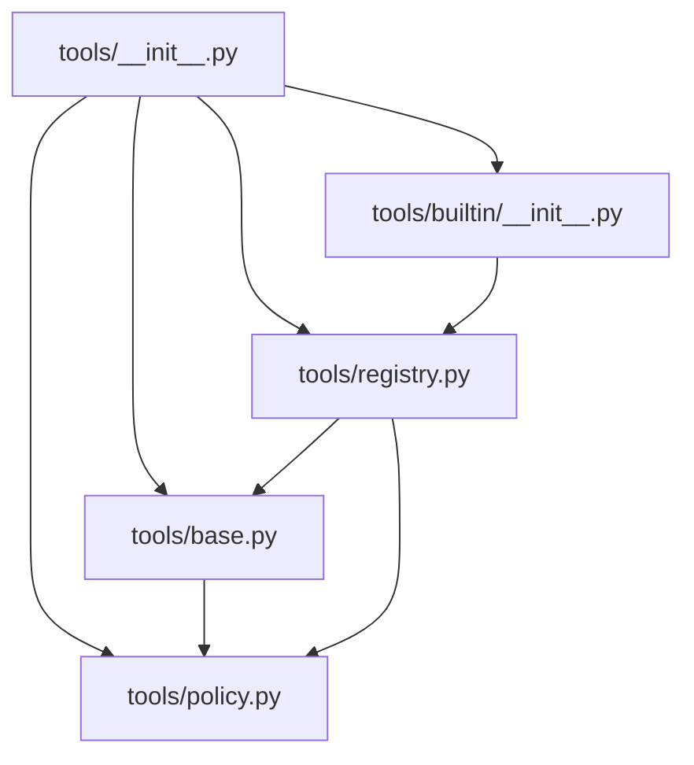
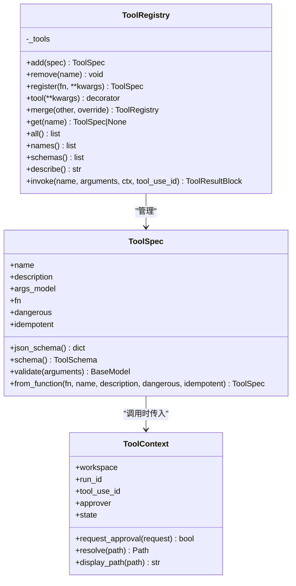
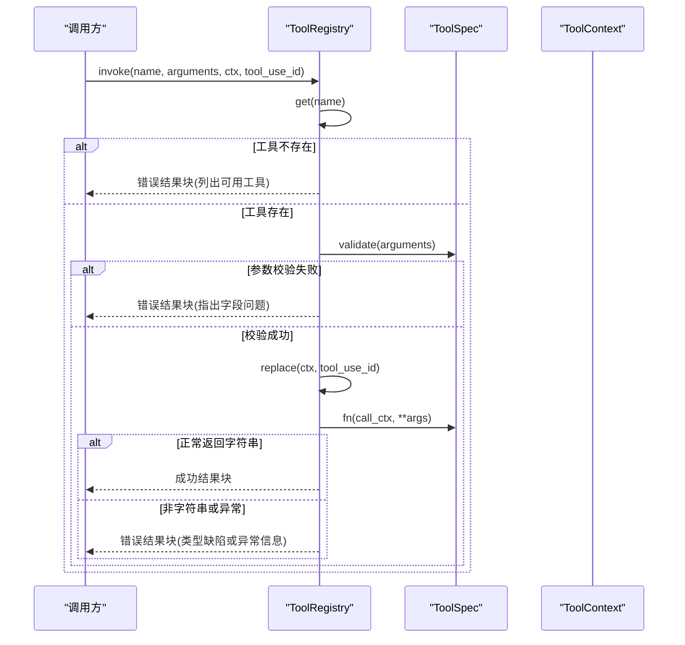
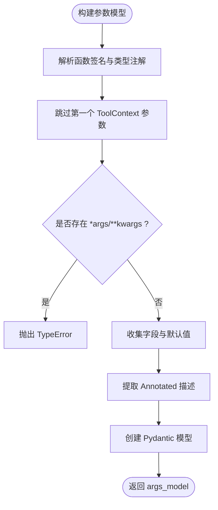
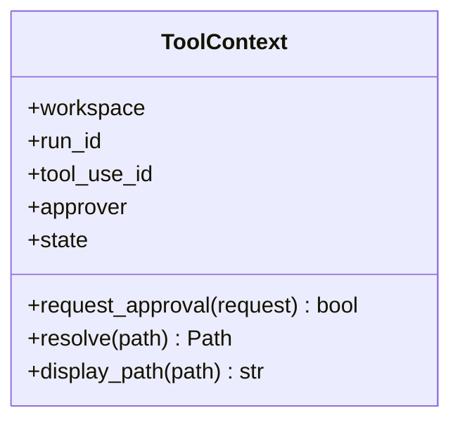
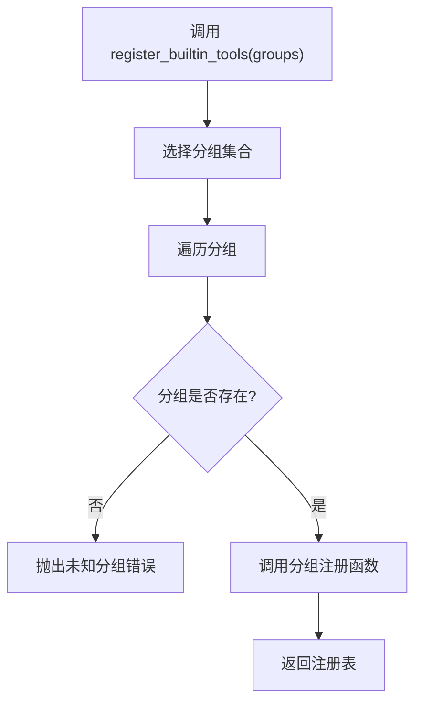
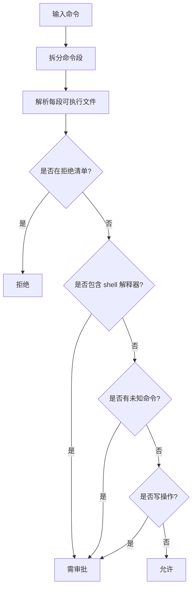
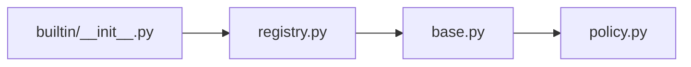

# 工具注册表

<cite>
**本文引用的文件**   
- [registry.py](file://src/agentkit/tools/registry.py)
- [base.py](file://src/agentkit/tools/base.py)
- [__init__.py（tools）](file://src/agentkit/tools/__init__.py)
- [builtin/__init__.py](file://src/agentkit/tools/builtin/__init__.py)
- [policy.py](file://src/agentkit/tools/policy.py)
- [_util.py](file://src/agentkit/tools/_util.py)
- [test_tools.py](file://tests/test_tools.py)
</cite>

## 目录
1. [引言](#引言)
2. [项目结构](#项目结构)
3. [核心组件](#核心组件)
4. [架构总览](#架构总览)
5. [详细组件分析](#详细组件分析)
6. [依赖关系分析](#依赖关系分析)
7. [性能与行为特性](#性能与行为特性)
8. [最佳实践](#最佳实践)
9. [故障排查](#故障排查)
10. [结论](#结论)

## 引言
本文件面向“工具注册表”的实现机制与管理能力，围绕以下目标展开：
- 解释工具的生命周期：注册、查找、校验、调用、错误回灌。
- 说明工具发现机制：内置工具的分组注册与默认注册表。
- 梳理工具元数据结构：名称、描述、参数 Schema、危险性与幂等性标记。
- 给出命名、描述、权限控制等最佳实践。
- 说明冲突处理、版本合并策略，以及审批与安全策略对工具调用的影响。

## 项目结构
工具子系统位于 `src/agentkit/tools`，关键文件职责如下：
- `base.py`：定义工具协议、上下文、参数模型生成与工具规格对象。
- `registry.py`：实现工具注册表，负责注册、查询、执行与错误回灌。
- `builtin/__init__.py`：提供内置工具分组与默认注册表构造。
- `policy.py`：路径边界、命令裁决与审批协议。
- `_util.py`：内置工具共享的输出截断、格式化辅助函数。
- `__init__.py（tools）`：对外暴露统一入口。
- `tests/test_tools.py`：覆盖注册表语义、Schema 生成、内置工具行为与审批流程。

**图表来源**
- [__init__.py（tools）:7-16](file://src/agentkit/tools/__init__.py#L7-L16)
- [builtin/__init__.py:5-8](file://src/agentkit/tools/builtin/__init__.py#L5-L8)
- [registry.py:21-28](file://src/agentkit/tools/registry.py#L21-L28)
- [base.py:31-36](file://src/agentkit/tools/base.py#L31-L36)

**章节来源**
- [__init__.py（tools）:1-32](file://src/agentkit/tools/__init__.py#L1-L32)
- [builtin/__init__.py:1-46](file://src/agentkit/tools/builtin/__init__.py#L1-L46)

## 核心组件
- 工具上下文 `ToolContext`：注入工作区、运行 ID、调用 ID、审批通道与进程内状态。
- 工具规格 `ToolSpec`：封装工具名、描述、参数模型、可调用函数及副作用标记。
- 工具注册表 `ToolRegistry`：容器式管理工具，提供注册、查询、合并、执行接口。
- 内置工具注册器：按分组批量注册文件系统、搜索、Shell 工具。
- 安全策略：路径边界检查、命令裁决与审批协议。

**章节来源**
- [base.py:40-76](file://src/agentkit/tools/base.py#L40-L76)
- [base.py:130-214](file://src/agentkit/tools/base.py#L130-L214)
- [registry.py:33-109](file://src/agentkit/tools/registry.py#L33-L109)
- [builtin/__init__.py:12-45](file://src/agentkit/tools/builtin/__init__.py#L12-L45)
- [policy.py:49-90](file://src/agentkit/tools/policy.py#L49-L90)

## 架构总览
工具注册表采用“实例化容器 + 协议解耦”的设计：
- 注册表不持有全局状态，支持多套工具集并存。
- 工具通过函数签名自动生成参数 Schema，减少手写 Schema 的维护成本。
- 执行路径将异常转换为结构化结果块，便于模型自我修正。
- 审批通道以协议形式注入，保持工具层不依赖运行时实现。

**图表来源**
- [base.py:40-76](file://src/agentkit/tools/base.py#L40-L76)
- [base.py:130-214](file://src/agentkit/tools/base.py#L130-L214)
- [registry.py:33-109](file://src/agentkit/tools/registry.py#L33-L109)

## 详细组件分析

### 工具注册表 `ToolRegistry`
- 注册
  - `add`：按名称注册，重复名称抛错，避免静默覆盖。
  - `register`：从异步函数构造 `ToolSpec` 并注册。
  - `tool`：装饰器形式注册，返回原函数以便继续复用。
  - `merge`：合并另一个注册表；可选择是否覆盖同名工具。
- 查询
  - `get`、`all`、`names`、`schemas`、`describe`：提供单查、全量、名称列表、Schema 列表与人类可读清单。
- 执行
  - `invoke`：定位工具 → 参数校验 → 复制上下文并填充调用 ID → 调用函数 → 捕获异常并转为错误结果块 → 确保返回字符串。
  - 取消异常 `RunCancelled` 会直接上抛，表示整个运行应停止。
  - 其他异常统一包装为 `is_error=True` 的结果块，便于模型自我修正。

**图表来源**
- [registry.py:113-174](file://src/agentkit/tools/registry.py#L113-L174)

**章节来源**
- [registry.py:33-109](file://src/agentkit/tools/registry.py#L33-L109)
- [registry.py:113-174](file://src/agentkit/tools/registry.py#L113-L174)

### 工具协议与元数据 `ToolSpec`
- 元数据
  - `name`、`description`：工具标识与给模型的提示。
  - `args_model`：基于函数签名生成的 Pydantic 模型，用于参数校验与 JSON Schema 导出。
  - `dangerous`、`idempotent`：副作用标记与幂等性标记，供上层策略使用。
- 参数模型生成
  - 跳过第一个 `ToolContext` 参数。
  - 不支持可变参数，否则报错以保证 Schema 与实现一致。
  - 支持 `Annotated[T, "描述"]`，描述进入 Schema 帮助模型理解参数。
- 校验与 Schema
  - `validate`：失败抛出带字段信息的验证错误，便于回灌给模型。
  - `schema`：导出 provider 中立的工具 Schema。

**图表来源**
- [base.py:94-127](file://src/agentkit/tools/base.py#L94-L127)

**章节来源**
- [base.py:94-127](file://src/agentkit/tools/base.py#L94-L127)
- [base.py:130-214](file://src/agentkit/tools/base.py#L130-L214)

### 工具上下文 `ToolContext`
- 作用
  - 注入工作区根路径、运行 ID、调用 ID、审批通道与进程内共享状态。
  - 提供路径解析与显示方法，保证路径在工作区内且日志可读。
- 审批
  - `request_approval`：若无审批通道则默认拒绝；有通道则委托 `Approver.request`。

**图表来源**
- [base.py:40-76](file://src/agentkit/tools/base.py#L40-L76)

**章节来源**
- [base.py:40-76](file://src/agentkit/tools/base.py#L40-L76)

### 内置工具与自动发现
- 分组注册
  - `BUILTIN_GROUPS`：映射分组名到注册函数，如 `fs`、`search`、`shell`。
  - `register_builtin_tools`：按分组批量注册，支持选择子集。
  - `default_registry`：返回包含全部内置工具的注册表。
- 自动发现
  - 当前仓库未实现动态扫描模块加载；“自动发现”体现为按分组的集中注册。
  - 扩展方式：新增分组函数并加入 `BUILTIN_GROUPS`，即可被 `register_builtin_tools` 发现。

**图表来源**
- [builtin/__init__.py:12-45](file://src/agentkit/tools/builtin/__init__.py#L12-L45)

**章节来源**
- [builtin/__init__.py:1-46](file://src/agentkit/tools/builtin/__init__.py#L1-L46)

### 安全策略与审批
- 路径边界
  - `resolve_in_workspace`：解析真实路径并进行包含判断，越界抛错。
- 命令裁决
  - `assess_command`：三分裁决（允许、拒绝、需审批），默认不信任。
  - `enforce_command`：拒绝类裁决抛错；需审批由调用方处理。
- 审批协议
  - `Approver`：定义 `request` 接口，具体实现由运行时注入。
  - `ApprovalRequest` / `ApprovalDecision`：审批请求与决策的数据结构。

**图表来源**
- [policy.py:181-298](file://src/agentkit/tools/policy.py#L181-L298)

**章节来源**
- [policy.py:49-90](file://src/agentkit/tools/policy.py#L49-L90)
- [policy.py:94-119](file://src/agentkit/tools/policy.py#L94-L119)
- [policy.py:125-176](file://src/agentkit/tools/policy.py#L125-L176)
- [policy.py:181-298](file://src/agentkit/tools/policy.py#L181-L298)

## 依赖关系分析
- 单向依赖
  - `tools` 层不 import `runtime`，审批能力通过协议注入，避免循环依赖。
- 内部耦合
  - `registry.py` 依赖 `base.py` 的工具协议与上下文。
  - `base.py` 依赖 `policy.py` 的路径解析与审批协议。
  - `builtin/__init__.py` 依赖 `registry.py` 进行分组注册。

**图表来源**
- [registry.py:21-28](file://src/agentkit/tools/registry.py#L21-L28)
- [base.py:31-36](file://src/agentkit/tools/base.py#L31-L36)
- [builtin/__init__.py:5-8](file://src/agentkit/tools/builtin/__init__.py#L5-L8)

**章节来源**
- [__init__.py（tools）:1-32](file://src/agentkit/tools/__init__.py#L1-L32)

## 性能与行为特性
- 常量开销
  - 无需审批通道的工具调用走固定路径，无额外审批等待。
- 异常不中断
  - `invoke` 永不抛异常（除取消），所有失败转为错误结果块，避免中断整个运行。
- 输出限制
  - 内置工具使用输出截断策略，防止大文本撑爆上下文。
- 时间统计
  - 耗时由上层引擎记录，注册表只保证不吞异常。

**章节来源**
- [registry.py:113-174](file://src/agentkit/tools/registry.py#L113-L174)
- [_util.py:7-32](file://src/agentkit/tools/_util.py#L7-L32)

## 最佳实践
- 命名规范
  - 使用具名、稳定、语义清晰的工具名；避免重名，注册时会抛错。
- 描述编写
  - 必须提供描述；优先使用 docstring 首行或显式传入描述，帮助模型正确触发工具。
- 参数设计
  - 使用显式具名参数，避免可变参数；用 `Annotated` 添加字段描述，提升模型填参准确率。
- 副作用与幂等性
  - 对写操作设置 `dangerous=True`；对可能产生副作用的命令设置 `idempotent=False`。
- 权限控制
  - 通过 `ToolContext.approver` 接入审批通道；没有通道时默认拒绝敏感操作。
- 冲突处理
  - 注册重名会抛错；合并时可指定 `override=True` 覆盖同名工具，但需谨慎审计。
- 版本管理
  - 当前实现未内置版本字段；可通过命名前缀或分组隔离不同版本工具，并在合并时明确覆盖策略。

**章节来源**
- [registry.py:43-80](file://src/agentkit/tools/registry.py#L43-L80)
- [base.py:178-214](file://src/agentkit/tools/base.py#L178-L214)
- [policy.py:49-90](file://src/agentkit/tools/policy.py#L49-L90)

## 故障排查
- 工具不存在
  - 现象：调用返回错误结果块，内容包含可用工具列表。
  - 排查：确认工具已注册且名称一致。
- 参数校验失败
  - 现象：错误结果块中包含字段位置与错误信息。
  - 排查：检查模型传参与函数签名是否匹配。
- 非字符串返回
  - 现象：错误结果块指出工具返回类型不是字符串。
  - 排查：确保工具函数返回字符串。
- 路径越界
  - 现象：错误结果块提示路径越出工作区。
  - 排查：使用 `ToolContext.resolve` 解析路径，避免拼接路径绕过安全检查。
- 命令被拒绝或需审批
  - 现象：错误结果块提示破坏性命令或缺少审批。
  - 排查：调整命令白名单或接入审批通道。

**章节来源**
- [registry.py:135-174](file://src/agentkit/tools/registry.py#L135-L174)
- [policy.py:94-119](file://src/agentkit/tools/policy.py#L94-L119)
- [policy.py:245-305](file://src/agentkit/tools/policy.py#L245-L305)
- [test_tools.py:113-175](file://tests/test_tools.py#L113-L175)
- [test_tools.py:206-339](file://tests/test_tools.py#L206-L339)

## 结论
工具注册表通过实例化容器、函数签名驱动的 Schema 生成与结构化错误回灌，提供了稳定、可观测、可组合的工具管理能力。配合内置工具分组注册与安全策略，既能满足常见场景，又为扩展与治理留出空间。建议在开发自定义工具时遵循命名与描述规范，合理使用危险性与幂等性标记，并通过审批通道保障敏感操作的受控执行。