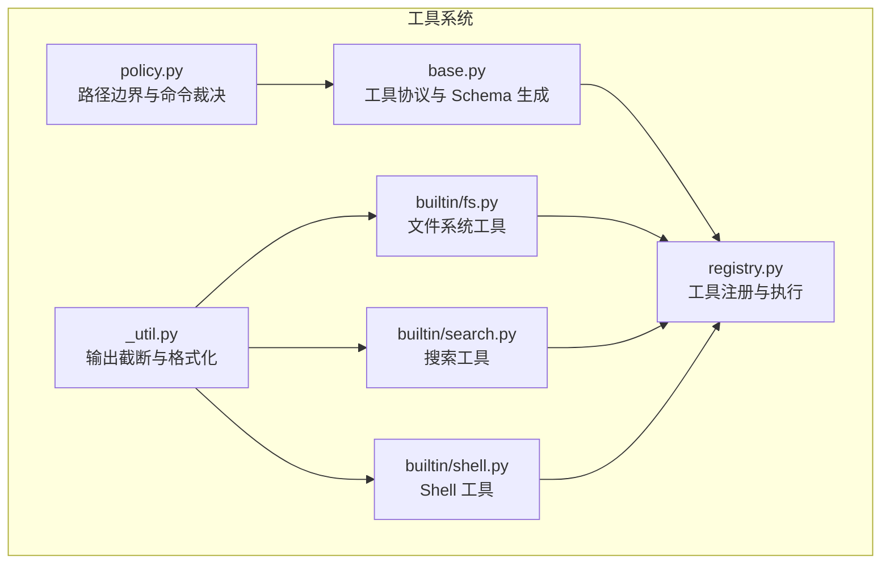
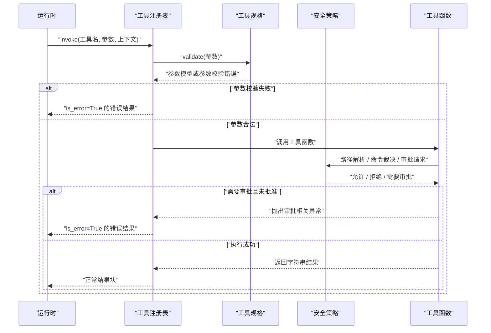
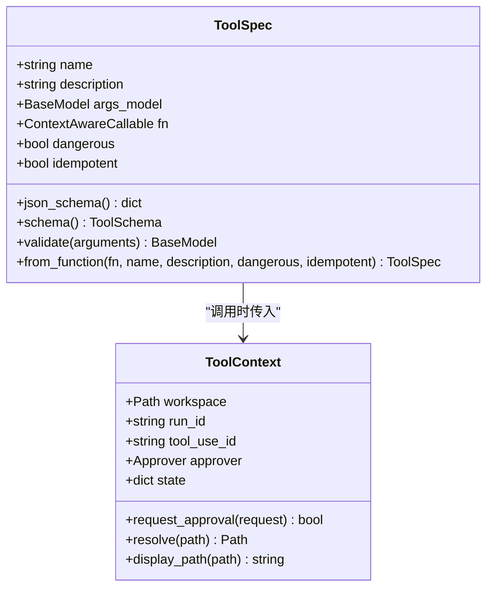
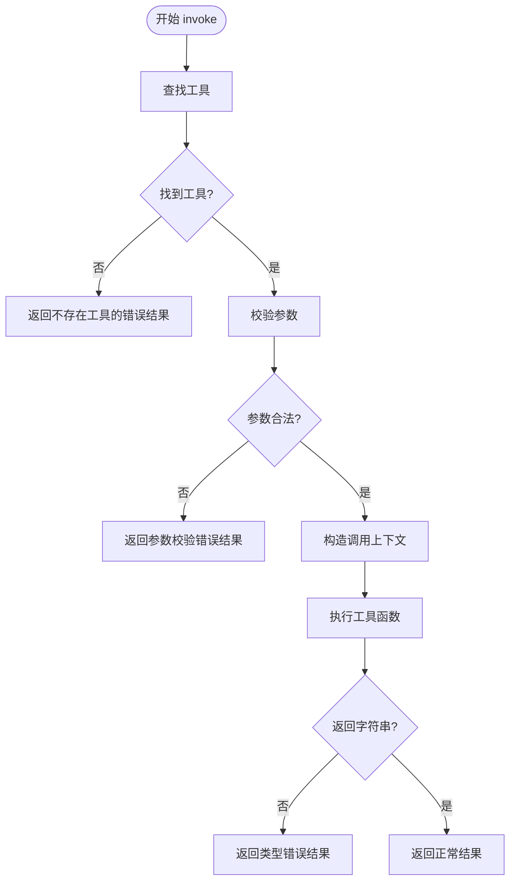
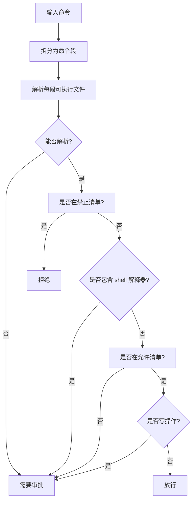
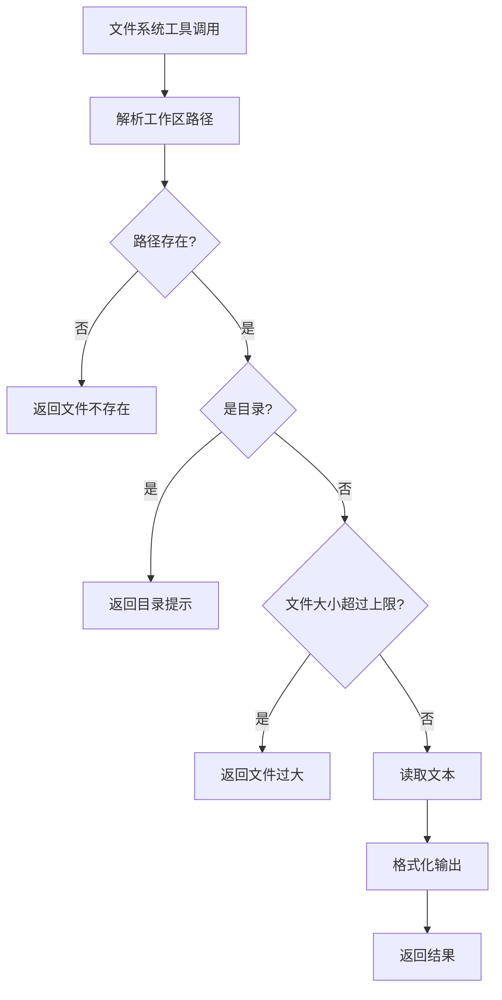
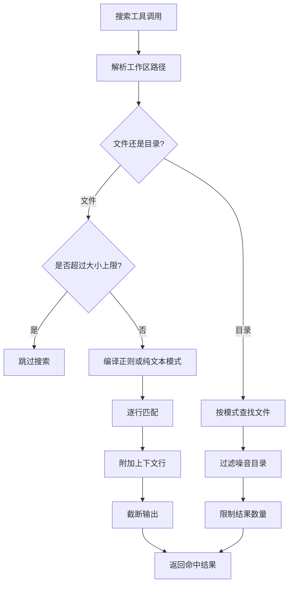
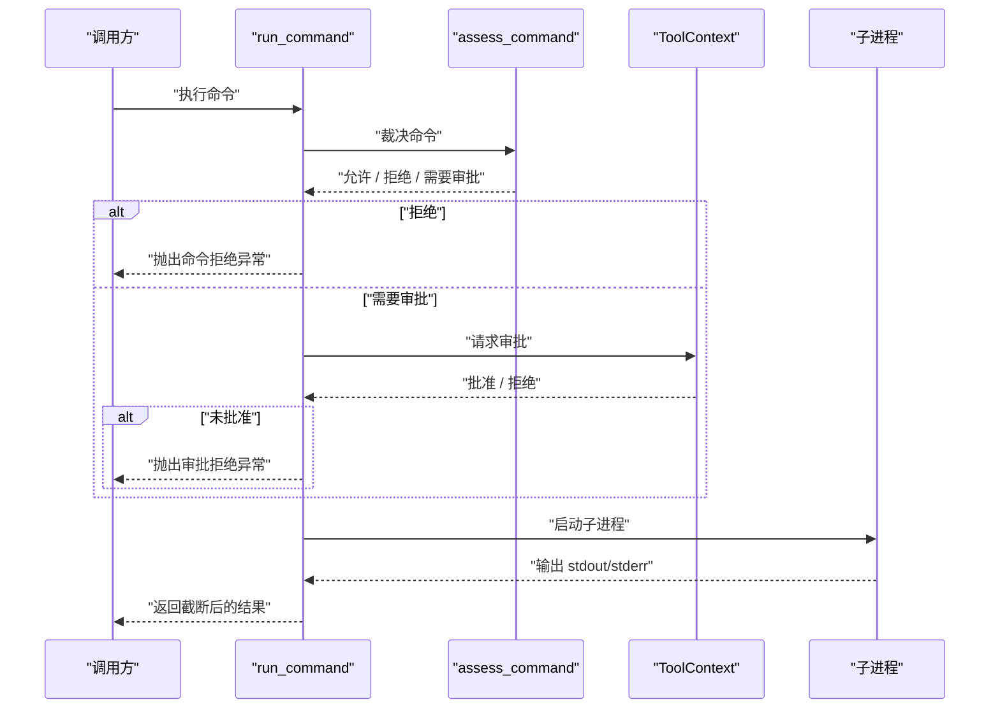
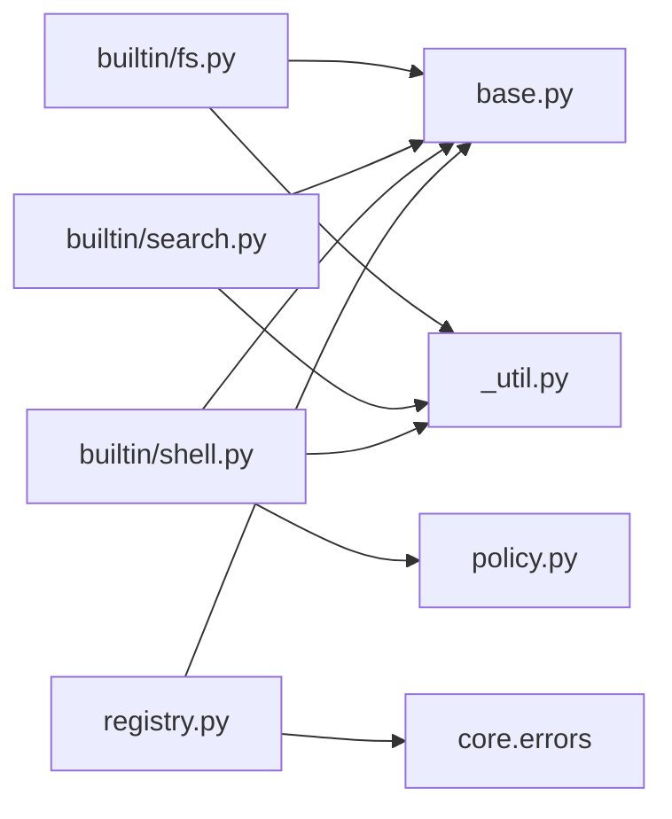
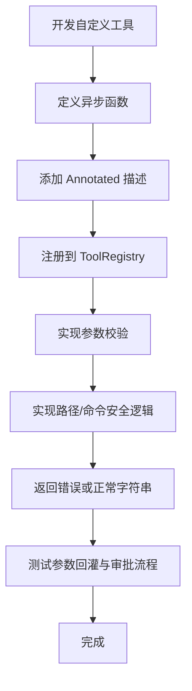

# 工具系统

<cite>
**本文引用的文件**   
- [src/agentkit/tools/base.py](file://src/agentkit/tools/base.py)
- [src/agentkit/tools/registry.py](file://src/agentkit/tools/registry.py)
- [src/agentkit/tools/policy.py](file://src/agentkit/tools/policy.py)
- [src/agentkit/tools/_util.py](file://src/agentkit/tools/_util.py)
- [src/agentkit/tools/builtin/fs.py](file://src/agentkit/tools/builtin/fs.py)
- [src/agentkit/tools/builtin/search.py](file://src/agentkit/tools/builtin/search.py)
- [src/agentkit/tools/builtin/shell.py](file://src/agentkit/tools/builtin/shell.py)
</cite>

## 目录
1. [引言](#引言)
2. [项目结构](#项目结构)
3. [核心组件](#核心组件)
4. [架构总览](#架构总览)
5. [详细组件分析](#详细组件分析)
6. [依赖关系分析](#依赖关系分析)
7. [性能与容量控制](#性能与容量控制)
8. [故障排查指南](#故障排查指南)
9. [结论](#结论)
10. [附录：自定义工具开发指南](#附录自定义工具开发指南)

## 引言
AgentKit 的工具系统为模型提供一组可被调用的能力，包括文件系统读写、搜索、Shell 命令执行等。它通过统一的协议暴露工具名称、描述和参数 JSON Schema，由注册表完成参数校验、安全策略执行、错误回灌和结果封装，最终把结构化错误反馈给模型，让模型能自我修正调用方式。

该系统的核心设计目标是：
- 用函数签名自动生成 JSON Schema，减少手写 schema 的维护成本。
- 将路径边界、命令裁决等安全策略集中实现，避免正则黑名单带来的绕过风险。
- 让所有工具调用失败都变成模型可读的错误结果，而不是直接抛出异常中断流程。
- 支持审批通道，对危险操作进行人工确认。
- 保持运行时与工具模块解耦，避免循环依赖。

## 项目结构
工具系统位于 `src/agentkit/tools` 下，按职责分层组织：
- `base.py`：定义工具上下文、工具规格、从函数签名生成参数的机制。
- `registry.py`：工具注册表，负责注册、查询、执行和统一错误处理。
- `policy.py`：安全策略，包含路径边界检查、命令裁决与审批协议。
- `_util.py`：内置工具共享的文本截断、单位格式化、行号辅助函数。
- `builtin/`：内置工具实现，包括文件系统、搜索、Shell。

**图表来源**
- [src/agentkit/tools/base.py:1-214](file://src/agentkit/tools/base.py#L1-L214)
- [src/agentkit/tools/registry.py:1-175](file://src/agentkit/tools/registry.py#L1-L175)
- [src/agentkit/tools/policy.py:1-305](file://src/agentkit/tools/policy.py#L1-L305)
- [src/agentkit/tools/_util.py:1-51](file://src/agentkit/tools/_util.py#L1-L51)
- [src/agentkit/tools/builtin/fs.py:1-138](file://src/agentkit/tools/builtin/fs.py#L1-L138)
- [src/agentkit/tools/builtin/search.py:1-146](file://src/agentkit/tools/builtin/search.py#L1-L146)
- [src/agentkit/tools/builtin/shell.py:1-141](file://src/agentkit/tools/builtin/shell.py#L1-L141)

**章节来源**
- [src/agentkit/tools/base.py:1-214](file://src/agentkit/tools/base.py#L1-L214)
- [src/agentkit/tools/registry.py:1-175](file://src/agentkit/tools/registry.py#L1-L175)
- [src/agentkit/tools/policy.py:1-305](file://src/agentkit/tools/policy.py#L1-L305)
- [src/agentkit/tools/_util.py:1-51](file://src/agentkit/tools/_util.py#L1-L51)
- [src/agentkit/tools/builtin/fs.py:1-138](file://src/agentkit/tools/builtin/fs.py#L1-L138)
- [src/agentkit/tools/builtin/search.py:1-146](file://src/agentkit/tools/builtin/search.py#L1-L146)
- [src/agentkit/tools/builtin/shell.py:1-141](file://src/agentkit/tools/builtin/shell.py#L1-L141)

## 核心组件
工具系统的核心由四个部分组成：
- 工具协议与上下文：定义工具如何被描述、如何接收上下文、如何生成参数模型。
- 工具注册表：管理工具集合、执行工具、统一错误回灌。
- 安全策略：保证路径不越界、命令不被滥用，并提供审批接口。
- 内置工具：文件系统、搜索、Shell 的具体实现。

这些组件共同构成“声明式工具 + 自动 Schema + 安全执行”的闭环。

**章节来源**
- [src/agentkit/tools/base.py:1-214](file://src/agentkit/tools/base.py#L1-L214)
- [src/agentkit/tools/registry.py:1-175](file://src/agentkit/tools/registry.py#L1-L175)
- [src/agentkit/tools/policy.py:1-305](file://src/agentkit/tools/policy.py#L1-L305)

## 架构总览
下图展示一次工具调用从注册到执行的完整链路：

**图表来源**
- [src/agentkit/tools/registry.py:113-175](file://src/agentkit/tools/registry.py#L113-L175)
- [src/agentkit/tools/base.py:159-177](file://src/agentkit/tools/base.py#L159-L177)
- [src/agentkit/tools/policy.py:94-119](file://src/agentkit/tools/policy.py#L94-L119)
- [src/agentkit/tools/policy.py:245-305](file://src/agentkit/tools/policy.py#L245-L305)
- [src/agentkit/tools/builtin/shell.py:38-97](file://src/agentkit/tools/builtin/shell.py#L38-L97)

## 详细组件分析

### 工具协议与 Schema 生成
工具协议的核心是三个概念：
- `ToolContext`：工具执行时注入的上下文，包含工作区路径、运行 ID、工具调用 ID、审批通道和进程内状态。
- `ToolSpec`：工具的元数据，包括名称、描述、参数模型、函数引用以及是否危险、是否幂等。
- `build_args_model`：从异步函数签名生成 Pydantic 参数模型，并导出 JSON Schema。

关键行为如下：
- 第一个参数必须是 `ToolContext`，不参与 Schema。
- 使用 `Annotated[T, "描述"]` 为字段添加人类可读的描述，帮助模型理解参数含义。
- 不支持可变参数；如果函数使用 `*args` 或 `**kwargs`，会直接报错，避免 Schema 与实际实现不一致。
- `ToolSpec.from_function` 会从 docstring 首行提取默认描述，若没有描述则拒绝注册。
- `ToolSpec.validate` 会把 Pydantic 校验错误转成带字段定位的错误信息，供模型自我修正。

**图表来源**
- [src/agentkit/tools/base.py:40-76](file://src/agentkit/tools/base.py#L40-L76)
- [src/agentkit/tools/base.py:130-214](file://src/agentkit/tools/base.py#L130-L214)

**章节来源**
- [src/agentkit/tools/base.py:1-214](file://src/agentkit/tools/base.py#L1-L214)

### 工具注册表
工具注册表承担以下职责：
- 注册工具：支持装饰器形式和显式注册。
- 查询工具：获取单个工具、列出全部工具、生成 Schema 列表。
- 执行工具：校验参数、构造调用上下文、调用函数、捕获异常并回灌错误。

重要特性：
- 注册表实例化后持有自己的工具映射，不依赖全局状态，便于多 Agent、多权限场景。
- `invoke` 方法在正常情况下永不抛异常（取消除外），所有失败都转为 `is_error=True` 的结果块。
- 每次调用会复制上下文并填充 `tool_use_id`，使审批请求与审批决定能够关联。
- 工具返回值必须为字符串，否则会被视为实现缺陷并返回错误结果。

**图表来源**
- [src/agentkit/tools/registry.py:113-175](file://src/agentkit/tools/registry.py#L113-L175)

**章节来源**
- [src/agentkit/tools/registry.py:1-175](file://src/agentkit/tools/registry.py#L1-L175)

### 安全策略
安全策略分为两部分：路径边界和命令裁决。

#### 路径边界
旧实现使用绝对路径前缀判断，存在符号链接绕过和前缀误判问题。新实现：
- 使用 `realpath` 解析真实路径，消除符号链接影响。
- 使用 `commonpath` 判断目标路径是否在工作区内。
- 跨盘符或不在工作区时抛出路径违规异常。

#### 命令裁决
命令不再使用简单黑名单，而是三分裁决：
- 明确破坏性命令：直接拒绝。
- 已知安全命令：放行。
- 其他命令：要求人工审批。

此外，管道到 shell 解释器的命令一律要求审批，因为这是典型的远程代码执行路径。写操作命令即使不在禁止清单，也会进入审批流程。

**图表来源**
- [src/agentkit/tools/policy.py:181-298](file://src/agentkit/tools/policy.py#L181-L298)

**章节来源**
- [src/agentkit/tools/policy.py:1-305](file://src/agentkit/tools/policy.py#L1-L305)

### 内置工具：文件系统
文件系统工具提供读取、写入和列出目录的能力：
- `read_file`：读取 UTF-8 文本文件，大文件截断，二进制文件拒绝。
- `write_file`：覆盖写入文件，父目录不存在时自动创建。
- `list_directory`：列出目录内容，支持递归和条目上限。

安全方面：
- 所有路径先通过 `ctx.resolve` 解析，越界会触发路径违规。
- 大文件读取有大小限制，防止上下文被撑爆。
- 写入工具标记为 `dangerous=True`，以便后续审批和审计。

**图表来源**
- [src/agentkit/tools/builtin/fs.py:19-49](file://src/agentkit/tools/builtin/fs.py#L19-L49)

**章节来源**
- [src/agentkit/tools/builtin/fs.py:1-138](file://src/agentkit/tools/builtin/fs.py#L1-L138)

### 内置工具：搜索
搜索工具提供单文件内容搜索和文件名模式匹配：
- `search_in_file`：支持正则和纯文本匹配，返回命中行及上下文。
- `find_files`：递归查找匹配文件名的文件，跳过噪音目录。

安全与性能：
- 单文件搜索有大小上限，避免正则卡死。
- 递归搜索跳过 `.venv`、`node_modules` 等目录。
- 正则表达式非法时会抛出参数校验错误，走回灌路径。

**图表来源**
- [src/agentkit/tools/builtin/search.py:25-88](file://src/agentkit/tools/builtin/search.py#L25-L88)
- [src/agentkit/tools/builtin/search.py:91-139](file://src/agentkit/tools/builtin/search.py#L91-L139)

**章节来源**
- [src/agentkit/tools/builtin/search.py:1-146](file://src/agentkit/tools/builtin/search.py#L1-L146)

### 内置工具：Shell
Shell 工具用于执行命令，是整个工具集风险最高的部分：
- 执行前进行命令裁决。
- 危险命令直接拒绝。
- 需要审批的命令走 `ToolContext.request_approval`。
- 子进程超时会被终止。
- 环境变量做敏感键过滤，避免凭据泄露。

**图表来源**
- [src/agentkit/tools/builtin/shell.py:38-97](file://src/agentkit/tools/builtin/shell.py#L38-L97)
- [src/agentkit/tools/policy.py:245-305](file://src/agentkit/tools/policy.py#L245-L305)

**章节来源**
- [src/agentkit/tools/builtin/shell.py:1-141](file://src/agentkit/tools/builtin/shell.py#L1-L141)

## 依赖关系分析
工具系统内部依赖方向清晰：
- 内置工具依赖 `base`、`_util`、`registry`。
- `registry` 依赖 `base` 和核心错误类型。
- `policy` 只依赖核心错误类型，不反向依赖 runtime。
- 审批协议放在 `policy` 中，使 tools 模块不 import runtime，保持单向依赖。

**图表来源**
- [src/agentkit/tools/builtin/fs.py:1-138](file://src/agentkit/tools/builtin/fs.py#L1-L138)
- [src/agentkit/tools/builtin/search.py:1-146](file://src/agentkit/tools/builtin/search.py#L1-L146)
- [src/agentkit/tools/builtin/shell.py:1-141](file://src/agentkit/tools/builtin/shell.py#L1-L141)
- [src/agentkit/tools/base.py:1-214](file://src/agentkit/tools/base.py#L1-L214)
- [src/agentkit/tools/registry.py:1-175](file://src/agentkit/tools/registry.py#L1-L175)
- [src/agentkit/tools/policy.py:1-305](file://src/agentkit/tools/policy.py#L1-L305)

**章节来源**
- [src/agentkit/tools/base.py:1-214](file://src/agentkit/tools/base.py#L1-L214)
- [src/agentkit/tools/registry.py:1-175](file://src/agentkit/tools/registry.py#L1-L175)
- [src/agentkit/tools/policy.py:1-305](file://src/agentkit/tools/policy.py#L1-L305)

## 性能与容量控制
工具系统在多处做了容量控制，避免模型上下文被意外撑爆：
- 文件读取上限：超过 2MB 的文件不会读取正文，只返回提示。
- 文件搜索上限：单文件搜索超过 5MB 直接跳过。
- 输出截断：通用输出默认保留约 12000 字符，命令输出默认保留约 10000 字符。
- 目录列举限制：默认最多 200 项，递归遍历也受上限控制。
- 搜索命中限制：单文件搜索默认最多返回 50 条命中。
- 命令超时：默认 60 秒，最大 600 秒，超时后会终止进程。

这些限制不是硬编码的魔法数字堆砌，而是围绕“模型只需要关键信息”这一原则设计的。

**章节来源**
- [src/agentkit/tools/builtin/fs.py:15-16](file://src/agentkit/tools/builtin/fs.py#L15-L16)
- [src/agentkit/tools/builtin/fs.py:32-49](file://src/agentkit/tools/builtin/fs.py#L32-L49)
- [src/agentkit/tools/builtin/search.py:21-22](file://src/agentkit/tools/builtin/search.py#L21-L22)
- [src/agentkit/tools/builtin/search.py:39-44](file://src/agentkit/tools/builtin/search.py#L39-L44)
- [src/agentkit/tools/_util.py:7-12](file://src/agentkit/tools/_util.py#L7-L12)
- [src/agentkit/tools/builtin/shell.py:32-35](file://src/agentkit/tools/builtin/shell.py#L32-L35)

## 故障排查指南
常见错误及其含义：
- 工具不存在：注册表中找不到该工具名，可用工具列表会一起返回，帮助模型选择正确工具。
- 参数不合法：Pydantic 校验失败，错误信息包含字段位置，模型可以据此修改参数。
- 路径越界：目标路径不在工作区内，可能是相对路径拼错、符号链接绕过或跨盘符访问。
- 命令被拒绝：命令属于明确破坏性操作，无法通过审批。
- 命令需要审批：命令不在允许清单、包含 shell 解释器或涉及写操作，需要人工确认。
- 审批被拒绝：人工或策略拒绝执行该命令。
- 工具返回非字符串：工具实现不符合协议，应报告实现缺陷。
- 命令超时：子进程执行时间过长，已被终止。

排查建议：
- 先看错误结果中的字段定位，优先修正参数。
- 如果是路径错误，检查工作区根目录和相对路径是否正确。
- 如果是命令被拒绝，改用允许清单内的命令，或把危险步骤交给人工完成。
- 如果输出过长，考虑先用搜索工具定位，再读取具体文件。
- 如果频繁出现审批拒绝，调整命令写法使其落入允许清单。

**章节来源**
- [src/agentkit/tools/registry.py:135-174](file://src/agentkit/tools/registry.py#L135-L174)
- [src/agentkit/tools/base.py:159-177](file://src/agentkit/tools/base.py#L159-L177)
- [src/agentkit/tools/policy.py:94-119](file://src/agentkit/tools/policy.py#L94-L119)
- [src/agentkit/tools/policy.py:245-305](file://src/agentkit/tools/policy.py#L245-L305)
- [src/agentkit/tools/builtin/shell.py:38-97](file://src/agentkit/tools/builtin/shell.py#L38-L97)

## 结论
AgentKit 工具系统通过“函数签名驱动 Schema + 注册表统一执行 + 安全策略集中管控”的方式，把模型可调用的能力与安全边界绑定在一起。它不依赖全局状态，支持并发和多套工具集；它不把异常当作黑盒吞掉，而是把错误结构化地回灌给模型；它对路径和命令采用更严谨的策略，而不是脆弱的正则黑名单。对于使用者来说，这意味着更少的配置、更强的安全性，以及更好的模型自我修复体验。

## 附录：自定义工具开发指南

### 基本步骤
1. 定义一个异步函数，第一个参数为 `ToolContext`。
2. 使用 `Annotated` 为每个参数添加描述，帮助模型理解用途。
3. 通过 `ToolRegistry.register` 或 `@registry.tool` 装饰器注册工具。
4. 如果需要副作用，设置 `dangerous=True`；如果重复执行语义稳定，设置 `idempotent=True`。
5. 所有路径访问都要通过 `ctx.resolve`，不要自己拼接路径。
6. 所有用户输入都要做参数校验，非法输入抛出 `ToolValidationError`。
7. 返回字符串结果，不要返回对象、字典或 None。

### 权限控制
- 工作区边界：始终使用 `ctx.resolve`，越界会抛出路径违规。
- 审批通道：危险操作通过 `ctx.request_approval` 请求审批，未批准时抛出审批拒绝。
- 命令评估：Shell 类工具应调用 `assess_command`，根据裁决结果拒绝、放行或审批。
- 环境变量：执行子进程时裁剪敏感变量，避免凭据泄露。

### 路径验证最佳实践
- 不要使用 `abspath` + `startswith` 做路径白名单。
- 不要信任用户提供的路径字符串，先解析再判断。
- 使用 `realpath` 消除符号链接影响。
- 使用 `commonpath` 判断父子关系。
- 不要在路径解析后再手动拼接路径，避免 TOCTOU 窗口。

### 命令评估最佳实践
- 不要对整个命令串做正则黑名单。
- 使用分段解析，识别真正的可执行文件。
- 对 shell 解释器管道执行一律要求审批。
- 对写操作命令保守处理，进入审批流程。
- 对未知命令默认拒绝或审批，而不是放行。

### 错误回灌最佳实践
- 参数校验失败抛出 `ToolValidationError`，让模型知道改参数。
- 业务逻辑失败返回人类可读的错误字符串，让模型知道下一步怎么做。
- 不要吞掉异常，也不要让工具抛出未预期异常。
- 所有错误结果都应带有 `is_error=True`，由注册表统一封装。

### 示例流程

**图表来源**
- [src/agentkit/tools/base.py:94-127](file://src/agentkit/tools/base.py#L94-L127)
- [src/agentkit/tools/base.py:159-177](file://src/agentkit/tools/base.py#L159-L177)
- [src/agentkit/tools/registry.py:53-70](file://src/agentkit/tools/registry.py#L53-L70)
- [src/agentkit/tools/policy.py:94-119](file://src/agentkit/tools/policy.py#L94-L119)
- [src/agentkit/tools/policy.py:245-305](file://src/agentkit/tools/policy.py#L245-L305)