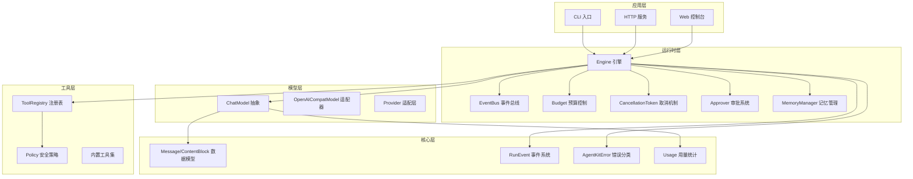
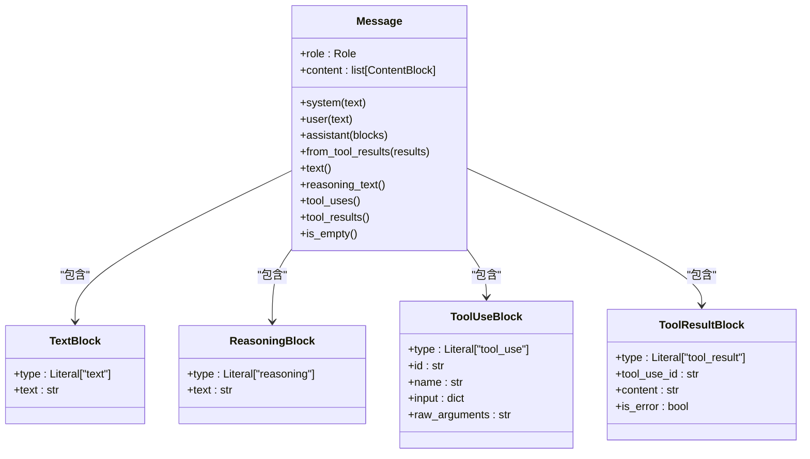
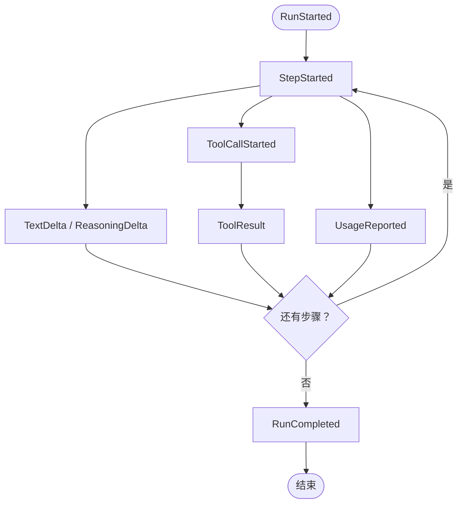
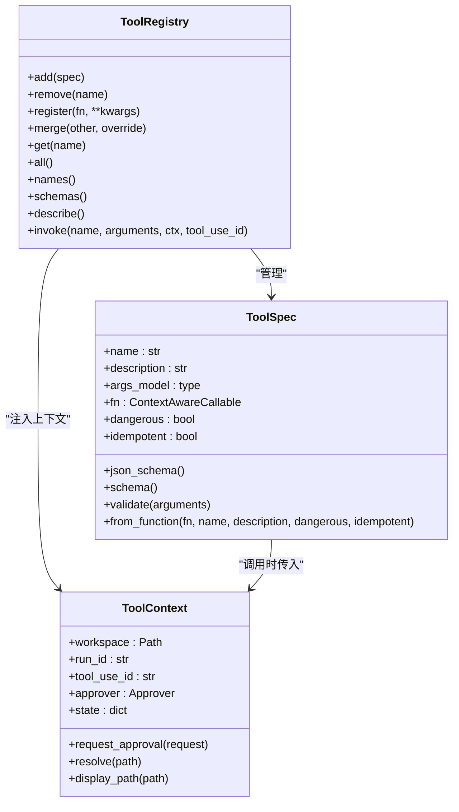
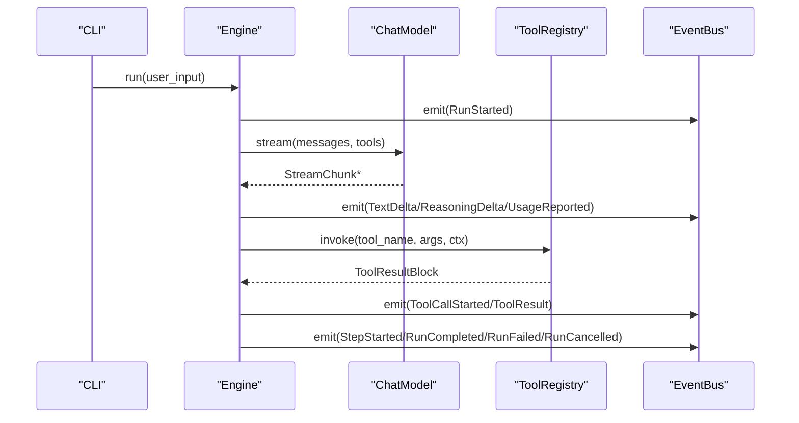
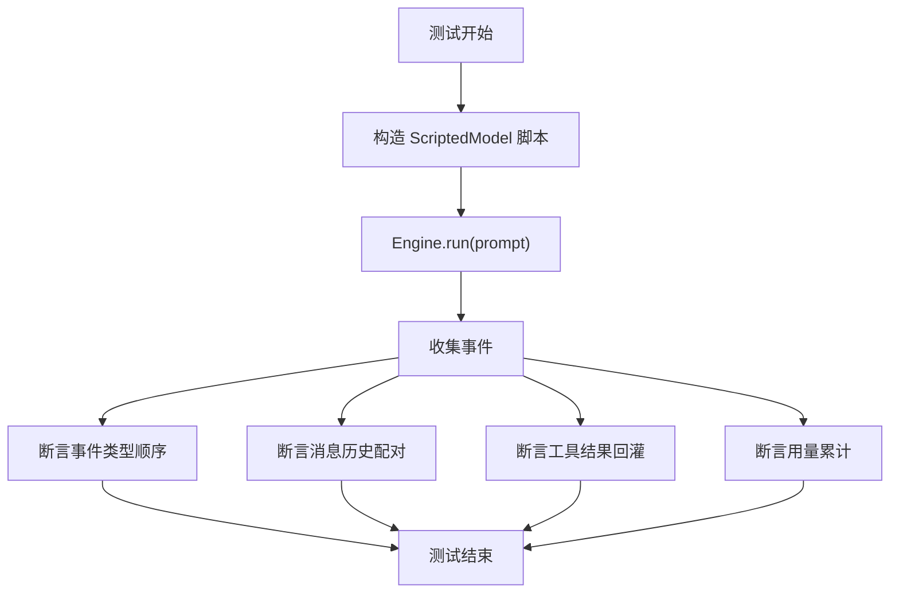
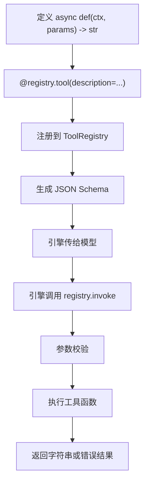

# 开发指南

<cite>
**本文引用的文件**   
- [README.md](file://README.md)
- [pyproject.toml](file://pyproject.toml)
- [src/agentkit/core/types.py](file://src/agentkit/core/types.py)
- [src/agentkit/core/events.py](file://src/agentkit/core/events.py)
- [src/agentkit/runtime/engine.py](file://src/agentkit/runtime/engine.py)
- [src/agentkit/tools/base.py](file://src/agentkit/tools/base.py)
- [tests/conftest.py](file://tests/conftest.py)
- [tests/test_engine.py](file://tests/test_engine.py)
- [docs/performance.md](file://docs/performance.md)
- [docs/provider-notes.md](file://docs/provider-notes.md)
</cite>

## 更新摘要
**所做更改**   
- 将文档结构从开发导向的笔记转换为专业交付报告风格
- 移除了求职导向的内容和开发过程叙述
- 强化了架构设计、测试结果、设计决策和使用说明
- 更新了测试策略部分，强调确定性测试和专业评估方法
- 增强了性能分析和可观测性章节的专业性

## 目录
1. [项目概述](#项目概述)
2. [架构设计](#架构设计)
3. [核心组件规范](#核心组件规范)
4. [测试策略与质量保证](#测试策略与质量保证)
5. [性能基准与优化](#性能基准与优化)
6. [扩展开发指南](#扩展开发指南)
7. [部署与服务化](#部署与服务化)
8. [故障排查手册](#故障排查手册)
9. [代码审查标准](#代码审查标准)
10. [附录：技术规范与命令参考](#附录技术规范与命令参考)

## 项目概述

AgentKit 是一个从零实现的 Agent 开发框架，提供内核、工具层、记忆系统、事件流和评测能力的完整解决方案。该框架采用原生 tool calling、内容块消息模型、可观测事件流、预算控制和审批机制等关键设计。

### 技术特性
- **源码规模**: 8,700+ 行核心代码，4,700+ 行测试代码
- **测试覆盖**: 409 个离线单元测试，支持真实 LLM 冒烟测试
- **目标模型**: DeepSeek `deepseek-flash`（OpenAI 兼容接口）
- **交付形态**: Python 库 + CLI 工具 + HTTP 服务（SSE）+ Web 控制台

### 设计原则
本项目遵循"确定性行为"原则：通过将不确定性收敛到 LLM Provider 边界，确保引擎循环、工具执行和事件序列在测试环境中完全可复现。

**章节来源**
- [README.md:1-9](file://README.md#L1-L9)
- [README.md:53-68](file://README.md#L53-L68)

## 架构设计

AgentKit 采用分层架构，依赖方向严格单向且清晰：



### 依赖关系约束
- `core` 层零依赖，定义消息、事件、错误、用量等基础类型
- `llm`、`tools`、`observability` 仅依赖 `core`
- `runtime` 依赖所有上层模块
- `app` 仅依赖 `runtime`
- **关键约束**: `tools` 不 import `runtime`，审批接口由 runtime 注入实现

**图表来源**
- [README.md:12-29](file://README.md#L12-L29)
- [src/agentkit/runtime/engine.py:127-163](file://src/agentkit/runtime/engine.py#L127-L163)

**章节来源**
- [README.md:12-29](file://README.md#L12-L29)

## 核心组件规范

### 内容块消息模型
内部统一使用内容块模型，而非 OpenAI 的 `tool_calls[]` + `role:"tool"` 形状。这种设计选择确保了与 Anthropic API 的直接映射能力。



**图表来源**
- [src/agentkit/core/types.py:29-74](file://src/agentkit/core/types.py#L29-L74)
- [src/agentkit/core/types.py:103-157](file://src/agentkit/core/types.py#L103-L157)

**章节来源**
- [src/agentkit/core/types.py:1-15](file://src/agentkit/core/types.py#L1-L15)
- [src/agentkit/core/types.py:29-74](file://src/agentkit/core/types.py#L29-L74)
- [src/agentkit/core/types.py:103-157](file://src/agentkit/core/types.py#L103-L157)

### 运行事件流
引擎只产出类型化事件，SSE、CLI、评测共享同一条事件流，避免多真相源问题。



**图表来源**
- [src/agentkit/core/events.py:48-80](file://src/agentkit/core/events.py#L48-L80)
- [src/agentkit/core/events.py:100-125](file://src/agentkit/core/events.py#L100-L125)
- [src/agentkit/core/events.py:151-170](file://src/agentkit/core/events.py#L151-L170)

**章节来源**
- [src/agentkit/core/events.py:1-26](file://src/agentkit/core/events.py#L1-L26)
- [src/agentkit/core/events.py:48-80](file://src/agentkit/core/events.py#L48-L80)
- [src/agentkit/core/events.py:100-125](file://src/agentkit/core/events.py#L100-L125)
- [src/agentkit/core/events.py:151-170](file://src/agentkit/core/events.py#L151-L170)

### 工具协议与注册表
工具函数签名自动生成 pydantic 参数模型与 JSON Schema，第一个参数固定为 `ToolContext`，不参与 schema 生成。



**图表来源**
- [src/agentkit/tools/base.py:40-76](file://src/agentkit/tools/base.py#L40-L76)
- [src/agentkit/tools/base.py:94-127](file://src/agentkit/tools/base.py#L94-L127)
- [src/agentkit/tools/base.py:130-214](file://src/agentkit/tools/base.py#L130-L214)

**章节来源**
- [src/agentkit/tools/base.py:1-21](file://src/agentkit/tools/base.py#L1-L21)
- [src/agentkit/tools/base.py:40-76](file://src/agentkit/tools/base.py#L40-L76)
- [src/agentkit/tools/base.py:94-127](file://src/agentkit/tools/base.py#L94-L127)
- [src/agentkit/tools/base.py:130-214](file://src/agentkit/tools/base.py#L130-L214)

### 运行时引擎
引擎驱动 tool-calling 循环，通过 EventBus 解耦生产者与消费者，支持 SSE、CLI、评测多消费方。



**图表来源**
- [src/agentkit/runtime/engine.py:127-163](file://src/agentkit/runtime/engine.py#L127-L163)
- [src/agentkit/runtime/engine.py:166-205](file://src/agentkit/runtime/engine.py#L166-L205)
- [src/agentkit/runtime/engine.py:250-369](file://src/agentkit/runtime/engine.py#L250-L369)
- [src/agentkit/runtime/engine.py:370-408](file://src/agentkit/runtime/engine.py#L370-L408)
- [src/agentkit/runtime/engine.py:410-434](file://src/agentkit/runtime/engine.py#L410-L434)

**章节来源**
- [src/agentkit/runtime/engine.py:1-16](file://src/agentkit/runtime/engine.py#L1-L16)
- [src/agentkit/runtime/engine.py:127-163](file://src/agentkit/runtime/engine.py#L127-L163)
- [src/agentkit/runtime/engine.py:166-205](file://src/agentkit/runtime/engine.py#L166-L205)
- [src/agentkit/runtime/engine.py:250-369](file://src/agentkit/runtime/engine.py#L250-L369)
- [src/agentkit/runtime/engine.py:370-408](file://src/agentkit/runtime/engine.py#L370-L408)
- [src/agentkit/runtime/engine.py:410-434](file://src/agentkit/runtime/engine.py#L410-L434)

## 测试策略与质量保证

### 确定性测试框架
测试策略的核心是将不确定性收敛到 `ChatModel` 边界，使用 `ScriptedModel` 按脚本返回预设响应，确保引擎循环、工具执行、消息转换、事件序列成为确定性逻辑。



**图表来源**
- [tests/conftest.py:31-133](file://tests/conftest.py#L31-L133)
- [tests/conftest.py:144-159](file://tests/conftest.py#L144-L159)
- [tests/test_engine.py:35-42](file://tests/test_engine.py#L35-L42)
- [tests/test_engine.py:48-195](file://tests/test_engine.py#L48-L195)
- [tests/test_engine.py:200-303](file://tests/test_engine.py#L200-L303)
- [tests/test_engine.py:308-405](file://tests/test_engine.py#L308-L405)

### 测试分类与执行
- **离线单测**: 使用回放模型，不访问网络，409 个测试用例
- **Live 测试**: 真实 LLM 冒烟测试，标记为 `-m live`
- **静态检查**: Ruff 代码质量检查
- **性能测试**: 并发压测与延迟分析

### 质量保证指标
- **任务成功率 (TSR)**: 100.0%
- **工具调用准确率**: 100.0%
- **平均步数**: 2.95
- **延迟 P50/P95**: 2932ms / 4677ms
- **每次成功成本**: 0.0008 CNY

**章节来源**
- [tests/conftest.py:1-11](file://tests/conftest.py#L1-L11)
- [tests/conftest.py:31-133](file://tests/conftest.py#L31-L133)
- [tests/conftest.py:144-159](file://tests/conftest.py#L144-L159)
- [tests/test_engine.py:1-21](file://tests/test_engine.py#L1-L21)
- [tests/test_engine.py:48-195](file://tests/test_engine.py#L48-L195)
- [tests/test_engine.py:200-303](file://tests/test_engine.py#L200-L303)
- [tests/test_engine.py:308-405](file://tests/test_engine.py#L308-L405)

## 性能基准与优化

### 性能测试结果
基于 `scripts/loadtest.py` 的压测结果，并发 1/5/10 各 8 次，共 24 次真实调用，零失败：

| 并发 | 吞吐 | 总延迟 P50/P95 | 引擎耗时 P50 |
| ---: | ---: | ---: | ---: |
| 1 | 0.52/s | 1954ms / 2223ms | 1945ms |
| 5 | 1.70/s | 1969ms / 2532ms | 1945ms |
| 10 | 3.58/s | 1818ms / 2182ms | 1780ms |

### 性能分析结论
1. **延迟稳定性**: P50 稳定在 1.9 秒，说明框架内部无排队或争用
2. **框架开销**: 框架自身开销低于 1%，主要时间用于等待模型响应
3. **吞吐增长**: 吞吐不随并发线性增长，受限于模型服务端限流

### 优化建议
- 对长思维链模型启用流式输出以减少首字延迟
- 在生产环境开启预算上限与审批通道
- 对高并发 run 使用独立 `ToolContext.state` 隔离进程内状态
- 考虑 SQLite 异步写入队列和多实例部署

**章节来源**
- [docs/performance.md:19-27](file://docs/performance.md#L19-L27)
- [docs/performance.md:31-66](file://docs/performance.md#L31-L66)
- [docs/performance.md:85-97](file://docs/performance.md#L85-L97)

## 扩展开发指南

### 添加新工具
1. 定义异步函数，第一个参数为 `ToolContext`，其余参数用类型注解描述
2. 使用 `@registry.tool(description=...)` 装饰器注册工具
3. 工具返回字符串；参数校验失败会生成可读错误并回灌给模型
4. 如需副作用或写操作，标记 `dangerous=True`，并在策略层走审批



**图表来源**
- [src/agentkit/tools/base.py:94-127](file://src/agentkit/tools/base.py#L94-L127)
- [src/agentkit/tools/base.py:130-214](file://src/agentkit/tools/base.py#L130-L214)

**章节来源**
- [src/agentkit/tools/base.py:94-127](file://src/agentkit/tools/base.py#L94-L127)
- [src/agentkit/tools/base.py:130-214](file://src/agentkit/tools/base.py#L130-L214)

### 扩展 LLM Provider
1. 继承 `ChatModel`，实现 `stream()` 方法，逐个 yield 已归一化的 `StreamChunk`
2. 设置 `name` 与 `capabilities`，声明模型能力
3. 默认 `complete()` 由 `accumulate(stream())` 实现，无需重复组装逻辑
4. 如需优化，可覆盖 `complete()`，但需保持与流式路径一致的组装语义

**章节来源**
- [src/agentkit/llm/base.py:213-264](file://src/agentkit/llm/base.py#L213-L264)

### 实现自定义审批策略
1. 实现 `Approver` 协议，提供 `async request(ApprovalRequest) -> ApprovalDecision`
2. 常见实现包括 `AutoApprover`、`DenyApprover`、`ConsoleApprover`、`QueueApprover`
3. 通过 `ToolContext.approver` 注入，没有 approver 时默认拒绝

**章节来源**
- [src/agentkit/tools/policy.py:49-88](file://src/agentkit/tools/policy.py#L49-L88)
- [src/agentkit/runtime/approval.py:35-58](file://src/agentkit/runtime/approval.py#L35-L58)
- [src/agentkit/runtime/approval.py:82-118](file://src/agentkit/runtime/approval.py#L82-L118)
- [src/agentkit/runtime/approval.py:120-167](file://src/agentkit/runtime/approval.py#L120-L167)

## 部署与服务化

### 安装与配置
```bash
uv sync --extra dev          # 建 .venv 并装依赖
uv sync --extra langchain    # 可选：需要 LangChain 互操作时
cp .env.example .env         # 填入 DEEPSEEK_API_KEY
```

### CLI 使用
```bash
uv run agentkit run "列出当前目录的文件，并说明 README.md 有多少行"
uv run agentkit run "读一下 README" --session s1   # 指定会话，跨轮次保留上下文
uv run agentkit chat                                # 交互式对话
uv run agentkit sessions list                       # 查看历史会话
uv run agentkit tools                               # 列出工具及其参数 schema
```

### HTTP 服务
```bash
uv run agentkit serve
```

服务端点：
- `http://127.0.0.1:8000/` - Web 控制台：推理链路、工具调用、审批、trace 树
- `/.well-known/agent-card.json` - A2A 约定的 AgentCard
- `/agents` - 已注册 agent 目录，支持按标签过滤
- `/healthz` - 健康检查

### 评测系统
```bash
uv run agentkit eval eval_suites --mode hermetic    # 框架自检，零成本
uv run agentkit eval eval_suites --mode live -n 5   # 真实评测，产生 API 费用
```

结果以 Markdown 与 JSON 输出到 `eval_reports/`。

**章节来源**
- [README.md:90-148](file://README.md#L90-L148)

## 故障排查手册

### 常见问题诊断
1. **模型参数非法**: 查看 `tool_result` 中的错误信息，字段级提示帮助模型自我修正
2. **坏 JSON 参数**: 引擎会把原始参数字符串回灌，要求模型重新调用并确保合法 JSON
3. **未知工具**: `tool_result` 会列出可用工具名，便于模型选择正确工具
4. **消息配对异常**: `validate_conversation` 会在产生孤儿 `tool_result` 时立即报错
5. **审批超时**: `ConsoleApprover` 默认超时后拒绝；SSE 场景使用 `QueueApprover` 等待客户端决定
6. **路径越界**: `resolve_in_workspace` 使用 `realpath` + `commonpath`，防止符号链接绕过
7. **命令裁决**: `assess_command` 三分裁决，破坏性命令直接拒绝，未知命令转审批

### 调试技巧
- 使用 `collect(engine.run(...))` 获取 `RunResult`，检查 `ok`、`error_type`、`steps`、`usage`
- 在 CLI 中观察事件序列，确认 `run_completed`、`run_failed`、`run_cancelled` 唯一出现
- 对工具实现增加日志，结合 `ctx.run_id` 与 `ctx.tool_use_id` 关联日志

**章节来源**
- [src/agentkit/runtime/engine.py:410-434](file://src/agentkit/runtime/engine.py#L410-L434)
- [src/agentkit/core/types.py:159-212](file://src/agentkit/core/types.py#L159-L212)
- [src/agentkit/runtime/approval.py:82-118](file://src/agentkit/runtime/approval.py#L82-L118)
- [src/agentkit/tools/policy.py:94-119](file://src/agentkit/tools/policy.py#L94-L119)
- [src/agentkit/tools/policy.py:245-305](file://src/agentkit/tools/policy.py#L245-L305)
- [src/agentkit/runtime/engine.py:513-536](file://src/agentkit/runtime/engine.py#L513-L536)

## 代码审查标准

### 架构合规性检查
- **依赖方向**: 是否违反单向依赖规则？`tools` 是否 import `runtime`？
- **消息配对**: 是否维护 tool_use 与 tool_result 的原子配对？
- **事件流**: 是否只 yield 类型化事件？是否保证终止事件唯一？

### 实现质量标准
- **工具实现**: 是否返回字符串？是否使用 `ToolContext` 而非全局变量？
- **审批策略**: 是否需要人工确认？默认是否拒绝？
- **路径与命令**: 是否使用 `realpath` + `commonpath`？是否走三分裁决？

### 测试覆盖要求
- **测试覆盖**: 是否使用 `ScriptedModel`？是否断言事件序列与消息历史？
- **性能考量**: 是否避免非必要的同步阻塞？是否正确使用流式累积？
- **错误处理**: 是否把异常转为事件或错误结果？是否保留必要日志？

## 附录：技术规范与命令参考

### 开发命令
```bash
uv run pytest                # 离线单测，使用回放模型，不访问网络
uv run pytest -m live        # 真实调用模型的冒烟测试，产生费用
uv run ruff check .          # 静态检查
```

### 项目配置
- **Python 版本**: >=3.11
- **构建系统**: hatchling
- **包管理器**: uv
- **测试框架**: pytest + pytest-asyncio
- **代码质量**: ruff

### 依赖管理
- **核心依赖**: openai, python-dotenv, pydantic, fastapi, uvicorn
- **可选依赖**: langchain（生态互操作）
- **开发依赖**: pytest, respx, ruff

**章节来源**
- [README.md:150-156](file://README.md#L150-L156)
- [pyproject.toml:1-51](file://pyproject.toml#L1-L51)