# 性能基准测试

<cite>
**本文引用的文件**   
- [README.md](file://README.md)
- [performance.md](file://docs/performance.md)
- [loadtest.py](file://scripts/loadtest.py)
- [engine.py](file://src/agentkit/runtime/engine.py)
- [bus.py](file://src/agentkit/runtime/bus.py)
- [api.py](file://src/agentkit/app/api.py)
</cite>

## 目录
1. [引言](#引言)
2. [项目结构与压测入口](#项目结构与压测入口)
3. [核心组件与性能相关设计](#核心组件与性能相关设计)
4. [架构总览：一次压测请求的完整链路](#架构总览一次压测请求的完整链路)
5. [详细组件分析](#详细组件分析)
6. [依赖关系分析](#依赖关系分析)
7. [性能结论与边界](#性能结论与边界)
8. [优化建议](#优化建议)
9. [故障排查](#故障排查)
10. [结论](#结论)

## 引言
这份文档围绕 AgentKit 的性能基准测试展开，目标是把“框架能扛多少并发”从一句模糊描述变成有边界、可复现的数字。仓库已经提供了完整的压测脚本、服务启动方式、实测结果和明确的边界说明；本文在此基础上，把压测数据与引擎、事件总线、HTTP 服务三个关键实现串联起来，解释为什么延迟不随并发上升、为什么吞吐没有线性增长，以及如果要继续往上压，应该先动哪里。

## 项目结构与压测入口
AgentKit 是一个从零实现的 Agent 开发框架，包含内核、工具层、记忆、评测、可观测性、HTTP 服务和 Web 控制台。压测相关的代码主要集中在以下位置：

- 压测脚本：`scripts/loadtest.py`
- 性能文档与复现命令：`docs/performance.md`
- HTTP 服务与 SSE 事件流：`src/agentkit/app/api.py`
- 推理引擎与事件总线：`src/agentkit/runtime/engine.py`、`src/agentkit/runtime/bus.py`
- README 中的性能数字摘要：`README.md`

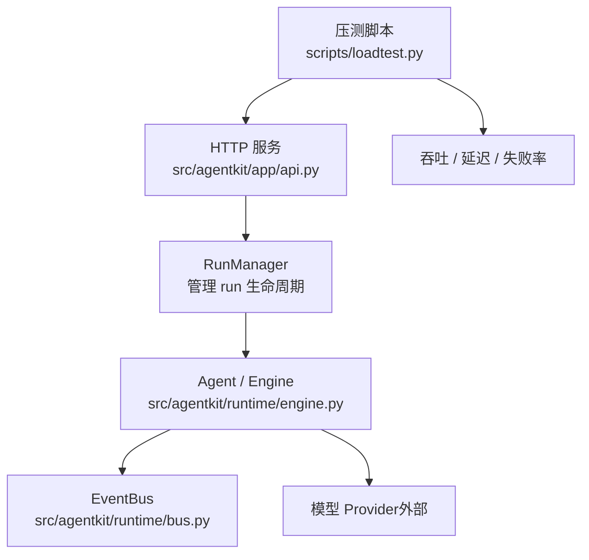

**图表来源**
- [loadtest.py:167-206](file://scripts/loadtest.py#L167-L206)
- [api.py:349-438](file://src/agentkit/app/api.py#L349-L438)
- [engine.py:127-205](file://src/agentkit/runtime/engine.py#L127-L205)
- [bus.py:30-72](file://src/agentkit/runtime/bus.py#L30-L72)

**章节来源**
- [README.md:26-38](file://README.md#L26-L38)
- [performance.md:6-14](file://docs/performance.md#L6-L14)

## 核心组件与性能相关设计
压测不是只跑一个接口，而是走完整链路：创建 run → 订阅 SSE → 引擎循环 → 工具执行 → 收尾。因此，性能不仅取决于 HTTP 层，还取决于事件分发、工具调用、记忆持久化和可观测性导出。

### 压测脚本的职责
`scripts/loadtest.py` 是一个简单但目标明确的压测客户端：

- 使用 `httpx.AsyncClient` 发起真实请求。
- 每个并发档位用信号量限流。
- 通过 `/runs` 创建任务，再通过 `/runs/{run_id}/events` 订阅 SSE。
- 统计墙钟时间、成功数、失败率、P50/P95/最大值、吞吐。
- 从 `run_completed` 事件中读取引擎自己统计的耗时，从而区分“等模型的时间”和“框架自身开销”。

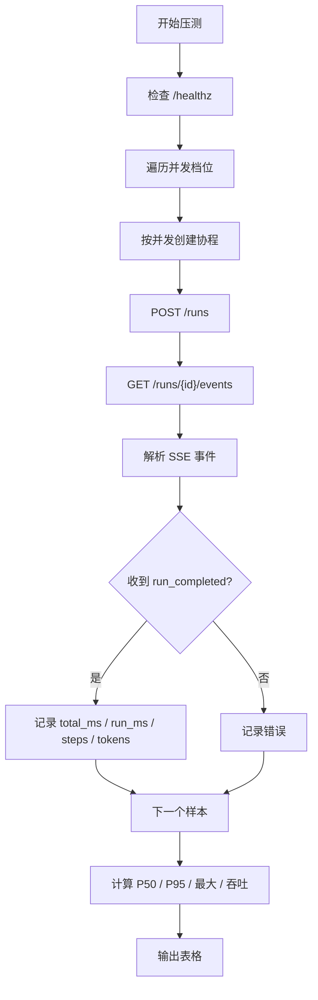

**图表来源**
- [loadtest.py:36-78](file://scripts/loadtest.py#L36-L78)
- [loadtest.py:92-136](file://scripts/loadtest.py#L92-L136)
- [loadtest.py:139-206](file://scripts/loadtest.py#L139-L206)

**章节来源**
- [loadtest.py:1-17](file://scripts/loadtest.py#L1-L17)
- [loadtest.py:32-46](file://scripts/loadtest.py#L32-L46)
- [loadtest.py:92-136](file://scripts/loadtest.py#L92-L136)

### 引擎的事件驱动设计
推理引擎的核心循环只有四步：发消息给模型、收最终答复或工具调用、执行工具并追加结果、回到第一步。它不直接返回值，而是通过事件总线向外推送类型化事件。

这个设计对性能有两个重要影响：

1. **事件解耦**：审批、工具执行、模型流式增量都可以推事件，消费者按自己的节奏取，避免“谁在等待”成为全局瓶颈。
2. **取消安全**：当消费者提前退出时，引擎会取消生产者任务，防止后台继续烧 token。

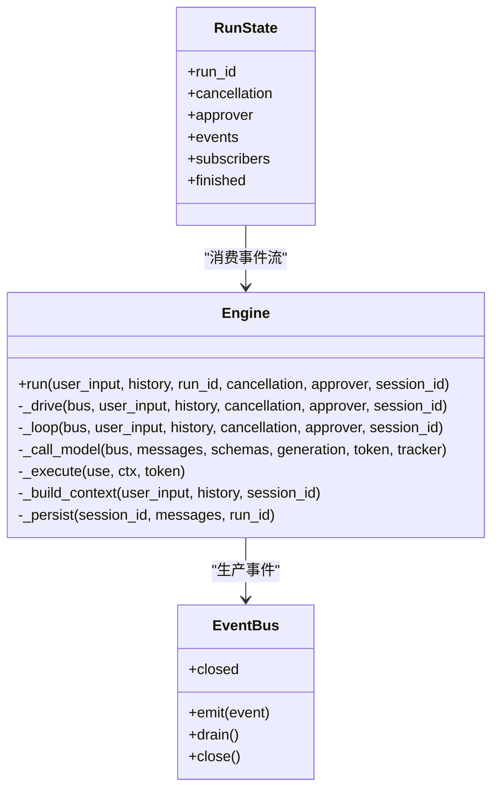

**图表来源**
- [engine.py:127-205](file://src/agentkit/runtime/engine.py#L127-L205)
- [engine.py:250-368](file://src/agentkit/runtime/engine.py#L250-L368)
- [bus.py:30-72](file://src/agentkit/runtime/bus.py#L30-L72)
- [api.py:72-162](file://src/agentkit/app/api.py#L72-L162)

**章节来源**
- [engine.py:1-16](file://src/agentkit/runtime/engine.py#L1-L16)
- [engine.py:166-205](file://src/agentkit/runtime/engine.py#L166-L205)
- [bus.py:1-14](file://src/agentkit/runtime/bus.py#L1-L14)

### HTTP 服务的断线续传与回收
HTTP 服务把 run 的生命周期拆成三件事：创建 run、订阅事件、取消 run。这样即使某个 run 跑几十秒，也不会阻塞 POST 返回。

SSE 事件带单调递增序号，服务端保留回放缓冲，客户端重连时可以带 `from_seq` 补齐断线期间的事件。同时，`RunManager` 有后台回收逻辑，清理已结束且无人监听的 run，避免长期运行后内存无限增长。

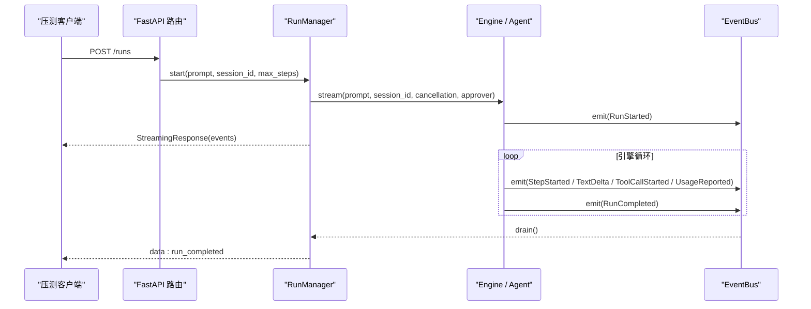

**图表来源**
- [api.py:402-438](file://src/agentkit/app/api.py#L402-L438)
- [api.py:195-239](file://src/agentkit/app/api.py#L195-L239)
- [engine.py:250-368](file://src/agentkit/runtime/engine.py#L250-L368)
- [bus.py:55-61](file://src/agentkit/runtime/bus.py#L55-L61)

**章节来源**
- [api.py:1-14](file://src/agentkit/app/api.py#L1-L14)
- [api.py:112-162](file://src/agentkit/app/api.py#L112-L162)
- [api.py:402-438](file://src/agentkit/app/api.py#L402-L438)

## 架构总览：一次压测请求的完整链路
一次压测请求并不是单纯测 HTTP 响应时间，而是覆盖以下阶段：

1. 压测脚本建立异步连接。
2. 调用健康检查端点确认服务可用。
3. 创建 run，拿到 `run_id`。
4. 订阅 SSE 事件流。
5. 引擎组装上下文、调用模型、执行工具、更新预算、写入记忆。
6. 事件经 `EventBus` 进入 `RunManager` 的回放缓冲。
7. 客户端解析 `run_completed`，记录总延迟和引擎耗时。
8. 多并发下重复上述过程，最后汇总 P50、P95、最大延迟和吞吐。

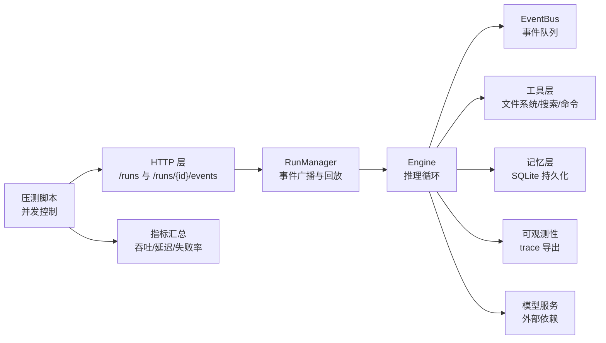

**图表来源**
- [loadtest.py:92-136](file://scripts/loadtest.py#L92-L136)
- [api.py:402-438](file://src/agentkit/app/api.py#L402-L438)
- [engine.py:250-368](file://src/agentkit/runtime/engine.py#L250-L368)
- [bus.py:30-72](file://src/agentkit/runtime/bus.py#L30-L72)

## 详细组件分析

### 压测脚本：并发、指标与失败处理
`scripts/loadtest.py` 的关键设计点如下：

- 使用 `asyncio.Semaphore(concurrency)` 控制同一时刻最多有多少个请求同时运行。
- 每个请求独立计时，记录 `total_ms` 和从事件里拿到的 `run_ms`。
- 如果收到 `run_failed` 或 `run_cancelled`，标记为失败。
- 任何异常都算一次失败，便于观察网络、超时、JSON 解析等问题。
- 使用自定义百分位函数计算 P50、P95 和最大值。
- 每档之间等待 1 秒，减少前一档余温对后一档的影响。

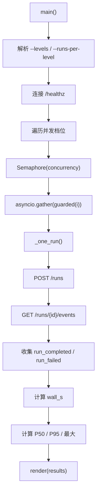

**图表来源**
- [loadtest.py:167-206](file://scripts/loadtest.py#L167-L206)
- [loadtest.py:124-136](file://scripts/loadtest.py#L124-L136)
- [loadtest.py:92-121](file://scripts/loadtest.py#L92-L121)

**章节来源**
- [loadtest.py:36-78](file://scripts/loadtest.py#L36-L78)
- [loadtest.py:92-136](file://scripts/loadtest.py#L92-L136)
- [loadtest.py:139-206](file://scripts/loadtest.py#L139-L206)

### 推理引擎：循环、预算与工具执行
引擎是性能分析中最核心的部分，因为它承担了模型调用、工具执行、事件生成和状态收敛的主要工作。

关键行为包括：

- 每次 run 创建一个 `EventBus`，并把 `_drive` 作为独立任务运行。
- 主循环中维护步骤计数、预算追踪、消息历史。
- 模型调用使用流式接口，边生成边推 `TextDelta` 和 `ReasoningDelta`。
- 工具调用前发 `ToolCallStarted`，完成后发 `ToolResultEvent`。
- 最终 `RunCompleted` 中包含 `duration_ms`，这是压测区分“框架开销”和“模型等待时间”的关键字段。
- 工具参数非法时不走异常分支，而是回灌错误信息让模型自我修正。

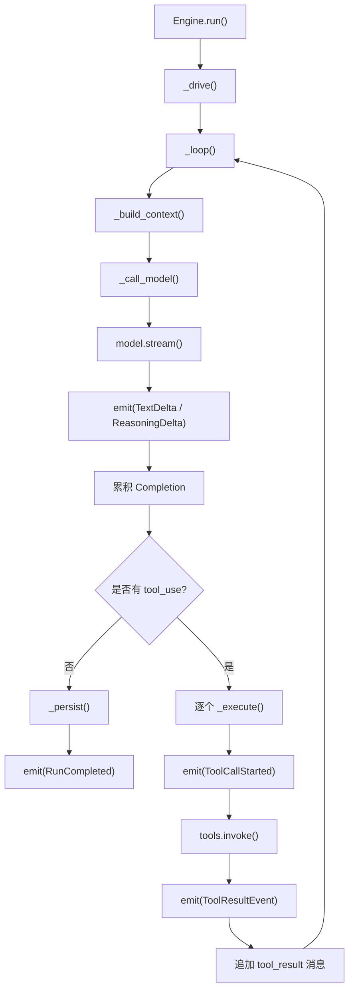

**图表来源**
- [engine.py:166-205](file://src/agentkit/runtime/engine.py#L166-L205)
- [engine.py:250-368](file://src/agentkit/runtime/engine.py#L250-L368)
- [engine.py:370-434](file://src/agentkit/runtime/engine.py#L370-L434)
- [engine.py:438-493](file://src/agentkit/runtime/engine.py#L438-L493)

**章节来源**
- [engine.py:127-205](file://src/agentkit/runtime/engine.py#L127-L205)
- [engine.py:250-368](file://src/agentkit/runtime/engine.py#L250-L368)
- [engine.py:370-434](file://src/agentkit/runtime/engine.py#L370-L434)

### 事件总线：同步入队与终止语义
`EventBus` 的设计很克制：它就是一个带序列号的异步队列，负责把引擎产生的事件交给消费者。

性能相关要点：

- `emit` 是同步方法，避免在工具执行或审批路径中引入额外的异步复杂度。
- 关闭后继续 emit 的事件会被丢弃，因为此时已经没有消费者。
- `drain` 遇到哨兵值就结束，保证消费者总能等到终止信号。
- 每个事件带 `seq`，用于 SSE 断线续传。

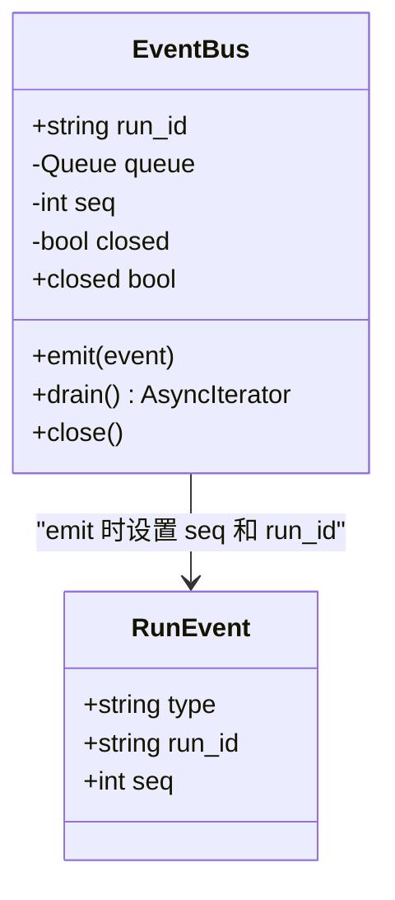

**图表来源**
- [bus.py:30-72](file://src/agentkit/runtime/bus.py#L30-L72)

**章节来源**
- [bus.py:1-14](file://src/agentkit/runtime/bus.py#L1-L14)
- [bus.py:30-72](file://src/agentkit/runtime/bus.py#L30-L72)

### HTTP 服务：RunManager 与 SSE 广播
`RunManager` 是压测场景下的关键中间件：它负责启动 run、广播事件、支持取消、回收资源。

关键点：

- 每个 run 对应一个 `RunState`，包含取消令牌、审批队列、已产出事件、订阅者集合。
- `_pump` 把 agent 的事件流转发到所有订阅者。
- `subscribe` 先回放历史事件，再实时推送。
- 后台 `reap` 定期清理已结束且无订阅者的 run。
- SSE 响应头关闭反向代理缓冲，保证流式效果。

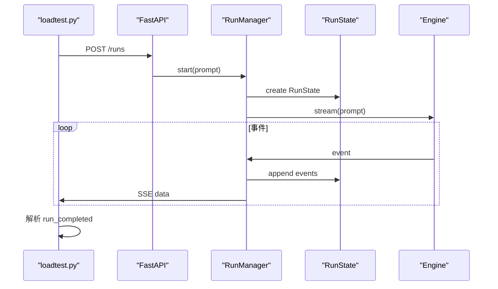

**图表来源**
- [api.py:112-162](file://src/agentkit/app/api.py#L112-L162)
- [api.py:195-239](file://src/agentkit/app/api.py#L195-L239)
- [api.py:242-266](file://src/agentkit/app/api.py#L242-L266)
- [api.py:402-438](file://src/agentkit/app/api.py#L402-L438)

**章节来源**
- [api.py:72-162](file://src/agentkit/app/api.py#L72-L162)
- [api.py:195-239](file://src/agentkit/app/api.py#L195-L239)
- [api.py:242-266](file://src/agentkit/app/api.py#L242-L266)
- [api.py:402-438](file://src/agentkit/app/api.py#L402-L438)

## 依赖关系分析
从性能角度看，AgentKit 的依赖方向比较清晰：

- 压测脚本依赖 HTTP 服务。
- HTTP 服务依赖 `RunManager`、`Agent`、`Observer`、`Settings`。
- `Agent` 内部依赖 `Engine`、`ToolRegistry`、`MemoryManager`、`Budget`。
- `Engine` 依赖 `EventBus`、`ChatModel`、`ToolRegistry`、`MemoryManager`。
- `EventBus` 几乎零外部依赖，只依赖事件类型。

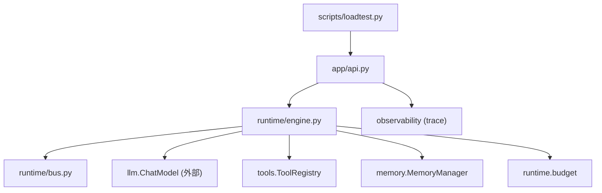

**图表来源**
- [loadtest.py:167-206](file://scripts/loadtest.py#L167-L206)
- [api.py:349-438](file://src/agentkit/app/api.py#L349-L438)
- [engine.py:127-205](file://src/agentkit/runtime/engine.py#L127-L205)
- [bus.py:30-72](file://src/agentkit/runtime/bus.py#L30-L72)

**章节来源**
- [README.md:131-147](file://README.md#L131-L147)
- [engine.py:127-205](file://src/agentkit/runtime/engine.py#L127-L205)
- [api.py:349-438](file://src/agentkit/app/api.py#L349-L438)

## 性能结论与边界
根据仓库提供的 README 和性能文档，当前压测的核心结论如下：

| 并发 | 吞吐 | 总延迟 P50 / P95 | 引擎耗时 P50 |
| ---: | ---: | ---: | ---: |
| 1 | 约 0.52 /s | 约 1954 ms / 2223 ms | 约 1945 ms |
| 5 | 约 1.70 /s | 约 1969 ms / 2532 ms | 约 1945 ms |
| 10 | 约 3.58 /s | 约 1818 ms / 2182 ms | 约 1780 ms |

这些数字来自真实调用 `deepseek-flash`，并发 1/5/10 各跑 8 次，共 24 次真实调用，零失败。

### 三个关键观察
1. **延迟不随并发上升**  
   P50 在并发 1/5/10 下基本是一条平线，说明框架内部没有明显的排队或争用。如果事件分发、SQLite 写入或 SSE 编码存在串行瓶颈，并发上去后 P50 通常会翘头。

2. **框架自身开销不到 1%**  
   总延迟是压测脚本测的墙钟时间，引擎耗时是 `RunCompleted` 事件里引擎自己统计的那一段。两者差值代表 HTTP 往返、SSE 传输和 JSON 序列化开销。并发 1 时差值约 9 毫秒，说明链路上绝大部分时间在等模型返回。

3. **吞吐不随并发线性增长**  
   1 到 5 是约 3.3 倍，5 到 10 只有约 2.1 倍。原因不在框架内部：模型服务端的限流可能是基于并发数而非 RPM，压测脚本本身也是单进程 asyncio，多个并发连接共享一个事件循环。

### 明确没测到的边界
- 更高并发下的表现和 429 限流触发点。
- 长时间运行的内存增长、SQLite 膨胀、连接泄漏。
- 多轮会话下的上下文裁剪开销。
- 写工具或命令执行工具的子进程开销与审批等待。
- 多实例、容器、反向代理部署。

**章节来源**
- [README.md:26-38](file://README.md#L26-L38)
- [performance.md:18-26](file://docs/performance.md#L18-L26)
- [performance.md:30-64](file://docs/performance.md#L30-L64)
- [performance.md:68-81](file://docs/performance.md#L68-L81)

## 优化建议
文档已经按性价比排序给出了四条优先优化方向，它们不是“现在很慢”，而是“并发再上一个量级时会先撞到的地方”：

1. **换掉压测客户端**  
   使用多进程压测客户端，并用假模型替换真实模型，排除模型服务端和网络影响，才能测出框架上限。

2. **给 SQLite 加异步写入队列**  
   当前每次 `record` 可能走线程池，会话多、写入频繁时线程池会成为瓶颈。

3. **给 `RunManager` 的事件缓冲带上限**  
   当前每个 run 的事件全留在内存里直到被回收，长会话会堆起来。环形缓冲或落盘更稳。

4. **OTel 导出改批量**  
   当前 JSONL 是同步追加写，高频下会变成热点。

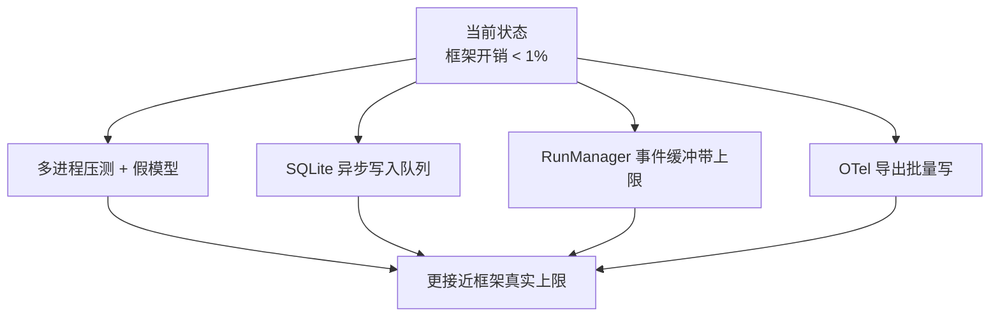

**图表来源**
- [performance.md:85-96](file://docs/performance.md#L85-L96)

**章节来源**
- [performance.md:85-96](file://docs/performance.md#L85-L96)

## 故障排查
压测过程中如果出现失败，可以从以下几个维度定位：

### 压测脚本侧
- 无法连接服务：检查端口、健康检查端点和网络。
- 请求超时：调整 `--timeout`。
- JSON 解析失败：检查 SSE 事件格式和 `data:` 行。
- 未收到 `run_completed`：检查是否收到 `run_failed` 或 `run_cancelled`。

### HTTP 服务侧
- run 不存在：检查 `run_id` 是否正确。
- SSE 断线：检查 `from_seq` 是否携带正确序号。
- 服务崩溃：查看日志中 run 失败的异常信息。
- 内存增长：检查 `RunManager.reap()` 是否清理已结束且无订阅者的 run。

### 引擎侧
- 达到最大步数：检查 `max_steps` 配置。
- 预算超限：检查预算配置和模型用量。
- 工具执行失败：检查工具策略、审批流程和工具实现。
- 消息配对不完整：检查记忆持久化前的对话不变量校验。

**章节来源**
- [loadtest.py:167-206](file://scripts/loadtest.py#L167-L206)
- [api.py:409-474](file://src/agentkit/app/api.py#L409-L474)
- [engine.py:250-368](file://src/agentkit/runtime/engine.py#L250-L368)
- [engine.py:465-493](file://src/agentkit/runtime/engine.py#L465-L493)

## 结论
AgentKit 的性能基准测试并不只是报一个 QPS，而是明确区分了“总延迟”和“引擎耗时”，并指出绝大多数时间花在等模型返回上。在当前压测条件下，框架内部没有明显排队或争用，自身开销不到 1%。如果要继续提升，应该先排除模型服务端和压测客户端的影响，再逐步优化 SQLite 写入、事件缓冲和 trace 导出。

对于作品集或面试场景，最重要的不是“吞吐很高”，而是能把数字的来源、边界和下一步优化方向说清楚。仓库已经提供了足够清晰的实现和文档，本文只是把它们串成一条可理解的链路。