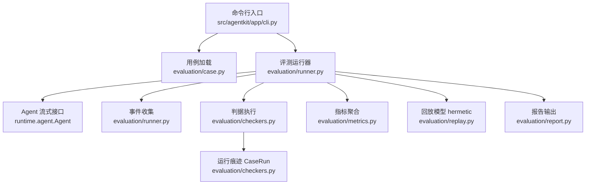
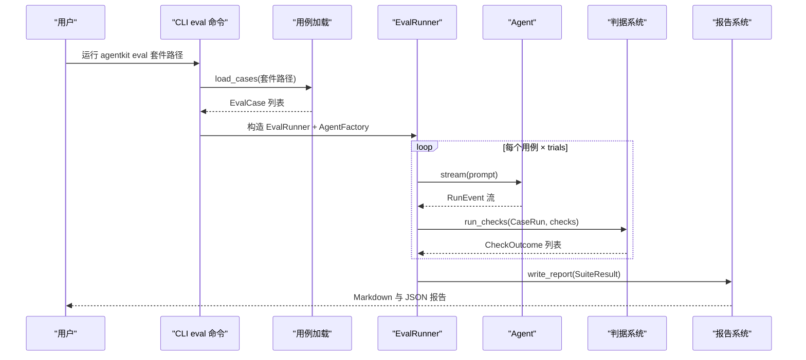
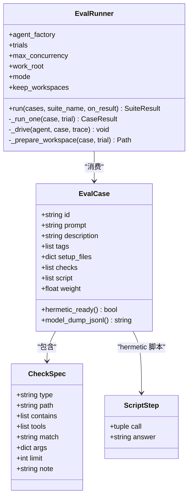
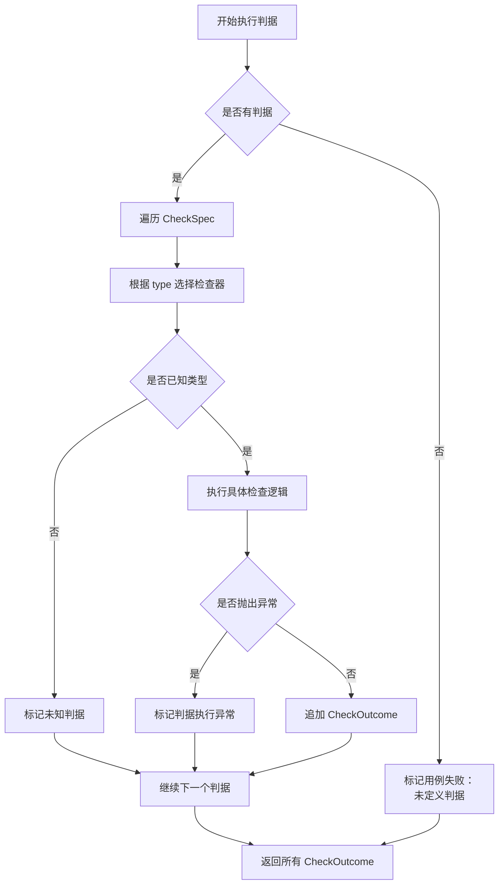
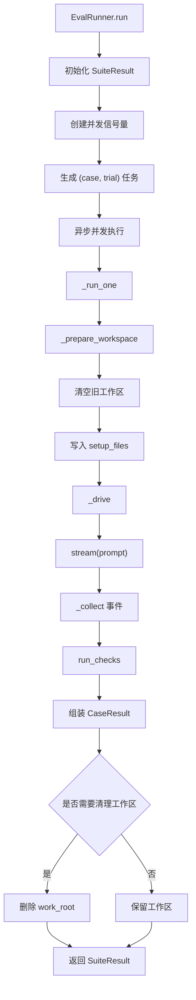
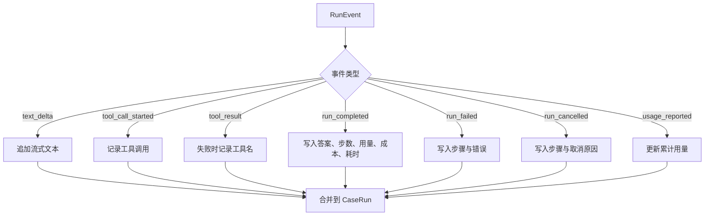
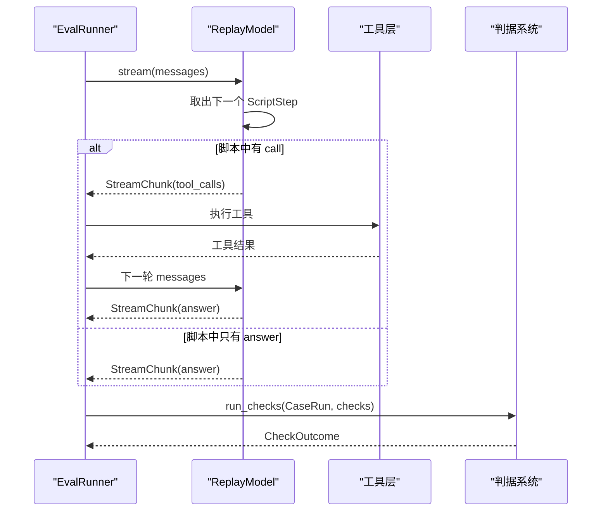
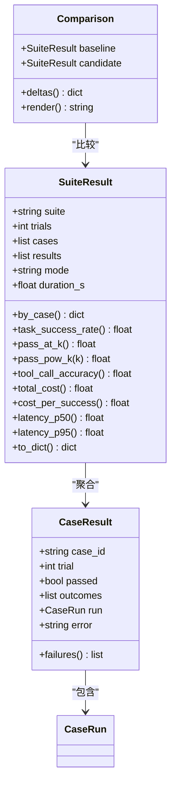
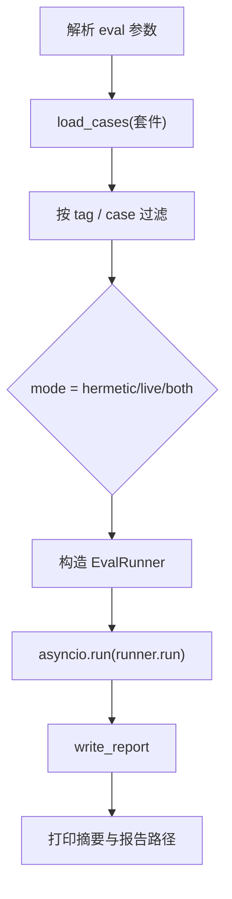
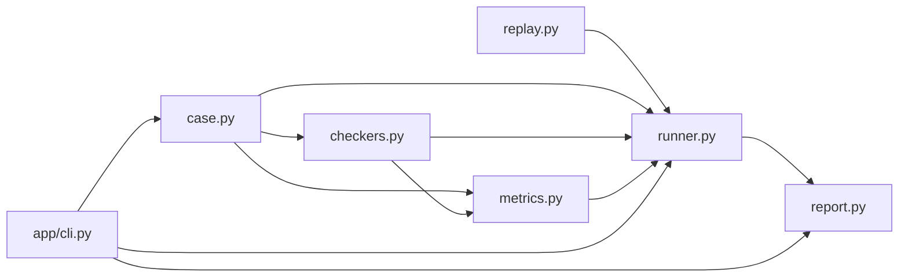

# 评估框架

<cite>
**本文引用的文件**   
- [README.md](file://README.md)
- [evaluation/__init__.py](file://src/agentkit/evaluation/__init__.py)
- [evaluation/case.py](file://src/agentkit/evaluation/case.py)
- [evaluation/checkers.py](file://src/agentkit/evaluation/checkers.py)
- [evaluation/metrics.py](file://src/agentkit/evaluation/metrics.py)
- [evaluation/replay.py](file://src/agentkit/evaluation/replay.py)
- [evaluation/report.py](file://src/agentkit/evaluation/report.py)
- [evaluation/runner.py](file://src/agentkit/evaluation/runner.py)
- [app/cli.py](file://src/agentkit/app/cli.py)
- [adr/0008-evaluation-metrics.md](file://docs/adr/0008-evaluation-metrics.md)
</cite>

## 目录
1. [引言](#引言)
2. [项目结构](#项目结构)
3. [核心组件](#核心组件)
4. [架构总览](#架构总览)
5. [详细组件分析](#详细组件分析)
6. [依赖关系分析](#依赖关系分析)
7. [性能与成本特性](#性能与成本特性)
8. [故障排查指南](#故障排查指南)
9. [结论](#结论)
10. [附录：评测指标说明](#附录评测指标说明)

## 引言
本仓库的评估框架是一个从零实现的 Agent 评测子系统，目标是把“Agent 是否做对了”从“对话文本看起来对不对”升级为“执行后的状态和关键事实是否满足声明式判据”。它同时支持两层评测：

- **hermetic（回放）模式**：用脚本驱动假模型，不联网、不花钱、结果确定，适合 CI 验证评测框架自身。
- **live（真实）模式**：调用真实 LLM，评估 Agent 的真实能力。

该框架强调三个关键点：
1. 评测的是**执行后的状态**，而不是单纯比对最终答复。
2. 上线的关键指标是 **pass^k**，不是 TSR 或 pass@k。
3. 报告必须保留失败明细和样本量，避免只报一个笼统的成功率。

这些设计取舍在 README 与 ADR 中都有明确记录。

**章节来源**
- [README.md:8-24](file://README.md#L8-L24)
- [README.md:40-63](file://README.md#L40-L63)
- [adr/0008-evaluation-metrics.md:46-72](file://docs/adr/0008-evaluation-metrics.md#L46-L72)

## 项目结构
评估框架位于 `src/agentkit/evaluation`，围绕“用例定义 → 运行器 → 判据 → 指标 → 回放模型 → 报告”这条主线组织。CLI 层负责加载套件、选择模式、构造 Agent 工厂并写出报告。

**图表来源**
- [app/cli.py:594-674](file://src/agentkit/app/cli.py#L594-L674)
- [evaluation/case.py:99-162](file://src/agentkit/evaluation/case.py#L99-L162)
- [evaluation/runner.py:39-149](file://src/agentkit/evaluation/runner.py#L39-L149)
- [evaluation/checkers.py:22-34](file://src/agentkit/evaluation/checkers.py#L22-L34)
- [evaluation/metrics.py:51-85](file://src/agentkit/evaluation/metrics.py#L51-L85)
- [evaluation/replay.py:27-88](file://src/agentkit/evaluation/replay.py#L27-L88)
- [evaluation/report.py:28-150](file://src/agentkit/evaluation/report.py#L28-L150)

**章节来源**
- [evaluation/__init__.py:1-16](file://src/agentkit/evaluation/__init__.py#L1-L16)
- [app/cli.py:594-674](file://src/agentkit/app/cli.py#L594-L674)

## 核心组件
评估框架的核心由以下模块组成：

| 组件 | 职责 | 关键类型 / 函数 |
|---|---|---|
| 用例定义 | 声明 prompt、工作区初始文件、判据、hermetic 脚本、权重 | `EvalCase`、`CheckSpec`、`ScriptStep`、`load_cases`、`dump_cases` |
| 运行器 | 并发执行 trial、隔离工作区、驱动 Agent、收集事件、聚合结果 | `EvalRunner`、`AgentFactory`、`summarize_usage` |
| 判据系统 | 对工作区和运行痕迹执行声明式检查 | `run_checks`、`CHECKERS`、`CaseRun`、`CheckOutcome` |
| 指标系统 | 计算成功率、延迟分位、工具准确率、成本等 | `SuiteResult`、`CaseResult`、`percentile`、`Comparison` |
| 回放模型 | 按脚本产出 tool call 或答案，用于 hermetic 模式 | `ReplayModel`、`build_from_script` |
| 报告系统 | 输出 Markdown 与 JSON 报告，包含失败明细 | `render_markdown`、`write_report`、`report_paths` |

**章节来源**
- [evaluation/case.py:37-127](file://src/agentkit/evaluation/case.py#L37-L127)
- [evaluation/runner.py:39-191](file://src/agentkit/evaluation/runner.py#L39-L191)
- [evaluation/checkers.py:22-259](file://src/agentkit/evaluation/checkers.py#L22-L259)
- [evaluation/metrics.py:37-355](file://src/agentkit/evaluation/metrics.py#L37-L355)
- [evaluation/replay.py:27-97](file://src/agentkit/evaluation/replay.py#L27-L97)
- [evaluation/report.py:28-155](file://src/agentkit/evaluation/report.py#L28-L155)

## 架构总览
评估框架的整体流程如下：

**图表来源**
- [app/cli.py:612-674](file://src/agentkit/app/cli.py#L612-L674)
- [evaluation/case.py:130-162](file://src/agentkit/evaluation/case.py#L130-L162)
- [evaluation/runner.py:63-123](file://src/agentkit/evaluation/runner.py#L63-L123)
- [evaluation/checkers.py:233-259](file://src/agentkit/evaluation/checkers.py#L233-L259)
- [evaluation/report.py:141-150](file://src/agentkit/evaluation/report.py#L141-L150)

## 详细组件分析

### 用例定义与数据模型
用例定义采用 Pydantic 模型，强调“声明式判据”而非可执行代码。这样做的目的是让用例保持为数据，便于 diff、静态分析和复用，而不是变成注入面。

关键设计点：
- `CheckSpec` 限定判据类型，包括答复检查、文件/目录检查、工具调用检查、步数限制等。
- `EvalCase` 描述一次评测任务：prompt、初始文件、判据、hermetic 脚本、权重。
- `ScriptStep` 是 hermetic 模式下的一次模型输出，要么返回 tool call，要么返回最终答案。
- `load_cases` 从 JSONL 读取用例，支持目录扫描、注释行跳过、id 重复校验。

**图表来源**
- [evaluation/case.py:37-127](file://src/agentkit/evaluation/case.py#L37-L127)
- [evaluation/runner.py:39-149](file://src/agentkit/evaluation/runner.py#L39-L149)

**章节来源**
- [evaluation/case.py:1-26](file://src/agentkit/evaluation/case.py#L1-L26)
- [evaluation/case.py:37-127](file://src/agentkit/evaluation/case.py#L37-L127)
- [evaluation/case.py:130-171](file://src/agentkit/evaluation/case.py#L130-L171)

### 判据系统与运行痕迹
判据系统的输入是 `CaseRun`，即一次运行留下的全部痕迹；输出是 `CheckOutcome`，包含是否通过和面向人的说明。

`CaseRun` 暴露的信息包括：
- 最终答案
- 调用的工具名与参数
- 失败的工具
- 步数、用量、成本、耗时
- 错误信息
- 工作区路径

判据类型覆盖：
- 答复包含 / 不包含
- 文件存在 / 不存在 / 包含内容 / 不包含内容
- 目录存在 / 不存在
- 工具被调用 / 未被调用
- 工具入参包含指定键值
- 没有失败工具
- 最大步数限制

**图表来源**
- [evaluation/checkers.py:22-34](file://src/agentkit/evaluation/checkers.py#L22-L34)
- [evaluation/checkers.py:216-259](file://src/agentkit/evaluation/checkers.py#L216-L259)

**章节来源**
- [evaluation/checkers.py:1-8](file://src/agentkit/evaluation/checkers.py#L1-L8)
- [evaluation/checkers.py:22-68](file://src/agentkit/evaluation/checkers.py#L22-L68)
- [evaluation/checkers.py:77-214](file://src/agentkit/evaluation/checkers.py#L77-L214)
- [evaluation/checkers.py:216-259](file://src/agentkit/evaluation/checkers.py#L216-L259)

### 评测运行器与工作区隔离
`EvalRunner` 是评估框架的调度中心。它负责：
- 创建独立工作区，避免多次 trial 互相污染。
- 控制并发，默认上限为 3，主要为了防止 API 限流导致环境噪声混入成功率。
- 驱动 Agent 的流式事件，并把事件收敛到 `CaseRun`。
- 捕获单次试验异常，保证一个用例失败不会拖垮整套评测。
- 清理工作区（除非显式保留）。

**图表来源**
- [evaluation/runner.py:39-149](file://src/agentkit/evaluation/runner.py#L39-L149)
- [evaluation/runner.py:152-178](file://src/agentkit/evaluation/runner.py#L152-L178)

**章节来源**
- [evaluation/runner.py:1-16](file://src/agentkit/evaluation/runner.py#L1-L16)
- [evaluation/runner.py:39-97](file://src/agentkit/evaluation/runner.py#L39-L97)
- [evaluation/runner.py:101-149](file://src/agentkit/evaluation/runner.py#L101-L149)
- [evaluation/runner.py:152-191](file://src/agentkit/evaluation/runner.py#L152-L191)

### 事件收集与 CaseRun 构建
运行器通过遍历 Agent 的流式事件，把分散的事件聚合成一次运行的完整痕迹。重点字段映射如下：

| 事件类型 | 写入字段 |
|---|---|
| `text_delta` | 累积流式文本 |
| `tool_call_started` | 记录工具名与参数 |
| `tool_result` | 若失败则记录工具名 |
| `run_completed` | 答案、步数、用量、成本、耗时 |
| `run_failed` | 步骤与错误信息 |
| `run_cancelled` | 步骤与取消原因 |
| `usage_reported` | 累计用量兜底 |

**图表来源**
- [evaluation/runner.py:152-178](file://src/agentkit/evaluation/runner.py#L152-L178)

**章节来源**
- [evaluation/runner.py:125-136](file://src/agentkit/evaluation/runner.py#L125-L136)
- [evaluation/runner.py:152-178](file://src/agentkit/evaluation/runner.py#L152-L178)

### 回放模型与 hermetic 模式
`ReplayModel` 是 hermetic 模式的替身模型。它按 `ScriptStep` 顺序产出响应：
- 如果 step 有 `call`，就返回 tool call。
- 否则返回最终答案。
- 如果脚本耗尽，仍会返回一个终止答复，让判据去发现“该调的工具没调”，而不是让评测因边界异常失败。

**图表来源**
- [evaluation/replay.py:27-88](file://src/agentkit/evaluation/replay.py#L27-L88)
- [evaluation/runner.py:101-123](file://src/agentkit/evaluation/runner.py#L101-L123)

**章节来源**
- [evaluation/replay.py:1-11](file://src/agentkit/evaluation/replay.py#L1-L11)
- [evaluation/replay.py:27-88](file://src/agentkit/evaluation/replay.py#L27-L88)

### 指标聚合与报告
指标层把 `CaseResult` 汇总成 `SuiteResult`，并提供三类成功率、工具准确率、延迟分位、成本、token 用量等统计。报告层则输出人类可读的 Markdown 和机器可读的 JSON。

关键行为：
- 三种成功率并列展示：TSR、pass@k、pass^k。
- 成本查不到价格时返回 `None`，不伪造精确数字。
- 报告包含逐用例结果、失败归因、运行错误、失败明细。
- 对比功能支持基准与候选两套结果的差值展示。

**图表来源**
- [evaluation/metrics.py:51-85](file://src/agentkit/evaluation/metrics.py#L51-L85)
- [evaluation/metrics.py:101-284](file://src/agentkit/evaluation/metrics.py#L101-L284)
- [evaluation/metrics.py:294-349](file://src/agentkit/evaluation/metrics.py#L294-L349)

**章节来源**
- [evaluation/metrics.py:1-23](file://src/agentkit/evaluation/metrics.py#L1-L23)
- [evaluation/metrics.py:37-48](file://src/agentkit/evaluation/metrics.py#L37-L48)
- [evaluation/metrics.py:101-227](file://src/agentkit/evaluation/metrics.py#L101-L227)
- [evaluation/metrics.py:243-284](file://src/agentkit/evaluation/metrics.py#L243-L284)
- [evaluation/report.py:28-150](file://src/agentkit/evaluation/report.py#L28-L150)

### CLI 集成与运行入口
CLI 的 `eval` 子命令负责：
- 解析套件路径、trial 次数、模式、并发、输出目录、标签过滤、用例过滤。
- 加载设置并构造工作区根目录。
- 根据模式筛选可跑用例。
- 调用 `EvalRunner` 执行评测。
- 写出 Markdown 与 JSON 报告。
- 对 hermetic 模式给出可靠性提示。

**图表来源**
- [app/cli.py:594-674](file://src/agentkit/app/cli.py#L594-L674)

**章节来源**
- [app/cli.py:594-674](file://src/agentkit/app/cli.py#L594-L674)

## 依赖关系分析
评估框架内部依赖方向清晰：
- `case.py` 提供用例与判据的数据模型。
- `checkers.py` 消费 `case.py` 中的 `CheckSpec`，并产出 `CaseRun` 与 `CheckOutcome`。
- `metrics.py` 消费 `CaseResult`、`CaseRun`、`CheckOutcome`、`EvalCase`。
- `replay.py` 实现 `ChatModel` 接口，供 hermetic 模式使用。
- `runner.py` 组合以上模块，并依赖运行时 `Agent`。
- `report.py` 消费 `SuiteResult`。
- CLI 作为外部入口，依赖 `evaluation` 包。

**图表来源**
- [evaluation/case.py:1-34](file://src/agentkit/evaluation/case.py#L1-L34)
- [evaluation/checkers.py:10-19](file://src/agentkit/evaluation/checkers.py#L10-L19)
- [evaluation/metrics.py:25-34](file://src/agentkit/evaluation/metrics.py#L25-L34)
- [evaluation/replay.py:13-24](file://src/agentkit/evaluation/replay.py#L13-L24)
- [evaluation/runner.py:18-33](file://src/agentkit/evaluation/runner.py#L18-L33)
- [evaluation/report.py:10-17](file://src/agentkit/evaluation/report.py#L10-L17)
- [app/cli.py:612-616](file://src/agentkit/app/cli.py#L612-L616)

**章节来源**
- [evaluation/__init__.py:1-16](file://src/agentkit/evaluation/__init__.py#L1-L16)
- [evaluation/case.py:1-34](file://src/agentkit/evaluation/case.py#L1-L34)
- [evaluation/checkers.py:10-19](file://src/agentkit/evaluation/checkers.py#L10-L19)
- [evaluation/metrics.py:25-34](file://src/agentkit/evaluation/metrics.py#L25-L34)
- [evaluation/replay.py:13-24](file://src/agentkit/evaluation/replay.py#L13-L24)
- [evaluation/runner.py:18-33](file://src/agentkit/evaluation/runner.py#L18-L33)
- [evaluation/report.py:10-17](file://src/agentkit/evaluation/report.py#L10-L17)
- [app/cli.py:612-616](file://src/agentkit/app/cli.py#L612-L616)

## 性能与成本特性
评估框架在性能与成本方面有几个重要设计：

1. **并发上限为 3**：不是怕机器资源不够，而是防止 API 限流造成 429 错误，从而污染成功率。
2. **每次 trial 独立工作区**：避免第 1 次试验产生的文件让后续试验“白过”。
3. **延迟分位优先看 P95**：P95 更能反映用户实际体感。
4. **成本必须与成功率并列**：总花费不可比，因此报告提供“每次成功成本”。
5. **hermetic 与 live 分层**：CI 用 hermetic 验证框架，live 测真实能力。

这些特性在运行器、指标和 README 中均有体现。

**章节来源**
- [evaluation/runner.py:1-16](file://src/agentkit/evaluation/runner.py#L1-L16)
- [evaluation/runner.py:39-97](file://src/agentkit/evaluation/runner.py#L39-L97)
- [evaluation/metrics.py:17-23](file://src/agentkit/evaluation/metrics.py#L17-L23)
- [evaluation/metrics.py:195-210](file://src/agentkit/evaluation/metrics.py#L195-L210)
- [evaluation/report.py:28-67](file://src/agentkit/evaluation/report.py#L28-L67)
- [README.md:26-38](file://README.md#L26-L38)

## 故障排查指南
评估框架的错误可以分为两类：**运行错误**和**判据失败**。

### 运行错误
运行错误指 Agent 本身在执行过程中抛异常、API 失败、取消等情况。这类错误会被记录在 `CaseResult.error`，并在报告中单独列出。

常见原因：
- LLM 调用失败。
- 工具执行失败。
- Agent 被取消。
- 工作区权限或路径问题。

排查建议：
- 查看报告中的“运行错误”部分。
- 使用 `--keep-workspaces` 保留工作区，定位文件状态。
- 先用 hermetic 模式确认判据和工作区逻辑是否正确。

**章节来源**
- [evaluation/runner.py:101-123](file://src/agentkit/evaluation/runner.py#L101-L123)
- [evaluation/report.py:101-113](file://src/agentkit/evaluation/report.py#L101-L113)

### 判据失败
判据失败表示 Agent 的行为没有满足声明式检查。报告会把失败判据类型、失败次数、失败明细都列出来。

常见原因：
- 文件没创建或内容不对。
- 工具选错或参数写错。
- 步数过多。
- 使用了不该使用的工具。
- 判据本身写错。

排查建议：
- 先看“失败归因”，快速定位系统性问题。
- 再看“失败明细”，对照实际工具调用和答案。
- 特别注意 `answer_not_contains` 等负面判据容易误伤措辞。
- 优先用正面事实判据，减少措辞敏感。

**章节来源**
- [evaluation/checkers.py:55-68](file://src/agentkit/evaluation/checkers.py#L55-L68)
- [evaluation/checkers.py:233-259](file://src/agentkit/evaluation/checkers.py#L233-L259)
- [evaluation/case.py:60-87](file://src/agentkit/evaluation/case.py#L60-L87)
- [evaluation/report.py:93-131](file://src/agentkit/evaluation/report.py#L93-L131)

## 结论
这个评估框架的核心价值在于：
- 把评测从“文本相似度”升级到“状态与事实一致性”。
- 用 hermetic 与 live 两层解耦“评测框架正确性”和“Agent 真实能力”。
- 用 pass^k 作为上线关键指标，强调可靠性而不是偶尔能蒙对。
- 用声明式判据降低评测代码的脆弱性和注入风险。
- 用报告保留失败明细和样本量，避免数字误导。

对于使用者来说，最重要的实践是：
1. 先写判据，再写用例。
2. 能用正面事实就不用负面判据。
3. 先用 hermetic 验证框架，再用 live 评估 Agent。
4. 关注 pass^k、工具调用准确率、延迟 P95 和每次成功成本。
5. 失败时先看报告中的失败归因和失败明细，不要只看总分。

[本节不直接分析具体源码文件]

## 附录：评测指标说明
| 指标 | 含义 | 适用场景 |
|---|---|---|
| TSR | 全部试验通过的比例 | 衡量平均表现 |
| pass@k | k 次里至少成功一次的用例比例 | 衡量潜力 |
| pass^k | k 次全部成功的用例比例 | 衡量可靠性，上线关键指标 |
| 工具调用准确率 | 工具类判据通过率 | 判断工具选择和参数是否正确 |
| 平均步数 | 越少越好，但不应以牺牲正确性为代价 | 效率参考 |
| 延迟 P50 / P95 | P95 更贴近用户体感 | 体验参考 |
| 总成本 / 每次成功成本 | 成本必须与成功率并列看 | 经济参考 |
| 总 token | 输入与输出 token 总量 | 用量参考 |

**章节来源**
- [evaluation/metrics.py:1-23](file://src/agentkit/evaluation/metrics.py#L1-L23)
- [evaluation/metrics.py:101-227](file://src/agentkit/evaluation/metrics.py#L101-L227)
- [evaluation/report.py:42-67](file://src/agentkit/evaluation/report.py#L42-L67)