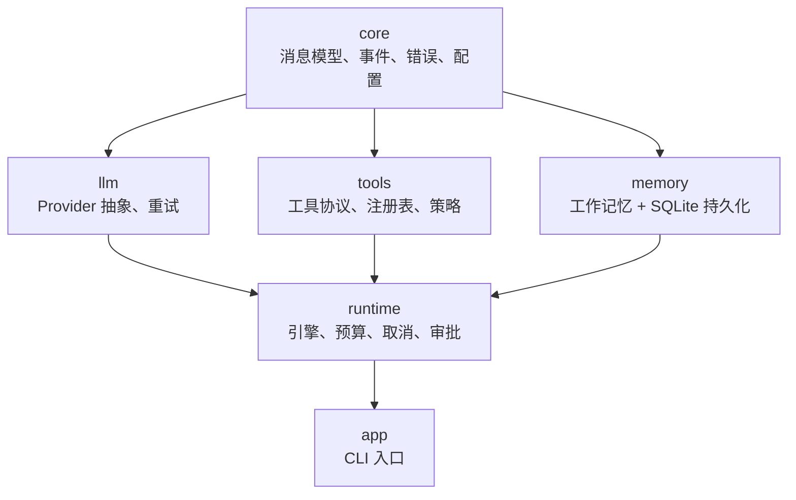
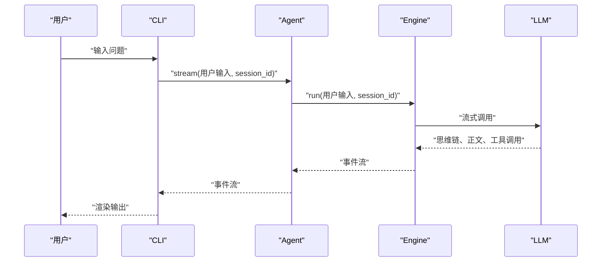
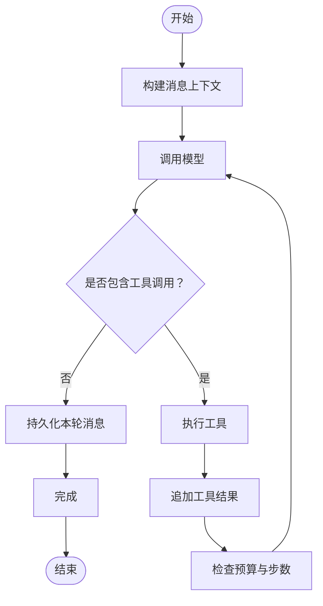
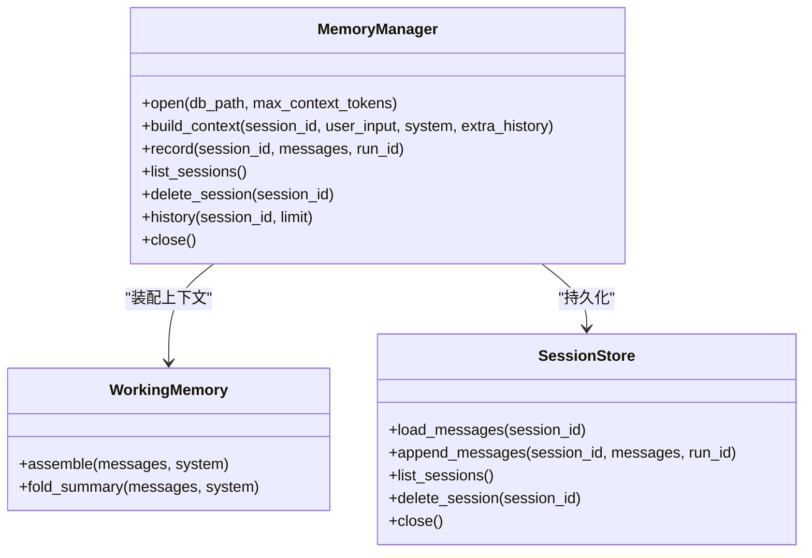
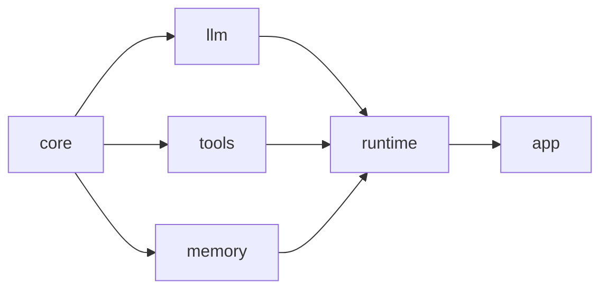

# 快速开始

<cite>
**本文引用的文件**   
- [README.md](file://README.md)
- [pyproject.toml](file://pyproject.toml)
- [src/agentkit/__init__.py](file://src/agentkit/__init__.py)
- [src/agentkit/core/config.py](file://src/agentkit/core/config.py)
- [src/agentkit/runtime/engine.py](file://src/agentkit/runtime/engine.py)
- [src/agentkit/runtime/agent.py](file://src/agentkit/runtime/agent.py)
- [src/agentkit/app/cli.py](file://src/agentkit/app/cli.py)
- [src/agentkit/memory/manager.py](file://src/agentkit/memory/manager.py)
- [src/agentkit/tools/base.py](file://src/agentkit/tools/base.py)
- [src/agentkit/core/types.py](file://src/agentkit/core/types.py)
</cite>

## 目录
1. [引言](#引言)
2. [项目结构](#项目结构)
3. [环境要求与安装](#环境要求与安装)
4. [配置说明](#配置说明)
5. [核心概念与设计哲学](#核心概念与设计哲学)
6. [基本使用方法](#基本使用方法)
7. [交互式对话](#交互式对话)
8. [任务执行](#任务执行)
9. [会话管理](#会话管理)
10. [架构总览](#架构总览)
11. [关键组件分析](#关键组件分析)
12. [依赖关系分析](#依赖关系分析)
13. [性能与成本特性](#性能与成本特性)
14. [常见问题与故障排查](#常见问题与故障排查)
15. [结论](#结论)

## 引言
AgentKit 是一个从零实现的 Agent 开发框架。它不依赖 LangChain、LlamaIndex 等现成框架，而是自己实现核心循环、工具层、记忆、预算、取消、审批和事件流。目标是让每个机制都清晰可见：你能讲清楚 Agent 是怎么工作的，而不是只会调某个框架的 API。

当前状态已完成内核、流式输出、取消、预算、审批和工作记忆；服务化、可观测性和评测仍在路线图中。

**章节来源**
- [README.md:1-27](file://README.md#L1-L27)

## 项目结构
仓库采用按职责分层的包结构，依赖方向是单向的：`core` 零依赖，`llm`/`tools`/`memory` 依赖 `core`，`runtime` 依赖全部，`app` 只依赖 `runtime`。

**图表来源**
- [README.md:53-68](file://README.md#L53-L68)
- [src/agentkit/__init__.py:1-10](file://src/agentkit/__init__.py#L1-L10)

**章节来源**
- [README.md:53-68](file://README.md#L53-L68)
- [src/agentkit/__init__.py:1-10](file://src/agentkit/__init__.py#L1-L10)

## 环境要求与安装
### 环境要求
- Python 版本不低于 3.11。
- 推荐使用 `uv` 管理虚拟环境和依赖。
- 需要配置一个 OpenAI 兼容的 LLM 提供商（例如 DeepSeek），并准备 API Key。

### 安装步骤
1. 使用 `uv` 同步依赖并创建虚拟环境。
2. 复制环境变量示例文件，填入你的 LLM API Key。
3. 通过 `uv run agentkit --help` 验证 CLI 是否可用。

推荐命令流程如下：
- 初始化环境与依赖
- 生成 `.env` 配置文件
- 查看帮助信息

这些命令在 README 中已经给出，可以直接照做。

**章节来源**
- [README.md:28-47](file://README.md#L28-L47)
- [pyproject.toml:1-14](file://pyproject.toml#L1-L14)

## 配置说明
AgentKit 的配置由 `Settings` 类统一管理，支持从环境变量和 `.env` 文件加载。优先级为：环境变量 > `.env` > 默认值。

### 主要配置项
| 配置项 | 环境变量名 | 默认值或含义 | 说明 |
|---|---|---|---|
| `api_key` | `LLM_API_KEY` 或 `DEEPSEEK_API_KEY` | 空 | LLM API Key。缺失时会抛出明确的配置错误。 |
| `base_url` | `LLM_BASE_URL` | DeepSeek 官方端点 | OpenAI 兼容端点地址。 |
| `model` | `LLM_MODEL` | `deepseek-flash` | 模型 ID。应使用账号下可用的模型。 |
| `temperature` | `LLM_TEMPERATURE` | `0.0` | 生成温度。 |
| `max_tokens` | `LLM_MAX_TOKENS` | 空 | 单次回复输出上限。 |
| `request_timeout` | `LLM_TIMEOUT` | `120.0` | 请求超时时间。 |
| `max_retries` | `LLM_MAX_RETRIES` | `3` | 最大尝试次数。 |
| `retry_base_delay` | `LLM_RETRY_BASE_DELAY` | `0.5` | 重试基础延迟。 |
| `retry_max_delay` | `LLM_RETRY_MAX_DELAY` | `30.0` | 重试最大延迟。 |
| `max_steps` | `AGENT_MAX_STEPS` | `15` | 引擎最大推理步数。 |
| `workspace` | `AGENT_WORKSPACE` | 当前工作目录 | 工具可读写的工作区根目录。 |

### 配置加载方式
- 进程级配置通过 `load_settings()` 加载。
- 命令行参数可以覆盖部分配置，例如模型、最大步数、工作区。
- 如果未配置 API Key，调用 `require_api_key()` 会抛出清晰的错误，提示你设置环境变量或 `.env`。

**章节来源**
- [src/agentkit/core/config.py:1-99](file://src/agentkit/core/config.py#L1-L99)
- [src/agentkit/app/cli.py:283-323](file://src/agentkit/app/cli.py#L283-L323)

## 核心概念与设计哲学
### 为什么从零实现
AgentKit 明确选择不套 LangChain 或 LlamaIndex。原因是：
- 希望把 Agent 的每个机制讲清楚。
- 避免被现成框架的抽象掩盖真实行为。
- 代价是自己写持久化、可观测、重试等能力，但换来的是透明度和可控性。

### 关键设计决策
- **内容块消息模型**：内部统一用 `TextBlock`、`ReasoningBlock`、`ToolUseBlock`、`ToolResultBlock`，而不是直接绑定 OpenAI 的 `tool_calls[]`。这样更容易适配 Anthropic 等 provider。
- **原生 function calling**：取代文本解析 JSON 的方式，降低格式错误率，并支持并行工具调用。
- **引擎只产出类型化事件**：SSE、CLI、可观测、评测共享同一条事件流，避免“返回值 + 回调”的双真相源。
- **工具参数用 pydantic 校验**：失败时把可读错误回灌给模型，让它自我修正。
- **路径边界安全**：使用绝对路径和公共路径判断，防止符号链接绕过工作区限制。
- **命令安全用三分裁决**：拒绝、放行、转人工审批，而不是黑名单正则。
- **事件经队列推送**：审批事件在工具仍阻塞时就送达客户端，而不是等结果出来再问。
- **工具失败不回滚整个 run**：参数错误或策略拒绝变成错误结果，让模型继续修正。
- **记忆只做工作记忆 + 持久化**：语义记忆、情节记忆不在当前范围，避免半成品。

**章节来源**
- [README.md:8-27](file://README.md#L8-L27)
- [src/agentkit/core/types.py:1-15](file://src/agentkit/core/types.py#L1-L15)
- [src/agentkit/runtime/engine.py:1-16](file://src/agentkit/runtime/engine.py#L1-L16)

## 基本使用方法
### 运行单个任务
你可以直接让 Agent 执行一个任务，例如列出文件、读取文件、统计行数等。命令会进入引擎循环，根据模型返回决定是否调用工具。

常用形式：
- 执行任务
- 指定会话 ID，让多轮对话记住上下文
- 进入交互式对话
- 查看历史会话
- 列出内置工具和参数 schema

### 审批与安全
需要写文件或执行未知命令的动作会触发审批。默认情况下终端会询问；非交互场景加关闭审批参数后，所有需要审批的动作会被直接拒绝。文档强调：**默认拒绝，不是默认放行**。

**章节来源**
- [README.md:38-51](file://README.md#L38-L51)
- [src/agentkit/app/cli.py:51-85](file://src/agentkit/app/cli.py#L51-L85)

## 交互式对话
AgentKit 提供 `chat` 子命令，用于在同一会话内保持上下文。它会：
- 打印当前会话 ID 和工作区。
- 接收用户输入。
- 将每次输入作为一轮对话推入引擎。
- 支持退出、换会话等操作。

交互流程大致如下：

**图表来源**
- [src/agentkit/app/cli.py:366-410](file://src/agentkit/app/cli.py#L366-L410)
- [src/agentkit/runtime/agent.py:72-112](file://src/agentkit/runtime/agent.py#L72-L112)
- [src/agentkit/runtime/engine.py:166-205](file://src/agentkit/runtime/engine.py#L166-L205)

**章节来源**
- [src/agentkit/app/cli.py:100-103](file://src/agentkit/app/cli.py#L100-L103)
- [src/agentkit/app/cli.py:366-410](file://src/agentkit/app/cli.py#L366-L410)

## 任务执行
任务执行的核心是引擎循环。它只做四件事：
1. 把消息历史和工具 schema 发给模型。
2. 模型返回最终答复或工具调用。
3. 如果有工具调用，执行工具并把结果打包成 user 消息追加回去。
4. 回到第 1 步。

与传统实现相比，新实现不再用正则从模型输出里抠 JSON，也不再有多重静默降级。错误更清晰，并行工具调用也能表达。

**图表来源**
- [src/agentkit/runtime/engine.py:250-369](file://src/agentkit/runtime/engine.py#L250-L369)

**章节来源**
- [src/agentkit/runtime/engine.py:1-16](file://src/agentkit/runtime/engine.py#L1-L16)
- [src/agentkit/runtime/engine.py:250-369](file://src/agentkit/runtime/engine.py#L250-L369)

## 会话管理
AgentKit 的记忆模块负责两件事：
- 装配发给模型的完整消息序列。
- 把对话落盘到 SQLite。

会话相关 CLI 命令包括：
- 列出会话
- 查看某条会话的消息
- 删除会话

会话数据库默认位于项目目录下，可通过命令行参数覆盖路径。

**图表来源**
- [src/agentkit/memory/manager.py:29-134](file://src/agentkit/memory/manager.py#L29-L134)

**章节来源**
- [src/agentkit/memory/manager.py:1-14](file://src/agentkit/memory/manager.py#L1-L14)
- [src/agentkit/memory/manager.py:29-134](file://src/agentkit/memory/manager.py#L29-L134)
- [src/agentkit/app/cli.py:412-465](file://src/agentkit/app/cli.py#L412-L465)

## 架构总览
AgentKit 的整体架构可以分为四层：
- **配置层**：`Settings` 统一加载环境变量、`.env` 和默认值。
- **模型层**：`ChatModel` 抽象不同 LLM provider，OpenAI 兼容实现负责流式归一化和重试。
- **工具层**：工具通过函数签名自动生成参数 schema，运行时注入 `ToolContext`。
- **运行时层**：`Agent` 是门面，`Engine` 驱动 tool-calling 循环，`EventBus` 汇聚事件。

```mermaid
graph TB
Settings["Settings<br/>配置加载"] --> BuildAgent["build_agent<br/>组装 Agent"]
BuildAgent --> Agent["Agent<br/>门面"]
Agent --> Engine["Engine<br/>推理循环"]
Engine --> ChatModel["ChatModel<br/>LLM 抽象"]
Engine --> ToolRegistry["ToolRegistry<br/>工具注册表"]
Engine --> MemoryManager["MemoryManager<br/>记忆管理"]
Engine --> EventBus["EventBus<br/>事件总线"]
```

**图表来源**
- [src/agentkit/core/config.py:27-99](file://src/agentkit/core/config.py#L27-L99)
- [src/agentkit/runtime/agent.py:38-175](file://src/agentkit/runtime/agent.py#L38-L175)
- [src/agentkit/runtime/engine.py:127-205](file://src/agentkit/runtime/engine.py#L127-L205)

**章节来源**
- [src/agentkit/runtime/agent.py:1-35](file://src/agentkit/runtime/agent.py#L1-L35)
- [src/agentkit/runtime/engine.py:127-205](file://src/agentkit/runtime/engine.py#L127-L205)

## 关键组件分析

### 配置系统
`Settings` 是进程级配置对象，封装了 LLM 连接参数、生成参数、运行时参数。它还提供：
- `require_api_key()`：强制检查 API Key，缺失时报错。
- `resolved_workspace()`：返回工作区的绝对路径。
- `load_settings()`：支持用 `overrides` 覆盖配置。

**章节来源**
- [src/agentkit/core/config.py:27-99](file://src/agentkit/core/config.py#L27-L99)

### Agent 门面
`Agent` 把模型、工具、工作区、系统提示词、预算、记忆等组合起来，对外暴露：
- `engine()`：创建底层引擎。
- `stream()`：消费事件流。
- `run()`：聚合事件为 `RunResult`。
- `aclose()`：关闭模型连接。

`build_agent()` 则负责按配置自动注册内置工具、创建工作区、构造模型和引擎参数。

**章节来源**
- [src/agentkit/runtime/agent.py:38-175](file://src/agentkit/runtime/agent.py#L38-L175)

### 推理引擎
`Engine` 是 AgentKit 的核心。它：
- 维护消息历史。
- 控制最大步数。
- 处理流式输出。
- 执行工具调用。
- 估算 token 用量和成本。
- 与记忆管理器协作持久化。
- 通过事件总线向外推送 `RunStarted`、`StepStarted`、`TextDelta`、`ToolCallStarted`、`ToolResult`、`UsageReported`、`RunCompleted`、`RunFailed`、`RunCancelled` 等事件。

**章节来源**
- [src/agentkit/runtime/engine.py:74-94](file://src/agentkit/runtime/engine.py#L74-L94)
- [src/agentkit/runtime/engine.py:127-205](file://src/agentkit/runtime/engine.py#L127-L205)
- [src/agentkit/runtime/engine.py:250-369](file://src/agentkit/runtime/engine.py#L250-L369)
- [src/agentkit/runtime/engine.py:513-536](file://src/agentkit/runtime/engine.py#L513-L536)

### 工具协议
工具通过异步函数定义，第一个参数固定是 `ToolContext`，不参与 schema。其余参数从函数签名和类型注解自动生成 pydantic 模型，并进一步生成 JSON Schema。

`ToolContext` 提供：
- 工作区路径。
- 当前 run id。
- 当前工具调用 id。
- 审批通道。
- 进程内共享状态。
- 路径解析方法。

**章节来源**
- [src/agentkit/tools/base.py:40-76](file://src/agentkit/tools/base.py#L40-L76)
- [src/agentkit/tools/base.py:94-127](file://src/agentkit/tools/base.py#L94-L127)
- [src/agentkit/tools/base.py:130-214](file://src/agentkit/tools/base.py#L130-L214)

### 内容块消息模型
`Message` 是全局消息模型，内部用 content block 表示文本、思维链、工具调用和工具结果。它提供：
- 构造器：`system`、`user`、`assistant`、`from_tool_results`。
- 查询器：`text`、`reasoning_text`、`tool_uses`、`tool_results`。
- 不变量校验：`validate_conversation` 强制 tool_use 与 tool_result 配对。

**章节来源**
- [src/agentkit/core/types.py:29-74](file://src/agentkit/core/types.py#L29-L74)
- [src/agentkit/core/types.py:103-157](file://src/agentkit/core/types.py#L103-L157)
- [src/agentkit/core/types.py:159-212](file://src/agentkit/core/types.py#L159-L212)

## 依赖关系分析
AgentKit 的依赖方向非常明确：
- `core` 零依赖。
- `llm`、`tools`、`memory` 只依赖 `core`。
- `runtime` 依赖 `core`、`llm`、`tools`、`memory`。
- `app` 只依赖 `runtime`。

这种单向依赖避免了循环引用，也让测试更容易 mock 边界。

**图表来源**
- [README.md:53-68](file://README.md#L53-L68)
- [src/agentkit/__init__.py:1-10](file://src/agentkit/__init__.py#L1-L10)

**章节来源**
- [README.md:53-68](file://README.md#L53-L68)
- [src/agentkit/__init__.py:1-10](file://src/agentkit/__init__.py#L1-L10)

## 性能与成本特性
### 流式输出
引擎使用流式调用，边生成边推送事件。这样可以避免用户长时间盯着空白界面，尤其当模型产生大量思维链 token 时体验更好。

### 预算与成本
引擎会累计 token 用量，并根据模型定价估算成本。CLI 支持：
- `--max-cost`：本次 run 的成本上限。
- `--max-tokens`：本次 run 的 token 上限。
- `--max-steps`：最大推理步数。

### 重试策略
LLM 适配器支持重试策略，包括最大尝试次数、基础延迟和最大延迟。重试发生在网络或临时错误场景，不会无限重试。

**章节来源**
- [src/agentkit/runtime/engine.py:370-408](file://src/agentkit/runtime/engine.py#L370-L408)
- [src/agentkit/runtime/engine.py:505-510](file://src/agentkit/runtime/engine.py#L505-L510)
- [src/agentkit/runtime/agent.py:118-140](file://src/agentkit/runtime/agent.py#L118-L140)
- [src/agentkit/app/cli.py:57-85](file://src/agentkit/app/cli.py#L57-L85)

## 常见问题与故障排查

### 没有配置 API Key
**现象**：启动或运行时报配置错误。  
**原因**：未设置 `LLM_API_KEY` 或 `DEEPSEEK_API_KEY`。  
**解决**：
- 复制 `.env.example` 为 `.env`。
- 填入正确的 API Key。
- 或直接设置环境变量 `LLM_API_KEY`。

**章节来源**
- [src/agentkit/core/config.py:79-88](file://src/agentkit/core/config.py#L79-L88)

### 工作区不存在或不是目录
**现象**：构建 Agent 时报工作区错误。  
**原因**：传入的工作区路径不存在或不是目录。  
**解决**：确认 `workspace` 指向一个存在的目录，或使用默认当前目录。

**章节来源**
- [src/agentkit/runtime/agent.py:158-160](file://src/agentkit/runtime/agent.py#L158-L160)

### 工具参数不合法
**现象**：模型调用工具时报参数错误，但错误信息能指到具体字段。  
**原因**：模型生成的参数不符合工具的 JSON Schema。  
**解决**：让模型看到错误信息并自我修正；如果是 CLI，可以在事件中查看详细参数。

**章节来源**
- [src/agentkit/tools/base.py:159-176](file://src/agentkit/tools/base.py#L159-L176)

### 达到最大步数仍未得到最终答复
**现象**：引擎停止并报告 `MaxStepsExceeded`。  
**原因**：模型一直在调用工具，没有返回最终文本。  
**解决**：
- 增加 `max_steps`。
- 检查工具描述是否足够清晰。
- 检查工作区和权限是否导致工具反复失败。

**章节来源**
- [src/agentkit/runtime/engine.py:281-298](file://src/agentkit/runtime/engine.py#L281-L298)

### 需要审批的动作被拒绝
**现象**：写文件、执行命令等动作被拒绝。  
**原因**：使用了 `--no-approve`，或者没有配置审批通道。  
**解决**：
- 交互模式下允许审批。
- 非交互模式明确知道风险后再放开。
- 注意：默认拒绝更安全。

**章节来源**
- [src/agentkit/app/cli.py:62-66](file://src/agentkit/app/cli.py#L62-L66)
- [src/agentkit/app/cli.py:307-310](file://src/agentkit/app/cli.py#L307-L310)

### 会话数据丢失或无法读取
**现象**：查看会话为空或报错。  
**原因**：
- 会话数据库路径不正确。
- 会话尚未写入。
- 消息配对不完整时被跳过持久化。

**解决**：
- 确认 `--db` 路径。
- 检查是否传入了 `session`。
- 查看日志中关于配对不完整或落盘失败的提示。

**章节来源**
- [src/agentkit/memory/manager.py:94-106](file://src/agentkit/memory/manager.py#L94-L106)
- [src/agentkit/runtime/engine.py:465-493](file://src/agentkit/runtime/engine.py#L465-L493)
- [src/agentkit/app/cli.py:412-465](file://src/agentkit/app/cli.py#L412-L465)

## 结论
AgentKit 适合那些希望真正理解 Agent 运行机制的开发者。它不隐藏细节，也不假装成熟生态已经完备；相反，它把核心循环、工具协议、记忆、预算、事件流都做成可观察、可测试、可替换的组件。

如果你只是想快速调一个 API，LangChain 可能更快；但如果你想搞清楚“模型什么时候决定调用工具”“工具失败时 Agent 怎么恢复”“审批为什么要在工具阻塞前通知”“为什么工具结果要合并进一条 user 消息”，AgentKit 的设计会更值得细读。

对于初学者，建议按以下顺序学习：
1. 先跑通 `uv sync`、`.env`、`uv run agentkit chat`。
2. 再看 `Settings` 和 `build_agent`。
3. 然后看 `Agent.stream` 和 `Engine.run`。
4. 最后深入 `Message`、`ToolSpec`、`MemoryManager`。

**章节来源**
- [README.md:1-27](file://README.md#L1-L27)
- [src/agentkit/runtime/agent.py:1-35](file://src/agentkit/runtime/agent.py#L1-L35)
- [src/agentkit/runtime/engine.py:1-16](file://src/agentkit/runtime/engine.py#L1-L16)