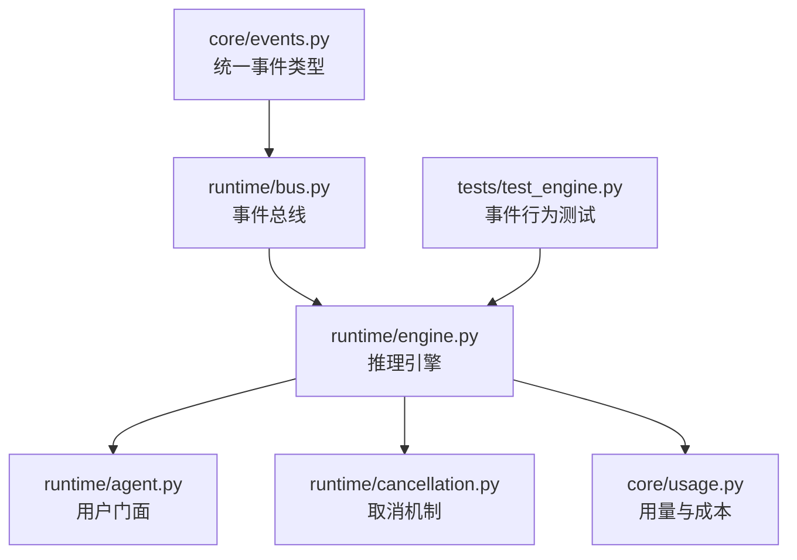
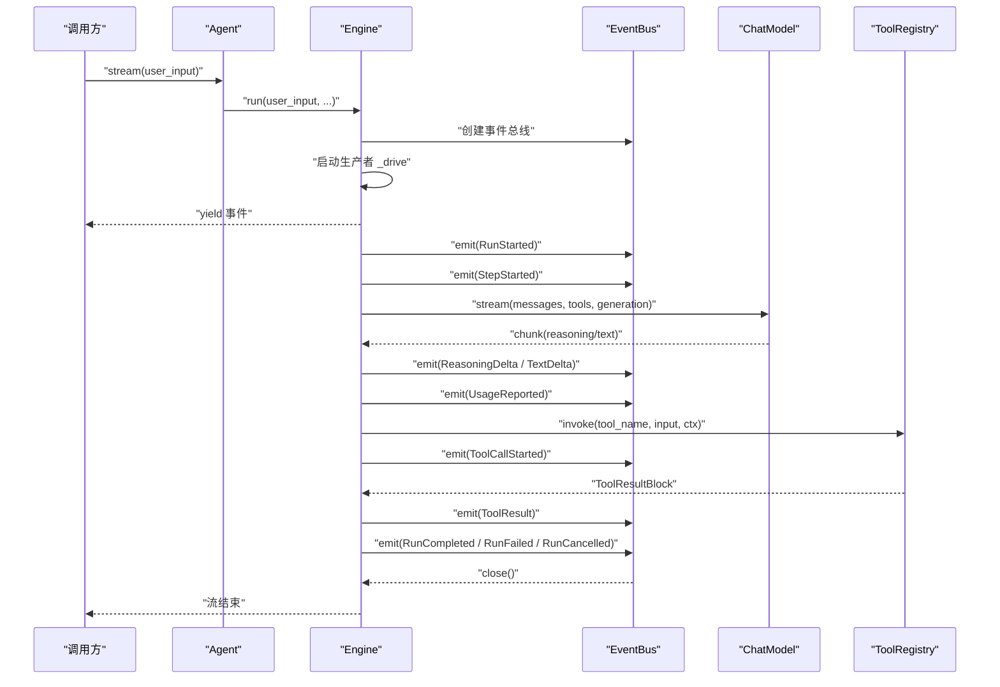
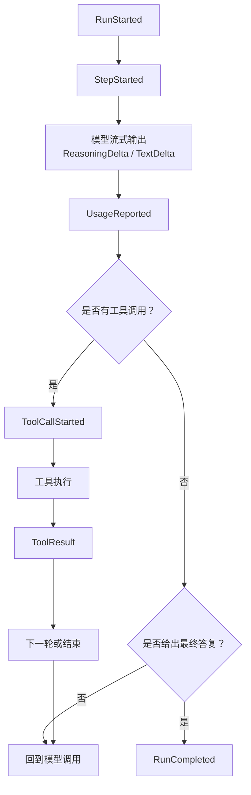
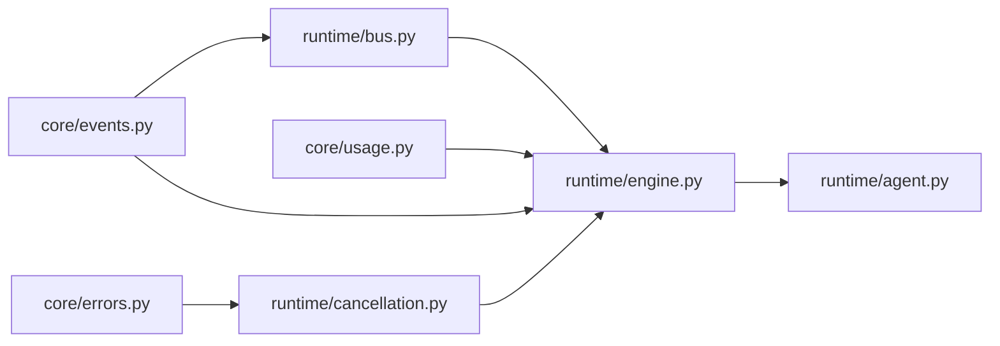

# 事件系统

<cite>
**本文引用的文件**   
- [events.py](file://src/agentkit/core/events.py)
- [bus.py](file://src/agentkit/runtime/bus.py)
- [engine.py](file://src/agentkit/runtime/engine.py)
- [agent.py](file://src/agentkit/runtime/agent.py)
- [cancellation.py](file://src/agentkit/runtime/cancellation.py)
- [usage.py](file://src/agentkit/core/usage.py)
- [README.md](file://README.md)
- [test_engine.py](file://tests/test_engine.py)
</cite>

## 目录
1. [引言](#引言)
2. [项目结构](#项目结构)
3. [核心组件](#核心组件)
4. [架构总览](#架构总览)
5. [详细组件分析](#详细组件分析)
6. [依赖关系分析](#依赖关系分析)
7. [性能与并发特性](#性能与并发特性)
8. [故障排查指南](#故障排查指南)
9. [结论](#结论)

## 引言
AgentKit 的事件驱动架构围绕“统一事件流”展开：引擎不直接返回最终文本，而是把推理过程中的每一步都建模为类型化的运行时事件。CLI、SSE、可观测性、评测等消费者共享同一条事件流，从而避免“返回值 + 回调”的双真相源问题。

该设计的关键动机包括：
- CLI 需要逐步打印进度；
- SSE 端点需要把事件转发给浏览器；
- 可观测层需要在事件边界上开关 span、累计用量；
- 评测需要根据轨迹计算工具选择正确率、步数、成本等指标。

如果采用“返回字符串 + 注册回调”，回调里能看到 token 级信息，而返回值看不到，两者可能不一致。事件流则保证所有消费者看到的是同一份事实。

**章节来源**
- [events.py:1-26](file://src/agentkit/core/events.py#L1-L26)
- [README.md:18-25](file://README.md#L18-L25)

## 项目结构
事件系统主要分布在 `core` 和 `runtime` 两个层次：
- `core/events.py` 定义统一事件类型、判别联合、终止事件集合；
- `runtime/bus.py` 提供基于异步队列的事件总线；
- `runtime/engine.py` 是推理引擎，负责生产事件；
- `runtime/agent.py` 是面向用户的门面，暴露流式接口和汇聚结果；
- `runtime/cancellation.py` 提供 run 级取消语义；
- `core/usage.py` 提供用量与成本模型；
- `tests/test_engine.py` 通过确定性脚本模型验证事件序列、终止条件、序列化稳定性。

**图表来源**
- [events.py:37-169](file://src/agentkit/core/events.py#L37-L169)
- [bus.py:30-73](file://src/agentkit/runtime/bus.py#L30-L73)
- [engine.py:127-548](file://src/agentkit/runtime/engine.py#L127-L548)
- [agent.py:38-112](file://src/agentkit/runtime/agent.py#L38-L112)
- [cancellation.py:30-145](file://src/agentkit/runtime/cancellation.py#L30-L145)
- [usage.py:22-127](file://src/agentkit/core/usage.py#L22-L127)
- [test_engine.py:48-405](file://tests/test_engine.py#L48-L405)

**章节来源**
- [README.md:53-68](file://README.md#L53-L68)

## 核心组件
### 统一事件类型与生命周期
事件基类包含单调递增序号 `seq` 和运行标识 `run_id`，用于 SSE 断线重连去重、续传以及跨事件关联。生命周期事件包括：
- `RunStarted`：一次推理开始；
- `StepStarted`：每轮步骤开始；
- `RunCompleted`：成功结束，携带最终文本、步数、用量、成本、时长；
- `RunFailed`：失败结束，携带错误类型和消息；
- `RunCancelled`：取消结束，携带原因。

终止事件集合明确限定为成功、失败、取消三类，且三者互斥、必居其一。

**章节来源**
- [events.py:37-81](file://src/agentkit/core/events.py#L37-L81)
- [events.py:151-169](file://src/agentkit/core/events.py#L151-L169)

### 模型输出与工具执行事件
模型输出被拆成增量事件：
- `ReasoningDelta`：思维链增量；
- `TextDelta`：正文增量；
- `UsageReported`：每次模型调用后报告用量，并附带累计用量。

工具执行使用配对事件：
- `ToolCallStarted`：工具调用开始，携带工具名、参数；
- `ToolResult`：工具执行结果，携带内容、是否错误、耗时。

审批流程也建模为事件：
- `ApprovalRequested`：需要人工确认；
- `ApprovalResolved`：审批结果返回。

**章节来源**
- [events.py:86-149](file://src/agentkit/core/events.py#L86-L149)

### 事件总线与发布订阅
事件总线封装 `asyncio.Queue`，提供：
- 同步 `emit`：生产者随时入队，自动填充 `seq` 和 `run_id`；
- 异步 `drain`：消费者按顺序取事件，直到收到关闭哨兵；
- 幂等 `close`：写入关闭哨兵，确保消费者能正常结束；
- `closed` 状态：防止关闭后继续消费。

这种设计解耦了生产者和消费者，使引擎循环、工具实现、审批通道都能立即推事件，消费者按自己的节奏处理。

**章节来源**
- [bus.py:1-14](file://src/agentkit/runtime/bus.py#L1-L14)
- [bus.py:30-73](file://src/agentkit/runtime/bus.py#L30-L73)

### 引擎事件生产与错误传播
引擎主入口 `run` 创建 `EventBus`，启动生产者协程 `_drive`，并把总线 drain 的结果作为异步迭代器暴露给上层。`_drive` 捕获各类异常，把它们转成终止事件，最后关闭总线。

关键错误传播策略：
- `RunCancelled` → `RunCancelled` 事件；
- `BudgetExceeded` → `RunFailed`，错误类型为 `BudgetExceeded`；
- `AgentKitError` → `RunFailed`，错误类型为异常类名；
- `asyncio.CancelledError` → `RunCancelled`，并重新抛出；
- 其他异常 → 记录日志，发出 `RunFailed`，内部错误摘要放入事件，避免 traceback 撑大 SSE 载荷。

**章节来源**
- [engine.py:166-205](file://src/agentkit/runtime/engine.py#L166-L205)
- [engine.py:208-248](file://src/agentkit/runtime/engine.py#L208-L248)

### 用户门面与结果汇聚
`Agent.stream` 直接委托 `Engine.run`，暴露统一的 `AsyncIterator[RunEvent]`。`Agent.run` 则通过 `collect` 消费整条事件流，汇总为 `RunResult`。

`collect` 根据事件类型更新结果字段：
- `run_completed`：填充文本、步数、用量、成本、货币、时长；
- `run_failed`：填充错误信息和错误类型；
- `run_cancelled`：标记已取消。

**章节来源**
- [agent.py:72-112](file://src/agentkit/runtime/agent.py#L72-L112)
- [engine.py:513-536](file://src/agentkit/runtime/engine.py#L513-L536)

## 架构总览
下图展示从用户调用到事件消费的完整时序：

**图表来源**
- [agent.py:72-112](file://src/agentkit/runtime/agent.py#L72-L112)
- [engine.py:166-205](file://src/agentkit/runtime/engine.py#L166-L205)
- [engine.py:250-369](file://src/agentkit/runtime/engine.py#L250-L369)
- [engine.py:370-408](file://src/agentkit/runtime/engine.py#L370-L408)
- [engine.py:410-434](file://src/agentkit/runtime/engine.py#L410-L434)
- [bus.py:30-73](file://src/agentkit/runtime/bus.py#L30-L73)

## 详细组件分析

### 为什么选择事件流而非回调模式
事件流的核心优势是单一真相源。CLI、SSE、可观测、评测四个消费者都需要看到相同的事件序列：
- CLI 要逐步打印进度；
- SSE 要把事件转发给浏览器；
- 可观测层要在事件边界上开关 span、累加用量；
- 评测要按轨迹算工具选对没有、花了几步等指标。

如果改为“返回字符串 + 回调”，回调里能看到 token 级信息，返回值里看不到，两者可能不一致。事件流避免了这个问题。

此外，事件总线用队列解耦生产者和消费者，解决审批时序问题：在 SSE 场景下，客户端必须在工具仍然阻塞等待时收到审批请求，而不是先等出结果再问要不要批准。

**章节来源**
- [events.py:1-26](file://src/agentkit/core/events.py#L1-L26)
- [bus.py:1-14](file://src/agentkit/runtime/bus.py#L1-L14)
- [README.md:18-25](file://README.md#L18-L25)

### 事件生命周期与终止语义
正常运行的事件序列大致如下：
1. `RunStarted`；
2. `StepStarted`；
3. 模型输出 `ReasoningDelta`、`TextDelta`；
4. 每次模型调用后 `UsageReported`；
5. 工具调用 `ToolCallStarted` → `ToolResult`；
6. 最终 `RunCompleted`。

失败或取消时以 `RunFailed` 或 `RunCancelled` 收尾，二者互斥且必居其一。测试中验证了终止事件只出现一次。

**图表来源**
- [events.py:14-25](file://src/agentkit/core/events.py#L14-L25)
- [engine.py:250-369](file://src/agentkit/runtime/engine.py#L250-L369)
- [test_engine.py:48-90](file://tests/test_engine.py#L48-L90)

**章节来源**
- [events.py:14-25](file://src/agentkit/core/events.py#L14-L25)
- [test_engine.py:308-343](file://tests/test_engine.py#L308-L343)

### 发布订阅机制与异步处理模式
事件总线是典型的发布订阅实现：
- 生产者通过 `emit` 同步入队；
- 消费者通过 `drain` 异步迭代；
- 关闭哨兵 `_CLOSED` 表示不会再有事件；
- `close` 幂等写入哨兵；
- `closed` 属性用于判断总线状态。

引擎在 `run` 中创建任务 `_drive` 作为生产者，并在 `finally` 中取消未完成的 producer，防止 HTTP 连接断开后仍在后台消耗 token。

**章节来源**
- [bus.py:30-73](file://src/agentkit/runtime/bus.py#L30-L73)
- [engine.py:166-205](file://src/agentkit/runtime/engine.py#L166-L205)

### 错误传播策略
引擎的错误处理遵循“运行时不能让调用方炸”的原则：
- 已知业务异常映射为 `RunFailed` 或 `RunCancelled`；
- 未知异常记录完整栈到日志，事件只放摘要；
- 所有路径最终调用 `bus.close()`，确保消费者不会挂住；
- 取消走显式 `CancellationToken`，不是单纯依赖 `asyncio.CancelledError`。

取消机制强调三点：
1. 取消要能传进工具，避免子进程孤儿；
2. 取消要说明原因，区分用户取消和超时；
3. 取消是正常终止，不是异常，要让引擎发完最后一个事件再退出。

**章节来源**
- [engine.py:208-248](file://src/agentkit/runtime/engine.py#L208-L248)
- [cancellation.py:1-13](file://src/agentkit/runtime/cancellation.py#L1-L13)
- [cancellation.py:30-89](file://src/agentkit/runtime/cancellation.py#L30-L89)
- [cancellation.py:83-119](file://src/agentkit/runtime/cancellation.py#L83-L119)

### SSE、CLI、可观测性、评测共享同一条事件流
README 明确指出：引擎只 yield 类型化事件，SSE、CLI、可观测、评测四个消费者共享同一条流。测试中也验证了事件可以稳定序列化为 JSON，这正是 SSE 端点需要的。

虽然当前仓库尚未包含完整的 FastAPI SSE 服务实现，但事件类型的判别联合、Pydantic 序列化、`model_dump_json` 的使用，已经为 SSE 提供了稳定的数据契约。

**章节来源**
- [README.md:18-25](file://README.md#L18-L25)
- [test_engine.py:375-383](file://tests/test_engine.py#L375-L383)
- [events.py:151-169](file://src/agentkit/core/events.py#L151-L169)

### 实际事件监听与处理示例
以下示例描述如何监听和处理不同类型的运行时事件。为避免直接粘贴代码，这里给出调用路径和事件类型对照。

#### 引擎启动事件
调用 `Agent.stream` 或 `Engine.run` 后，第一个事件通常是 `RunStarted`，携带 agent 名称、模型名称和用户输入。

参考路径：
- [engine.py:273](file://src/agentkit/runtime/engine.py#L273)
- [events.py:48-53](file://src/agentkit/core/events.py#L48-L53)

#### 模型调用事件
模型流式输出会触发：
- `ReasoningDelta`：思维链增量；
- `TextDelta`：正文增量；
- `UsageReported`：用量报告。

参考路径：
- [engine.py:389-400](file://src/agentkit/runtime/engine.py#L389-L400)
- [events.py:86-106](file://src/agentkit/core/events.py#L86-L106)

#### 工具执行事件
工具调用前后分别触发：
- `ToolCallStarted`：工具名、参数；
- `ToolResult`：内容、是否错误、耗时。

参考路径：
- [engine.py:342-365](file://src/agentkit/runtime/engine.py#L342-L365)
- [events.py:111-125](file://src/agentkit/core/events.py#L111-L125)

#### 会话结束事件
成功结束时触发 `RunCompleted`，携带最终文本、步数、用量、成本、时长。失败或取消时分别触发 `RunFailed` 或 `RunCancelled`。

参考路径：
- [engine.py:327-339](file://src/agentkit/runtime/engine.py#L327-L339)
- [engine.py:288-298](file://src/agentkit/runtime/engine.py#L288-L298)
- [engine.py:228-246](file://src/agentkit/runtime/engine.py#L228-L246)
- [events.py:60-81](file://src/agentkit/core/events.py#L60-L81)

#### 审批事件
需要人工确认的工具会触发：
- `ApprovalRequested`：携带工具名、参数、原因；
- `ApprovalResolved`：携带是否批准和备注。

参考路径：
- [engine.py:96-124](file://src/agentkit/runtime/engine.py#L96-L124)
- [events.py:130-149](file://src/agentkit/core/events.py#L130-L149)

**章节来源**
- [engine.py:96-124](file://src/agentkit/runtime/engine.py#L96-L124)
- [engine.py:273-369](file://src/agentkit/runtime/engine.py#L273-L369)
- [engine.py:389-408](file://src/agentkit/runtime/engine.py#L389-L408)
- [events.py:48-149](file://src/agentkit/core/events.py#L48-L149)

## 依赖关系分析
事件系统的依赖方向清晰且单向：
- `core/events.py` 零依赖，仅依赖 Pydantic 和用量模块；
- `runtime/bus.py` 依赖 `core.events.RunEvent`；
- `runtime/engine.py` 依赖事件、错误、ID、类型、用量、LLM 抽象、记忆、工具、预算、取消、提示词；
- `runtime/agent.py` 依赖配置、事件、类型、LLM、记忆、工具、引擎；
- `runtime/cancellation.py` 依赖 `core.errors.RunCancelled`；
- `core/usage.py` 提供用量和定价模型。

**图表来源**
- [events.py:30-34](file://src/agentkit/core/events.py#L30-L34)
- [bus.py:22-23](file://src/agentkit/runtime/bus.py#L22-L23)
- [engine.py:29-60](file://src/agentkit/runtime/engine.py#L29-L60)
- [agent.py:20-34](file://src/agentkit/runtime/agent.py#L20-L34)
- [cancellation.py:23-25](file://src/agentkit/runtime/cancellation.py#L23-L25)
- [usage.py:19-23](file://src/agentkit/core/usage.py#L19-L23)

**章节来源**
- [README.md:68-68](file://README.md#L68-L68)

## 性能与并发特性
### 流式输出降低首字节延迟
引擎使用流式模型调用，边生成边推事件。注释中提到 DeepSeek 的思维链 token 数量可能很大，非流式会导致用户长时间面对空白界面。

**章节来源**
- [engine.py:379-384](file://src/agentkit/runtime/engine.py#L379-L384)

### 用量累计与成本估算
`Usage` 明确区分原始值和计费值，避免缓存命中部分重复计费。引擎每轮调用后累计用量，并通过价格表估算成本。

**章节来源**
- [usage.py:1-15](file://src/agentkit/core/usage.py#L1-L15)
- [usage.py:22-73](file://src/agentkit/core/usage.py#L22-L73)
- [engine.py:312-321](file://src/agentkit/runtime/engine.py#L312-L321)
- [engine.py:505-510](file://src/agentkit/runtime/engine.py#L505-L510)

### 取消与资源清理
`race_cancellation` 让取消真正生效：如果 token 先触发，工作协程会被取消，从而触发工具内部的 `finally` 清理逻辑，避免子进程变成孤儿。

**章节来源**
- [cancellation.py:83-119](file://src/agentkit/runtime/cancellation.py#L83-L119)

## 故障排查指南
### 事件序列不符合预期
常见问题包括：
- 缺少 `RunCompleted` / `RunFailed` / `RunCancelled` 之一；
- 终止事件出现多次；
- `seq` 不单调或从非 1 开始；
- 不同事件的 `run_id` 不一致。

可通过测试用例定位：
- 终止事件唯一性；
- `seq` 单调递增；
- 所有事件共享 `run_id`；
- 事件可稳定序列化为 JSON。

**章节来源**
- [test_engine.py:308-343](file://tests/test_engine.py#L308-L343)
- [test_engine.py:348-383](file://tests/test_engine.py#L348-L383)

### 工具参数错误或坏 JSON
引擎会把工具参数校验失败和坏 JSON 回灌为 `ToolResult`，而不是中断整个 run。这样模型可以看到错误并自我修正。

排查要点：
- 检查 `ToolResult.is_error`；
- 检查 `ToolResult.content` 是否包含字段名或原文片段；
- 确认模型后续调用是否修正参数。

**章节来源**
- [engine.py:410-434](file://src/agentkit/runtime/engine.py#L410-L434)
- [test_engine.py:200-255](file://tests/test_engine.py#L200-L255)

### 取消后仍产生事件
如果取消后仍有事件，检查：
- 是否在工具执行前调用 `raise_if_cancelled`；
- 是否使用 `race_cancellation` 包裹长耗时操作；
- 是否在 `finally` 中关闭总线；
- 是否在消费者提前退出时取消生产者。

**章节来源**
- [cancellation.py:57-64](file://src/agentkit/runtime/cancellation.py#L57-L64)
- [cancellation.py:83-119](file://src/agentkit/runtime/cancellation.py#L83-L119)
- [engine.py:195-205](file://src/agentkit/runtime/engine.py#L195-L205)
- [engine.py:247-248](file://src/agentkit/runtime/engine.py#L247-L248)

## 结论
AgentKit 的事件驱动架构通过统一事件类型、事件总线、引擎事件生产和用户门面汇聚，构建了一条贯穿 CLI、SSE、可观测性、评测的单一事实流。其设计选择强调：
- 单一真相源，避免回调与返回值不一致；
- 队列解耦，支持审批时序和资源清理；
- 类型化事件，便于序列化、追踪和评测；
- 显式取消语义，保证资源释放和正常终止；
- 用量与成本分离，避免重复计费。

对于使用者而言，最自然的接入方式是调用 `Agent.stream` 消费事件流，或在需要批量结果时使用 `Agent.run` 获取 `RunResult`。对于扩展者而言，新增消费者只需订阅同一条事件流，无需修改引擎内部逻辑。