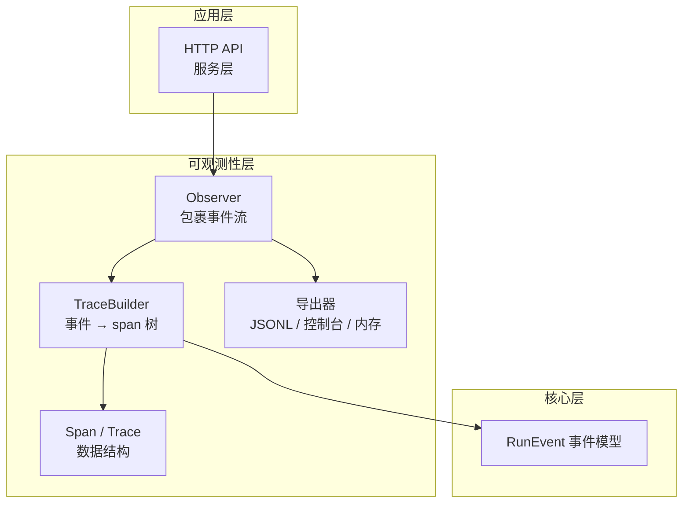
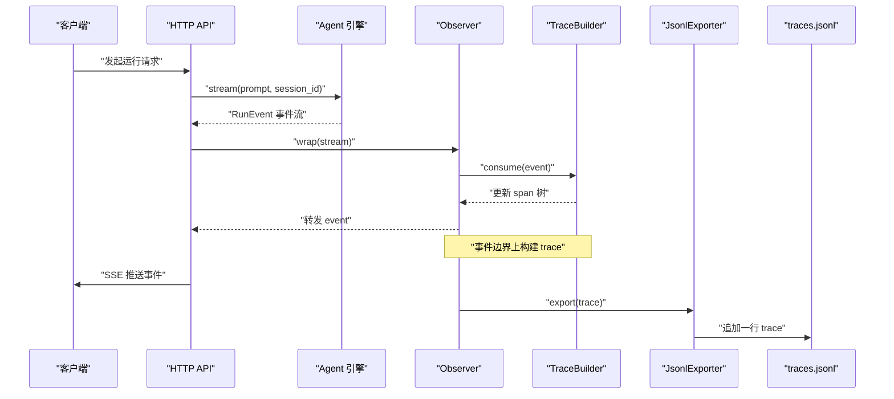
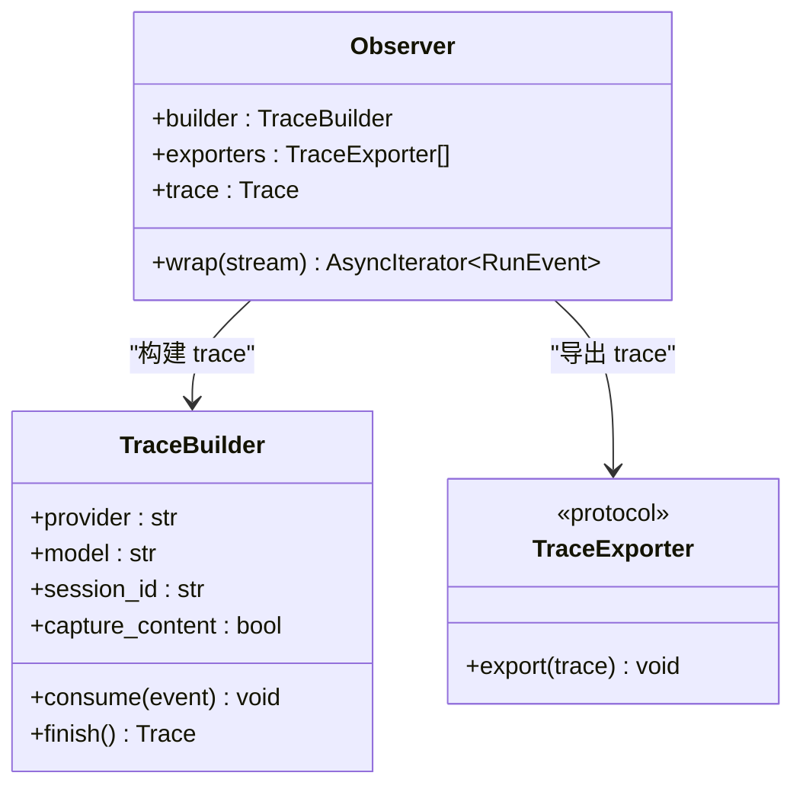
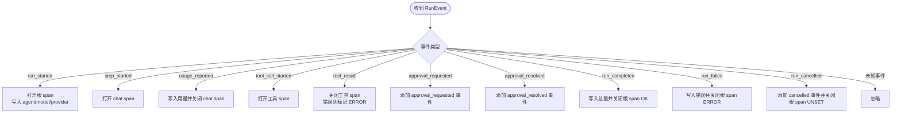
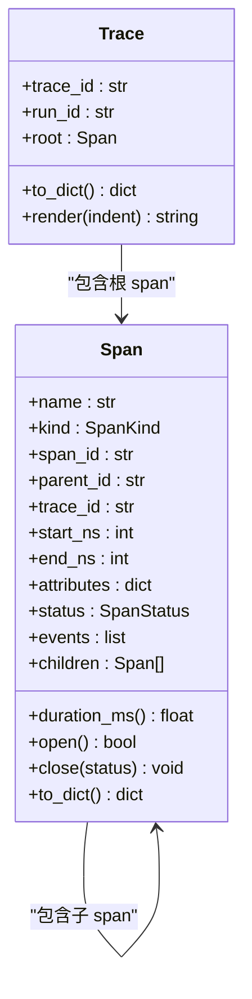
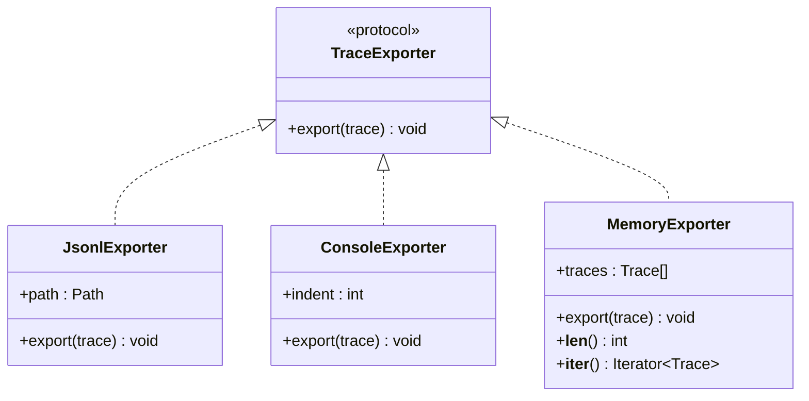
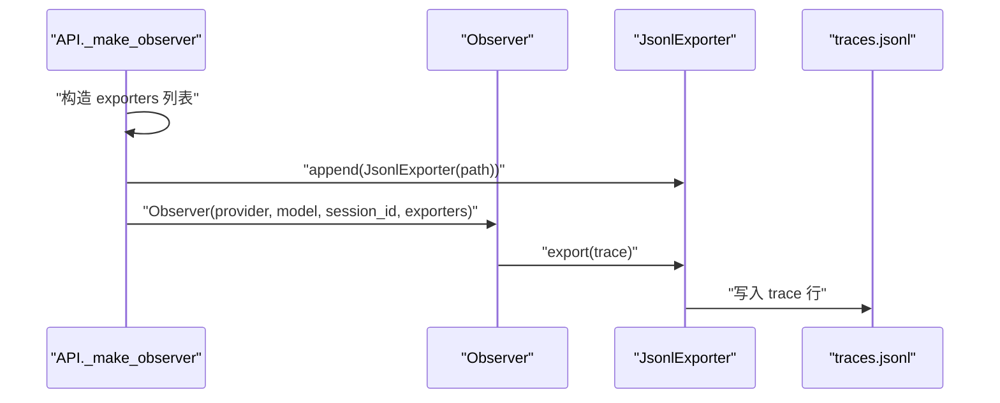
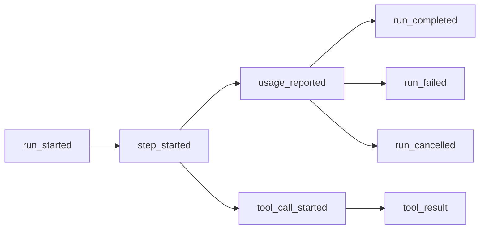
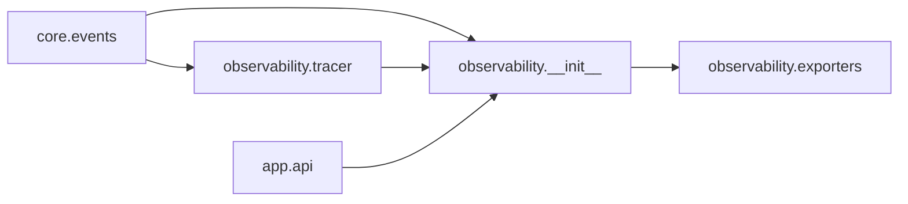

# 可观测性系统

<cite>
**本文引用的文件**   
- [README.md](file://README.md)
- [__init__.py](file://src/agentkit/observability/__init__.py)
- [exporters.py](file://src/agentkit/observability/exporters.py)
- [tracer.py](file://src/agentkit/observability/tracer.py)
- [events.py](file://src/agentkit/core/events.py)
- [api.py](file://src/agentkit/app/api.py)
- [test_observability.py](file://tests/test_observability.py)
</cite>

## 目录
1. [引言](#引言)
2. [项目结构](#项目结构)
3. [核心组件](#核心组件)
4. [架构总览](#架构总览)
5. [详细组件分析](#详细组件分析)
6. [依赖关系分析](#依赖关系分析)
7. [性能与可扩展性](#性能与可扩展性)
8. [故障排查指南](#故障排查指南)
9. [结论](#结论)

## 引言
本文件聚焦 AgentKit 的可观测性子系统：它把引擎产生的事件流转换为结构化 trace，并支持多种导出方式。该子系统遵循“引擎只产出事件、追踪器只消费事件”的设计原则，避免在引擎内部埋点，从而降低遗漏关闭 span 的风险，同时让追踪逻辑可以独立测试和替换。

从整体设计看，可观测性不是运行时引擎的一部分，而是运行时的消费者；它通过 `Observer` 包裹事件流，在事件边界上构建 span 树，并在 run 结束时把 trace 交给一个或多个导出器。

**章节来源**
- [README.md:40-63](file://README.md#L40-L63)

## 项目结构
可观测性相关代码集中在 `src/agentkit/observability` 包中，并与 `core.events` 的事件模型以及 `app.api` 的服务层集成。

**图表来源**
- [api.py:182-217](file://src/agentkit/app/api.py#L182-L217)
- [__init__.py:43-90](file://src/agentkit/observability/__init__.py#L43-L90)
- [tracer.py:201-432](file://src/agentkit/observability/tracer.py#L201-L432)
- [exporters.py:34-107](file://src/agentkit/observability/exporters.py#L34-L107)
- [events.py:1-170](file://src/agentkit/core/events.py#L1-L170)

**章节来源**
- [README.md:131-146](file://README.md#L131-L146)

## 核心组件
可观测性系统的核心由四类对象组成：

| 组件 | 职责 | 关键行为 |
|---|---|---|
| `Observer` | 把一次 agent 运行与 trace 记录绑定 | 包裹事件流，逐条消费并构建 trace，结束时导出 |
| `TraceBuilder` | 把事件序列映射为 span 树 | 根据事件类型打开/关闭 span，写入属性、事件和状态 |
| `Span` / `Trace` | 表示一次操作区间和完整 trace | 提供时间、属性、子 span、事件、渲染和序列化能力 |
| 导出器 | 把 trace 输出到不同目的地 | JSONL 追加写、控制台打印、内存缓存 |

这些组件共同实现“事件流 → trace → 可消费事实”的链路，而不是在引擎里插入成对的埋点调用。

**章节来源**
- [__init__.py:43-90](file://src/agentkit/observability/__init__.py#L43-L90)
- [tracer.py:68-154](file://src/agentkit/observability/tracer.py#L68-L154)
- [tracer.py:201-432](file://src/agentkit/observability/tracer.py#L201-L432)
- [exporters.py:34-107](file://src/agentkit/observability/exporters.py#L34-L107)

## 架构总览
下图展示一次 HTTP 请求如何经过 API、Agent 事件流、Observer 和导出器，最终落到 trace 文件。

**图表来源**
- [api.py:182-217](file://src/agentkit/app/api.py#L182-L217)
- [__init__.py:69-90](file://src/agentkit/observability/__init__.py#L69-L90)
- [tracer.py:239-409](file://src/agentkit/observability/tracer.py#L239-L409)
- [exporters.py:40-53](file://src/agentkit/observability/exporters.py#L40-L53)

## 详细组件分析

### Observer：事件流的追踪包装器
`Observer` 是用户可见的可观测性入口。它不直接读取引擎内部状态，而是接收一个 `AsyncIterator[RunEvent]`，在每次 `yield` 之前调用 `TraceBuilder.consume`，并在生成器结束时完成 trace 并触发导出。

关键点包括：
- 支持 provider、model、session_id、trace_id 等上下文信息。
- 支持可选的内容捕获开关，默认不记录大体积内容。
- 支持多个导出器并行导出。
- 文档明确提醒：如果调用方中途 `break`，应使用确定性关闭方式，否则收尾可能延迟到异步生成器回收时。

**图表来源**
- [__init__.py:43-90](file://src/agentkit/observability/__init__.py#L43-L90)
- [tracer.py:201-257](file://src/agentkit/observability/tracer.py#L201-L257)
- [exporters.py:34-38](file://src/agentkit/observability/exporters.py#L34-L38)

**章节来源**
- [__init__.py:43-90](file://src/agentkit/observability/__init__.py#L43-L90)

### TraceBuilder：事件到 span 树的映射
`TraceBuilder` 是可观测性的核心状态机。它维护根 span、当前 chat span、当前工具 span 以及子 span 栈，并根据事件类型执行以下映射：

| 事件 | 行为 |
|---|---|
| `run_started` | 创建根 span `invoke_agent <agent>`，写入 provider、agent、model、会话 id 等属性 |
| `step_started` | 打开 chat span `chat <model>` |
| `usage_reported` | 写入 token 用量并关闭 chat span |
| `tool_call_started` | 打开工具 span `execute_tool <name>`，写入工具名、类型、调用 id |
| `tool_result` | 关闭工具 span，错误结果标记工具 span 状态为 ERROR |
| `approval_requested` | 在当前工具或根 span 上添加审批请求事件 |
| `approval_resolved` | 在当前工具或根 span 上添加审批结果事件 |
| `run_completed` | 写入累计用量、步数、耗时、成本，并关闭根 span |
| `run_failed` | 写入错误类型，关闭根 span 为 ERROR |
| `run_cancelled` | 添加取消事件，根 span 状态保持 UNSET |

**图表来源**
- [tracer.py:239-409](file://src/agentkit/observability/tracer.py#L239-L409)

**章节来源**
- [tracer.py:1-31](file://src/agentkit/observability/tracer.py#L1-L31)
- [tracer.py:201-432](file://src/agentkit/observability/tracer.py#L201-L432)

### Span 与 Trace：数据结构与语义
`Span` 表示一次带时间的操作区间，包含名称、kind、span_id、parent_id、trace_id、起止时间、属性、状态、事件和子 span。`Trace` 表示一次运行的完整 span 树，并提供渲染和序列化方法。

重要语义：
- `duration_ms` 在未关闭时仍可按当前时间计算，便于调试。
- `open` 属性用于检测是否还有未关闭的 span。
- `to_dict` 输出可直接 JSON 化，适合 JSONL 导出。
- `render` 输出人类可读的缩进树，便于终端调试。

**图表来源**
- [tracer.py:68-154](file://src/agentkit/observability/tracer.py#L68-L154)

**章节来源**
- [tracer.py:68-154](file://src/agentkit/observability/tracer.py#L68-L154)

### 导出器：JSONL、控制台与内存
导出器遵循统一协议 `TraceExporter.export(trace)`，但不承担聚合统计职责。项目明确强调：导出器只负责记录事实，汇总指标应由消费 JSONL 的分析代码计算。

| 导出器 | 用途 | 特点 |
|---|---|---|
| `JsonlExporter` | 持久化 trace | 按行追加，中文不转义，自动创建目录 |
| `ConsoleExporter` | 调试查看 | 调用 `trace.render()` 打印树 |
| `MemoryExporter` | 测试和单次查询 | 内存中保存 trace 列表，支持迭代 |
| `read_jsonl` | 读取 trace | 跳过坏行，容错截断尾行 |
| `export_all` | 批量导出 | 返回导出条数 |

**图表来源**
- [exporters.py:34-107](file://src/agentkit/observability/exporters.py#L34-L107)

**章节来源**
- [exporters.py:1-14](file://src/agentkit/observability/exporters.py#L1-L14)
- [exporters.py:40-107](file://src/agentkit/observability/exporters.py#L40-L107)

### 与 HTTP API 的集成
HTTP API 在服务层构造 `Observer`，并把 trace 导出到 `traces.jsonl`。Provider 名称通过 `provider_name_for` 推断，通常来自模型名或 base_url。

**图表来源**
- [api.py:182-193](file://src/agentkit/app/api.py#L182-L193)
- [tracer.py:188-198](file://src/agentkit/observability/tracer.py#L188-L198)
- [exporters.py:40-53](file://src/agentkit/observability/exporters.py#L40-L53)

**章节来源**
- [api.py:182-217](file://src/agentkit/app/api.py#L182-L217)

### 事件模型与可观测性契约
可观测性依赖 `core.events` 中的 `RunEvent` 联合类型。事件不仅是 UI 和 SSE 的显示源，也是可观测性和评测的共同真相源。因此，事件顺序必须能还原时间结构，这也是测试重点之一。

典型事件序列包括：
- `RunStarted`
- `StepStarted`
- `UsageReported`
- `ToolCallStarted` → `ToolResult`
- `RunCompleted` / `RunFailed` / `RunCancelled`

**图表来源**
- [events.py:1-26](file://src/agentkit/core/events.py#L1-L26)
- [events.py:48-170](file://src/agentkit/core/events.py#L48-L170)

**章节来源**
- [events.py:1-170](file://src/agentkit/core/events.py#L1-L170)

## 依赖关系分析
可观测性模块的依赖方向清晰且单向：

- `observability.tracer` 依赖 `core.events` 和 `core.ids`、`core.usage`。
- `observability.__init__` 暴露 `Observer`、`TraceBuilder`、`Span`、`Trace`、导出器和辅助函数。
- `app.api` 依赖 `observability` 来构造 observer 和 exporter。
- 可观测性本身不反向依赖 `runtime.engine`，这是设计上的解耦。

**图表来源**
- [__init__.py:15-24](file://src/agentkit/observability/__init__.py#L15-L24)
- [tracer.py:40-42](file://src/agentkit/observability/tracer.py#L40-L42)
- [api.py:42-42](file://src/agentkit/app/api.py#L42-L42)

**章节来源**
- [README.md:146-146](file://README.md#L146-L146)

## 性能与可扩展性
可观测性对性能的影响主要来自三个方面：

1. **事件消费开销**  
   `Observer.wrap` 会逐条消费事件并调用 `TraceBuilder.consume`。由于只是字典属性和少量列表追加，开销很小；真正的延迟主要花在 LLM 调用和工具执行上。

2. **内容捕获开关**  
   `capture_content=True` 会把文本增量、工具参数、工具结果写入 span 属性。这会增大 trace 体积，适合调试，不适合长期生产日志。

3. **导出策略**  
   JSONL 是追加写，适合事后分析；控制台导出适合调试；内存导出适合测试。项目明确反对在导出器中做聚合统计，以避免“事实”变成“有立场的观点”。

扩展建议：
- 新增导出器只需实现 `TraceExporter.export(trace)`。
- 新增事件类型时，优先保证 `TraceBuilder.consume` 能安全忽略未知事件，再补充 `_on_xxx` 处理。
- 如需对接 OTel，可在 `app.api` 中增加 OTel exporter，而不改动引擎。

**章节来源**
- [exporters.py:1-14](file://src/agentkit/observability/exporters.py#L1-L14)
- [tracer.py:212-235](file://src/agentkit/observability/tracer.py#L212-L235)
- [__init__.py:69-90](file://src/agentkit/observability/__init__.py#L69-L90)

## 故障排查指南

### 常见问题与定位方式

| 现象 | 可能原因 | 排查方式 |
|---|---|---|
| trace 中没有结束时间 | 事件序列不完整，某个 span 没有被关闭 | 检查 `run_completed` / `run_failed` / `run_cancelled` 是否存在 |
| 工具失败但整个 agent 被标为 ERROR | 错误类型判断错误或事件顺序异常 | 查看工具 span 的 `error.type` 和根 span 状态 |
| 取消被误判为错误 | 取消事件没有正确映射 | 确认根 span 状态为 UNSET，且有 `cancelled` 事件 |
| JSONL 读取出错 | 文件被截断或存在坏行 | 使用 `read_jsonl`，它会跳过坏行 |
| 浏览器断开后 trace 未导出 | 调用方没有确定性关闭 observer | 使用 `contextlib.aclosing` 包裹 `observer.wrap` |

### 关键测试用例参考
测试覆盖了 provider 推断、span 树结构、内容捕获、错误状态、取消语义、审批事件、JSONL 读写、observer 端到端行为和 early break 场景。

**章节来源**
- [test_observability.py:52-70](file://tests/test_observability.py#L52-L70)
- [test_observability.py:72-281](file://tests/test_observability.py#L72-L281)
- [test_observability.py:309-357](file://tests/test_observability.py#L309-L357)
- [test_observability.py:359-419](file://tests/test_observability.py#L359-L419)

## 结论
AgentKit 的可观测性系统以事件流为中心，通过 `Observer` 和 `TraceBuilder` 将运行时行为转化为结构化的 span 树，并通过导出器输出为 JSONL、控制台或内存数据。其设计优势在于：

- 不侵入引擎，避免埋点遗漏导致的永不结束 span。
- 事件即唯一真相源，CLI、SSE、可观测、评测共享同一条流。
- 导出器只做事实记录，不做业务聚合，便于后续分析和口径切换。
- 通过测试覆盖事件到 span 的映射契约，确保事件顺序变化不会静默破坏 trace。

对于使用者而言，最直接的接入方式是：在启动 agent 流的地方构造 `Observer`，按需开启内容捕获，并注册需要的导出器。对于运维和分析侧，`traces.jsonl` 是主要的可消费资产。