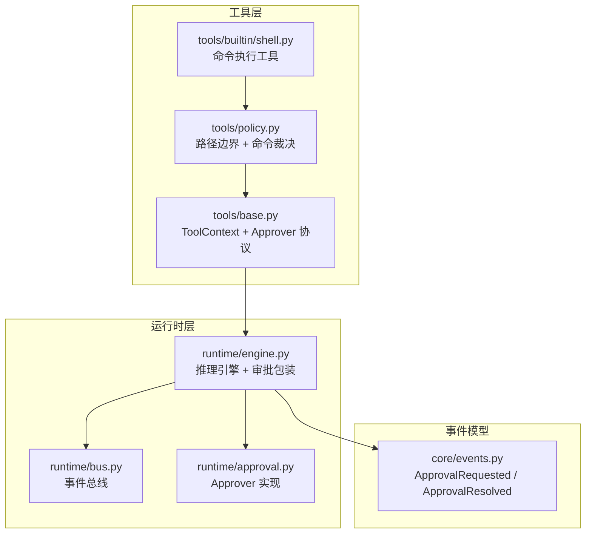
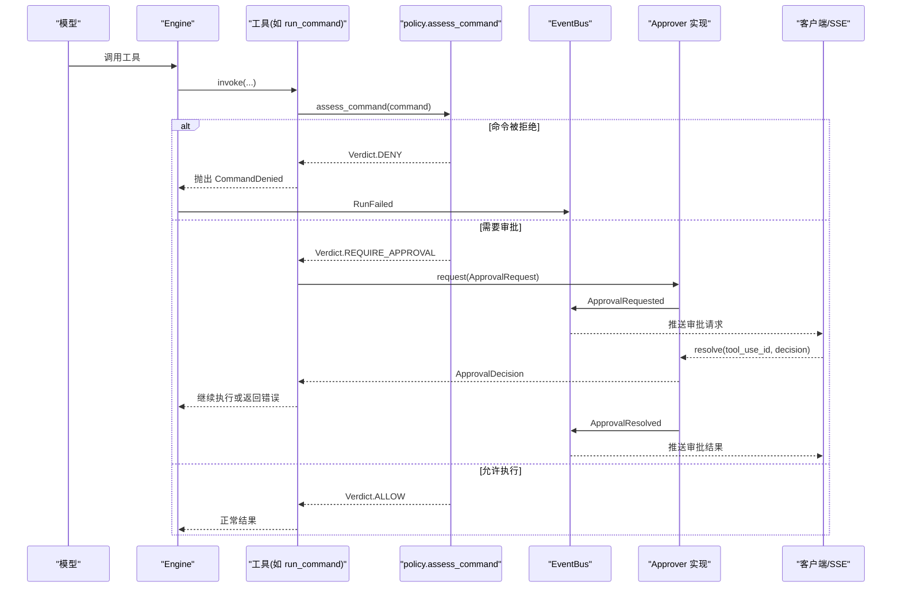
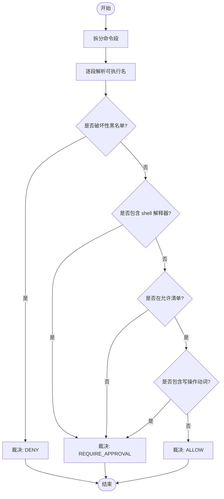
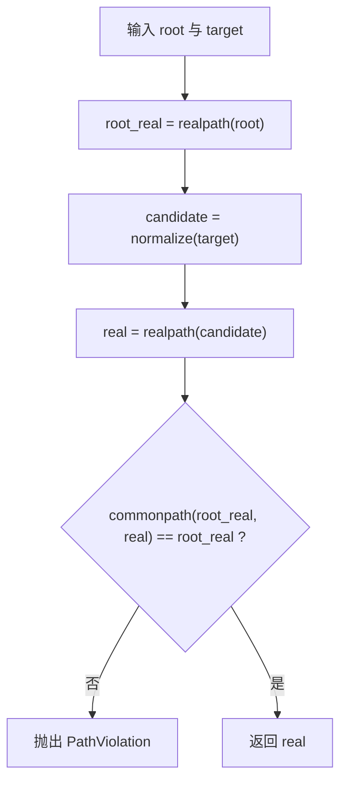
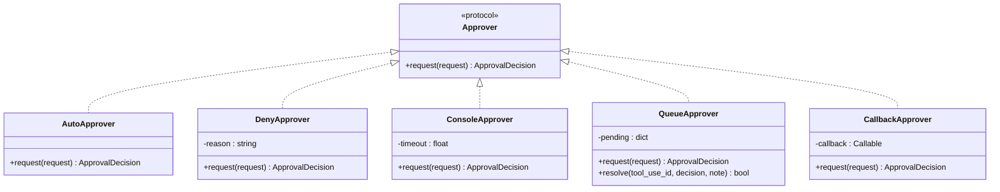
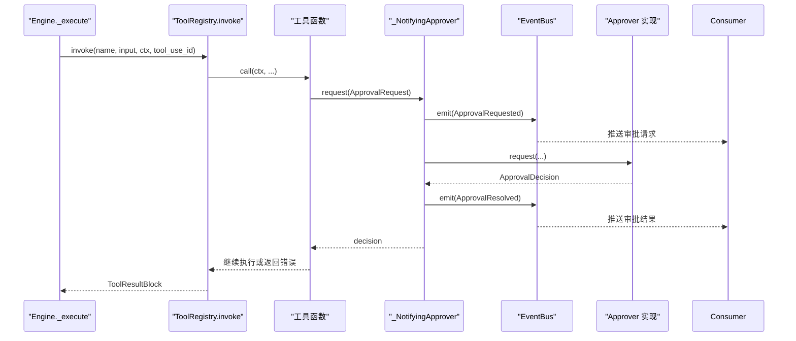
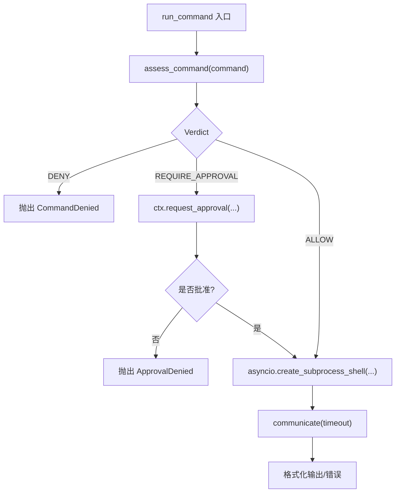
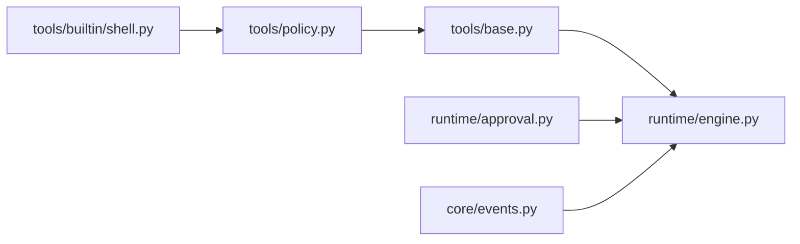

# 安全机制

<cite>
**本文引用的文件**   
- [README.md](file://README.md)
- [src/agentkit/tools/policy.py](file://src/agentkit/tools/policy.py)
- [src/agentkit/runtime/approval.py](file://src/agentkit/runtime/approval.py)
- [src/agentkit/runtime/engine.py](file://src/agentkit/runtime/engine.py)
- [src/agentkit/runtime/bus.py](file://src/agentkit/runtime/bus.py)
- [src/agentkit/tools/base.py](file://src/agentkit/tools/base.py)
- [src/agentkit/tools/builtin/shell.py](file://src/agentkit/tools/builtin/shell.py)
- [src/agentkit/core/events.py](file://src/agentkit/core/events.py)
- [tests/test_policy.py](file://tests/test_policy.py)
- [tests/test_runtime.py](file://tests/test_runtime.py)
</cite>

## 目录
1. [引言](#引言)
2. [项目结构](#项目结构)
3. [核心组件](#核心组件)
4. [架构总览](#架构总览)
5. [详细组件分析](#详细组件分析)
6. [依赖关系分析](#依赖关系分析)
7. [性能与可观测性](#性能与可观测性)
8. [故障排查指南](#故障排查指南)
9. [结论](#结论)
10. [附录：配置与使用示例路径](#附录配置与使用示例路径)

## 引言
本文件系统性梳理 AgentKit 的安全控制体系，重点解释“三分裁决”（拒绝 / 放行 / 转审批）的设计原理、默认拒绝策略的重要性、命令评估与路径安全验证的实现，以及 Approver 接口与多种审批策略。文档同时给出事件驱动下的审批时序、常见用法与高级扩展点，帮助读者在本地开发、CLI、服务化 SSE 等场景下正确配置和执行安全审批。

## 项目结构
AgentKit 的安全能力横跨工具层与运行时层：
- 工具层负责安全策略定义与命令/路径判定；
- 运行时层负责审批通道实现、事件总线与引擎调度；
- 事件模型统一承载审批请求与结果；
- 测试覆盖命令评估、路径边界与审批流程。

**图示来源**
- [src/agentkit/tools/policy.py:1-44](file://src/agentkit/tools/policy.py#L1-L44)
- [src/agentkit/tools/base.py:35-66](file://src/agentkit/tools/base.py#L35-L66)
- [src/agentkit/tools/builtin/shell.py:38-66](file://src/agentkit/tools/builtin/shell.py#L38-L66)
- [src/agentkit/runtime/engine.py:96-124](file://src/agentkit/runtime/engine.py#L96-L124)
- [src/agentkit/runtime/bus.py:1-14](file://src/agentkit/runtime/bus.py#L1-L14)
- [src/agentkit/runtime/approval.py:1-32](file://src/agentkit/runtime/approval.py#L1-L32)
- [src/agentkit/core/events.py:130-148](file://src/agentkit/core/events.py#L130-L148)

**章节来源**
- [README.md:53-69](file://README.md#L53-L69)

## 核心组件
- 命令评估与三分裁决：通过允许清单、破坏性黑名单、写操作标记与 shell 管道检测，将命令分类为 ALLOW / DENY / REQUIRE_APPROVAL。
- 路径安全验证：基于 realpath + commonpath 的真实路径包含判断，避免符号链接与前缀比较漏洞。
- 审批协议与实现：Approver 协议解耦工具与运行时；提供 Auto/Deny/Console/Queue/Callback 五种实现。
- 事件驱动的审批流：引擎用 _NotifyingApprover 把审批请求与结果广播到 EventBus，确保客户端在工具阻塞时即可收到请求。
- 工具上下文：ToolContext 暴露 request_approval 与 resolve 方法，默认无审批通道即拒绝。

**章节来源**
- [src/agentkit/tools/policy.py:125-304](file://src/agentkit/tools/policy.py#L125-L304)
- [src/agentkit/runtime/approval.py:35-178](file://src/agentkit/runtime/approval.py#L35-L178)
- [src/agentkit/runtime/engine.py:96-124](file://src/agentkit/runtime/engine.py#L96-L124)
- [src/agentkit/tools/base.py:40-66](file://src/agentkit/tools/base.py#L40-L66)

## 架构总览
AgentKit 的安全架构以“默认不信任”为核心原则：
- 命令层面：未知或写操作一律转审批，明确破坏性直接拒绝。
- 路径层面：越界直接抛错，不允许逃逸工作区。
- 审批层面：没有审批通道即拒绝；服务化默认 DenyApprover。
- 事件层面：所有审批请求与决定都走事件总线，保证异步与可观测。

**图示来源**
- [src/agentkit/tools/policy.py:245-304](file://src/agentkit/tools/policy.py#L245-L304)
- [src/agentkit/tools/builtin/shell.py:46-66](file://src/agentkit/tools/builtin/shell.py#L46-L66)
- [src/agentkit/runtime/engine.py:96-124](file://src/agentkit/runtime/engine.py#L96-L124)
- [src/agentkit/runtime/bus.py:39-53](file://src/agentkit/runtime/bus.py#L39-L53)
- [src/agentkit/core/events.py:130-148](file://src/agentkit/core/events.py#L130-L148)

## 详细组件分析

### 命令评估与三分裁决
命令评估采用保守启发式：
- 按 shell 操作符分段解析，尊重引号，避免误杀字符串中的危险片段。
- 提取每段的可执行文件名，跳过 sudo/env/time/nohup/exec 等包装器。
- 命中破坏性黑名单 → DENY。
- 命中 shell 解释器（sh/bash/zsh/fish/cmd/powershell/pwsh）→ REQUIRE_APPROVAL。
- 不在允许清单且非写操作动词 → REQUIRE_APPROVAL。
- 包含写操作动词（rm/del/rmdir/mv/cp/tee/touch/mkdir）→ REQUIRE_APPROVAL。
- 其余 → ALLOW。

**图示来源**
- [src/agentkit/tools/policy.py:181-242](file://src/agentkit/tools/policy.py#L181-L242)
- [src/agentkit/tools/policy.py:245-298](file://src/agentkit/tools/policy.py#L245-L298)

**章节来源**
- [src/agentkit/tools/policy.py:143-176](file://src/agentkit/tools/policy.py#L143-L176)
- [src/agentkit/tools/policy.py:181-242](file://src/agentkit/tools/policy.py#L181-L242)
- [src/agentkit/tools/policy.py:245-298](file://src/agentkit/tools/policy.py#L245-L298)
- [tests/test_policy.py:111-140](file://tests/test_policy.py#L111-L140)

### 路径安全验证
路径校验使用 realpath 解析符号链接与相对路径，再用 commonpath 做真实包含判断，避免前缀匹配漏洞与跨盘符问题。越界直接抛出 PathViolation，调用方应直接使用返回的真实路径，避免 TOCTOU。

**图示来源**
- [src/agentkit/tools/policy.py:94-119](file://src/agentkit/tools/policy.py#L94-L119)

**章节来源**
- [src/agentkit/tools/policy.py:94-119](file://src/agentkit/tools/policy.py#L94-L119)
- [tests/test_policy.py:26-42](file://tests/test_policy.py#L26-L42)

### 审批协议 Approver 与实现
Approver 是一个 Protocol，仅定义 request(request: ApprovalRequest) -> ApprovalDecision。具体实现放在 runtime 中，保持 tools 不依赖 runtime。

- AutoApprover：全部放行，仅适合本地开发。
- DenyApprover：全部拒绝，服务化默认值，体现“默认拒绝”。
- ConsoleApprover：终端交互，超时默认拒绝，空输入拒绝。
- QueueApprover：SSE 外部队列，通过 tool_use_id 关联请求与结果。
- CallbackApprover：回调封装，支持同步/异步返回值。

**图示来源**
- [src/agentkit/tools/policy.py:77-88](file://src/agentkit/tools/policy.py#L77-L88)
- [src/agentkit/runtime/approval.py:35-178](file://src/agentkit/runtime/approval.py#L35-L178)

**章节来源**
- [src/agentkit/tools/policy.py:49-88](file://src/agentkit/tools/policy.py#L49-L88)
- [src/agentkit/runtime/approval.py:35-178](file://src/agentkit/runtime/approval.py#L35-L178)
- [tests/test_runtime.py:309-391](file://tests/test_runtime.py#L309-L391)

### 引擎与事件驱动的审批流
引擎在执行工具前注入 ToolContext，其中 approver 被 _NotifyingApprover 包装，用于在工具阻塞期间发出 ApprovalRequested 事件，并在得到结果后发出 ApprovalResolved 事件。EventBus 确保事件在工具尚未完成时就送达消费者。

**图示来源**
- [src/agentkit/runtime/engine.py:410-434](file://src/agentkit/runtime/engine.py#L410-L434)
- [src/agentkit/runtime/engine.py:96-124](file://src/agentkit/runtime/engine.py#L96-L124)
- [src/agentkit/runtime/bus.py:39-53](file://src/agentkit/runtime/bus.py#L39-L53)
- [src/agentkit/core/events.py:130-148](file://src/agentkit/core/events.py#L130-L148)

**章节来源**
- [src/agentkit/runtime/engine.py:96-124](file://src/agentkit/runtime/engine.py#L96-L124)
- [src/agentkit/runtime/bus.py:1-14](file://src/agentkit/runtime/bus.py#L1-L14)
- [tests/test_runtime.py:394-458](file://tests/test_runtime.py#L394-L458)

### 命令执行工具的安全集成
run_command 工具在内部先进行命令评估：
- DENY：抛出 CommandDenied，由注册表标记为 is_error。
- REQUIRE_APPROVAL：通过 ctx.request_approval 发起审批；若未批准则抛出 ApprovalDenied。
- ALLOW：创建子进程执行，带超时与环境裁剪。

**图示来源**
- [src/agentkit/tools/builtin/shell.py:38-97](file://src/agentkit/tools/builtin/shell.py#L38-L97)
- [src/agentkit/tools/policy.py:245-304](file://src/agentkit/tools/policy.py#L245-L304)

**章节来源**
- [src/agentkit/tools/builtin/shell.py:38-97](file://src/agentkit/tools/builtin/shell.py#L38-L97)

### 默认拒绝策略的重要性
- 工具上下文 request_approval：若无 approver，直接返回 False（拒绝）。
- DenyApprover：服务化默认值，无人值守时拒绝一切需审批动作。
- README 强调：非交互场景加 --no-approve 直接拒绝所有需要审批的动作——默认拒绝，不是默认放行。

**章节来源**
- [src/agentkit/tools/base.py:57-62](file://src/agentkit/tools/base.py#L57-L62)
- [src/agentkit/runtime/approval.py:46-57](file://src/agentkit/runtime/approval.py#L46-L57)
- [README.md:49-52](file://README.md#L49-L52)

## 依赖关系分析
- tools.policy 只定义协议与策略，不依赖 runtime。
- runtime.approval 实现 Approver 协议，供 engine 注入。
- engine 通过 ToolContext 向工具注入 approver，并通过 EventBus 广播审批事件。
- core.events 提供 ApprovalRequested / ApprovalResolved 事件类型。

**图示来源**
- [src/agentkit/tools/policy.py:1-44](file://src/agentkit/tools/policy.py#L1-L44)
- [src/agentkit/tools/base.py:35-66](file://src/agentkit/tools/base.py#L35-L66)
- [src/agentkit/runtime/engine.py:96-124](file://src/agentkit/runtime/engine.py#L96-L124)
- [src/agentkit/runtime/approval.py:1-32](file://src/agentkit/runtime/approval.py#L1-L32)
- [src/agentkit/core/events.py:130-148](file://src/agentkit/core/events.py#L130-L148)
- [src/agentkit/tools/builtin/shell.py:38-66](file://src/agentkit/tools/builtin/shell.py#L38-L66)

**章节来源**
- [README.md:68-69](file://README.md#L68-L69)

## 性能与可观测性
- 事件总线使用同步入队，避免在工具执行中途引入额外 await 开销；消费者异步消费，解耦生产与消费。
- 审批事件在工具仍阻塞时发出，确保客户端能即时响应，避免“先出结果再问批准”的逻辑倒置。
- 引擎对异常进行分类处理，将预算超限、取消、内部错误等转为终止事件，便于上层统一处理与观测。

**章节来源**
- [src/agentkit/runtime/bus.py:1-14](file://src/agentkit/runtime/bus.py#L1-L14)
- [src/agentkit/runtime/engine.py:218-248](file://src/agentkit/runtime/engine.py#L218-L248)

## 故障排查指南
- 命令被拒绝：检查 assess_command 的 DENY 分支，确认是否命中破坏性黑名单或 shell 解释器。
- 审批一直等待：检查 QueueApprover.pending_ids 是否为空，确认 resolve 是否传入正确的 tool_use_id。
- 控制台审批无效：ConsoleApprover 在非 TTY 环境下不会启用；可通过 default_console_approver 判断。
- 路径越界：确认 resolve_in_workspace 是否抛出 PathViolation，检查目标路径是否包含符号链接或跨盘符。
- 审批未生效：确认 ToolContext.approver 是否为 None；若为 None，request_approval 会直接拒绝。

**章节来源**
- [src/agentkit/tools/policy.py:245-304](file://src/agentkit/tools/policy.py#L245-L304)
- [src/agentkit/runtime/approval.py:120-178](file://src/agentkit/runtime/approval.py#L120-L178)
- [src/agentkit/runtime/approval.py:170-178](file://src/agentkit/runtime/approval.py#L170-L178)
- [src/agentkit/tools/policy.py:94-119](file://src/agentkit/tools/policy.py#L94-L119)
- [src/agentkit/tools/base.py:57-62](file://src/agentkit/tools/base.py#L57-L62)

## 结论
AgentKit 的安全体系以“默认不信任”为核心，通过命令三分裁决、路径真实边界校验、Approver 协议与多实现、以及事件驱动的审批流，构建起从工具到运行时的完整安全闭环。服务化默认拒绝、CLI 交互式审批、SSE 外部队列审批三种形态覆盖了典型部署场景，同时保留回调封装与自定义策略扩展点，便于审计日志、紧急绕过等高级用法落地。

## 附录：配置与使用示例路径
- 命令评估与路径校验用例：
  - [tests/test_policy.py:26-42](file://tests/test_policy.py#L26-L42)
  - [tests/test_policy.py:111-140](file://tests/test_policy.py#L111-L140)
- 审批策略实现与测试：
  - [src/agentkit/runtime/approval.py:35-178](file://src/agentkit/runtime/approval.py#L35-L178)
  - [tests/test_runtime.py:309-391](file://tests/test_runtime.py#L309-L391)
- 引擎审批事件与阻塞期到达性：
  - [tests/test_runtime.py:394-458](file://tests/test_runtime.py#L394-L458)
- CLI 与服务端审批说明：
  - [README.md:49-52](file://README.md#L49-L52)