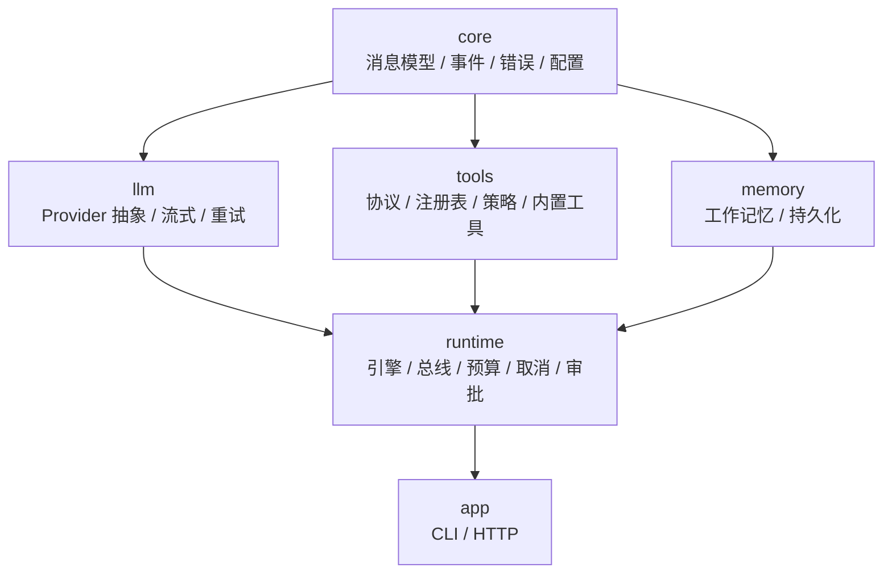
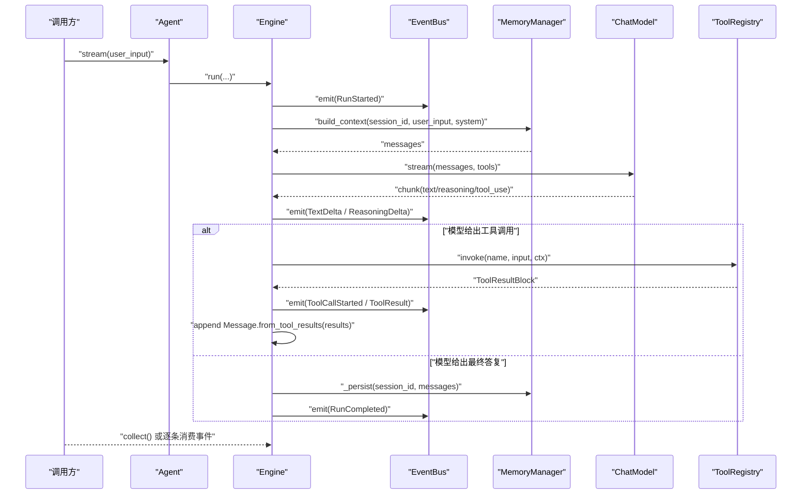
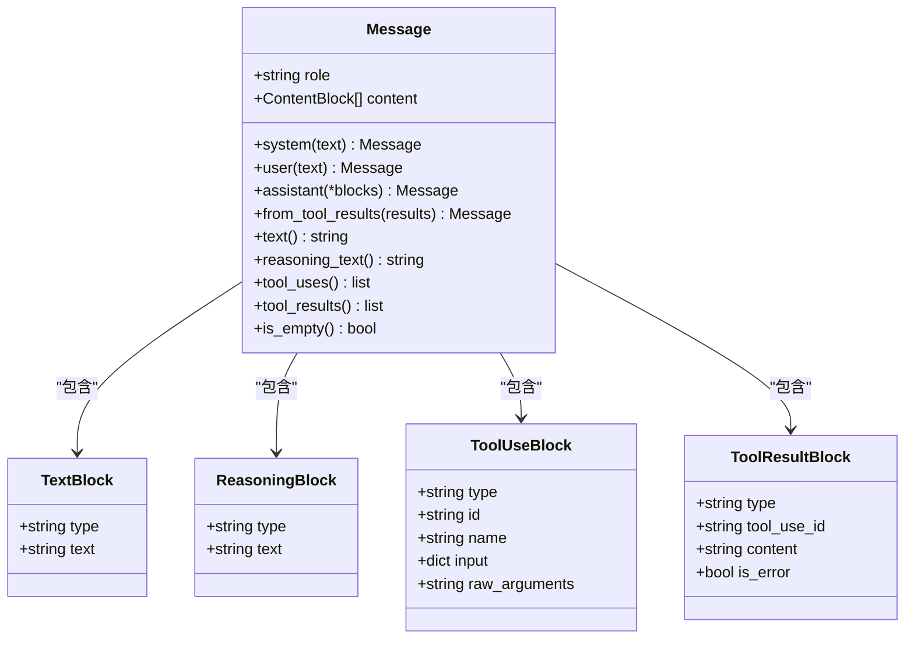
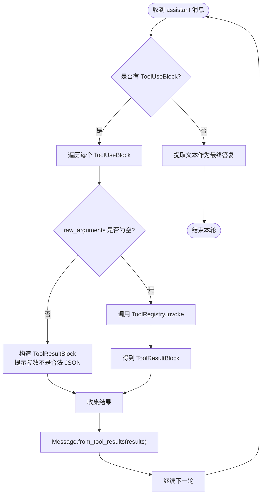
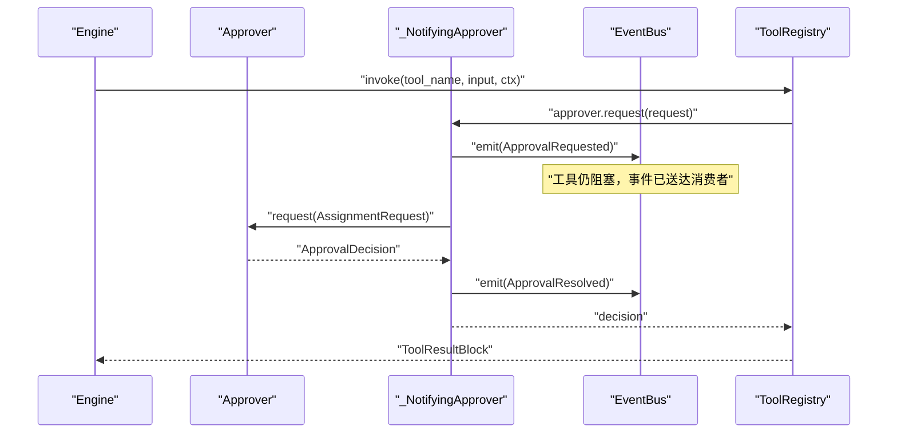
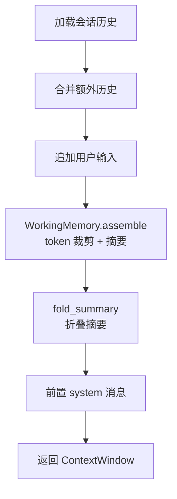
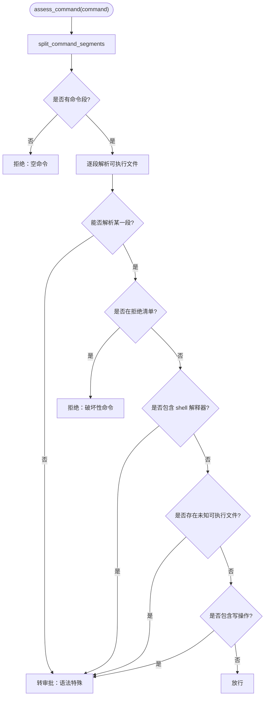
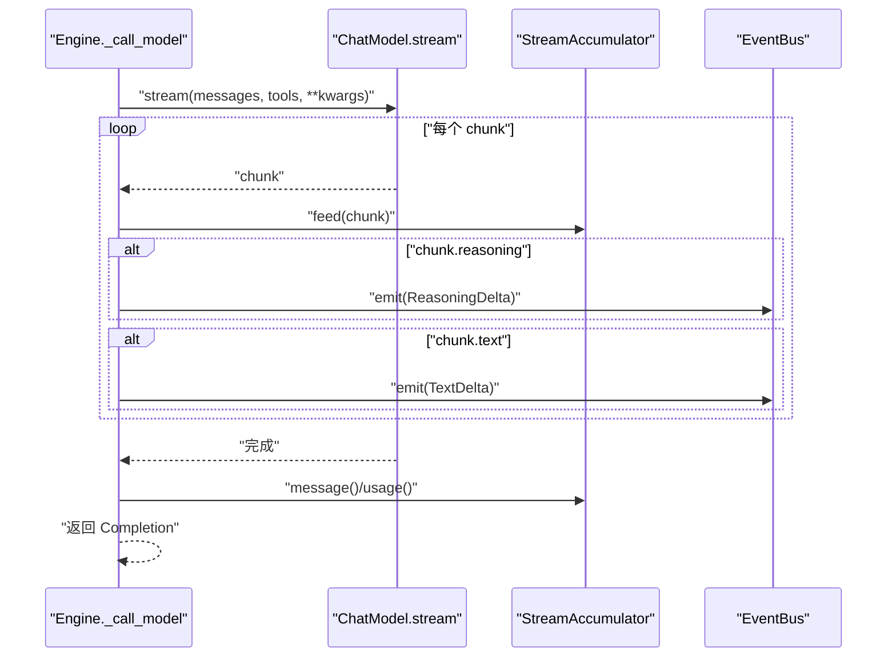
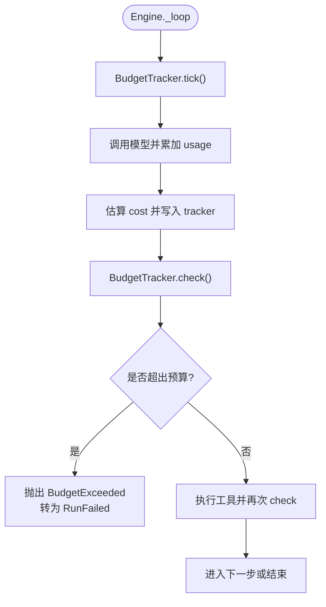
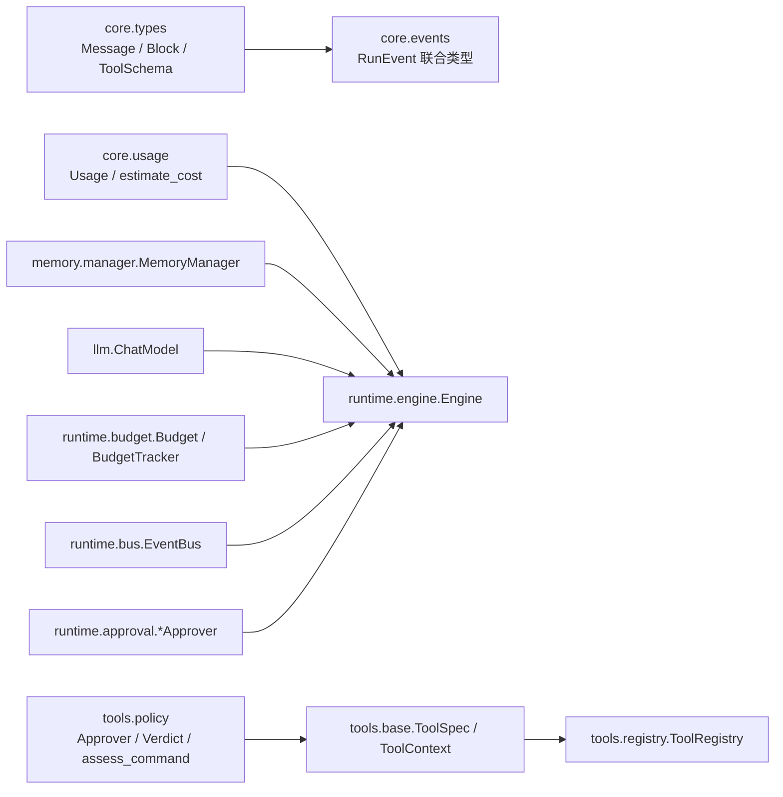

# 核心概念

<cite>
**本文引用的文件**   
- [README.md](file://README.md)
- [types.py](file://src/agentkit/core/types.py)
- [events.py](file://src/agentkit/core/events.py)
- [engine.py](file://src/agentkit/runtime/engine.py)
- [agent.py](file://src/agentkit/runtime/agent.py)
- [bus.py](file://src/agentkit/runtime/bus.py)
- [budget.py](file://src/agentkit/runtime/budget.py)
- [approval.py](file://src/agentkit/runtime/approval.py)
- [base.py](file://src/agentkit/tools/base.py)
- [policy.py](file://src/agentkit/tools/policy.py)
- [manager.py](file://src/agentkit/memory/manager.py)
- [memory-design.md](file://docs/memory-design.md)
</cite>

## 目录
1. [引言](#引言)
2. [项目结构](#项目结构)
3. [核心组件](#核心组件)
4. [架构总览](#架构总览)
5. [详细组件分析](#详细组件分析)
6. [依赖关系分析](#依赖关系分析)
7. [性能与成本考量](#性能与成本考量)
8. [故障排查指南](#故障排查指南)
9. [结论](#结论)

## 引言
AgentKit 是一个从零实现的 Agent 开发框架，核心循环、工具层、记忆、评测和可观测性全部自研，不依赖 LangChain 等现成框架。它的关键设计取舍包括：使用内容块消息模型而非 role-based 的 tool_calls；用原生 Tool Calling 替代文本解析；引擎只产出类型化事件；参数校验失败回灌给模型；路径边界用 realpath + commonpath；命令安全用三分裁决；事件经队列解耦；工具结果失败不回滚 run；流式重试只在首个 chunk 之前允许；记忆只做工作记忆与持久化。

这些取舍共同构成一个“可解释、可观测、可审计”的 Agent 内核：开发者能清楚看到每一步在做什么、花了多少 token、调了哪些工具、是否被审批拦截，而不是把不确定性分散到正则、回调和隐式状态里。

**章节来源**
- [README.md:8-26](file://README.md#L8-L26)

## 项目结构
仓库按职责分层组织：core 是零依赖的消息、事件、错误、配置和用量定义；llm 做 Provider 抽象、流式归一化和重试；tools 定义工具协议、注册表、策略和内置工具；memory 负责工作记忆与 SQLite 持久化；runtime 组合引擎、事件总线、预算、取消和审批；app 提供 CLI 与服务入口。依赖方向是单向的：core 零依赖，llm/tools/observability 只依赖 core，runtime 依赖全部，app 只依赖 runtime，tools 绝不 import runtime。

**图表来源**
- [README.md:53-68](file://README.md#L53-L68)

**章节来源**
- [README.md:53-68](file://README.md#L53-L68)

## 核心组件
AgentKit 的核心由五类组件组成：

| 组件 | 主要职责 | 关键文件 |
|---|---|---|
| 内容块消息模型 | 定义 TextBlock、ReasoningBlock、ToolUseBlock、ToolResultBlock、Message 及对话配对不变量 | [types.py](file://src/agentkit/core/types.py) |
| 运行时事件系统 | 定义 RunStarted、StepStarted、TextDelta、ToolCallStarted、ToolResult、ApprovalRequested 等事件，并作为唯一真相源 | [events.py](file://src/agentkit/core/events.py) |
| 推理引擎 | 驱动原生 Tool Calling 循环，组装上下文、调用模型、执行工具、持久化历史、上报预算 | [engine.py](file://src/agentkit/runtime/engine.py) |
| 工具与安全策略 | 从函数签名生成 JSON Schema，注入 ToolContext，实现路径边界与三分命令裁决 | [base.py](file://src/agentkit/tools/base.py)、[policy.py](file://src/agentkit/tools/policy.py) |
| 记忆管理器 | 作为上下文装配的唯一入口，负责会话读取、token 裁剪、摘要折叠、落盘 | [manager.py](file://src/agentkit/memory/manager.py) |

**章节来源**
- [types.py:1-15](file://src/agentkit/core/types.py#L1-L15)
- [events.py:1-26](file://src/agentkit/core/events.py#L1-L26)
- [engine.py:1-16](file://src/agentkit/runtime/engine.py#L1-L16)
- [base.py:1-21](file://src/agentkit/tools/base.py#L1-L21)
- [policy.py:1-19](file://src/agentkit/tools/policy.py#L1-L19)
- [manager.py:1-14](file://src/agentkit/memory/manager.py#L1-L14)

## 架构总览
Engine 是 Agent 的运行中枢。它接收用户输入，通过 MemoryManager 或本地逻辑构建消息序列，再把消息发给 ChatModel。模型返回最终文本或一个或多个 ToolUseBlock；引擎执行工具并把结果打包为一条 user 消息追加回去，然后回到第一步。整个过程中，所有中间状态都以事件形式推入 EventBus，供 CLI、SSE、可观测层和评测消费。

**图表来源**
- [engine.py:166-205](file://src/agentkit/runtime/engine.py#L166-L205)
- [engine.py:250-368](file://src/agentkit/runtime/engine.py#L250-L368)
- [engine.py:370-408](file://src/agentkit/runtime/engine.py#L370-L408)
- [engine.py:438-493](file://src/agentkit/runtime/engine.py#L438-L493)
- [events.py:14-26](file://src/agentkit/core/events.py#L14-L26)

**章节来源**
- [engine.py:1-16](file://src/agentkit/runtime/engine.py#L1-L16)
- [engine.py:166-205](file://src/agentkit/runtime/engine.py#L166-L205)
- [engine.py:250-368](file://src/agentkit/runtime/engine.py#L250-L368)

## 详细组件分析

### 内容块消息模型与传统 role-based 消息的区别
传统 OpenAI 风格的消息常用 `role:"assistant"` 配合 `tool_calls[]`，再用 `role:"tool"` 表示结果。但 Anthropic 没有独立的 `tool` role，它的 `tool_use` 和 `tool_result` 是 assistant/user 消息内部的 content block，并且同一轮每个 `tool_use` 必须在紧随其后的 user 消息中配对。如果内部直接抄 OpenAI 形状，每次转 Anthropic 都要重新分组、重排消息，还可能丢失并行调用的语义。

AgentKit 选择内部统一为内容块模型：

| 内容块 | 含义 | 关键属性 |
|---|---|---|
| TextBlock | 普通文本 | type、text |
| ReasoningBlock | 思维链或 reasoning_content | type、text |
| ToolUseBlock | 模型请求调用工具 | type、id、name、input、raw_arguments |
| ToolResultBlock | 工具执行结果回灌给模型 | type、tool_use_id、content、is_error |

Message 不再只是字符串，而是 role 加 ContentBlock 列表。它提供 text、reasoning_text、tool_uses、tool_results 等查询方法，以及 from_tool_results 构造器，保证“一条 assistant 的 tool_use 对应一条 user 的 tool_result”。

**图表来源**
- [types.py:29-74](file://src/agentkit/core/types.py#L29-L74)
- [types.py:103-157](file://src/agentkit/core/types.py#L103-L157)

**章节来源**
- [types.py:1-15](file://src/agentkit/core/types.py#L1-L15)
- [types.py:29-74](file://src/agentkit/core/types.py#L29-L74)
- [types.py:103-157](file://src/agentkit/core/types.py#L103-L157)

### 原生 Tool Calling 相比文本解析的优势
旧实现每一轮都要从模型输出里用正则抠出 json 代码块，再尝试 json.loads，失败再用 ast.literal_eval 兜底，最后失败就把原始输出当 observation 塞回去。这条路径有四个静默降级点，每个都可能吞掉真实错误，而且无法表达并行工具调用。

Engine 的循环只有四步：发消息、收最终答复或 tool_use、执行工具、追加结果。它不解析文本，而是依赖模型的原生 function calling。如果模型给出的参数不是合法 JSON，ToolUseBlock 会保留 raw_arguments，引擎把它包装成明确的错误结果回灌给模型，让模型自我修正，而不是抛异常中断整个 run。

**图表来源**
- [engine.py:308-368](file://src/agentkit/runtime/engine.py#L308-L368)
- [engine.py:410-434](file://src/agentkit/runtime/engine.py#L410-L434)

**章节来源**
- [engine.py:1-16](file://src/agentkit/runtime/engine.py#L1-L16)
- [engine.py:308-368](file://src/agentkit/runtime/engine.py#L308-L368)
- [engine.py:410-434](file://src/agentkit/runtime/engine.py#L410-L434)

### 事件驱动架构的设计理念
Engine 不直接 yield 字符串，也不采用“返回值 + 回调”的双真相源模式。它只产出 RunEvent，并通过 EventBus 汇聚。这样 CLI、SSE、可观测层、评测可以共享同一条流：CLI 逐步打印进度，SSE 转发给浏览器，可观测层在事件边界上开关 span 和累计用量，评测按轨迹计算工具正确性和步骤数。

EventBus 用 asyncio.Queue 把生产者和消费者解耦。审批是关键动机：客户端必须**在工具仍然阻塞等待时**就收到 ApprovalRequested，否则审批就变成了“先等出结果，再问你要不要批准”。总线还负责给事件编号 seq 和 run_id，并在 close 时放入哨兵，让消费者能稳定结束。

**图表来源**
- [engine.py:96-124](file://src/agentkit/runtime/engine.py#L96-L124)
- [bus.py:1-14](file://src/agentkit/runtime/bus.py#L1-L14)
- [bus.py:30-73](file://src/agentkit/runtime/bus.py#L30-L73)

**章节来源**
- [events.py:1-26](file://src/agentkit/core/events.py#L1-L26)
- [bus.py:1-14](file://src/agentkit/runtime/bus.py#L1-L14)
- [bus.py:30-73](file://src/agentkit/runtime/bus.py#L30-L73)
- [engine.py:96-124](file://src/agentkit/runtime/engine.py#L96-L124)

### 工作记忆与语义记忆的区分
AgentKit 的记忆系统明确做了边界划分：实现了工作记忆与持久化，刻意没有实现语义记忆、情节记忆和记忆整合。

工作记忆负责当前上下文窗口内的对话，包括 token 预算裁剪、原子配对丢弃、摘要压缩和会话持久化。MemoryManager 是上下文装配的唯一 owner：它从 SessionStore 加载历史，拼接 extra_history 和用户输入，交给 WorkingMemory 组装 ContextWindow，必要时折叠摘要，再把 system 消息放在最前面。

语义记忆需要 embedding 模型、向量库、抽取提示词、去重与冲突消解逻辑，且缺乏可接受的评测方式；情节记忆在“向量检索 + 会话摘要”架构里只是 episode 类型的存储条目；记忆整合则需要异步 sweep 和成熟的事实合并流程。文档明确指出，在没有语义记忆的前提下，整合没有对象可整合。

**图表来源**
- [manager.py:59-90](file://src/agentkit/memory/manager.py#L59-L90)

**章节来源**
- [manager.py:1-14](file://src/agentkit/memory/manager.py#L1-L14)
- [manager.py:29-90](file://src/agentkit/memory/manager.py#L29-L90)
- [memory-design.md:9-31](file://docs/memory-design.md#L9-L31)
- [memory-design.md:34-83](file://docs/memory-design.md#L34-L83)

### 三分裁决的安全机制
命令安全没有沿用正则黑名单，而是采用三分裁决：拒绝、放行、转审批。默认不信任，看不明白的一律转人工。

具体流程如下：

1. 把命令按 shell 操作符拆成若干段，尊重引号。
2. 对每段提取可执行文件名，跳过 sudo/env/time/nohup/command/exec 这类包装。
3. 如果可执行文件属于 DENIED_EXECUTABLES，直接拒绝。
4. 如果任何一段是 shell 解释器，转审批，因为管道到 shell 是典型远程代码执行路径。
5. 如果存在不在允许清单中的未知可执行文件，转审批。
6. 如果包含写操作动词，转审批。
7. 否则放行。

路径边界则用 realpath 解析符号链接和相对路径，再用 commonpath 判断真实父子关系，避免 abspath + startswith 的漏洞。

**图表来源**
- [policy.py:181-220](file://src/agentkit/tools/policy.py#L181-L220)
- [policy.py:245-298](file://src/agentkit/tools/policy.py#L245-L298)

**章节来源**
- [policy.py:1-19](file://src/agentkit/tools/policy.py#L1-L19)
- [policy.py:125-179](file://src/agentkit/tools/policy.py#L125-L179)
- [policy.py:181-220](file://src/agentkit/tools/policy.py#L181-L220)
- [policy.py:245-305](file://src/agentkit/tools/policy.py#L245-L305)

### 流式事件系统的工作原理
Engine 调用 ChatModel.stream，把每个 chunk 喂给 StreamAccumulator，同时根据 chunk 的内容发出 ReasoningDelta 或 TextDelta。累积完成后，再汇总 message、finish_reason 和 usage。这样正文和思维链都能边生成边推送，避免用户盯着空白界面等待。

事件总线确保即使 SSE 连接断开或调用方 break，生产者也能被取消，不会继续在后台烧 token。collect 函数则把整条事件流收敛成 RunResult，适合不需要中间过程的场景。

**图表来源**
- [engine.py:370-408](file://src/agentkit/runtime/engine.py#L370-L408)
- [events.py:86-98](file://src/agentkit/core/events.py#L86-L98)

**章节来源**
- [engine.py:370-408](file://src/agentkit/runtime/engine.py#L370-L408)
- [events.py:86-98](file://src/agentkit/core/events.py#L86-L98)

### 预算控制的实现方式
预算控制分为四层：步数、token、成本、时长。Budget 描述一次 run 的上限，BudgetTracker 累计实际消耗并在越界时抛出 BudgetExceeded。引擎在每个可能显著消耗资源的节点后检查预算：每步开始 tick，每次模型调用后 add_usage 并 set_cost，每次工具执行后 check。

预算不是“超了就截断”，而是“检查后抛错”。因为截断会让模型收到不完整上下文，可能产生看起来很确定的错误答案；宁可整个 run 失败并说明原因，也不要产出一个自己都不知道是错的答复。

**图表来源**
- [engine.py:279-366](file://src/agentkit/runtime/engine.py#L279-L366)
- [budget.py:59-156](file://src/agentkit/runtime/budget.py#L59-L156)

**章节来源**
- [budget.py:1-13](file://src/agentkit/runtime/budget.py#L1-L13)
- [budget.py:26-47](file://src/agentkit/runtime/budget.py#L26-L47)
- [budget.py:59-156](file://src/agentkit/runtime/budget.py#L59-L156)
- [engine.py:279-366](file://src/agentkit/runtime/engine.py#L279-L366)

### 实际开发中的应用示例
下面给出几个常见开发场景，并指向对应的实现位置，而不粘贴具体代码。

| 场景 | 推荐做法 | 参考实现 |
|---|---|---|
| 快速跑一次任务 | 使用 build_agent 构造 Agent，调用 run 或 stream | [agent.py:143-175](file://src/agentkit/runtime/agent.py#L143-L175)、[agent.py:92-112](file://src/agentkit/runtime/agent.py#L92-L112) |
| 自定义工具 | 用 async def 定义函数，第一个参数是 ToolContext，其余参数由签名自动生成 JSON Schema | [base.py:94-127](file://src/agentkit/tools/base.py#L94-L127)、[base.py:178-213](file://src/agentkit/tools/base.py#L178-L213) |
| 限制运行资源 | 传入 Budget，设置 max_steps、max_tokens、max_cost、max_duration_s | [budget.py:26-47](file://src/agentkit/runtime/budget.py#L26-L47)、[engine.py:130-156](file://src/agentkit/runtime/engine.py#L130-L156) |
| 启用会话记忆 | 使用 MemoryManager.open 打开 SQLite 记忆，传给 Agent | [manager.py:41-55](file://src/agentkit/memory/manager.py#L41-L55)、[engine.py:438-493](file://src/agentkit/runtime/engine.py#L438-L493) |
| 服务化审批 | 使用 QueueApprover，SSE 端点发 ApprovalRequested，外部 POST 决定 | [approval.py:120-167](file://src/agentkit/runtime/approval.py#L120-L167)、[engine.py:96-124](file://src/agentkit/runtime/engine.py#L96-L124) |
| 安全执行命令 | 先用 assess_command 裁决，DENY 抛错，REQUIRE_APPROVAL 走审批，ALLOW 才执行 | [policy.py:245-305](file://src/agentkit/tools/policy.py#L245-L305) |

**章节来源**
- [agent.py:143-175](file://src/agentkit/runtime/agent.py#L143-L175)
- [base.py:94-127](file://src/agentkit/tools/base.py#L94-L127)
- [base.py:178-213](file://src/agentkit/tools/base.py#L178-L213)
- [budget.py:26-47](file://src/agentkit/runtime/budget.py#L26-L47)
- [engine.py:130-156](file://src/agentkit/runtime/engine.py#L130-L156)
- [manager.py:41-55](file://src/agentkit/memory/manager.py#L41-L55)
- [approval.py:120-167](file://src/agentkit/runtime/approval.py#L120-L167)
- [policy.py:245-305](file://src/agentkit/tools/policy.py#L245-L305)

## 依赖关系分析
AgentKit 的依赖方向非常清晰：core 是地基，llm/tools/memory 围绕它扩展，runtime 组合它们，app 面向用户。tools 不 import runtime，审批接口以 Protocol 形式定义在 tools.policy，具体实现放在 runtime.approval，由 runtime 注入。这保证了工具层保持纯业务逻辑，而部署形态（控制台、自动、拒绝、SSE）由运行时决定。

**图表来源**
- [types.py:77-100](file://src/agentkit/core/types.py#L77-L100)
- [events.py:151-166](file://src/agentkit/core/events.py#L151-L166)
- [engine.py:29-60](file://src/agentkit/runtime/engine.py#L29-L60)
- [base.py:31-36](file://src/agentkit/tools/base.py#L31-L36)
- [policy.py:46-89](file://src/agentkit/tools/policy.py#L46-L89)
- [manager.py:18-25](file://src/agentkit/memory/manager.py#L18-L25)

**章节来源**
- [README.md:68-68](file://README.md#L68-L68)
- [engine.py:29-60](file://src/agentkit/runtime/engine.py#L29-L60)
- [policy.py:46-89](file://src/agentkit/tools/policy.py#L46-L89)

## 性能与成本考量
Engine 使用流式调用而不是一次性请求，是为了让正文和思维链边生成边推送。DeepSeek-flash 在简单回答中也可能产生大量 reasoning token，不流式会让用户长时间看不到输出。流式重试只在首个 chunk 之前允许，因为已经吐给调用方的内容收不回来，重来会导致重复输出，而且那部分输入 token 已经计费。

预算控制以服务端返回的 usage 为准，不做计费估算；记忆模块的 token 估算只是启发式，用于裁剪历史，不能替代真实计费。成本估算只在价格表可用时进行，否则返回 None，不编数字。

**章节来源**
- [engine.py:370-408](file://src/agentkit/runtime/engine.py#L370-L408)
- [README.md:25-25](file://README.md#L25-L25)
- [memory-design.md:102-116](file://docs/memory-design.md#L102-L116)
- [engine.py:505-510](file://src/agentkit/runtime/engine.py#L505-L510)

## 故障排查指南
排查 AgentKit 问题时，建议按以下顺序定位：

| 现象 | 可能原因 | 排查重点 |
|---|---|---|
| 对话报 InvalidConversation | tool_use 和 tool_result 未配对，或并行结果被拆分 | 检查 validate_conversation 的规则：每个 tool_use 必须在紧随其后的 user 消息中配对，不能有孤儿 result，并行结果必须合并 |
| 工具参数总是报错 | 模型生成的参数不是合法 JSON | 查看 ToolUseBlock.raw_arguments，引擎会把原文回灌给模型让它自我修正 |
| 审批事件晚到 | 事件没有经 EventBus，或审批通道阻塞 | 确认 Engine 使用 _NotifyingApprover，ApprovalRequested 在工具仍阻塞时发出 |
| 命令被拒绝 | assess_command 判定为 DENY | 检查命令是否落在 DENIED_EXECUTABLES，或是否包含 shell 解释器 |
| 路径写入失败 | resolve_in_workspace 抛出 PathViolation | 检查目标路径是否真的在工作区内，注意符号链接和跨盘符 |
| 运行超时或超成本 | BudgetTracker.check 抛出 BudgetExceeded | 检查 max_steps、max_tokens、max_cost、max_duration_s |
| 历史丢失 | 消息序列不完整导致落盘被跳过 | 检查 _persist 中的 validate_conversation 失败日志 |

**章节来源**
- [types.py:159-212](file://src/agentkit/core/types.py#L159-L212)
- [engine.py:410-434](file://src/agentkit/runtime/engine.py#L410-L434)
- [engine.py:465-493](file://src/agentkit/runtime/engine.py#L465-L493)
- [policy.py:94-119](file://src/agentkit/tools/policy.py#L94-L119)
- [policy.py:245-305](file://src/agentkit/tools/policy.py#L245-L305)
- [budget.py:118-156](file://src/agentkit/runtime/budget.py#L118-L156)

## 结论
AgentKit 的核心思想是用强类型、可验证的内部模型替代脆弱的文本解析，用事件流替代双真相源，用三分裁决替代黑名单，用工作记忆加持久化替代半成品语义记忆。它不追求“什么都能做”，而是追求“每个机制都能讲清楚”。对开发者来说，正确的架构思维是：

- 消息结构要稳定，tool_use 和 tool_result 必须配对。
- 工具调用要走原生 function calling，参数错误要回灌给模型。
- 所有中间状态都应该是事件，而不是隐藏状态或回调。
- 安全默认拒绝，看不明白的命令一律转审批。
- 预算控制要覆盖步数、token、成本和时长，越界就失败，不要静默截断。
- 记忆系统先做好工作记忆和持久化，语义记忆要有明确收益和评测方式再做。

这些原则比单个 API 更重要，因为它们决定了 Agent 在真实场景中是可调试、可审计、可运维的。