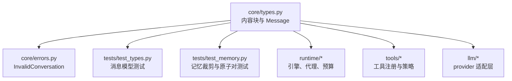
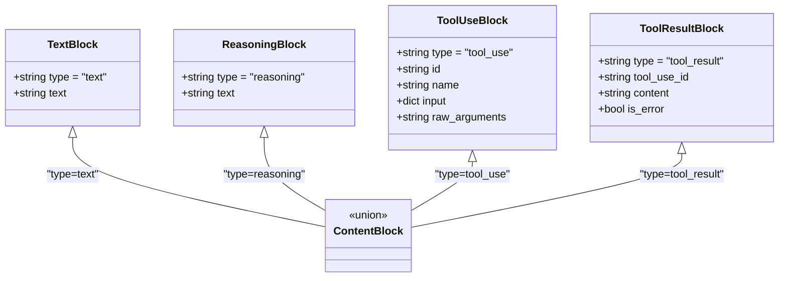
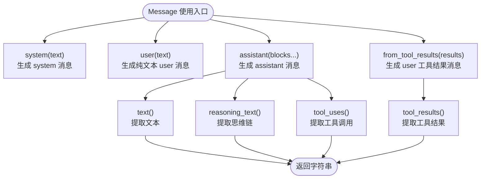
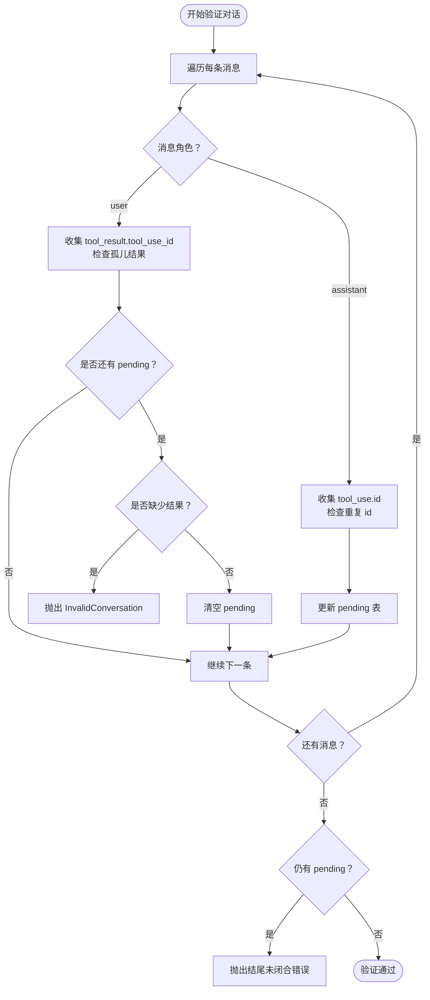
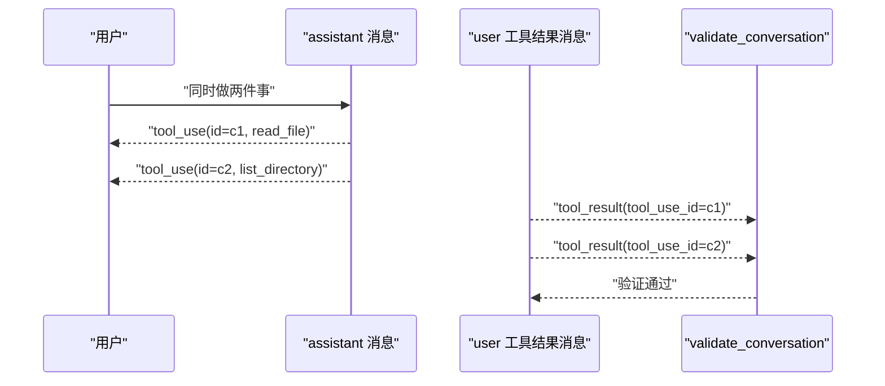
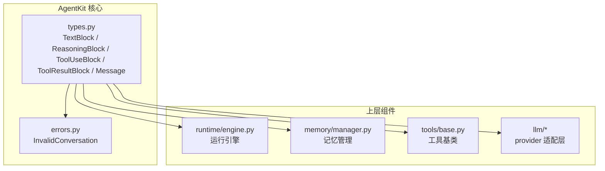
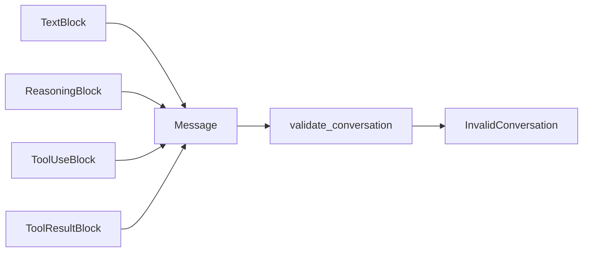

# 消息模型

<cite>
**本文引用的文件**   
- [types.py](file://src/agentkit/core/types.py)
- [errors.py](file://src/agentkit/core/errors.py)
- [test_types.py](file://tests/test_types.py)
- [test_memory.py](file://tests/test_memory.py)
</cite>

## 目录
1. [引言](#引言)
2. [项目结构中的位置](#项目结构中的位置)
3. [核心数据结构](#核心数据结构)
4. [为什么选择内容块抽象](#为什么选择内容块抽象)
5. [Message 类的构造与查询方法](#message-类的构造与查询方法)
6. [配对不变量验证机制](#配对不变量验证机制)
7. [使用示例：创建、操作与验证](#使用示例创建操作与验证)
8. [架构总览](#架构总览)
9. [依赖关系分析](#依赖关系分析)
10. [性能与可维护性考量](#性能与可维护性考量)
11. [故障排查指南](#故障排查指南)
12. [结论](#结论)

## 引言
AgentKit 的消息模型以“内容块”为核心，把文本、工具调用、工具结果和思维链统一成一组可组合的数据结构。它不是简单包装 OpenAI 的 `tool_calls` 或 Anthropic 的 `tool_use` / `tool_result`，而是先定义一套 provider 中立的内部表示，再由各 provider 适配层做双向转换。

这种设计的关键目标是：
- 让工具调用的语义（请求、结果、并行合并）在内部保持一致。
- 避免被某个 provider 的 role-based 格式绑定。
- 通过 `validate_conversation` 强制 tool_use 与 tool_result 的配对不变量，保证对话历史裁剪、回放、重试等流程不会破坏 API 契约。

## 项目结构中的位置
消息模型位于 AgentKit 的核心类型模块中，是整个运行时、记忆、工具和 LLM 适配层的共同基础。

**图表来源**
- [types.py:1-212](file://src/agentkit/core/types.py#L1-L212)
- [errors.py](file://src/agentkit/core/errors.py)
- [test_types.py:1-122](file://tests/test_types.py#L1-L122)
- [test_memory.py:76-107](file://tests/test_memory.py#L76-L107)

**章节来源**
- [types.py:1-26](file://src/agentkit/core/types.py#L1-L26)

## 核心数据结构
AgentKit 的内容块消息模型由四类核心 block 组成：

| 数据结构 | 用途 | 关键字段 | 典型角色 |
|---|---|---|---|
| `TextBlock` | 普通文本内容 | `type="text"`、`text` | system、user、assistant |
| `ReasoningBlock` | 模型暴露的思维链 | `type="reasoning"`、`text` | assistant |
| `ToolUseBlock` | 模型请求调用工具 | `type="tool_use"`、`id`、`name`、`input`、可选 `raw_arguments` | assistant |
| `ToolResultBlock` | 工具执行结果回灌给模型 | `type="tool_result"`、`tool_use_id`、`content`、`is_error` | user |

这些 block 通过 `ContentBlock` 联合类型聚合，并使用 Pydantic 的 discriminator 按 `type` 字段区分具体子类。

**图表来源**
- [types.py:29-74](file://src/agentkit/core/types.py#L29-L74)

**章节来源**
- [types.py:29-74](file://src/agentkit/core/types.py#L29-L74)

## 为什么选择内容块抽象
传统 role-based 消息模型通常把工具调用放在 `role="tool"` 或 provider 特定的 `tool_calls` 字段里。例如 OpenAI 的 `tool_calls[]` 配合独立的 `role: "tool"` 消息，而 Anthropic 则把 `tool_use` / `tool_result` 作为 assistant / user 消息内部的 content block，没有独立 `tool` role。

如果内部直接采用 OpenAI 的形状，会带来以下问题：
- 每次转 Anthropic 都需要重新分组、重排消息，容易丢失并行调用合并语义。
- 不同 provider 的工具调用形状差异会渗透到业务逻辑。
- 工具结果与工具请求的配对关系容易被扁平化消息序列掩盖。

AgentKit 选择内部规范为 content block，好处是：
- 转 Anthropic 时可以直接映射。
- 转 OpenAI 时才需要一次扁平化。
- 工具调用的配对关系成为一等公民，便于校验、裁剪、回放。
- 工具 schema 也保持 provider 中立，由各适配层负责转换成各家格式。

**章节来源**
- [types.py:1-15](file://src/agentkit/core/types.py#L1-L15)
- [types.py:77-100](file://src/agentkit/core/types.py#L77-L100)

## Message 类的构造与查询方法
`Message` 是围绕 `role` 和 `content` 列表构建的消息对象。它提供两类能力：构造方法和查询方法。

### 构造方法
- `system(text)`：创建 system 消息，内容为单个 `TextBlock`。
- `user(text)`：创建 user 消息，内容为单个 `TextBlock`。
- `assistant(*blocks)`：创建 assistant 消息，内容可以是任意数量的 content block，包括文本、思维链和工具调用。
- `from_tool_results(results)`：把一组 `ToolResultBlock` 打包成一条 user 消息。即使只有一个结果也走这里，保证“一个 assistant 的 tool_use 对应一个 user 的 tool_result”的形状恒定。

### 查询方法
- `text()`：拼接所有 `TextBlock` 的文本。
- `reasoning_text()`：拼接所有 `ReasoningBlock` 的文本。
- `tool_uses()`：提取所有 `ToolUseBlock`。
- `tool_results()`：提取所有 `ToolResultBlock`。
- `is_empty()`：判断是否没有任何 content block。

**图表来源**
- [types.py:103-157](file://src/agentkit/core/types.py#L103-L157)

**章节来源**
- [types.py:103-157](file://src/agentkit/core/types.py#L103-L157)

## 配对不变量验证机制
`validate_conversation` 是对话序列的“合法性检查器”。它强制以下不变量：

1. 每个 `tool_use` 必须在紧随其后的 user 消息中找到对应的 `tool_result`。
2. 不允许出现没有对应 `tool_use` 的孤儿 `tool_result`。
3. 并行调用的全部结果必须合并在同一条 user 消息里，不能拆成多条。
4. 同一 assistant 消息内不允许重复的 `tool_use.id`。
5. 对话结束时不能有未结清的 `tool_use`。

实现上，它维护一个 `pending` 字典，记录尚未收到结果的 `tool_use_id` 及其所在 assistant 消息下标；遇到 user 消息时检查该消息是否包含所有 pending 的结果，并清空 pending。

**图表来源**
- [types.py:159-212](file://src/agentkit/core/types.py#L159-L212)

**章节来源**
- [types.py:159-212](file://src/agentkit/core/types.py#L159-L212)

## 使用示例：创建、操作与验证
下面用“读文件 + 列出目录”的并行工具调用场景，展示消息的创建、操作和验证过程。

### 正常并行调用
1. 用户发起请求。
2. assistant 同时发出两个 `ToolUseBlock`。
3. 工具执行后，把两个 `ToolResultBlock` 合并到同一条 user 消息。
4. 再次调用 assistant 输出总结。
5. 调用 `validate_conversation` 通过。

**图表来源**
- [test_types.py:66-82](file://tests/test_types.py#L66-L82)
- [types.py:159-212](file://src/agentkit/core/types.py#L159-L212)

### 缺失结果
如果只返回其中一个工具结果，`validate_conversation` 会报错，提示缺少多少个 `tool_result`。

### 孤儿结果
如果 user 消息中出现没有对应 `tool_use` 的 `tool_result`，验证会失败，提示找不到对应的 `tool_use_id`。

### 重复 id
如果 assistant 消息中出现重复的 `tool_use.id`，验证会失败，提示重复 id。

### 结尾未闭合
如果对话结束仍有未收到结果的 `tool_use`，验证会失败，提示对话结束时仍有未闭合的工具调用。

**章节来源**
- [test_types.py:66-122](file://tests/test_types.py#L66-L122)
- [types.py:159-212](file://src/agentkit/core/types.py#L159-L212)

## 架构总览
从整体架构看，消息模型处于 AgentKit 的底层基础设施位置，向上支撑运行时、记忆、工具和 LLM 适配层。

**图表来源**
- [types.py:1-212](file://src/agentkit/core/types.py#L1-L212)
- [errors.py](file://src/agentkit/core/errors.py)

## 依赖关系分析
- `Message` 依赖 `TextBlock`、`ReasoningBlock`、`ToolUseBlock`、`ToolResultBlock`。
- `ContentBlock` 是这四个 block 的联合类型，使用 Pydantic discriminator。
- `validate_conversation` 依赖 `Message` 的查询方法以及 `InvalidConversation` 异常。
- 测试用例覆盖构造、查询、并行调用、缺失结果、孤儿结果、重复 id、结尾未闭合等边界情况。
- 记忆模块在裁剪历史时也依赖 `validate_conversation`，确保裁剪后对话仍然合法。

**图表来源**
- [types.py:29-212](file://src/agentkit/core/types.py#L29-L212)
- [errors.py](file://src/agentkit/core/errors.py)
- [test_types.py:1-122](file://tests/test_types.py#L1-L122)
- [test_memory.py:76-107](file://tests/test_memory.py#L76-L107)

**章节来源**
- [types.py:29-212](file://src/agentkit/core/types.py#L29-L212)
- [test_types.py:1-122](file://tests/test_types.py#L1-L122)
- [test_memory.py:76-107](file://tests/test_memory.py#L76-L107)

## 性能与可维护性考量
- **时间复杂度**：`validate_conversation` 线性扫描消息序列，对每条消息遍历其 content block，总体复杂度约为 O(N)，其中 N 是消息总数加上 block 总数。
- **空间复杂度**：主要额外空间是 `pending` 字典，最多保存当前轮次未闭合的 `tool_use_id`，空间复杂度约为 O(K)，K 是单轮并行工具调用数量。
- **可维护性**：将工具调用语义抽象为 content block，使 provider 适配层专注于格式转换，而不必理解业务逻辑；同时通过 `validate_conversation` 把 API 契约固化到内部模型。
- **可扩展性**：新增 block 类型只需扩展 `ContentBlock` 联合类型，并在相关查询方法中处理新类型；新增 provider 只需在适配层实现双向转换。

[本节为通用性能讨论，不直接分析具体代码行]

## 故障排查指南
当 `validate_conversation` 抛出 `InvalidConversation` 时，可以根据错误信息快速定位问题：

| 错误类型 | 常见原因 | 排查建议 |
|---|---|---|
| “tool_use id 重复” | assistant 消息中出现相同 `tool_use.id` | 检查工具调用生成逻辑，确保每个调用有唯一 id |
| “找不到对应的 tool_use” | user 消息中出现孤儿 `tool_result` | 检查工具结果组装逻辑，确认 `tool_use_id` 来自前一轮 assistant |
| “缺少 N 个 tool_result” | 并行调用结果未完整合并到同一条 user 消息 | 检查工具执行结果收集逻辑，确保一次性合并 |
| “对话结束时仍有未收到 tool_result” | 最后一条 assistant 消息的工具调用没有后续 user 结果 | 检查对话终止条件，确保所有工具调用都有结果 |

**章节来源**
- [types.py:159-212](file://src/agentkit/core/types.py#L159-L212)
- [test_types.py:84-122](file://tests/test_types.py#L84-L122)

## 结论
AgentKit 的消息模型通过内容块抽象，把文本、思维链、工具调用和工具结果统一起来，避免了被单一 provider 的 role-based 格式绑定。`Message` 的构造方法与查询方法提供了清晰的 API，`validate_conversation` 则把工具调用的配对不变量从“隐式约定”变成“显式断言”。

这种设计的代价是需要在 provider 适配层实现双向转换，但换来的是更强的可移植性、更稳定的对话历史处理和更容易调试的错误信息。对于多 provider 兼容、工具调用语义稳定、记忆裁剪安全等需求，这是一个值得投入的基础设施决策。

[本节为总结性内容，不直接分析具体代码行]