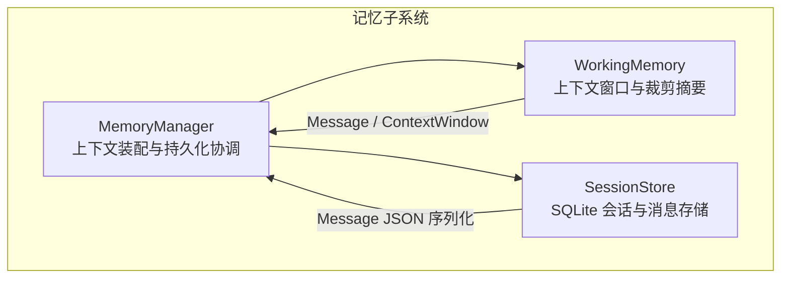
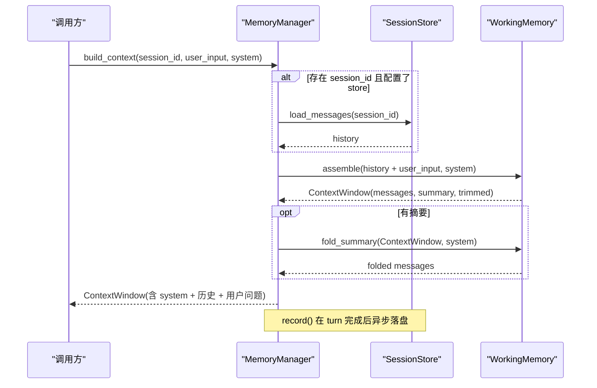
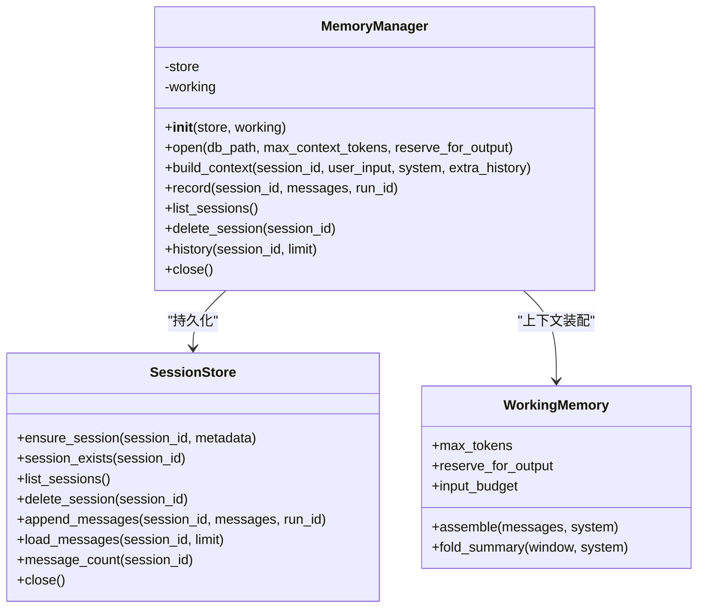
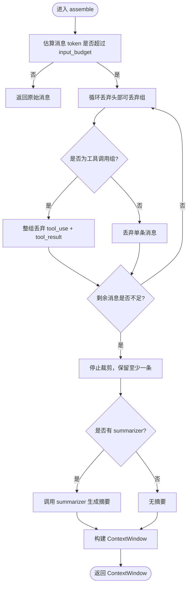
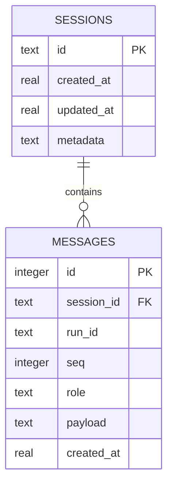
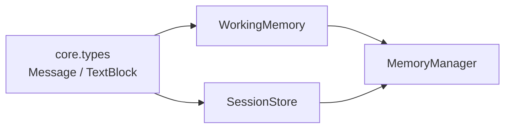

# 记忆概念

<cite>
**本文引用的文件**   
- [memory-design.md](file://docs/memory-design.md)
- [manager.py](file://src/agentkit/memory/manager.py)
- [working.py](file://src/agentkit/memory/working.py)
- [store.py](file://src/agentkit/memory/store.py)
- [test_memory.py](file://tests/test_memory.py)
</cite>

## 目录
1. [引言](#引言)
2. [项目结构](#项目结构)
3. [核心组件](#核心组件)
4. [架构总览](#架构总览)
5. [详细组件分析](#详细组件分析)
6. [依赖关系分析](#依赖关系分析)
7. [性能与上下文窗口优化](#性能与上下文窗口优化)
8. [故障排查指南](#故障排查指南)
9. [结论](#结论)
10. [附录：使用示例](#附录使用示例)

## 引言
本文件围绕 AgentKit 的记忆系统展开，重点说明其设计理念、实现边界与工程取舍。AgentKit 的记忆系统当前聚焦于“工作记忆 + 持久化”，即：在单次会话内维持对话历史，并在需要时裁剪历史、生成摘要以节省上下文；同时通过 SQLite 把消息持久化到磁盘，使跨轮次、跨进程能够恢复会话。语义记忆、情节记忆和记忆整合等更深层能力被刻意保留为设计决策而非半成品实现，详见设计文档。

## 项目结构
记忆相关代码集中在 `src/agentkit/memory` 下，由三个模块组成：
- `working.py`：工作记忆，负责上下文装配、token 估算、历史裁剪与摘要折叠。
- `store.py`：SQLite 持久化层，负责会话与消息的增删查改。
- `manager.py`：记忆管理器，是上下文装配的唯一入口，并协调持久化。

**图表来源**
- [manager.py:29-90](file://src/agentkit/memory/manager.py#L29-L90)
- [working.py:94-197](file://src/agentkit/memory/working.py#L94-L197)
- [store.py:87-248](file://src/agentkit/memory/store.py#L87-L248)

**章节来源**
- [manager.py:1-134](file://src/agentkit/memory/manager.py#L1-L134)
- [working.py:1-237](file://src/agentkit/memory/working.py#L1-L237)
- [store.py:1-248](file://src/agentkit/memory/store.py#L1-L248)

## 核心组件
- MemoryManager：上下文装配的唯一 owner，负责从持久化加载历史、组装 system 提示词和用户输入、调用 WorkingMemory 进行裁剪与摘要、最终产出发给模型的消息序列；并提供记录、查询、列出、删除会话等生命周期操作。
- WorkingMemory：在 token 预算内装配上下文，支持估算 token、按预算裁剪历史、原子丢弃工具调用组、可选摘要压缩，以及将摘要折叠进消息序列。
- SessionStore：基于 SQLite 的会话与消息持久化，提供会话创建、消息追加、按会话读取、限制最近 N 条、会话列表、删除会话等能力，并通过线程锁保证并发安全。

**章节来源**
- [manager.py:29-134](file://src/agentkit/memory/manager.py#L29-L134)
- [working.py:94-237](file://src/agentkit/memory/working.py#L94-L237)
- [store.py:76-248](file://src/agentkit/memory/store.py#L76-L248)

## 架构总览
下图展示一次典型请求中，MemoryManager 如何协调 WorkingMemory 与 SessionStore，完成上下文装配与持久化。

**图表来源**
- [manager.py:59-106](file://src/agentkit/memory/manager.py#L59-L106)
- [working.py:141-197](file://src/agentkit/memory/working.py#L141-L197)
- [store.py:199-221](file://src/agentkit/memory/store.py#L199-L221)

## 详细组件分析

### MemoryManager：会话状态管理、上下文装配与持久化策略
- 职责边界
  - 唯一决定“发给模型的消息长什么样”：system 提示词、历史、用户输入、摘要的顺序与内容都由它装配。
  - 协调持久化：load 历史、append 消息、列出会话、删除会话、查询历史。
  - 线程安全：所有对 SessionStore 的调用都通过 `asyncio.to_thread` 包裹，避免阻塞事件循环。
- 关键方法
  - `open(db_path, max_context_tokens, reserve_for_output)`：工厂方法，打开 SQLite 存储并初始化 WorkingMemory。
  - `build_context(session_id, user_input, system, extra_history)`：装配完整消息序列，必要时折叠摘要。
  - `record(session_id, messages, run_id)`：将一轮产生的消息落盘。
  - `list_sessions()`、`delete_session(session_id)`、`history(session_id, limit)`：会话管理与历史查询。
- 设计要点
  - 如果未配置 store 或未传 session_id，持久化操作为空操作，不影响上下文装配。
  - system 消息由这里统一产出，避免调用方拼装导致 token 预算与实际请求不一致。

**图表来源**
- [manager.py:29-134](file://src/agentkit/memory/manager.py#L29-L134)
- [store.py:87-248](file://src/agentkit/memory/store.py#L87-L248)
- [working.py:112-197](file://src/agentkit/memory/working.py#L112-L197)

**章节来源**
- [manager.py:29-134](file://src/agentkit/memory/manager.py#L29-L134)

### WorkingMemory：上下文窗口优化、历史裁剪与摘要生成
- 上下文窗口与预算
  - `ContextWindow` 封装已装配的消息、是否裁剪、丢弃数量、摘要、估算 token 数。
  - `input_budget = max_tokens - reserve_for_output`，确保模型回复有足够空间。
- Token 估算
  - `estimate_tokens(text)`：按字符粗略估算，CJK 约 0.6 token/字，其余约 0.3 token/字符。
  - `estimate_messages_tokens(messages)`：每条消息加固定开销，并计入 tool_use 的名称与参数。
- 历史裁剪
  - `assemble(messages, system)`：若超出预算，从头部开始丢弃可丢弃的消息组。
  - `_take_droppable_prefix(messages)`：核心不变量——工具调用组必须整组丢弃，否则产生孤儿块；至少保留一条消息（通常是最后一条 user 消息）。
- 摘要生成
  - 当存在 summarizer 钩子时，对被丢弃的历史调用 summarizer，得到摘要文本。
  - `fold_summary(window, system)`：将摘要作为 system 消息插入到历史之前，避免模型误以为摘要是最新发生的事件。

**图表来源**
- [working.py:141-178](file://src/agentkit/memory/working.py#L141-L178)
- [working.py:200-237](file://src/agentkit/memory/working.py#L200-L237)

**章节来源**
- [working.py:40-91](file://src/agentkit/memory/working.py#L40-L91)
- [working.py:94-197](file://src/agentkit/memory/working.py#L94-L197)
- [working.py:200-237](file://src/agentkit/memory/working.py#L200-L237)

### SessionStore：SQLite 持久化的会话管理机制
- 数据模型
  - `sessions`：会话元信息（id、created_at、updated_at、metadata）。
  - `messages`：消息行（session_id、run_id、seq、role、payload JSON、created_at），并按 session_id + seq 建索引。
- 线程安全
  - 使用 `threading.RLock` 串行化所有存储操作，避免 SQLite 连接跨线程访问造成损坏。
  - 通过装饰器 `_serialized` 强制新接口也加锁。
- 会话与消息操作
  - `ensure_session`：创建或更新会话时间戳。
  - `append_messages`：批量写入消息，维护 seq 顺序，更新会话更新时间。
  - `load_messages`：支持 limit 取最近 N 条，保持顺序 ASC。
  - `list_sessions`：统计每个会话的消息数量，按 updated_at 倒序。
  - `delete_session`：级联删除消息，防止孤儿行。
- 设计取舍
  - 消息整条存 JSON，不拆成关系表，因为 Message 已是 pydantic 模型，序列化/反序列化成本低；复杂查询走 observability 事件日志更合适。

**图表来源**
- [store.py:39-58](file://src/agentkit/memory/store.py#L39-L58)

**章节来源**
- [store.py:1-248](file://src/agentkit/memory/store.py#L1-L248)

## 依赖关系分析
- MemoryManager 依赖 WorkingMemory 与 SessionStore，但不直接感知底层存储细节。
- WorkingMemory 依赖 core.types.Message 与 TextBlock，用于消息结构与文本提取。
- SessionStore 依赖 core.types.Message 的序列化/反序列化，以及 sqlite3 原生库。
- 测试覆盖工作记忆裁剪、摘要、持久化往返、会话隔离、Engine 集成等场景。

**图表来源**
- [manager.py:22-24](file://src/agentkit/memory/manager.py#L22-L24)
- [working.py:27-27](file://src/agentkit/memory/working.py#L27-L27)
- [store.py:35-35](file://src/agentkit/memory/store.py#L35-L35)

**章节来源**
- [manager.py:22-24](file://src/agentkit/memory/manager.py#L22-L24)
- [working.py:27-27](file://src/agentkit/memory/working.py#L27-L27)
- [store.py:35-35](file://src/agentkit/memory/store.py#L35-L35)

## 性能与上下文窗口优化
- Token 估算采用启发式算法，非精确 tokenizer；裁剪应留安全余量，计费以服务端 usage 为准。
- 输出预留：`reserve_for_output` 确保模型回复不被上下文占满。
- 历史裁剪优先丢弃最早消息，但保证工具调用组原子性，避免 API 拒绝或模型幻觉。
- SQLite 写操作通过线程池执行，避免阻塞事件循环；内部用 RLock 串行化访问。
- 摘要压缩减少长期历史占用，但需权衡 summarizer 调用成本。

[本节为通用性能讨论，不直接分析具体文件]

## 故障排查指南
- 上下文撑爆
  - 检查 `max_tokens` 与 `reserve_for_output` 设置是否合理。
  - 确认 system 提示词长度已被纳入估算。
- 工具调用孤儿块
  - 确保裁剪逻辑遵循 `_take_droppable_prefix` 的原子丢弃规则。
  - 使用 `validate_conversation` 校验消息序列合法性。
- 持久化异常
  - 检查 SQLite 路径权限与目录是否存在。
  - 确认没有在同一进程中多线程直接访问 SQLite 连接。
- 会话泄漏
  - 删除会话后确认级联删除生效，避免孤儿消息堆积。

**章节来源**
- [working.py:141-178](file://src/agentkit/memory/working.py#L141-L178)
- [working.py:200-237](file://src/agentkit/memory/working.py#L200-L237)
- [store.py:151-155](file://src/agentkit/memory/store.py#L151-L155)

## 结论
AgentKit 的记忆系统以“工作记忆 + 持久化”为核心，通过 MemoryManager 统一上下文装配与持久化策略，WorkingMemory 负责上下文窗口优化与历史裁剪，SessionStore 提供轻量可靠的 SQLite 持久化。语义记忆、情节记忆与记忆整合被明确排除在当前实现之外，以避免引入不必要的复杂度与评测难题。该设计在工程上保证了消息序列的合法性、上下文窗口的可控性与跨轮次记忆的稳定性。

[本节为总结性内容，不直接分析具体文件]

## 附录：使用示例
以下示例帮助开发者理解如何在应用中正确使用记忆功能，包括创建会话、记录消息、查询历史、清理会话等。

- 创建与管理会话
  - 使用 `MemoryManager.open(db_path)` 打开一个基于 SQLite 的记忆管理器。
  - 通过 `build_context(session_id, user_input, system)` 装配上下文。
  - 通过 `record(session_id, messages, run_id)` 记录一轮产生的消息。
  - 通过 `list_sessions()` 列出所有会话，`delete_session(session_id)` 删除指定会话。
  - 通过 `history(session_id, limit)` 查询最近 N 条历史。

- 实际用例参考
  - 工作记忆与持久化测试覆盖了上下文装配、历史跨轮次、会话隔离、无存储模式、Engine 集成等场景。
  - 工具调用组的原子丢弃与非法序列校验在测试中通过 `validate_conversation` 断言。

**章节来源**
- [test_memory.py:289-338](file://tests/test_memory.py#L289-L338)
- [test_memory.py:340-400](file://tests/test_memory.py#L340-L400)
- [test_memory.py:49-157](file://tests/test_memory.py#L49-L157)

## 设计边界与未来路径
- 已实现：工作记忆 + 持久化（上下文装配、token 估算、历史裁剪、摘要压缩、SQLite 会话管理）。
- 刻意没做：语义记忆、情节记忆、记忆整合。原因包括嵌入模型与向量库依赖、抽取与冲突消解难度、缺乏可接受的评测方式。
- 未来路径：先增加嵌入与向量检索，再增加抽取与冲突消解，最后加入异步 sweep 整合流程；验收方式应为仓库自带评测，比较开/关记忆时的任务成功率与单位成本。

**章节来源**
- [memory-design.md:9-31](file://docs/memory-design.md#L9-L31)
- [memory-design.md:34-99](file://docs/memory-design.md#L34-L99)
- [memory-design.md:102-116](file://docs/memory-design.md#L102-L116)