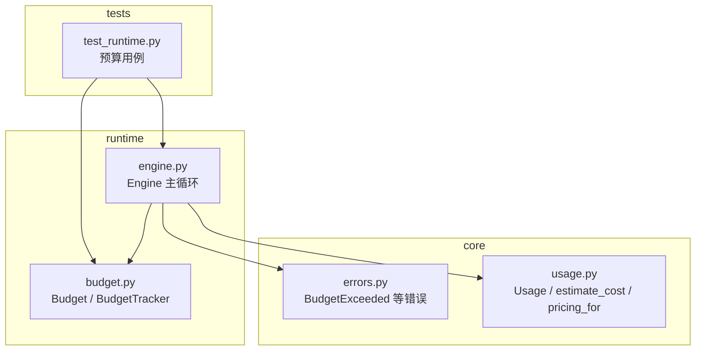
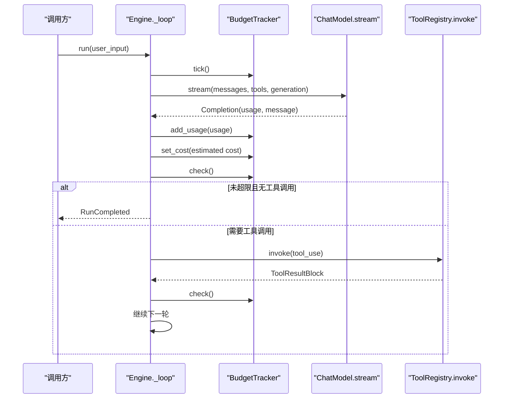
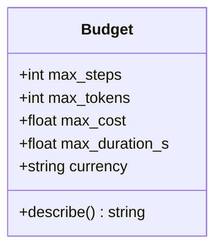
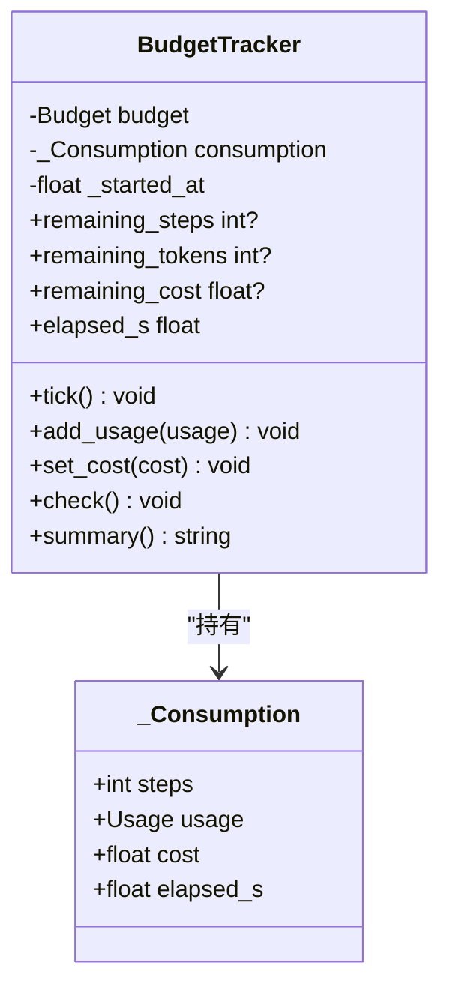
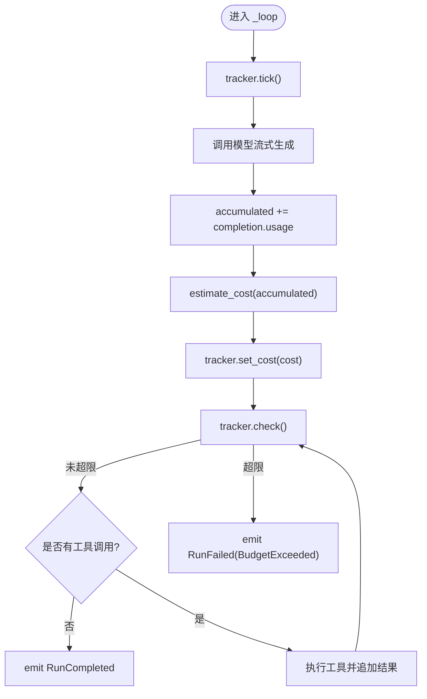
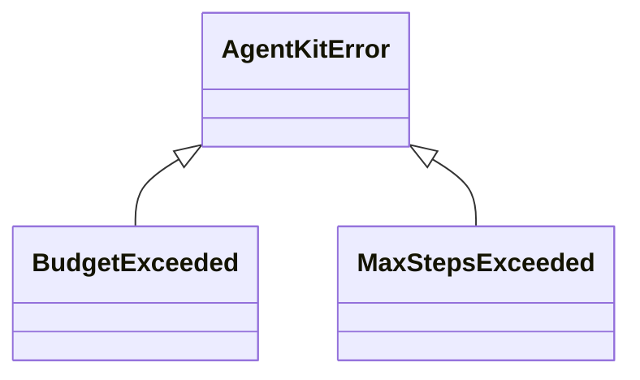
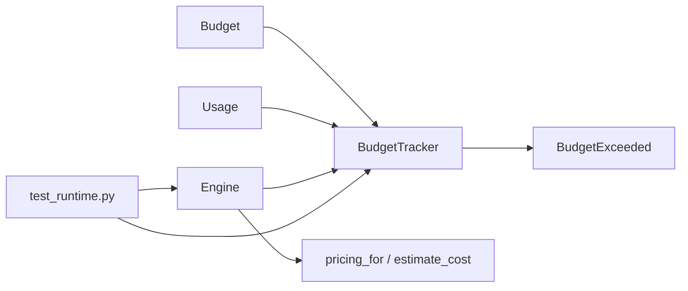
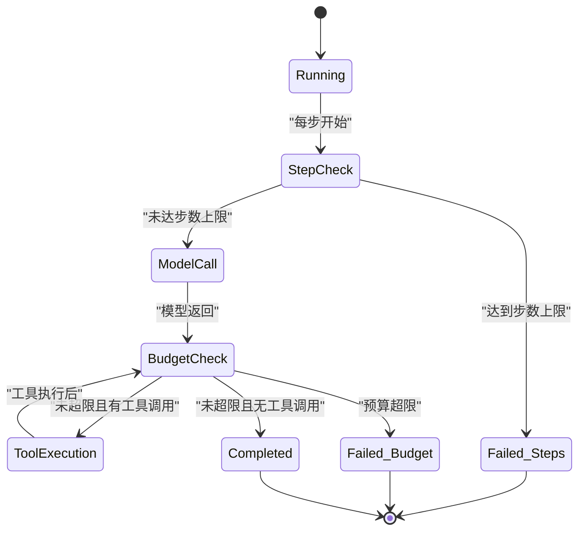

# 预算控制

<cite>
**本文引用的文件**   
- [src/agentkit/runtime/budget.py](file://src/agentkit/runtime/budget.py)
- [src/agentkit/runtime/engine.py](file://src/agentkit/runtime/engine.py)
- [src/agentkit/core/errors.py](file://src/agentkit/core/errors.py)
- [tests/test_runtime.py](file://tests/test_runtime.py)
- [README.md](file://README.md)
</cite>

## 目录
1. [引言](#引言)
2. [项目结构中的预算位置](#项目结构中的预算位置)
3. [核心组件](#核心组件)
4. [架构总览](#架构总览)
5. [详细组件分析](#详细组件分析)
6. [依赖关系分析](#依赖关系分析)
7. [性能与实时性](#性能与实时性)
8. [配置、监控与超限处理示例](#配置监控与超限处理示例)
9. [长时间运行任务中的预算控制](#长时间运行任务中的预算控制)
10. [故障排查](#故障排查)
11. [结论](#结论)

## 引言
本章节面向需要理解 AgentKit 预算控制机制的读者，重点说明以下问题：
- Token 数量限制和成本上限是如何实现和计量的。
- 预算监控为何是“检查后抛错”，以及这种设计对准确性和用户体验的影响。
- 预算超出的统一处理策略：错误类型、事件输出、调用方如何感知并做优雅降级。
- 如何在 Engine 中配置预算、观察用量、并在超限后安全收尾。
- 在长时间运行任务中，预算如何与步数、时长、取消、记忆裁剪等机制协同，平衡性能与安全。

## 项目结构中的预算位置
AgentKit 的预算控制位于运行时层，由引擎驱动循环时创建并使用预算追踪器；预算相关的数据模型、异常类型分别放在 core 层，测试覆盖在 tests 中。

**图表来源**
- [src/agentkit/runtime/engine.py:127-156](file://src/agentkit/runtime/engine.py#L127-L156)
- [src/agentkit/runtime/budget.py:26-64](file://src/agentkit/runtime/budget.py#L26-L64)
- [src/agentkit/core/errors.py:114-116](file://src/agentkit/core/errors.py#L114-L116)
- [tests/test_runtime.py:208-293](file://tests/test_runtime.py#L208-L293)

**章节来源**
- [README.md:53-68](file://README.md#L53-L68)

## 核心组件
预算系统由两个核心对象组成：
- `Budget`：描述一次 run 的资源上限，包括步数、token、成本、时长和货币单位。
- `BudgetTracker`：记录实际消耗，并在越界时抛出 `BudgetExceeded`。

关键设计要点：
- 四类上限各自有独立的失败语义：步数用于防止工具调用不收敛；token 控制上下文和计费主体；成本单独设限以应对缓存命中等非线性计费；时长作为外部依赖卡住时的兜底。
- 预算采用“检查后抛错”而非“超了就截断”，避免向模型发送不完整上下文导致确定性错误答案。
- 成本估算基于累计用量，而不是逐次累加，因为缓存命中价格不是线性的。

**章节来源**
- [src/agentkit/runtime/budget.py:1-23](file://src/agentkit/runtime/budget.py#L1-L23)
- [src/agentkit/runtime/budget.py:26-64](file://src/agentkit/runtime/budget.py#L26-L64)
- [src/agentkit/runtime/budget.py:71-93](file://src/agentkit/runtime/budget.py#L71-L93)
- [src/agentkit/runtime/budget.py:118-142](file://src/agentkit/runtime/budget.py#L118-L142)

## 架构总览
Engine 在每次推理循环中创建 `BudgetTracker`，并在多个关键节点更新和检查预算：
- 每步开始时记一步。
- 每次模型调用后累计 token 并估算成本。
- 每次工具执行后再次检查预算。
- 最终根据是否还有工具调用决定完成或继续。

**图表来源**
- [src/agentkit/runtime/engine.py:250-369](file://src/agentkit/runtime/engine.py#L250-L369)
- [src/agentkit/runtime/budget.py:73-93](file://src/agentkit/runtime/budget.py#L73-L93)
- [src/agentkit/runtime/budget.py:118-142](file://src/agentkit/runtime/budget.py#L118-L142)

## 详细组件分析

### Budget 数据模型
`Budget` 是一个不可变数据类，表示一次 run 的上限配置：
- `max_steps`：最大步数，用于防止模型反复调工具不收敛。
- `max_tokens`：最大 token 总量，控制上下文大小和主要计费项。
- `max_cost`：最大成本，独立于 token，因为缓存命中可能按更低单价计费。
- `max_duration_s`：最大运行时长，兜底外部依赖阻塞。
- `currency`：货币单位，默认人民币。

该类的 `describe()` 方法用于生成人类可读的预算摘要，便于日志和 CLI 展示。

**图表来源**
- [src/agentkit/runtime/budget.py:26-46](file://src/agentkit/runtime/budget.py#L26-L46)

**章节来源**
- [src/agentkit/runtime/budget.py:26-46](file://src/agentkit/runtime/budget.py#L26-L46)

### BudgetTracker 记账与判定
`BudgetTracker` 维护 `_Consumption`，包含步骤数、累计 Usage、成本估计和已用时长。它提供三类能力：
- 记账：`tick()`、`add_usage()`、`set_cost()`。
- 查询：`remaining_steps`、`remaining_tokens`、`remaining_cost`、`elapsed_s`。
- 判定：`check()` 在任一维度越界时抛出 `BudgetExceeded`。

成本估算通过引擎传入，原因是缓存命中价格非线性，不能简单累加每次增量。

**图表来源**
- [src/agentkit/runtime/budget.py:49-93](file://src/agentkit/runtime/budget.py#L49-L93)
- [src/agentkit/runtime/budget.py:96-155](file://src/agentkit/runtime/budget.py#L96-L155)

**章节来源**
- [src/agentkit/runtime/budget.py:49-93](file://src/agentkit/runtime/budget.py#L49-L93)
- [src/agentkit/runtime/budget.py:96-155](file://src/agentkit/runtime/budget.py#L96-L155)

### Engine 中的预算集成
Engine 在构造时接受可选的 `Budget`，并在 `_loop` 中创建 `BudgetTracker`。每次模型调用后，引擎会：
- 累计 `Usage`。
- 通过 `pricing_for` 和 `estimate_cost` 估算成本。
- 将成本和累计用量写入 tracker。
- 调用 `tracker.check()` 进行预算判定。

如果预算超限，`BudgetExceeded` 会被捕获并转为 `RunFailed` 事件，错误类型为 `BudgetExceeded`，消息中包含具体超限维度。

**图表来源**
- [src/agentkit/runtime/engine.py:250-369](file://src/agentkit/runtime/engine.py#L250-L369)
- [src/agentkit/runtime/engine.py:505-510](file://src/agentkit/runtime/engine.py#L505-L510)

**章节来源**
- [src/agentkit/runtime/engine.py:127-156](file://src/agentkit/runtime/engine.py#L127-L156)
- [src/agentkit/runtime/engine.py:250-369](file://src/agentkit/runtime/engine.py#L250-L369)
- [src/agentkit/runtime/engine.py:505-510](file://src/agentkit/runtime/engine.py#L505-L510)

### 错误分类与预算异常
`BudgetExceeded` 继承自 `AgentKitError`，用于标识 token、成本、时长等预算超限。它与 `MaxStepsExceeded` 不同：后者由引擎步数循环直接判断，前者由预算追踪器统一处理。

**图表来源**
- [src/agentkit/core/errors.py:110-116](file://src/agentkit/core/errors.py#L110-L116)

**章节来源**
- [src/agentkit/core/errors.py:110-116](file://src/agentkit/core/errors.py#L110-L116)

## 依赖关系分析
预算系统的依赖方向清晰：
- `BudgetTracker` 依赖 `Budget` 和 `Usage`，并通过 `BudgetExceeded` 向上报告错误。
- `Engine` 依赖 `BudgetTracker`、`Usage`、`pricing_for`、`estimate_cost`，并在循环中协调预算与工具执行。
- 测试覆盖预算追踪器和引擎行为，确保预算超限能正确终止 run 并产生可观测事件。

**图表来源**
- [src/agentkit/runtime/budget.py:20-23](file://src/agentkit/runtime/budget.py#L20-L23)
- [src/agentkit/runtime/engine.py:51-57](file://src/agentkit/runtime/engine.py#L51-L57)
- [tests/test_runtime.py:19-26](file://tests/test_runtime.py#L19-L26)

**章节来源**
- [src/agentkit/runtime/budget.py:20-23](file://src/agentkit/runtime/budget.py#L20-L23)
- [src/agentkit/runtime/engine.py:51-57](file://src/agentkit/runtime/engine.py#L51-L57)
- [tests/test_runtime.py:19-26](file://tests/test_runtime.py#L19-L26)

## 性能与实时性
预算监控的实时性体现在：
- 每次模型调用后立即累计 token 并估算成本。
- 每次工具执行后再次检查预算，避免工具链过长导致资源耗尽。
- 使用高精度计时器计算已用时长，确保时长预算准确。

准确性方面：
- 成本估算基于累计用量，避免缓存命中导致的非线性计费误差。
- 预算检查在关键节点集中进行，减少漏检风险。
- 若无法获取价格表，成本字段为 `None`，不会因未知价格而误判。

这些特性使预算控制在长时间运行任务中既能及时止损，又不会频繁中断正常流程。

**章节来源**
- [src/agentkit/runtime/budget.py:78-93](file://src/agentkit/runtime/budget.py#L78-L93)
- [src/agentkit/runtime/budget.py:118-142](file://src/agentkit/runtime/budget.py#L118-L142)
- [src/agentkit/runtime/engine.py:308-325](file://src/agentkit/runtime/engine.py#L308-L325)
- [src/agentkit/runtime/engine.py:505-510](file://src/agentkit/runtime/engine.py#L505-L510)

## 配置、监控与超限处理示例

### 配置预算参数
在 Engine 中可以通过 `budget=Budget(...)` 传入预算配置。常见配置包括：
- 设置 `max_tokens` 限制上下文和 token 总量。
- 设置 `max_cost` 限制成本上限。
- 设置 `max_duration_s` 限制最长运行时间。
- 设置 `max_steps` 限制最大步数（也可通过 Engine 构造参数）。

参考路径：
- [Engine 构造参数:130-156](file://src/agentkit/runtime/engine.py#L130-L156)
- [Budget 数据类:26-46](file://src/agentkit/runtime/budget.py#L26-L46)

### 监控使用情况
在 Engine 循环中，每次模型调用后会发出 `UsageReported` 事件，包含当前步、本次用量和累计用量。调用方可订阅该事件以实时监控 token 和成本趋势。

参考路径：
- [UsageReported 事件发射:317-321](file://src/agentkit/runtime/engine.py#L317-L321)

### 处理预算超限
当预算超限时：
- `BudgetTracker.check()` 抛出 `BudgetExceeded`。
- Engine 捕获该异常并发送 `RunFailed` 事件，错误类型为 `BudgetExceeded`，消息包含超限维度。
- 调用方可通过事件流判断 run 失败原因，并进行优雅降级，例如停止后续工具调用、提示用户、记录审计日志。

参考路径：
- [BudgetExceeded 抛出:118-142](file://src/agentkit/runtime/budget.py#L118-L142)
- [Engine 捕获并转事件:228-233](file://src/agentkit/runtime/engine.py#L228-L233)
- [测试验证 token 预算停止 run:271-293](file://tests/test_runtime.py#L271-L293)

### 代码示例路径
- 配置预算：[Engine.__init__:130-156](file://src/agentkit/runtime/engine.py#L130-L156)
- 预算追踪器基本用法：[TestBudgetTracker:208-269](file://tests/test_runtime.py#L208-L269)
- 引擎级预算行为：[TestEngineBudget:271-293](file://tests/test_runtime.py#L271-L293)

**章节来源**
- [src/agentkit/runtime/engine.py:130-156](file://src/agentkit/runtime/engine.py#L130-L156)
- [src/agentkit/runtime/engine.py:317-325](file://src/agentkit/runtime/engine.py#L317-L325)
- [src/agentkit/runtime/budget.py:118-142](file://src/agentkit/runtime/budget.py#L118-L142)
- [tests/test_runtime.py:208-293](file://tests/test_runtime.py#L208-L293)

## 长时间运行任务中的预算控制
在长时间运行任务中，预算控制的重要性体现在：
- 防止模型陷入工具调用循环：`max_steps` 与 `BudgetTracker.tick()` 共同约束。
- 防止上下文膨胀：`max_tokens` 控制输入输出 token 总量。
- 防止成本失控：`max_cost` 考虑缓存命中和非线性计费。
- 防止外部依赖阻塞：`max_duration_s` 作为兜底。

Engine 在每一步开始前检查步数上限，达到上限时持久化当前消息片段并返回 `MaxStepsExceeded`；预算超限则返回 `BudgetExceeded`。两者错误类型不同，便于上层区分处理。

**图表来源**
- [src/agentkit/runtime/engine.py:280-369](file://src/agentkit/runtime/engine.py#L280-L369)
- [src/agentkit/runtime/budget.py:118-142](file://src/agentkit/runtime/budget.py#L118-L142)

**章节来源**
- [src/agentkit/runtime/engine.py:280-369](file://src/agentkit/runtime/engine.py#L280-L369)
- [src/agentkit/runtime/budget.py:118-142](file://src/agentkit/runtime/budget.py#L118-L142)

## 故障排查
常见问题与定位方式：
- **Token 预算超限**：检查每次模型调用的 `Usage.input_tokens` 和 `Usage.output_tokens`，确认累计是否超过 `max_tokens`。
- **成本预算超限**：确认模型名称是否在价格表中，若不在，成本为 `None`，不会触发成本预算。
- **时长预算超限**：检查是否存在外部依赖阻塞，必要时缩短 `max_duration_s` 或优化工具执行。
- **步数预算超限**：检查工具调用是否收敛，必要时调整系统提示或工具 schema。

调试建议：
- 订阅 `UsageReported` 事件，观察 token 和成本趋势。
- 查看 `RunFailed` 事件的 `error_type` 和 `message`，确认超限维度。
- 使用 `BudgetTracker.summary()` 获取一行摘要，便于日志记录。

**章节来源**
- [src/agentkit/runtime/engine.py:317-321](file://src/agentkit/runtime/engine.py#L317-L321)
- [src/agentkit/runtime/engine.py:228-233](file://src/agentkit/runtime/engine.py#L228-L233)
- [src/agentkit/runtime/budget.py:144-155](file://src/agentkit/runtime/budget.py#L144-L155)

## 结论
AgentKit 的预算控制系统通过 `Budget` 和 `BudgetTracker` 提供了多维度、可观测、可配置的 run 级资源保护。它在 Engine 主循环的关键节点进行记账与判定，确保 token、成本、时长和步数均受控。预算超限采用“检查后抛错”的策略，避免不完整上下文导致的确定性错误，同时通过统一错误类型和事件机制，让调用方能可靠地进行优雅降级和资源回收。在长时间运行任务中，预算控制与步数限制、取消机制、记忆管理协同工作，既保障安全性，又兼顾性能和用户体验。