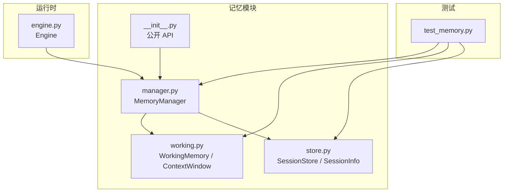
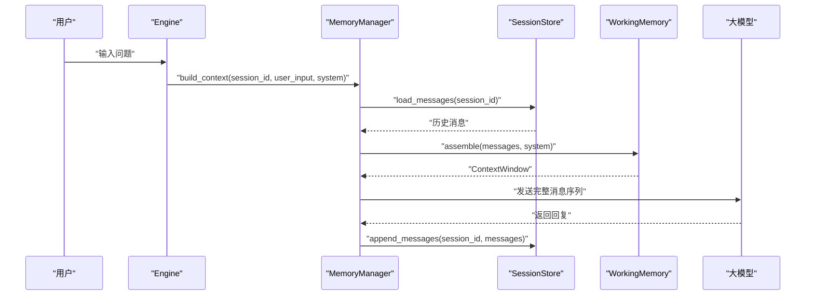
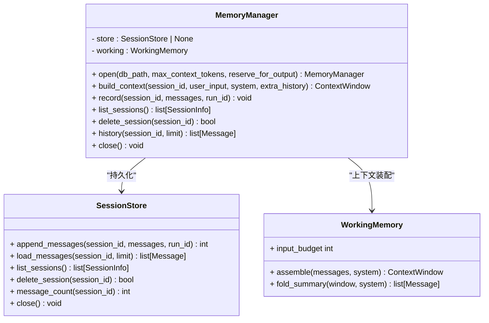
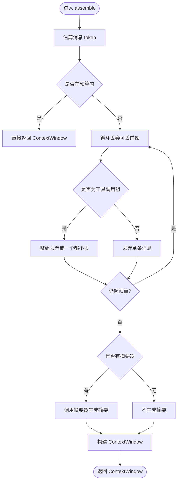
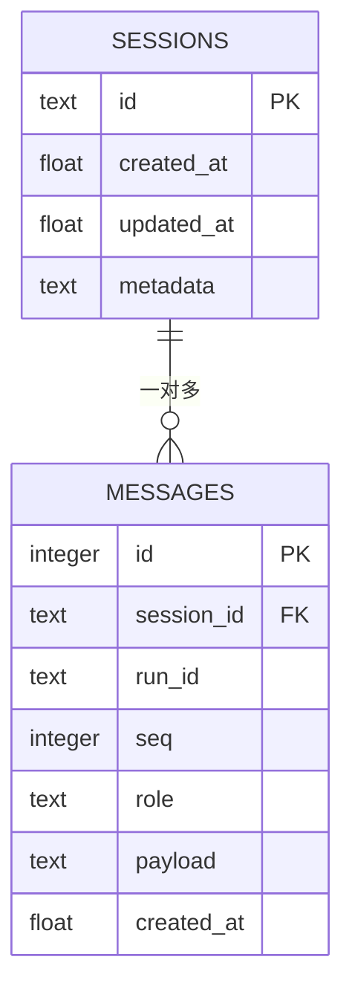
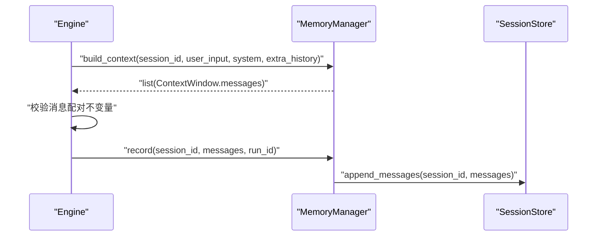
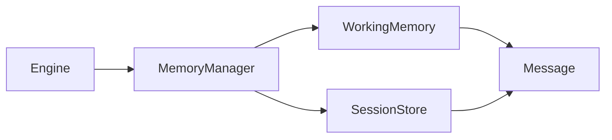

# 记忆系统

<cite>
**本文引用的文件**   
- [memory-design.md](file://docs/memory-design.md)
- [manager.py](file://src/agentkit/memory/manager.py)
- [working.py](file://src/agentkit/memory/working.py)
- [store.py](file://src/agentkit/memory/store.py)
- [__init__.py](file://src/agentkit/memory/__init__.py)
- [engine.py](file://src/agentkit/runtime/engine.py)
- [test_memory.py](file://tests/test_memory.py)
</cite>

## 目录
1. [引言](#引言)
2. [项目结构](#项目结构)
3. [核心组件](#核心组件)
4. [架构总览](#架构总览)
5. [详细组件分析](#详细组件分析)
6. [依赖关系分析](#依赖关系分析)
7. [性能与内存占用](#性能与内存占用)
8. [使用示例与调优建议](#使用示例与调优建议)
9. [故障排查](#故障排查)
10. [结论与演进方向](#结论与演进方向)

## 引言
本仓库的记忆系统聚焦于“工作记忆 + SQLite 持久化”，目标是让 Agent 在多轮对话中保持上下文，同时避免超出模型上下文窗口。它通过三个关键机制实现这一目标：
- 工作记忆：在 token 预算内装配消息序列，必要时裁剪历史并生成摘要。
- 会话持久化：用 SQLite 保存跨进程、跨重启的对话历史。
- 上下文装配唯一入口：由 `MemoryManager` 统一决定发给模型的消息长什么样，避免运行时和记忆模块各自拼装导致不一致。

语义记忆、情节记忆与记忆整合被刻意省略，设计取舍记录在文档中。当前实现适合“同一会话内多轮记忆”的工程需求；若需要跨会话事实检索或长期偏好建模，则需扩展向量检索与抽取整合链路。

**章节来源**
- [memory-design.md:9-31](file://docs/memory-design.md#L9-L31)
- [memory-design.md:34-83](file://docs/memory-design.md#L34-L83)
- [memory-design.md:102-116](file://docs/memory-design.md#L102-L116)

## 项目结构
记忆相关代码集中在 `src/agentkit/memory`，对外暴露统一的记忆管理接口，并通过测试覆盖工作记忆、持久化和引擎集成行为。

**图表来源**
- [manager.py:1-26](file://src/agentkit/memory/manager.py#L1-L26)
- [working.py:1-34](file://src/agentkit/memory/working.py#L1-L34)
- [store.py:1-37](file://src/agentkit/memory/store.py#L1-L37)
- [__init__.py:1-24](file://src/agentkit/memory/__init__.py#L1-L24)
- [engine.py:446-463](file://src/agentkit/runtime/engine.py#L446-L463)
- [test_memory.py:1-23](file://tests/test_memory.py#L1-L23)

**章节来源**
- [__init__.py:1-24](file://src/agentkit/memory/__init__.py#L1-L24)
- [manager.py:1-26](file://src/agentkit/memory/manager.py#L1-L26)
- [working.py:1-34](file://src/agentkit/memory/working.py#L1-L34)
- [store.py:1-37](file://src/agentkit/memory/store.py#L1-L37)

## 核心组件
- `MemoryManager`：上下文装配的唯一负责人，负责加载历史、调用工作记忆组装上下文、追加摘要、写入 system 提示词，以及把消息落盘到 SQLite。
- `WorkingMemory`：工作记忆实现，负责 token 估算、预算裁剪、工具调用组原子丢弃、摘要折叠。
- `ContextWindow`：装配结果，包含最终消息、是否裁剪、丢弃数量、摘要和估算 token。
- `SessionStore`：SQLite 会话存储，提供会话创建、查询、删除，以及消息追加、读取、计数等能力。
- `SessionInfo`：会话元信息，包括创建时间、更新时间、消息数量和元数据。

这些组件共同保证：
- 每次请求的消息序列一致且合法。
- 超长历史不会撑爆上下文窗口。
- 工具调用不会被拆成孤儿块。
- 对话可以跨轮次、跨进程持久化。

**章节来源**
- [manager.py:29-55](file://src/agentkit/memory/manager.py#L29-L55)
- [working.py:94-139](file://src/agentkit/memory/working.py#L94-L139)
- [store.py:76-107](file://src/agentkit/memory/store.py#L76-L107)

## 架构总览
下图展示一次典型对话中，记忆系统如何参与上下文装配与持久化。

**图表来源**
- [engine.py:446-463](file://src/agentkit/runtime/engine.py#L446-L463)
- [manager.py:59-90](file://src/agentkit/memory/manager.py#L59-L90)
- [store.py:199-221](file://src/agentkit/memory/store.py#L199-L221)
- [working.py:141-178](file://src/agentkit/memory/working.py#L141-L178)

## 详细组件分析

### MemoryManager：上下文装配与持久化协调者
`MemoryManager` 是“发给模型的消息长什么样”的唯一决策点。它接收运行时传入的 system 提示词和用户输入，从 SQLite 加载历史，交给 `WorkingMemory` 做预算裁剪和摘要处理，再把 system 消息放到最前面，最后返回 `ContextWindow`。

关键职责：
- 打开基于 SQLite 的记忆管理器。
- 构建上下文：加载历史、拼接用户输入、调用工作记忆、折叠摘要、插入 system。
- 记录消息：将本轮产生的消息异步线程化后写入 SQLite。
- 会话管理：列出会话、删除会话、查询历史。
- 生命周期：支持上下文管理器模式关闭存储。

**图表来源**
- [manager.py:29-134](file://src/agentkit/memory/manager.py#L29-L134)
- [store.py:87-248](file://src/agentkit/memory/store.py#L87-L248)
- [working.py:112-198](file://src/agentkit/memory/working.py#L112-L198)

**章节来源**
- [manager.py:1-14](file://src/agentkit/memory/manager.py#L1-L14)
- [manager.py:29-55](file://src/agentkit/memory/manager.py#L29-L55)
- [manager.py:59-90](file://src/agentkit/memory/manager.py#L59-L90)
- [manager.py:94-121](file://src/agentkit/memory/manager.py#L94-L121)
- [manager.py:125-134](file://src/agentkit/memory/manager.py#L125-L134)

### WorkingMemory：工作记忆、上下文窗口与历史裁剪
`WorkingMemory` 的核心是“在 token 预算内装配上下文”。它维护最大上下文窗口大小、为输出预留空间、可选摘要器，并提供两个关键方法：
- `assemble`：估算消息 token，判断是否需要裁剪；按最早消息开始丢弃，但保证工具调用组原子性，并保留最后一条用户消息。
- `fold_summary`：将被裁掉的历史摘要作为 system 消息插入到 system 之后、历史之前。

token 估算采用启发式算法：CJK 字符约 0.6 token/字，其余字符约 0.3 token/字符，每条消息加固定开销，工具调用名和参数也计入估算。

**图表来源**
- [working.py:40-81](file://src/agentkit/memory/working.py#L40-L81)
- [working.py:141-178](file://src/agentkit/memory/working.py#L141-L178)
- [working.py:200-237](file://src/agentkit/memory/working.py#L200-L237)

**章节来源**
- [working.py:1-20](file://src/agentkit/memory/working.py#L1-L20)
- [working.py:40-81](file://src/agentkit/memory/working.py#L40-L81)
- [working.py:94-139](file://src/agentkit/memory/working.py#L94-L139)
- [working.py:141-198](file://src/agentkit/memory/working.py#L141-L198)
- [working.py:200-237](file://src/agentkit/memory/working.py#L200-L237)

### SessionStore：SQLite 持久化机制
`SessionStore` 使用 SQLite 本地文件存储会话和消息。设计要点：
- 表结构：`sessions` 表保存会话元信息，`messages` 表保存序列化后的消息 JSON。
- 外键约束：启用 `PRAGMA foreign_keys = ON`，删除会话时级联删除消息。
- 线程安全：使用 `threading.RLock` 串行化所有写操作，配合 `check_same_thread=False` 避免 sqlite3 线程归属检查报错。
- 并发隔离：通过 `asyncio.to_thread` 在 `MemoryManager` 层把同步存储调用移出事件循环，避免高并发阻塞。
- 最近 N 条读取：使用子查询按 `seq DESC LIMIT N` 再翻回升序，确保取的是最近消息。

**图表来源**
- [store.py:39-58](file://src/agentkit/memory/store.py#L39-L58)

**章节来源**
- [store.py:1-22](file://src/agentkit/memory/store.py#L1-L22)
- [store.py:39-58](file://src/agentkit/memory/store.py#L39-L58)
- [store.py:87-107](file://src/agentkit/memory/store.py#L87-L107)
- [store.py:110-155](file://src/agentkit/memory/store.py#L110-L155)
- [store.py:159-221](file://src/agentkit/memory/store.py#L159-L221)
- [store.py:230-248](file://src/agentkit/memory/store.py#L230-L248)

### 与运行时的集成
Engine 在装配消息时，如果配置了 `MemoryManager`，就把装配权交给它；否则就地拼装 `[system, ...历史, user]`。持久化时先校验消息配对不变量，避免不完整轮次写入导致下一轮 API 拒绝。

**图表来源**
- [engine.py:446-480](file://src/agentkit/runtime/engine.py#L446-L480)
- [manager.py:94-106](file://src/agentkit/memory/manager.py#L94-L106)

**章节来源**
- [engine.py:446-480](file://src/agentkit/runtime/engine.py#L446-L480)

## 依赖关系分析
记忆模块内部依赖清晰：
- `MemoryManager` 依赖 `SessionStore` 和 `WorkingMemory`。
- `WorkingMemory` 依赖 `Message` 类型定义。
- `SessionStore` 依赖 `Message` 的 pydantic 序列化能力。
- 运行时 `Engine` 依赖 `MemoryManager` 以获取一致的上下文装配逻辑。

**图表来源**
- [manager.py:22-24](file://src/agentkit/memory/manager.py#L22-L24)
- [working.py:27-27](file://src/agentkit/memory/working.py#L27-L27)
- [store.py:35-35](file://src/agentkit/memory/store.py#L35-L35)
- [engine.py:446-463](file://src/agentkit/runtime/engine.py#L446-L463)

**章节来源**
- [manager.py:22-24](file://src/agentkit/memory/manager.py#L22-L24)
- [working.py:27-27](file://src/agentkit/memory/working.py#L27-L27)
- [store.py:35-35](file://src/agentkit/memory/store.py#L35-L35)
- [engine.py:446-463](file://src/agentkit/runtime/engine.py#L446-L463)

## 性能与内存占用
- Token 估算：采用启发式字符统计，CJK 与拉丁字符系数不同，每条消息加固定开销，工具调用名和参数也计入。估算用于裁剪决策，计费以服务端 usage 为准。
- 上下文窗口：默认最大上下文为 128,000 token，并为输出预留 4,000 token；可通过 `open` 的参数调整。
- 历史裁剪：从最早消息开始丢弃，但保证工具调用组原子性和最后一条用户消息不被丢弃。
- 摘要压缩：可选摘要器在被裁历史上生成一段 system 摘要，减少信息损失。
- SQLite 持久化：消息以 JSON 整条存储，避免频繁改表结构；索引按 `(session_id, seq)` 优化顺序读取；删除会话级联删除消息，防止孤儿行。
- 并发与线程安全：所有存储操作通过装饰器串行化，外部通过 `asyncio.to_thread` 避免阻塞事件循环。

优化建议：
- 合理设置 `max_context_tokens` 与 `reserve_for_output`，避免输入塞满导致模型无法输出。
- 在高并发场景下，确保每个 `SessionStore` 实例独立，并由 `MemoryManager` 统一线程化访问。
- 对高频短消息场景，注意固定开销带来的 token 低估风险，适当放宽预算。
- 如需更精确 token 控制，可在接入具备 `count_tokens` 接口的模型时替换估算逻辑。

**章节来源**
- [working.py:40-81](file://src/agentkit/memory/working.py#L40-L81)
- [working.py:115-139](file://src/agentkit/memory/working.py#L115-L139)
- [working.py:141-178](file://src/agentkit/memory/working.py#L141-L178)
- [store.py:39-58](file://src/agentkit/memory/store.py#L39-L58)
- [store.py:159-221](file://src/agentkit/memory/store.py#L159-L221)
- [memory-design.md:102-116](file://docs/memory-design.md#L102-L116)

## 使用示例与调优建议

### 会话管理与上下文装配
- 打开带 SQLite 的记忆管理器：
  - 使用 `MemoryManager.open(db_path, max_context_tokens, reserve_for_output)`。
- 构建上下文：
  - 调用 `build_context(session_id, user_input, system="...", extra_history=[...])`。
- 记录消息：
  - 调用 `record(session_id, messages, run_id="...")`。
- 查询历史：
  - 调用 `history(session_id, limit=N)` 获取最近 N 条消息。
- 会话列表与删除：
  - 调用 `list_sessions()` 和 `delete_session(session_id)`。

参考测试用例路径：
- [test_memory.py:289-338](file://tests/test_memory.py#L289-L338)

### 历史查询与上下文回放
- 使用 `limit` 参数获取最近 N 条消息，SQL 通过子查询保证顺序正确。
- 在 Engine 集成中，第二轮会看到第一轮的历史消息。

参考测试用例路径：
- [test_memory.py:236-245](file://tests/test_memory.py#L236-L245)
- [test_memory.py:340-363](file://tests/test_memory.py#L340-L363)

### 上下文装配的实际流程
- 运行时将 system 提示词和用户输入交给 `MemoryManager.build_context`。
- `MemoryManager` 加载历史、拼接用户输入、调用 `WorkingMemory.assemble`。
- 若有摘要，调用 `fold_summary` 插入摘要。
- 最终将 system 消息放在最前面，返回给 Engine 发送给模型。

参考实现路径：
- [manager.py:59-90](file://src/agentkit/memory/manager.py#L59-L90)
- [engine.py:446-463](file://src/agentkit/runtime/engine.py#L446-L463)

### 性能调优建议
- 根据模型上下文窗口设置 `max_context_tokens`，并为输出预留足够空间。
- 在高并发场景下，确保 `SessionStore` 的线程安全与事件循环非阻塞。
- 使用合适的 `summarizer` 钩子，对被裁历史进行摘要，减少信息损失。
- 对频繁短消息场景，注意估算开销，避免过度裁剪。

参考实现路径：
- [working.py:115-139](file://src/agentkit/memory/working.py#L115-L139)
- [working.py:141-178](file://src/agentkit/memory/working.py#L141-L178)
- [store.py:159-221](file://src/agentkit/memory/store.py#L159-L221)

## 故障排查
常见问题与定位方式：
- 上下文撑爆：检查 `max_context_tokens` 与 `reserve_for_output` 设置，确认 `WorkingMemory.input_budget` 是否足够。
- 工具调用孤儿块：确保 `_take_droppable_prefix` 的原子丢弃规则生效，并使用 `validate_conversation` 校验消息序列合法性。
- 不完整轮次写入：Engine 在持久化前校验消息配对不变量，取消或出错时跳过落盘，避免下一轮 API 拒绝。
- SQLite 并发问题：确认所有存储操作通过 `asyncio.to_thread` 调用，`SessionStore` 内部使用 RLock 串行化。
- 历史顺序错误：确认 `load_messages` 使用子查询按 `seq DESC LIMIT N` 再翻回升序。

参考实现路径：
- [working.py:200-237](file://src/agentkit/memory/working.py#L200-L237)
- [engine.py:465-480](file://src/agentkit/runtime/engine.py#L465-L480)
- [store.py:199-221](file://src/agentkit/memory/store.py#L199-L221)

**章节来源**
- [working.py:200-237](file://src/agentkit/memory/working.py#L200-L237)
- [engine.py:465-480](file://src/agentkit/runtime/engine.py#L465-L480)
- [store.py:199-221](file://src/agentkit/memory/store.py#L199-L221)

## 结论与演进方向
当前记忆系统实现了工程上最关键的“工作记忆 + 持久化”，通过上下文装配唯一入口、工具调用组原子丢弃、摘要压缩和 SQLite 持久化，保证了多轮对话的稳定性和一致性。语义记忆、情节记忆与记忆整合被刻意省略，因为在本项目场景中收益不足以抵消复杂度。

未来扩展方向（按依赖顺序）：
1. 增加嵌入与向量检索：为 `SessionStore` 增加事实表，支持混合召回。
2. 增加抽取与冲突消解：在被裁历史上跑抽取，产出候选事实并进行 ADD/UPDATE/DELETE/NOOP 裁决。
3. 增加异步 sweep：会话结束后用便宜模型跑整合，不阻塞主流程。

验收方式应基于仓库自带评测，比较开/关记忆时的任务成功率与单位成本，避免主观判断。

**章节来源**
- [memory-design.md:34-99](file://docs/memory-design.md#L34-L99)
- [memory-design.md:102-116](file://docs/memory-design.md#L102-L116)