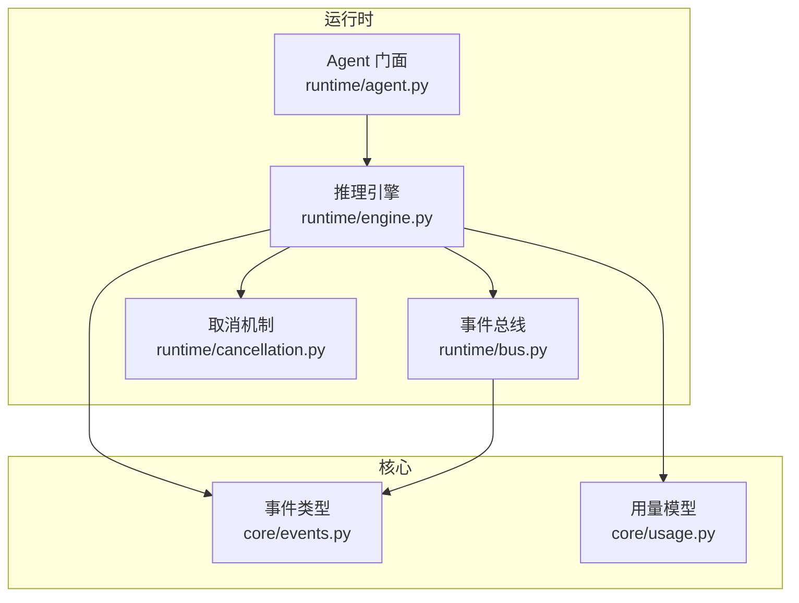
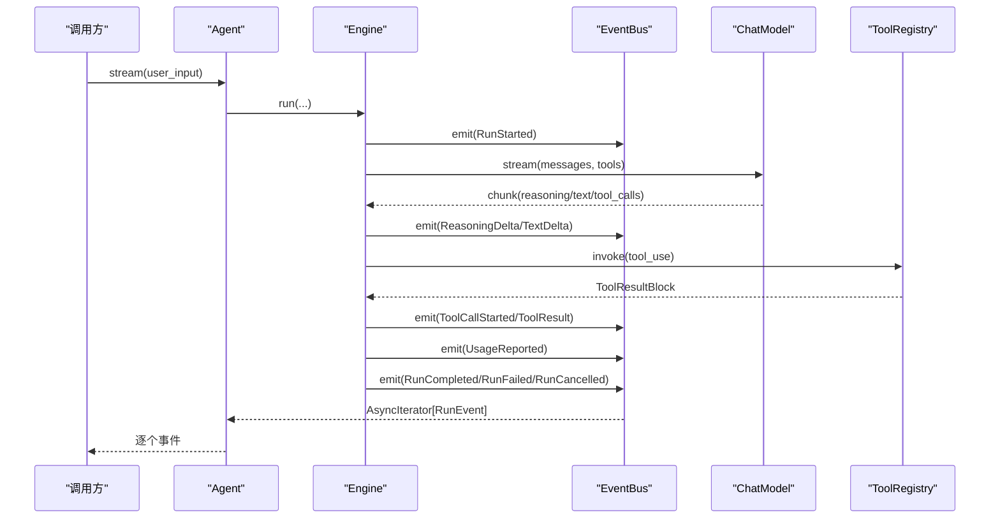
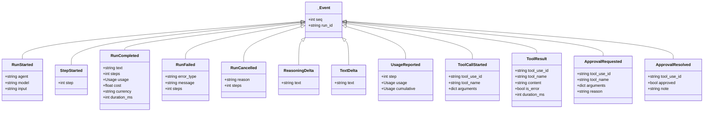
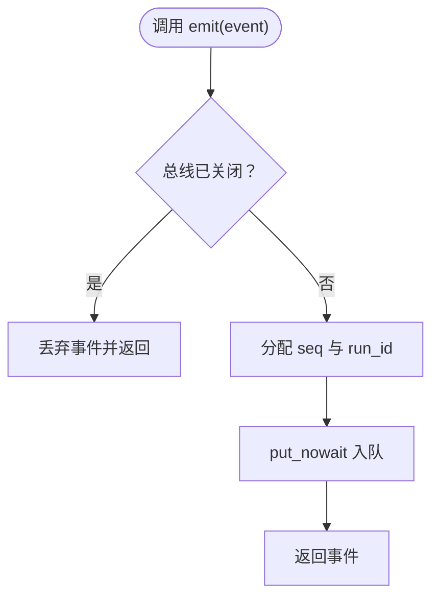
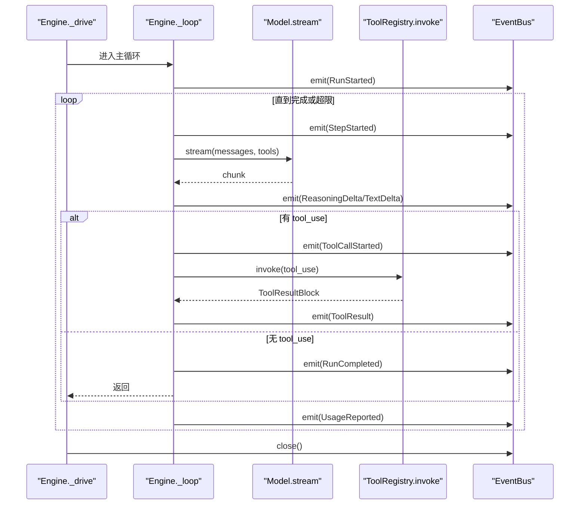
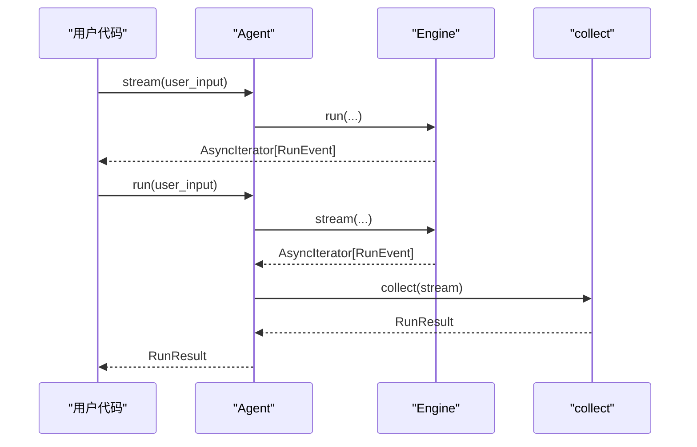
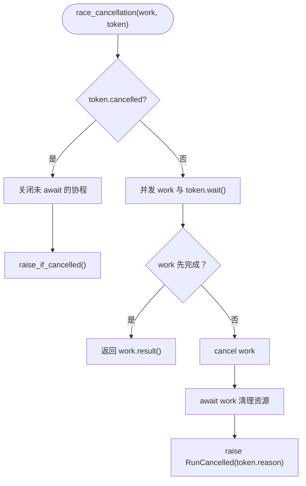
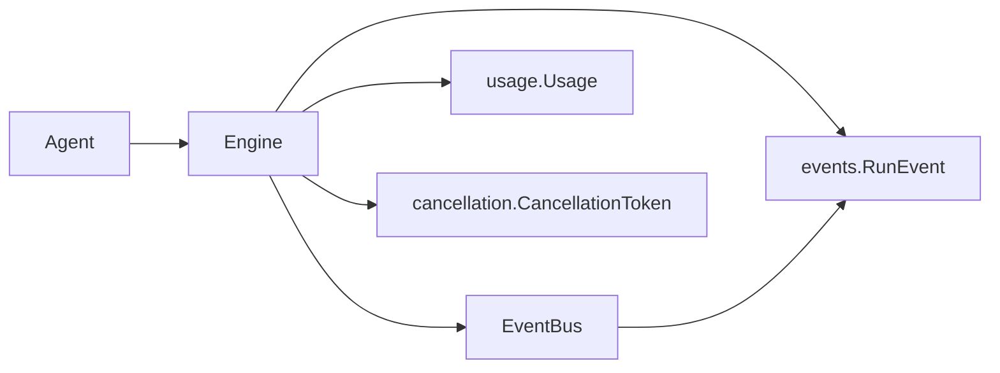
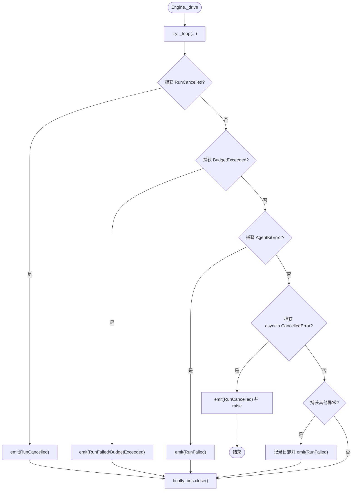

# 事件总线

<cite>
**本文引用的文件**   
- [events.py](file://src/agentkit/core/events.py)
- [bus.py](file://src/agentkit/runtime/bus.py)
- [engine.py](file://src/agentkit/runtime/engine.py)
- [agent.py](file://src/agentkit/runtime/agent.py)
- [usage.py](file://src/agentkit/core/usage.py)
- [cancellation.py](file://src/agentkit/runtime/cancellation.py)
</cite>

## 目录
1. [引言](#引言)
2. [项目结构](#项目结构)
3. [核心组件](#核心组件)
4. [架构总览](#架构总览)
5. [详细组件分析](#详细组件分析)
6. [依赖关系分析](#依赖关系分析)
7. [性能与背压](#性能与背压)
8. [错误传播与终止语义](#错误传播与终止语义)
9. [扩展指南：自定义事件类型](#扩展指南自定义事件类型)
10. [故障排查](#故障排查)
11. [结论](#结论)

## 引言
本仓库采用事件驱动架构，把“推理引擎”“工具执行”“审批通道”“可观测层”“评测与 SSE 客户端”等解耦为生产者与消费者。所有运行期状态都通过统一的事件流表达，而不是在函数返回值和回调之间分散传递。这样做的关键好处是：
- 单一真相源：CLI、SSE、追踪、评测都消费同一条事件流。
- 时序稳定：事件按单调序号排列，便于断线续传与去重。
- 生命周期清晰：RunStarted 到 RunCompleted / RunFailed / RunCancelled 构成完整生命周期。
- 异步友好：事件入队同步、出队异步；取消、预算、超时等控制信号贯穿整条调用链。

## 项目结构
围绕事件驱动的核心代码分布在以下模块：
- `core/events.py`：定义所有事件类型、联合类型与终止事件集合。
- `runtime/bus.py`：实现 EventBus，负责单 run 内的事件队列、序号注入、关闭语义。
- `runtime/engine.py`：推理引擎主循环，生产事件并处理异常、预算、持久化。
- `runtime/agent.py`：对外门面，暴露 `stream` 与 `run`，内部委托 Engine。
- `core/usage.py`：用量与成本模型，被 UsageReported 等事件引用。
- `runtime/cancellation.py`：取消令牌与竞态取消封装，保证取消能真正中断长耗时操作。

**图表来源**
- [events.py:37-169](file://src/agentkit/core/events.py#L37-L169)
- [bus.py:30-72](file://src/agentkit/runtime/bus.py#L30-L72)
- [engine.py:127-248](file://src/agentkit/runtime/engine.py#L127-L248)
- [agent.py:38-116](file://src/agentkit/runtime/agent.py#L38-L116)
- [usage.py:22-73](file://src/agentkit/core/usage.py#L22-L73)
- [cancellation.py:30-119](file://src/agentkit/runtime/cancellation.py#L30-L119)

**章节来源**
- [events.py:1-169](file://src/agentkit/core/events.py#L1-L169)
- [bus.py:1-72](file://src/agentkit/runtime/bus.py#L1-L72)
- [engine.py:1-248](file://src/agentkit/runtime/engine.py#L1-L248)
- [agent.py:1-116](file://src/agentkit/runtime/agent.py#L1-L116)
- [usage.py:1-73](file://src/agentkit/core/usage.py#L1-L73)
- [cancellation.py:1-119](file://src/agentkit/runtime/cancellation.py#L1-L119)

## 核心组件
- **EventBus**：基于 asyncio.Queue 的单 run 事件队列。提供同步 emit、异步 drain、幂等 close。
- **Engine**：tool-calling 推理引擎。构造消息上下文、调用模型流式生成、执行工具、统计用量、持久化历史，并把所有中间状态转为事件。
- **Agent**：对外入口。暴露 `stream`（事件流）和 `run`（汇聚结果），内部创建 Engine。
- **CancellationToken**：显式取消信号，配合 `race_cancellation` 让取消能中断工具、模型流、子进程等资源。
- **Usage**：用量数据模型，区分原始值与计费值，避免重复计费。

**章节来源**
- [bus.py:30-72](file://src/agentkit/runtime/bus.py#L30-L72)
- [engine.py:127-248](file://src/agentkit/runtime/engine.py#L127-L248)
- [agent.py:38-116](file://src/agentkit/runtime/agent.py#L38-L116)
- [cancellation.py:30-119](file://src/agentkit/runtime/cancellation.py#L30-L119)
- [usage.py:22-73](file://src/agentkit/core/usage.py#L22-L73)

## 架构总览
事件驱动的关键在于“引擎只产出事件”，而不同消费者以不同方式消费：
- CLI：逐步打印进度。
- SSE：把事件转发给浏览器。
- 可观测层：在事件边界上开启 span、累计用量。
- 评测：根据轨迹计算工具选择正确率、步数、成本等指标。

**图表来源**
- [engine.py:166-248](file://src/agentkit/runtime/engine.py#L166-L248)
- [engine.py:370-408](file://src/agentkit/runtime/engine.py#L370-L408)
- [engine.py:410-434](file://src/agentkit/runtime/engine.py#L410-L434)
- [bus.py:39-61](file://src/agentkit/runtime/bus.py#L39-L61)

**章节来源**
- [engine.py:166-434](file://src/agentkit/runtime/engine.py#L166-L434)
- [bus.py:30-72](file://src/agentkit/runtime/bus.py#L30-L72)

## 详细组件分析

### 事件类型与生命周期
事件体系以 `_Event` 为基类，每个事件都有 `seq` 与 `run_id`。生命周期事件包括：
- `RunStarted`：一次推理开始，携带 agent、model、input。
- `StepStarted`：每轮 step 开始。
- `RunCompleted`：正常结束，包含最终文本、步数、用量、成本、时长。
- `RunFailed`：失败结束，包含错误类型与消息。
- `RunCancelled`：取消结束，包含原因。

此外还有模型输出、工具调用、审批三类业务事件：
- 模型输出：`ReasoningDelta`、`TextDelta`、`UsageReported`。
- 工具调用：`ToolCallStarted`、`ToolResult`。
- 审批：`ApprovalRequested`、`ApprovalResolved`。

**图表来源**
- [events.py:37-169](file://src/agentkit/core/events.py#L37-L169)

**章节来源**
- [events.py:37-169](file://src/agentkit/core/events.py#L37-L169)

### EventBus：消息分发机制
EventBus 是一个单 run 内的异步队列：
- `emit`：同步入队，自动设置 `seq` 与 `run_id`。如果总线已关闭，直接丢弃后续事件。
- `drain`：异步迭代器，遇到哨兵 `_CLOSED` 时结束。
- `close`：幂等关闭，写入哨兵，通知消费者停止。

这种设计解决了两个问题：
1. 审批可以在工具阻塞前发出，避免“先出结果再问是否批准”的逻辑倒置。
2. 生产者无论以何种方式结束，都会关闭总线，消费者总能等到终止或正常结束。

**图表来源**
- [bus.py:39-53](file://src/agentkit/runtime/bus.py#L39-L53)

**章节来源**
- [bus.py:30-72](file://src/agentkit/runtime/bus.py#L30-L72)

### Engine：事件生产与生命周期管理
Engine 的 `run` 方法创建 EventBus，并启动生产者协程 `_drive`。消费者侧使用 `bus.drain()` 逐个 yield 事件。若消费者提前退出，会 cancel 生产者，防止后台继续消耗 token。

`_drive` 负责：
- 捕获 `RunCancelled`、`BudgetExceeded`、`AgentKitError`、`asyncio.CancelledError` 与通用异常。
- 将异常转换为终止事件 `RunCancelled` 或 `RunFailed`。
- 在 finally 中关闭总线。

主循环 `_loop` 负责：
- 构建上下文、校验对话配对不变量。
- 调用模型流式生成，产生 `ReasoningDelta`、`TextDelta`、`UsageReported`。
- 执行工具，产生 `ToolCallStarted`、`ToolResult`。
- 达到最大步数时记录部分进展并发送 `RunFailed(MaxStepsExceeded)`。
- 无工具调用时发送 `RunCompleted`。

**图表来源**
- [engine.py:208-248](file://src/agentkit/runtime/engine.py#L208-L248)
- [engine.py:250-369](file://src/agentkit/runtime/engine.py#L250-L369)
- [engine.py:370-408](file://src/agentkit/runtime/engine.py#L370-L408)
- [engine.py:410-434](file://src/agentkit/runtime/engine.py#L410-L434)

**章节来源**
- [engine.py:166-434](file://src/agentkit/runtime/engine.py#L166-L434)

### 异步事件处理模式
Engine 的 `run` 返回 `AsyncIterator[RunEvent]`，典型用法：
- 上层直接 `async for event in agent.stream(...)` 消费事件。
- 或者使用 `collect(stream)` 汇聚成 `RunResult`。

Agent 同时暴露：
- `stream`：透传 Engine 的事件流。
- `run`：内部调用 `collect`，返回聚合结果。

**图表来源**
- [agent.py:72-112](file://src/agentkit/runtime/agent.py#L72-L112)
- [engine.py:513-536](file://src/agentkit/runtime/engine.py#L513-L536)

**章节来源**
- [agent.py:72-112](file://src/agentkit/runtime/agent.py#L72-L112)
- [engine.py:513-536](file://src/agentkit/runtime/engine.py#L513-L536)

### 资源清理与取消
取消不是简单的 task 取消，而是显式的 `CancellationToken`：
- 多处调用 `raise_if_cancelled`，确保循环与工具执行前检查取消。
- `race_cancellation` 让取消能中断长耗时操作，并在取消后抛出 `RunCancelled`。
- Engine 在 `_drive` 中捕获 `asyncio.CancelledError`，发出 `RunCancelled` 后再向上抛出。
- `run` 的消费者提前退出时会 cancel 生产者，避免后台继续烧 token。

**图表来源**
- [cancellation.py:83-119](file://src/agentkit/runtime/cancellation.py#L83-L119)
- [engine.py:228-248](file://src/agentkit/runtime/engine.py#L228-L248)

**章节来源**
- [cancellation.py:30-119](file://src/agentkit/runtime/cancellation.py#L30-L119)
- [engine.py:208-248](file://src/agentkit/runtime/engine.py#L208-L248)

## 依赖关系分析
- Engine 依赖 EventBus 进行事件分发。
- Engine 依赖 events 中的事件类型与 usage 中的用量模型。
- Engine 依赖 cancellation 进行取消与超时控制。
- Agent 依赖 Engine 作为内部实现。
- EventBus 依赖 events 中的 RunEvent 联合类型。

**图表来源**
- [agent.py:38-116](file://src/agentkit/runtime/agent.py#L38-L116)
- [engine.py:127-248](file://src/agentkit/runtime/engine.py#L127-L248)
- [bus.py:30-72](file://src/agentkit/runtime/bus.py#L30-L72)
- [events.py:152-169](file://src/agentkit/core/events.py#L152-L169)
- [usage.py:22-73](file://src/agentkit/core/usage.py#L22-L73)
- [cancellation.py:30-119](file://src/agentkit/runtime/cancellation.py#L30-L119)

**章节来源**
- [agent.py:38-116](file://src/agentkit/runtime/agent.py#L38-L116)
- [engine.py:127-248](file://src/agentkit/runtime/engine.py#L127-L248)
- [bus.py:30-72](file://src/agentkit/runtime/bus.py#L30-L72)
- [events.py:152-169](file://src/agentkit/core/events.py#L152-L169)
- [usage.py:22-73](file://src/agentkit/core/usage.py#L22-L73)
- [cancellation.py:30-119](file://src/agentkit/runtime/cancellation.py#L30-L119)

## 性能与背压
- EventBus 默认使用无界队列（maxsize=0）。这意味着高吞吐的生产者可能快速堆积事件，消费者需要尽快消费。
- emit 是同步的，避免在工具执行路径中引入额外 await 复杂度。
- 如果需要背压保护，可在构造 EventBus 时传入 maxsize，使 put_nowait 在队列满时触发异常；但当前实现未做容量检查，因此建议在上层限制消费速率或使用带容量的队列包装。
- 模型流式生成避免长时间等待，减少首包延迟。
- 用量与成本估算在每步结束后更新，避免频繁计算。

**章节来源**
- [bus.py:33-53](file://src/agentkit/runtime/bus.py#L33-L53)
- [engine.py:370-408](file://src/agentkit/runtime/engine.py#L370-L408)
- [engine.py:317-321](file://src/agentkit/runtime/engine.py#L317-L321)

## 错误传播与终止语义
Engine 的错误处理策略：
- `RunCancelled`：用户或上层主动取消，发出 `RunCancelled` 事件。
- `BudgetExceeded`：预算或超时报错，发出 `RunFailed(BudgetExceeded)`。
- `AgentKitError`：业务错误，发出 `RunFailed` 并携带错误类型。
- `asyncio.CancelledError`：调用方终止 run，发出 `RunCancelled` 后重新抛出。
- 其他异常：记录日志，发出 `RunFailed(未预期的内部错误)`。

终止事件集合定义为 `TERMINAL_EVENT_TYPES`，包含 `run_completed`、`run_failed`、`run_cancelled`。任意一个出现都表示流不会再产生事件。

**图表来源**
- [engine.py:208-248](file://src/agentkit/runtime/engine.py#L208-L248)
- [events.py:168-169](file://src/agentkit/core/events.py#L168-L169)

**章节来源**
- [engine.py:208-248](file://src/agentkit/runtime/engine.py#L208-L248)
- [events.py:168-169](file://src/agentkit/core/events.py#L168-L169)

## 扩展指南：自定义事件类型
要扩展事件系统，遵循以下步骤：
1. 在 `core/events.py` 中新增事件类，继承 `_Event`，并设置唯一的 `type` 字面量。
2. 将该新事件加入 `RunEvent` 联合类型，保持 Pydantic 判别器字段一致。
3. 在 Engine 或其他生产者位置 emit 该事件。
4. 在消费者侧（如 SSE、可观测层、评测）匹配 `event.type` 并处理。

注意事项：
- `type` 必须唯一且稳定，因为它是反序列化判别器。
- 事件字段应尽量小，避免把大对象放入事件流。
- 如果事件涉及敏感信息，应在可观测层或上层决定是否记录。
- 终止事件应严格使用 `TERMINAL_EVENT_TYPES` 中的类型，以保证流语义正确。

**章节来源**
- [events.py:37-169](file://src/agentkit/core/events.py#L37-L169)
- [engine.py:273-369](file://src/agentkit/runtime/engine.py#L273-L369)

## 故障排查
常见问题与定位建议：
- 事件顺序错乱：检查是否多个 EventBus 实例混用，或手动修改了 `seq`。
- 消费者卡住：确认是否正确消费 `drain()` 直到结束，或是否收到终止事件。
- 取消不生效：检查是否在关键路径调用 `raise_if_cancelled`，并使用 `race_cancellation` 包裹长耗时操作。
- 预算报错：确认 BudgetTracker 的 tick 与 check 逻辑，以及 `max_steps` 配置。
- 工具参数非法 JSON：Engine 会回灌提示让模型重试，检查模型输出是否符合 tool calling schema。
- 历史落盘失败：Engine 会在持久化前校验对话配对，失败则跳过落盘，不影响 run 成功。

**章节来源**
- [engine.py:250-369](file://src/agentkit/runtime/engine.py#L250-L369)
- [engine.py:465-494](file://src/agentkit/runtime/engine.py#L465-L494)
- [cancellation.py:83-119](file://src/agentkit/runtime/cancellation.py#L83-L119)

## 结论
该事件驱动架构通过统一事件流连接推理引擎、工具、审批、可观测与评测，实现了清晰的职责分离与稳定的生命周期管理。EventBus 提供简单可靠的消息分发，Engine 负责事件生产与异常转换，CancellationToken 保证取消能真正中断资源。扩展新事件只需在 events.py 中注册类型并在生产者处 emit，消费者侧按需匹配处理。对于高吞吐场景，建议在上层控制消费速率或引入背压机制，以避免队列无限增长。