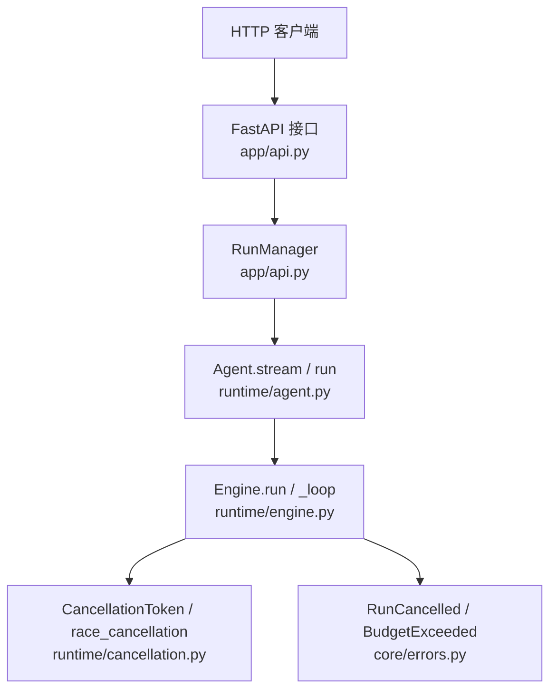
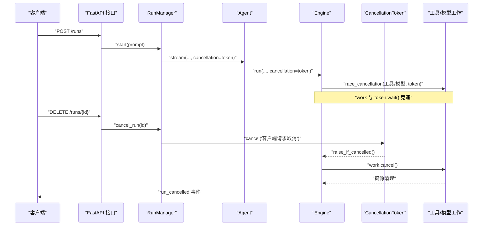
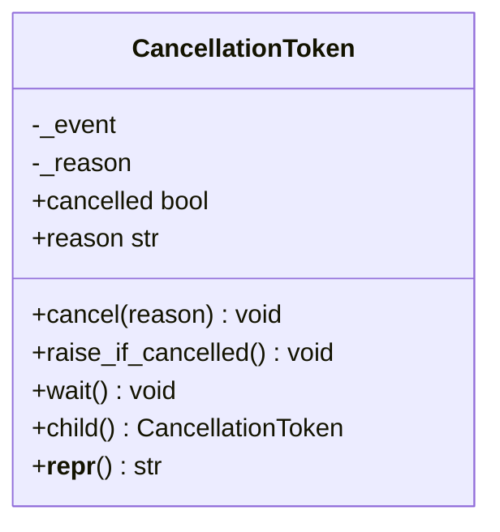
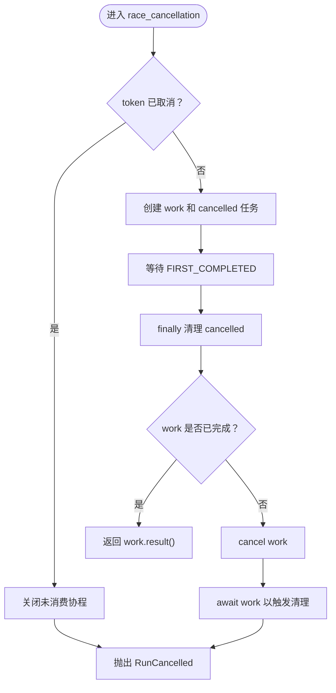
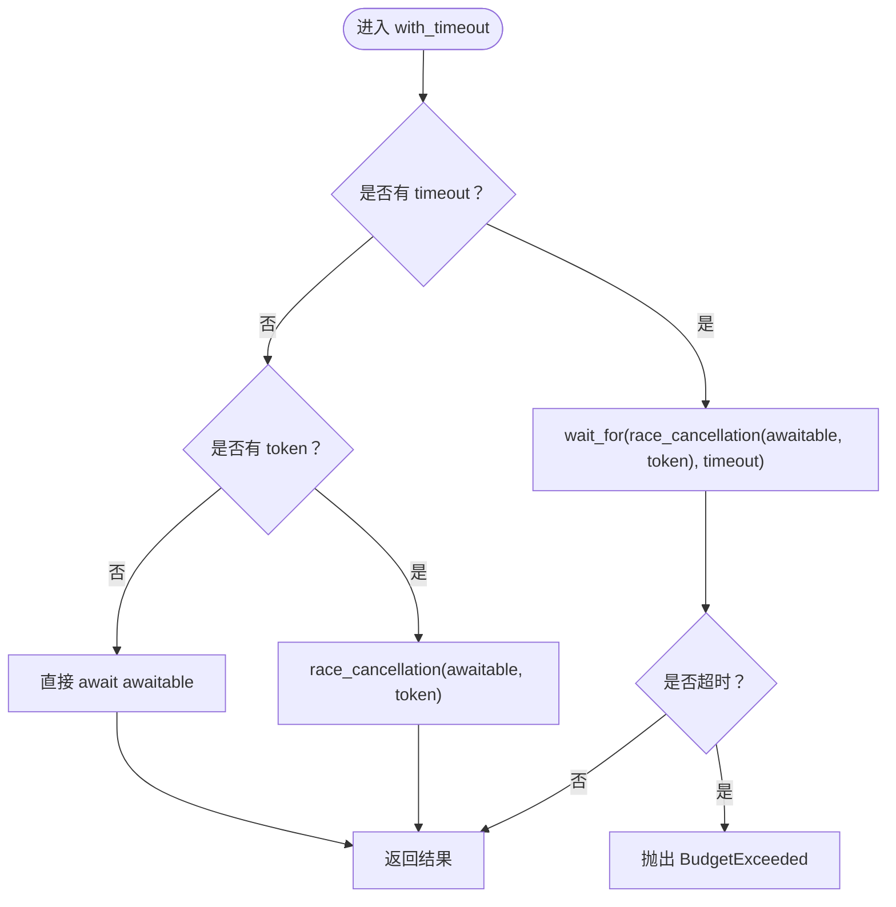
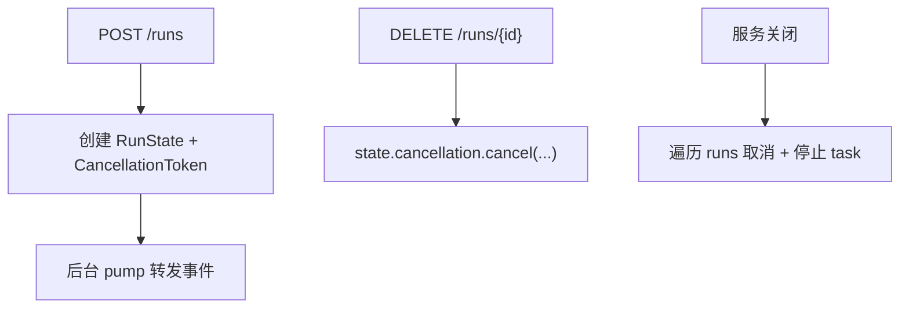
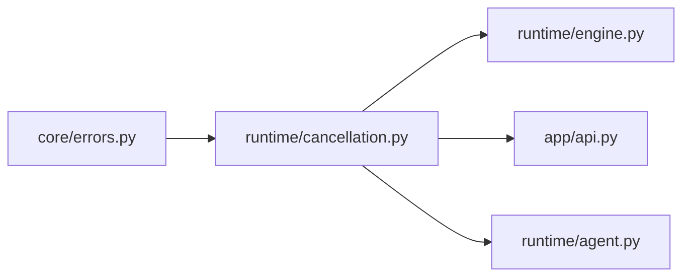

# 取消机制

<cite>
**本文引用的文件**   
- [cancellation.py](file://src/agentkit/runtime/cancellation.py)
- [engine.py](file://src/agentkit/runtime/engine.py)
- [errors.py](file://src/agentkit/core/errors.py)
- [api.py](file://src/agentkit/app/api.py)
- [agent.py](file://src/agentkit/runtime/agent.py)
- [test_runtime.py](file://tests/test_runtime.py)
</cite>

## 目录
1. [引言](#引言)
2. [项目结构中的取消位置](#项目结构中的取消位置)
3. [核心组件](#核心组件)
4. [架构总览](#架构总览)
5. [详细组件分析](#详细组件分析)
6. [依赖关系分析](#依赖关系分析)
7. [性能与资源清理](#性能与资源清理)
8. [故障排查](#故障排查)
9. [使用示例与最佳实践](#使用示例与最佳实践)
10. [结论](#结论)

## 引言
本文件聚焦 AgentKit 的异步取消机制，解释为什么不能只依赖 `asyncio.CancelledError`，以及 `CancellationToken`、`race_cancellation`、`with_timeout` 如何协作，让长时间运行的工具执行、网络请求和模型流式生成都能即时响应取消。文档还说明取消状态如何在引擎循环中传播、如何保证资源清理和状态一致性，并给出面向开发者的使用建议。

## 项目结构中的取消位置
取消能力集中在运行时层：
- 取消信号定义在 `runtime/cancellation.py`。
- 引擎循环在 `runtime/engine.py` 中消费取消信号，并把取消转成终止事件。
- HTTP 服务在 `app/api.py` 中暴露取消端点，把客户端取消映射到运行中的 token。
- 顶层门面 `runtime/agent.py` 把取消参数透传到引擎。
- 测试覆盖取消语义，包括提前取消、中断正在执行的协程、以及取消后不再执行后续工具。



**图表来源**
- [api.py:440-446](file://src/agentkit/app/api.py#L440-L446)
- [agent.py:72-112](file://src/agentkit/runtime/agent.py#L72-L112)
- [engine.py:166-248](file://src/agentkit/runtime/engine.py#L166-L248)
- [cancellation.py:30-144](file://src/agentkit/runtime/cancellation.py#L30-L144)
- [errors.py:114-119](file://src/agentkit/core/errors.py#L114-L119)

**章节来源**
- [cancellation.py:1-25](file://src/agentkit/runtime/cancellation.py#L1-L25)
- [engine.py:1-16](file://src/agentkit/runtime/engine.py#L1-L16)
- [api.py:1-14](file://src/agentkit/app/api.py#L1-L14)

## 核心组件
- `CancellationToken`：一次 run 的取消信号，支持幂等取消、原因记录、等待取消、检查取消。
- `race_cancellation`：将任意 awaitable 与 token 取消进行“竞速”，谁先完成就按对应语义处理；token 先到时主动 cancel 工作协程，确保子进程等资源能被清理。
- `with_timeout`：给操作加超时，同时保持对取消的响应；超时转换为预算类错误，取消则走取消路径。
- 引擎侧：在模型调用、工具执行、循环每步都检查取消，并把 `RunCancelled` 转为 `run_cancelled` 终止事件。
- HTTP 侧：每个 run 持有独立 token，取消端点调用 `cancel`，服务关闭时也统一取消所有活跃 run。

**章节来源**
- [cancellation.py:30-144](file://src/agentkit/runtime/cancellation.py#L30-L144)
- [engine.py:250-434](file://src/agentkit/runtime/engine.py#L250-L434)
- [api.py:72-142](file://src/agentkit/app/api.py#L72-L142)

## 架构总览
取消不是“抛异常就结束”的简单逻辑，而是贯穿以下链路：
1. 外部触发：用户点击取消、HTTP 连接断开、服务关闭、超时看门狗。
2. Token 被设置：`CancellationToken.cancel(reason)` 被调用。
3. 竞速取消：`race_cancellation` 发现 token 先到，cancel 正在执行的工作协程。
4. 引擎捕获：`RunCancelled` 被引擎捕获，发出 `run_cancelled` 事件，而不是向上抛出 500。
5. 状态收敛：消息配对校验失败时跳过落盘，避免写入残缺历史。



**图表来源**
- [api.py:402-446](file://src/agentkit/app/api.py#L402-L446)
- [agent.py:72-112](file://src/agentkit/runtime/agent.py#L72-L112)
- [engine.py:370-434](file://src/agentkit/runtime/engine.py#L370-L434)
- [cancellation.py:83-119](file://src/agentkit/runtime/cancellation.py#L83-L119)

## 详细组件分析

### CancellationToken：取消状态容器
`CancellationToken` 是取消机制的核心数据结构：
- 内部用 `asyncio.Event` 表示已取消状态。
- `cancelled` 属性用于快速判断。
- `reason` 保留第一次取消的原因，多次调用 `cancel` 是幂等的。
- `raise_if_cancelled()` 在取消时抛出 `RunCancelled`，适合放在循环和工具执行前。
- `wait()` 让其他协程可以等待取消信号。
- `child()` 提供同层级共享的子 token，但不会自动继承父级取消，跨层级应直接传同一个 token。



**图表来源**
- [cancellation.py:30-80](file://src/agentkit/runtime/cancellation.py#L30-L80)

**章节来源**
- [cancellation.py:30-80](file://src/agentkit/runtime/cancellation.py#L30-L80)

### race_cancellation：协作取消的关键
`race_cancellation` 解决的是“取消了也要等工具跑完才发现没人要结果”的问题：
- 如果 token 已经取消，立即关闭未消费的协程对象并抛出 `RunCancelled`。
- 否则创建 work future 和 cancelled future，使用 `asyncio.wait` 竞争。
- finally 块确保 cancelled future 被正确清理。
- 如果 work 先完成，返回其结果。
- 如果 token 先到，cancel work，等待 work 退出以触发清理逻辑，然后抛出 `RunCancelled`。



**图表来源**
- [cancellation.py:83-119](file://src/agentkit/runtime/cancellation.py#L83-L119)

**章节来源**
- [cancellation.py:83-119](file://src/agentkit/runtime/cancellation.py#L83-L119)

### with_timeout：超时与取消并存
`with_timeout` 区分两种语义：
- 超时：本次操作太久，转换为 `BudgetExceeded`。
- 取消：整个 run 不要了，走取消路径。

实现上：
- 无超时时，若存在 token 则走 `race_cancellation`，否则直接 await。
- 有超时时，外层用 `asyncio.wait_for`，内层再包一层 `race_cancellation`，保证超时和取消都能中断工作。



**图表来源**
- [cancellation.py:122-144](file://src/agentkit/runtime/cancellation.py#L122-L144)

**章节来源**
- [cancellation.py:122-144](file://src/agentkit/runtime/cancellation.py#L122-L144)

### 引擎中的取消传播
引擎是取消状态的汇聚点：
- `_drive` 捕获 `RunCancelled`，将其转为 `RunCancelledEvent` 事件，保证终止事件稳定输出。
- `_loop` 在每轮开始、每次工具执行前调用 `token.raise_if_cancelled()`。
- `_call_model` 对流式模型调用也使用 `race_cancellation`，防止取消后继续烧 token。
- `_execute` 对工具执行同样使用 `race_cancellation`，确保工具（尤其是子进程）能即时响应取消。

```mermaid
sequenceDiagram
participant Loop as "_loop"
participant Model as "_call_model"
participant Tool as "_execute"
participant Token as "CancellationToken"
Loop->>Token : "raise_if_cancelled()"
Loop->>Model : "调用模型"
Model->>Token : "流式过程中 raise_if_cancelled()"
Loop->>Tool : "执行工具"
Tool->>Token : "执行前 raise_if_cancelled()"
Token-->>Loop : "RunCancelled"
Loop-->>Loop : "转为 run_cancelled 事件"
```

**图表来源**
- [engine.py:250-434](file://src/agentkit/runtime/engine.py#L250-L434)

**章节来源**
- [engine.py:208-248](file://src/agentkit/runtime/engine.py#L208-L248)
- [engine.py:370-434](file://src/agentkit/runtime/engine.py#L370-L434)

### HTTP 层的取消入口
HTTP 层为每个 run 维护一个 `RunState`，其中包含独立的 `CancellationToken`：
- 启动 run 时创建 token。
- 取消端点调用 `state.cancellation.cancel("客户端请求取消")`。
- 服务关闭时遍历所有 run，统一取消并停止 task。
- SSE 订阅者断线不直接取消 run，因为刷新页面不应中断后台任务。



**图表来源**
- [api.py:72-142](file://src/agentkit/app/api.py#L72-L142)
- [api.py:440-446](file://src/agentkit/app/api.py#L440-L446)

**章节来源**
- [api.py:72-142](file://src/agentkit/app/api.py#L72-L142)
- [api.py:440-446](file://src/agentkit/app/api.py#L440-L446)

## 依赖关系分析
取消机制的依赖方向清晰：
- `runtime/cancellation.py` 依赖 `core/errors.RunCancelled`。
- `runtime/engine.py` 依赖 `runtime/cancellation` 和 `core/errors`。
- `app/api.py` 依赖 `runtime/cancellation` 来管理每个 run 的生命周期。
- `runtime/agent.py` 作为门面，透传 `CancellationToken`。



**图表来源**
- [errors.py:114-119](file://src/agentkit/core/errors.py#L114-L119)
- [cancellation.py:23-25](file://src/agentkit/runtime/cancellation.py#L23-L25)
- [engine.py:59-60](file://src/agentkit/runtime/engine.py#L59-L60)
- [api.py:45-46](file://src/agentkit/app/api.py#L45-L46)
- [agent.py:32-33](file://src/agentkit/runtime/agent.py#L32-L33)

**章节来源**
- [errors.py:114-119](file://src/agentkit/core/errors.py#L114-L119)
- [cancellation.py:23-25](file://src/agentkit/runtime/cancellation.py#L23-L25)
- [engine.py:59-60](file://src/agentkit/runtime/engine.py#L59-L60)
- [api.py:45-46](file://src/agentkit/app/api.py#L45-L46)
- [agent.py:32-33](file://src/agentkit/runtime/agent.py#L32-L33)

## 性能与资源清理
- 避免孤儿进程：`race_cancellation` 在 token 先到时 cancel work，从而触发工具内部的 `finally` 清理逻辑，例如子进程退出。
- 避免未消费协程泄漏：提前返回时会关闭未消费的协程对象，防止 Python 留下永不 await 的协程导致资源泄露。
- 避免无效计算：引擎在每步和每次工具执行前检查取消，防止取消后继续消耗 token。
- 避免写坏历史：持久化前先校验消息配对不变量，取消或出错时可能不完整，宁可少记一次也不写入非法数据。

**章节来源**
- [cancellation.py:83-119](file://src/agentkit/runtime/cancellation.py#L83-L119)
- [engine.py:465-493](file://src/agentkit/runtime/engine.py#L465-L493)

## 故障排查
常见问题与定位方式：
- 取消后仍继续执行工具：检查是否在工具执行前后调用了 `raise_if_cancelled()`，或是否使用了 `race_cancellation` 包裹工具调用。
- 取消没有中断模型流式生成：确认模型流式调用是否通过 `_call_model` 的 `race_cancellation` 包裹。
- 取消后仍然产生 500：确认上层是否捕获 `RunCancelled` 并转为 `run_cancelled` 事件，而不是让异常冒泡。
- 取消后历史写入失败：检查 `_persist` 的消息配对校验，取消可能导致消息不完整，此时会跳过落盘。
- 服务关闭后仍有后台任务：确认 `RunManager.shutdown` 是否对所有 run 调用 `cancellation.cancel` 并 cancel task。

**章节来源**
- [engine.py:208-248](file://src/agentkit/runtime/engine.py#L208-L248)
- [engine.py:465-493](file://src/agentkit/runtime/engine.py#L465-L493)
- [api.py:128-142](file://src/agentkit/app/api.py#L128-L142)

## 使用示例与最佳实践

### 在长时间运行操作中实现即时取消
- 工具执行：使用 `race_cancellation(self.tools.invoke(...), token)`，确保子进程和网络 IO 能即时响应取消。
- 模型流式生成：使用 `race_cancellation(consume(), token)`，并在 consume 内部对每个 chunk 调用 `raise_if_cancelled()`。
- 循环控制：在每轮开始和每次工具执行前调用 `token.raise_if_cancelled()`，避免取消后继续烧 token。

**章节来源**
- [engine.py:370-434](file://src/agentkit/runtime/engine.py#L370-L434)

### 取消状态传播
- 从 HTTP 层传入 `CancellationToken` 到 `Agent.stream` 和 `Engine.run`。
- 引擎内部复用同一个 token，不在层级间随意派生新 token，除非明确需要同层级隔离。
- 取消原因通过 `reason` 字段记录，便于日志和终端事件区分“用户取消”“超时”“服务关闭”。

**章节来源**
- [api.py:72-142](file://src/agentkit/app/api.py#L72-L142)
- [agent.py:72-112](file://src/agentkit/runtime/agent.py#L72-L112)
- [engine.py:250-434](file://src/agentkit/runtime/engine.py#L250-L434)

### 资源清理与状态一致性
- 工具内部使用 `try/finally` 清理子进程、文件句柄、网络连接。
- 引擎在取消或异常时跳过消息落盘，避免写入不完整对话。
- 使用 `validate_conversation` 校验消息配对不变量，尽早发现写坏历史的 bug。

**章节来源**
- [engine.py:465-493](file://src/agentkit/runtime/engine.py#L465-L493)

### 测试验证要点
- 验证 token 初始为活跃状态，取消后 `raise_if_cancelled()` 抛出 `RunCancelled`。
- 验证 `race_cancellation` 在 token 已取消时不执行工作。
- 验证取消能中断正在执行的慢工具，且后续工具不再执行。
- 验证取消后引擎以 `run_cancelled` 事件收尾，而不是异常冒泡。

**章节来源**
- [test_runtime.py:44-107](file://tests/test_runtime.py#L44-L107)
- [test_runtime.py:110-174](file://tests/test_runtime.py#L110-L174)

## 结论
AgentKit 的取消机制以显式的 `CancellationToken` 为核心，通过 `race_cancellation` 实现真正的协作取消，避免隐式 task 取消带来的孤儿资源和延迟响应问题。引擎层负责把取消状态传播到模型调用和工具执行，并把 `RunCancelled` 转化为稳定的终止事件。HTTP 层为每个 run 提供独立的取消入口，服务关闭时统一回收。配合消息配对校验和持久化前的合法性检查，系统在取消场景下仍能保持资源清理和状态一致性。开发者应在工具执行、模型流式生成和循环关键点插入取消检查，并使用 `race_cancellation` 包裹长时间运行操作，以获得即时、可观测、可恢复的取消体验。