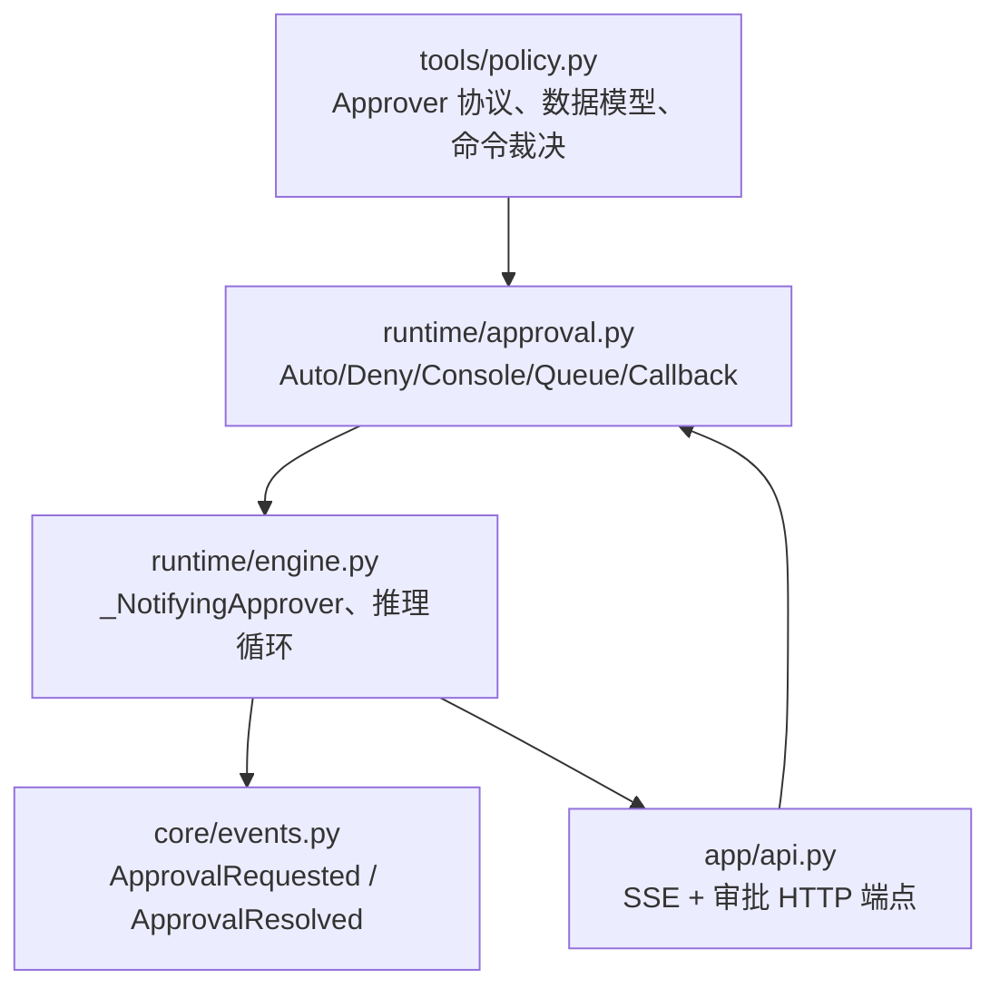
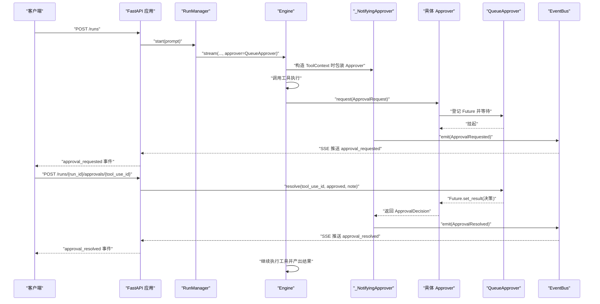
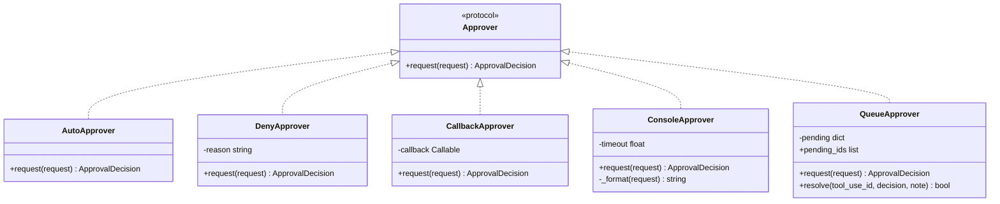
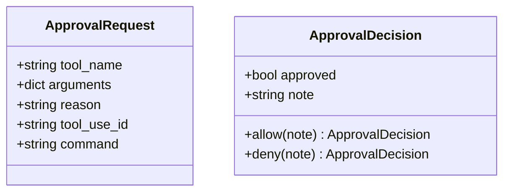
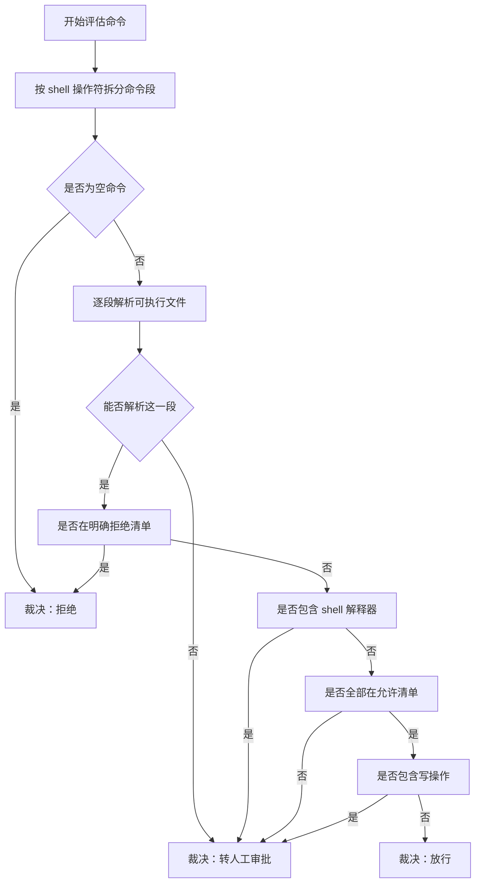
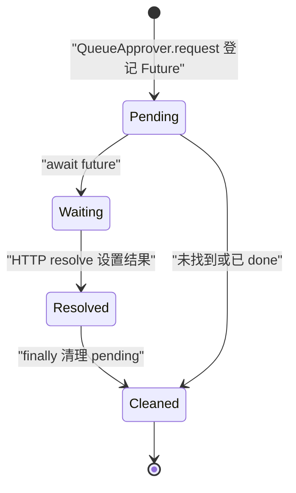
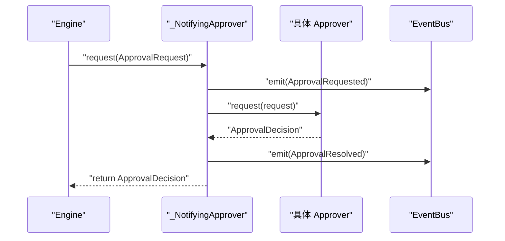
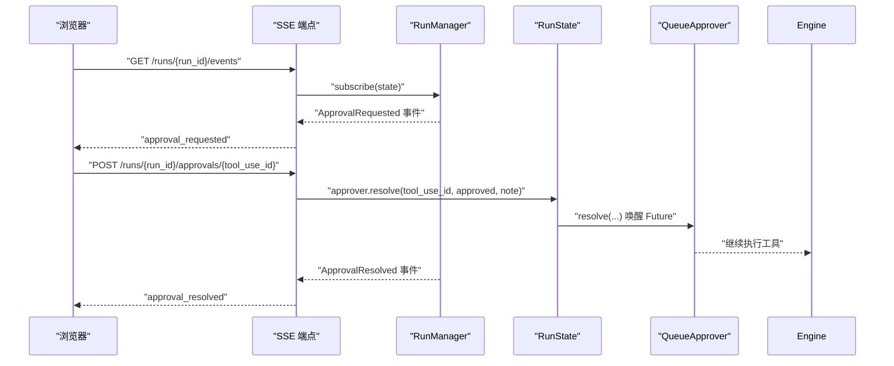
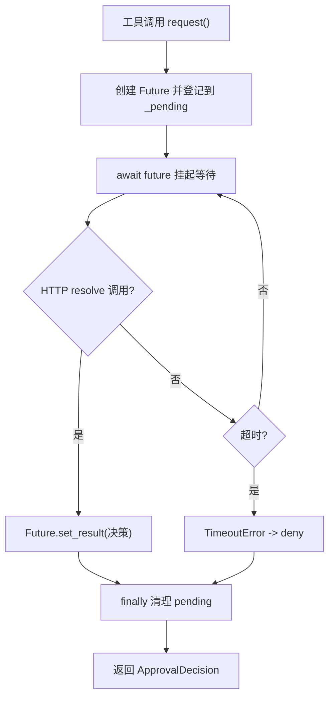
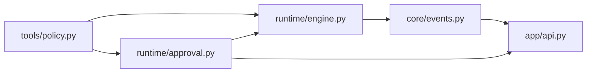

# 审批系统

<cite>
**本文引用的文件**   
- [src/agentkit/tools/policy.py](file://src/agentkit/tools/policy.py)
- [src/agentkit/runtime/approval.py](file://src/agentkit/runtime/approval.py)
- [src/agentkit/runtime/engine.py](file://src/agentkit/runtime/engine.py)
- [src/agentkit/core/events.py](file://src/agentkit/core/events.py)
- [src/agentkit/app/api.py](file://src/agentkit/app/api.py)
- [tests/test_runtime.py](file://tests/test_runtime.py)
</cite>

## 更新摘要
**已进行的变更**   
- 增强了 QueueApprover 以支持 SSE 场景的外部决策机制
- 集成了 HTTP API 审批工作流，提供 `/runs/{run_id}/approvals/{tool_use_id}` 端点
- 完善了 _NotifyingApprover 的事件通知机制，确保审批请求在工具阻塞时也能推送
- 扩展了 SSE 实时审批交互流程，支持客户端异步提交审批决定

## 目录
1. [引言](#引言)
2. [项目结构中的审批位置](#项目结构中的审批位置)
3. [核心组件总览](#核心组件总览)
4. [架构总览](#架构总览)
5. [详细组件分析](#详细组件分析)
6. [依赖关系分析](#依赖关系分析)
7. [性能与可靠性考虑](#性能与可靠性考虑)
8. [故障排查指南](#故障排查指南)
9. [结论](#结论)
10. [附录：自定义审批策略示例与安全最佳实践](#附录自定义审批策略示例与安全最佳实践)

## 引言
本文件面向"安全审批机制"的实现，目标是帮助开发者理解 AgentKit 中工具执行前的审批模型、决策流程、事件通知方式以及 SSE 实时交互链路。文档重点包括：

- Approver 接口的设计意图与扩展点。
- 命令裁决的三分逻辑：拒绝、放行、转人工审批。
- ApprovalRequest 与 ApprovalDecision 的数据语义。
- 引擎如何把审批请求包装成事件，并通过 _NotifyingApprover 推送到 EventBus。
- QueueApprover 在 SSE 服务中的等待与决议机制。
- HTTP API 审批工作流的完整集成。
- 如何编写自定义审批策略，以及生产环境的安全建议。

## 项目结构中的审批位置
审批相关代码分布在四个层次：

| 层次 | 文件 | 职责 |
|---|---|---|
| 协议层 | src/agentkit/tools/policy.py | 定义 Approver 协议、ApprovalRequest、ApprovalDecision、命令三分裁决逻辑 |
| 运行时实现层 | src/agentkit/runtime/approval.py | 提供 Auto/Deny/Console/Queue/Callback 等具体 Approver 实现 |
| 引擎层 | src/agentkit/runtime/engine.py | 驱动推理循环，把 Approver 包装为 _NotifyingApprover，并产生 ApprovalRequested / ApprovalResolved 事件 |
| 应用层 | src/agentkit/app/api.py | 通过 FastAPI 暴露 SSE 事件流和审批 POST 端点，使用 QueueApprover 完成外部决策 |
| 事件模型层 | src/agentkit/core/events.py | 定义 ApprovalRequested、ApprovalResolved 等运行事件类型 |

**图表来源**
- [src/agentkit/tools/policy.py:49-88](file://src/agentkit/tools/policy.py#L49-L88)
- [src/agentkit/runtime/approval.py:35-167](file://src/agentkit/runtime/approval.py#L35-L167)
- [src/agentkit/runtime/engine.py:96-124](file://src/agentkit/runtime/engine.py#L96-L124)
- [src/agentkit/core/events.py:130-148](file://src/agentkit/core/events.py#L130-L148)
- [src/agentkit/app/api.py:456-474](file://src/agentkit/app/api.py#L456-L474)

**章节来源**
- [src/agentkit/tools/policy.py:1-43](file://src/agentkit/tools/policy.py#L1-L43)
- [src/agentkit/runtime/approval.py:1-32](file://src/agentkit/runtime/approval.py#L1-L32)
- [src/agentkit/runtime/engine.py:1-16](file://src/agentkit/runtime/engine.py#L1-L16)
- [src/agentkit/core/events.py:1-26](file://src/agentkit/core/events.py#L1-L26)
- [src/agentkit/app/api.py:1-14](file://src/agentkit/app/api.py#L1-L14)

## 核心组件总览
审批系统的核心由以下部分组成：

1. **Approver 协议**：定义 `request(request)` 异步方法，要求实现方阻塞到有人做出决定为止。
2. **ApprovalRequest**：描述一个需要确认的动作，包含工具名、参数、原因、tool_use_id 和可选的命令原文。
3. **ApprovalDecision**：描述审批结果，包含是否批准和备注。
4. **命令三分裁决**：`Verdict.ALLOW`、`Verdict.DENY`、`Verdict.REQUIRE_APPROVAL`，配合 `assess_command` 对 shell 命令做保守判断。
5. **具体 Approver 实现**：自动放行、默认拒绝、终端交互、队列等待、回调封装。
6. **引擎包装器 _NotifyingApprover**：把 Approver 的请求和结果广播为事件。
7. **QueueApprover**：基于 asyncio.Future 的外部决策队列，用于 SSE 场景。
8. **HTTP API**：SSE 事件流 + `/runs/{run_id}/approvals/{tool_use_id}` 审批提交端点。

**章节来源**
- [src/agentkit/tools/policy.py:49-88](file://src/agentkit/tools/policy.py#L49-L88)
- [src/agentkit/tools/policy.py:125-131](file://src/agentkit/tools/policy.py#L125-L131)
- [src/agentkit/tools/policy.py:245-305](file://src/agentkit/tools/policy.py#L245-L305)
- [src/agentkit/runtime/approval.py:35-167](file://src/agentkit/runtime/approval.py#L35-L167)
- [src/agentkit/runtime/engine.py:96-124](file://src/agentkit/runtime/engine.py#L96-L124)
- [src/agentkit/app/api.py:456-474](file://src/agentkit/app/api.py#L456-L474)

## 架构总览
从调用方视角看，一次带审批的工具执行大致经历如下阶段：

**图表来源**
- [src/agentkit/app/api.py:402-438](file://src/agentkit/app/api.py#L402-L438)
- [src/agentkit/app/api.py:456-474](file://src/agentkit/app/api.py#L456-L474)
- [src/agentkit/runtime/engine.py:264-268](file://src/agentkit/runtime/engine.py#L264-L268)
- [src/agentkit/runtime/engine.py:96-124](file://src/agentkit/runtime/engine.py#L96-L124)
- [src/agentkit/runtime/approval.py:120-167](file://src/agentkit/runtime/approval.py#L120-L167)
- [src/agentkit/core/events.py:130-148](file://src/agentkit/core/events.py#L130-L148)

## 详细组件分析

### Approver 接口设计
Approver 是一个 Protocol，只要求实现一个异步方法 `request`，接收 `ApprovalRequest` 并返回 `ApprovalDecision`。它被放在 tools 层而不是 runtime 层，目的是让工具模块只依赖协议，不反向依赖运行时，从而保持单向依赖方向。

关键设计要点：

- 接口简单：只有 `request`，避免引入复杂状态机。
- 异步阻塞语义：实现方必须阻塞到有人做出决定，这样引擎侧可以把它当作普通 await 调用。
- 可替换性：CLI、本地开发、SSE 服务、业务系统都可以注入不同实现。

**图表来源**
- [src/agentkit/tools/policy.py:77-88](file://src/agentkit/tools/policy.py#L77-L88)
- [src/agentkit/runtime/approval.py:35-167](file://src/agentkit/runtime/approval.py#L35-L167)

**章节来源**
- [src/agentkit/tools/policy.py:77-88](file://src/agentkit/tools/policy.py#L77-L88)
- [src/agentkit/runtime/approval.py:35-80](file://src/agentkit/runtime/approval.py#L35-L80)

### ApprovalRequest 与 ApprovalDecision 数据结构
这两个 dataclass 是审批消息的契约：

| 字段 | 类型 | 含义 |
|---|---|---|
| tool_name | str | 触发审批的工具名称 |
| arguments | dict[str, Any] | 工具的原始参数 |
| reason | str | 为什么需要审批的原因说明 |
| tool_use_id | str | 与引擎工具调用 id 关联，用于 SSE 匹配 |
| command | str \| None | 命令类工具的原命令文本，便于界面高亮 |
| approved | bool | 是否批准 |
| note | str | 审批备注，可用于记录拒绝原因或审计信息 |

**图表来源**
- [src/agentkit/tools/policy.py:49-74](file://src/agentkit/tools/policy.py#L49-L74)

**章节来源**
- [src/agentkit/tools/policy.py:49-74](file://src/agentkit/tools/policy.py#L49-L74)

### 三分裁决：拒绝、放行、转审批
命令裁决不是简单的黑名单，而是三层判断：

1. **明确拒绝**：例如磁盘格式化、关机、重启、分区等高危命令。
2. **明确放行**：命令在允许清单内，且没有写操作。
3. **转人工审批**：无法解析、包含 shell 解释器、不在允许清单、包含写操作。

**图表来源**
- [src/agentkit/tools/policy.py:181-220](file://src/agentkit/tools/policy.py#L181-L220)
- [src/agentkit/tools/policy.py:245-298](file://src/agentkit/tools/policy.py#L245-L298)

**章节来源**
- [src/agentkit/tools/policy.py:125-131](file://src/agentkit/tools/policy.py#L125-L131)
- [src/agentkit/tools/policy.py:143-176](file://src/agentkit/tools/policy.py#L143-L176)
- [src/agentkit/tools/policy.py:181-220](file://src/agentkit/tools/policy.py#L181-L220)
- [src/agentkit/tools/policy.py:245-305](file://src/agentkit/tools/policy.py#L245-L305)

### 审批流程的状态管理
审批本身不是一个全局状态机，而是围绕"待处理 Future"和"事件流"的状态协作：

- **Pending 状态**：QueueApprover 内部维护 `tool_use_id -> Future` 映射。
- **Waiting 状态**：引擎调用 Approver.request 后，QueueApprover 挂起等待。
- **Resolved 状态**：HTTP 路由调用 resolve，Future 设置结果，等待恢复。
- **Cleaned 状态**：无论成功还是失败，finally 分支清理 pending 条目。
- **Event 状态**：_NotifyingApprover 在 request 前后分别发出 ApprovalRequested 和 ApprovalResolved。

**图表来源**
- [src/agentkit/runtime/approval.py:132-167](file://src/agentkit/runtime/approval.py#L132-L167)
- [src/agentkit/runtime/engine.py:96-124](file://src/agentkit/runtime/engine.py#L96-L124)

**章节来源**
- [src/agentkit/runtime/approval.py:120-167](file://src/agentkit/runtime/approval.py#L120-L167)
- [src/agentkit/runtime/engine.py:96-124](file://src/agentkit/runtime/engine.py#L96-L124)

### _NotifyingApprover 的事件通知机制
_NotifyApprover 是连接 Approver 与 EventBus 的桥梁。它的关键行为是：

1. 收到 ApprovalRequest 后，立即发出 ApprovalRequested 事件。
2. 调用内部 Approver.request 阻塞等待决策。
3. 拿到 ApprovalDecision 后，发出 ApprovalResolved 事件。
4. 返回决策给引擎，引擎继续执行工具。

这保证了即使工具仍在等待外部审批，SSE 客户端也能先看到请求，而不是等到审批结束才看到任何进展。

**图表来源**
- [src/agentkit/runtime/engine.py:96-124](file://src/agentkit/runtime/engine.py#L96-L124)
- [src/agentkit/core/events.py:130-148](file://src/agentkit/core/events.py#L130-L148)

**章节来源**
- [src/agentkit/runtime/engine.py:96-124](file://src/agentkit/runtime/engine.py#L96-L124)
- [src/agentkit/core/events.py:130-148](file://src/agentkit/core/events.py#L130-L148)

### SSE 实时审批交互
SSE 审批交互分为两段：

1. **服务端推送请求**：引擎产生 ApprovalRequested 事件，RunManager 转发到所有 SSE 订阅者。
2. **客户端提交决定**：客户端调用 `/runs/{run_id}/approvals/{tool_use_id}`，RunState.approver.resolve 唤醒等待的 Future。

**图表来源**
- [src/agentkit/app/api.py:413-438](file://src/agentkit/app/api.py#L413-L438)
- [src/agentkit/app/api.py:456-474](file://src/agentkit/app/api.py#L456-L474)
- [src/agentkit/runtime/approval.py:139-167](file://src/agentkit/runtime/approval.py#L139-L167)

**章节来源**
- [src/agentkit/app/api.py:413-438](file://src/agentkit/app/api.py#L413-L438)
- [src/agentkit/app/api.py:456-474](file://src/agentkit/app/api.py#L456-L474)
- [src/agentkit/runtime/approval.py:120-167](file://src/agentkit/runtime/approval.py#L120-L167)

### QueueApprover 的 SSE 集成机制
**新增** QueueApprover 是专门为 SSE 场景设计的审批通道，它通过 asyncio.Future 实现异步等待机制：

- **Future 登记**：当工具需要审批时，QueueApprover 创建一个 Future 并存储在 `_pending` 字典中，键为 `tool_use_id`。
- **超时保护**：默认 300 秒超时，防止无人接手的 run 无限期占用资源。
- **外部决议**：HTTP 路由调用 `resolve()` 方法，根据 `tool_use_id` 找到对应的 Future 并设置结果。
- **资源清理**：无论成功还是失败，finally 分支都会清理 pending 条目，防止内存泄漏。

**图表来源**
- [src/agentkit/runtime/approval.py:120-167](file://src/agentkit/runtime/approval.py#L120-L167)

**章节来源**
- [src/agentkit/runtime/approval.py:120-167](file://src/agentkit/runtime/approval.py#L120-L167)

### HTTP API 审批工作流
**新增** HTTP API 提供了完整的审批工作流支持：

- **POST `/runs/{run_id}/approvals/{tool_use_id}`**：客户端提交审批决定，包含 `approved` 布尔值和可选的 `note`。
- **GET `/runs/{run_id}/approvals`**：查询当前 run 的所有待审批项。
- **错误处理**：如果 `tool_use_id` 不存在或 run 已结束，返回 404 错误。
- **状态同步**：RunState 中的 `approver.pending_ids` 属性提供待审批项列表。

**章节来源**
- [src/agentkit/app/api.py:456-474](file://src/agentkit/app/api.py#L456-L474)
- [src/agentkit/app/api.py:72-110](file://src/agentkit/app/api.py#L72-L110)

## 依赖关系分析
审批系统的依赖方向非常明确：

- tools.policy 只定义协议和数据模型，不依赖 runtime。
- runtime.approval 依赖 tools.policy 的 ApprovalRequest 和 ApprovalDecision。
- runtime.engine 依赖 tools.policy 的 Approver 协议，并把 Approver 包装为 _NotifyingApprover。
- app.api 依赖 runtime.approval.QueueApprover 和 core.events.RunEvent。
- core.events 是纯事件模型，不被 policy 依赖。

**图表来源**
- [src/agentkit/tools/policy.py:1-43](file://src/agentkit/tools/policy.py#L1-L43)
- [src/agentkit/runtime/approval.py:1-32](file://src/agentkit/runtime/approval.py#L1-L32)
- [src/agentkit/runtime/engine.py:50-58](file://src/agentkit/runtime/engine.py#L50-L58)
- [src/agentkit/core/events.py:1-26](file://src/agentkit/core/events.py#L1-L26)
- [src/agentkit/app/api.py:31-45](file://src/agentkit/app/api.py#L31-L45)

**章节来源**
- [src/agentkit/tools/policy.py:1-43](file://src/agentkit/tools/policy.py#L1-L43)
- [src/agentkit/runtime/approval.py:1-32](file://src/agentkit/runtime/approval.py#L1-L32)
- [src/agentkit/runtime/engine.py:50-58](file://src/agentkit/runtime/engine.py#L50-L58)
- [src/agentkit/app/api.py:31-45](file://src/agentkit/app/api.py#L31-L45)

## 性能与可靠性考虑
审批机制在性能和可靠性上做了几个重要设计：

1. **SSE 断线续传**：每个事件带 seq 序号，客户端重连时可从 last_seq 补齐。
2. **事件缓冲**：RunState.events 保存已产出事件，支持回放。
3. **资源回收**：RunManager 后台任务定期回收已结束且无订阅者的 run。
4. **取消传播**：CancellationToken 贯穿引擎、模型调用、工具执行。
5. **默认拒绝**：DenyApprover 作为服务化默认值，避免无人值守时误放行。
6. **超时保护**：ConsoleApprover 支持等待超时，QueueApprover 也有超时机制。
7. **异常隔离**：引擎把异常转为 RunFailed 或 RunCancelled 事件，不让单个 run 拖垮服务。
8. **内存管理**：QueueApprover 在 finally 分支清理 pending 条目，防止内存泄漏。

**章节来源**
- [src/agentkit/app/api.py:72-110](file://src/agentkit/app/api.py#L72-L110)
- [src/agentkit/app/api.py:144-162](file://src/agentkit/app/api.py#L144-L162)
- [src/agentkit/app/api.py:195-239](file://src/agentkit/app/api.py#L195-L239)
- [src/agentkit/runtime/approval.py:89-107](file://src/agentkit/runtime/approval.py#L89-L107)
- [src/agentkit/runtime/engine.py:218-248](file://src/agentkit/runtime/engine.py#L218-L248)
- [src/agentkit/runtime/approval.py:159-160](file://src/agentkit/runtime/approval.py#L159-L160)

## 故障排查指南
常见问题和定位方式：

| 现象 | 可能原因 | 排查建议 |
|---|---|---|
| 审批一直 pending | 客户端没有 POST 审批结果，或 tool_use_id 不匹配 | 检查 `/runs/{run_id}/approvals` 返回的 pending_ids |
| 审批 resolve 返回 404 | run 已结束、tool_use_id 不存在、或重复 resolve | 检查 RunState.finished 和 tool_use_id 来源 |
| 控制台审批直接拒绝 | 用户未输入 y/yes，或超时 | 检查 ConsoleApprover 的 timeout 和用户输入 |
| 命令总是转审批 | 命令不在允许清单、包含写操作、或包含 shell 解释器 | 查看 assess_command 的 reason 和 executables |
| SSE 断线后丢失事件 | 客户端没有携带 from_seq 或 Last-Event-ID | 检查事件 seq 和重连参数 |
| 服务内存增长 | 长时间运行的 run 没有被回收 | 检查 RunManager.reap 和订阅者数量 |
| QueueApprover 超时 | 外部系统响应过慢或不可用 | 检查 QueueApprover.timeout 配置和外部系统状态 |
| pending_ids 不为空 | Future 未被正确清理 | 检查 QueueApprover 的 finally 分支执行情况 |

**章节来源**
- [src/agentkit/app/api.py:456-474](file://src/agentkit/app/api.py#L456-L474)
- [src/agentkit/runtime/approval.py:89-107](file://src/agentkit/runtime/approval.py#L89-L107)
- [src/agentkit/tools/policy.py:245-305](file://src/agentkit/tools/policy.py#L245-L305)
- [tests/test_runtime.py:309-391](file://tests/test_runtime.py#L309-L391)
- [src/agentkit/runtime/approval.py:159-160](file://src/agentkit/runtime/approval.py#L159-L160)

## 结论
AgentKit 的审批系统以 Approver 协议为核心，将"谁决定"和"怎么决定"解耦。命令层采用三分裁决，把高风险操作交给人工；运行时层用 _NotifyingApprover 把审批过程变成可观测事件；应用层用 QueueApprover 和 SSE 实现真正的异步远程审批。整体设计强调默认拒绝、可审计、可中断、可扩展，适合从 CLI 到服务化的多种部署形态。

**更新** 新增的 QueueApprover 和 HTTP API 集成使得审批系统能够完全支持现代 Web 应用的异步交互模式，客户端可以通过 SSE 实时接收审批请求，并通过 RESTful API 提交审批决定，形成了完整的异步审批工作流。

## 附录：自定义审批策略示例与安全最佳实践

### 自定义 Approver 示例思路
你可以实现一个 Approver，把审批逻辑委托给外部系统，例如数据库、消息队列、权限网关或企业审批流。基本模式是：

1. 在 `request` 中把 ApprovalRequest 发送到外部系统。
2. 使用 asyncio.Event、asyncio.Queue 或 asyncio.Future 等待外部回调。
3. 外部回调到达后，根据业务规则构造 ApprovalDecision.allow 或 ApprovalDecision.deny。
4. 如果外部系统不可用，应返回 deny 并带上错误说明，而不是静默放行。

参考现有实现的风格：

- 回调式 Approver：CallbackApprover 支持同步或异步回调，并可接受布尔值或 ApprovalDecision。
- 队列式 Approver：QueueApprover 用 pending 字典和 Future 等待外部 resolve。
- 终端式 Approver：ConsoleApprover 使用线程池调用 input，并设置超时。

**章节来源**
- [src/agentkit/runtime/approval.py:60-80](file://src/agentkit/runtime/approval.py#L60-L80)
- [src/agentkit/runtime/approval.py:120-167](file://src/agentkit/runtime/approval.py#L120-L167)
- [src/agentkit/runtime/approval.py:82-117](file://src/agentkit/runtime/approval.py#L82-L117)

### 安全最佳实践
结合仓库中的实现注释和测试，推荐以下实践：

1. **生产环境默认拒绝**：不要在生产使用 AutoApprover；服务化场景默认使用 DenyApprover。
2. **路径边界严格校验**：使用 realpath 和 commonpath 防止符号链接逃逸和路径前缀绕过。
3. **命令默认不信任**：看不懂的命令一律转审批，不要为了"方便"放宽黑名单。
4. **shell 解释器永远转审批**：sh、bash、zsh、cmd、powershell 等属于典型远程代码执行路径。
5. **写操作要人工确认**：rm、mv、cp、mkdir、touch 等命令即使允许执行，也应进入审批流程。
6. **审批备注可审计**：ApprovalDecision.note 应记录拒绝原因、审批人、外部系统响应。
7. **审批超时要有默认拒绝**：ConsoleApprover 超时返回 deny，QueueApprover 也应有超时保护。
8. **tool_use_id 必须可靠**：SSE 场景中，tool_use_id 是审批与工具调用的唯一关联键，不能省略或伪造。
9. **事件流要可重放**：保留 seq、from_seq、Last-Event-ID，确保断线后能补齐审批事件。
10. **测试覆盖 Approver 行为**：参考 tests/test_runtime.py 中对 Auto/Deny/Console/Queue Approver 的断言方式。
11. **资源清理**：确保 QueueApprover 的 pending 条目在 finally 分支中被正确清理，防止内存泄漏。
12. **外部系统集成**：外部审批系统不可用时，应返回 deny 而不是静默放行，确保安全优先。

**章节来源**
- [src/agentkit/tools/policy.py:1-19](file://src/agentkit/tools/policy.py#L1-L19)
- [src/agentkit/tools/policy.py:94-119](file://src/agentkit/tools/policy.py#L94-L119)
- [src/agentkit/tools/policy.py:143-176](file://src/agentkit/tools/policy.py#L143-L176)
- [src/agentkit/tools/policy.py:245-305](file://src/agentkit/tools/policy.py#L245-L305)
- [src/agentkit/runtime/approval.py:35-57](file://src/agentkit/runtime/approval.py#L35-L57)
- [src/agentkit/runtime/approval.py:89-107](file://src/agentkit/runtime/approval.py#L89-L107)
- [src/agentkit/runtime/approval.py:159-160](file://src/agentkit/runtime/approval.py#L159-L160)
- [tests/test_runtime.py:309-391](file://tests/test_runtime.py#L309-L391)