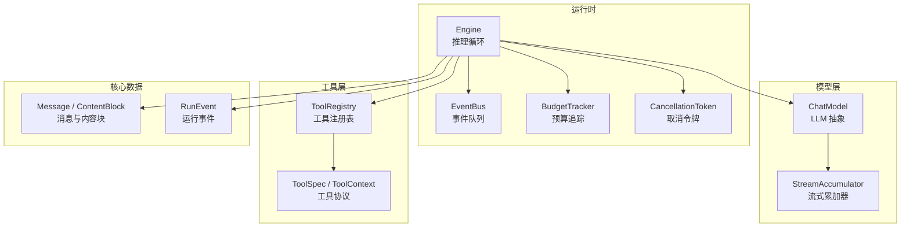
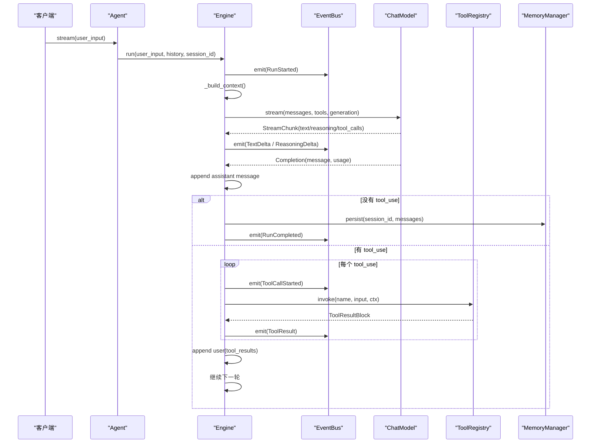
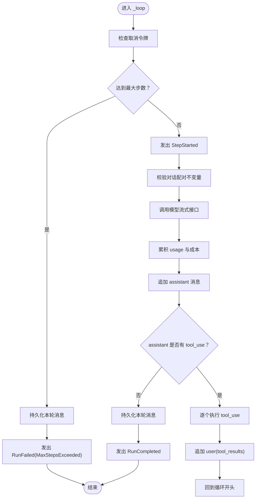
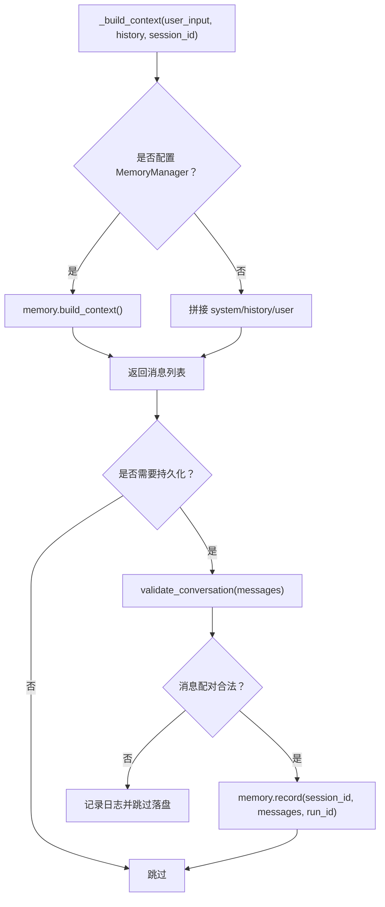
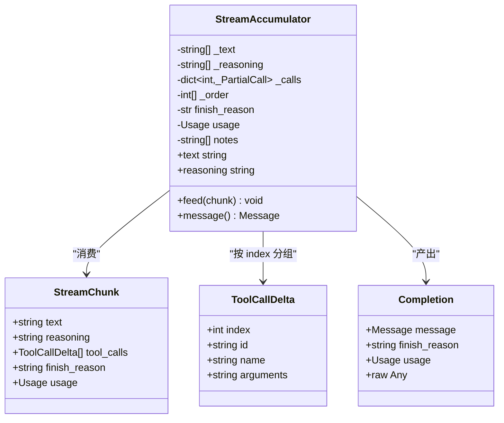
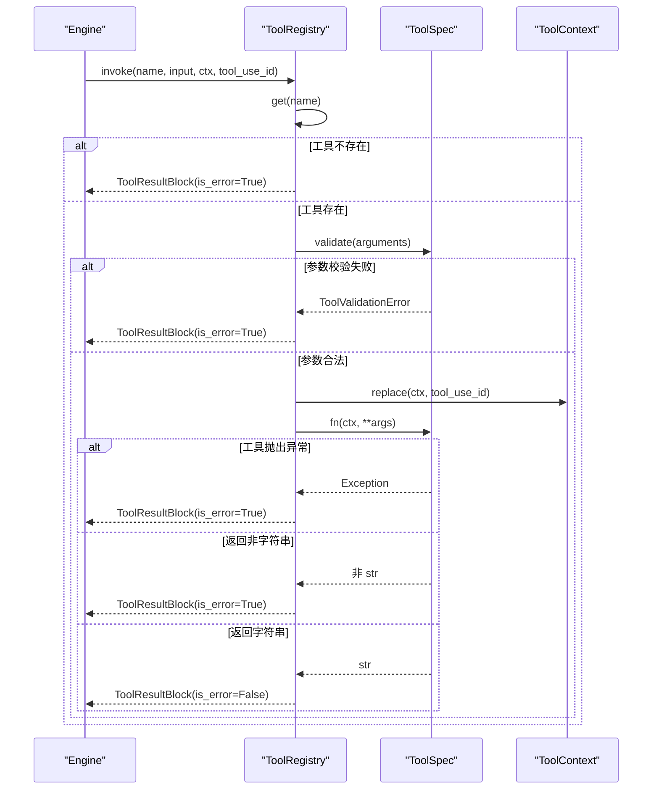
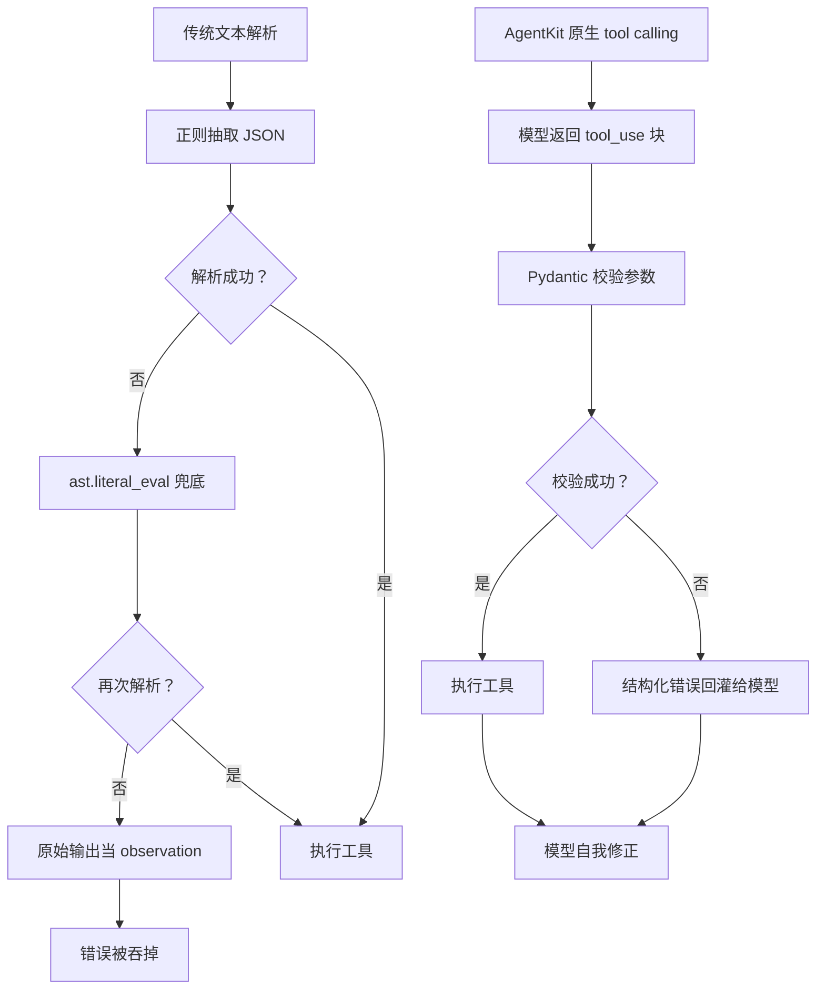
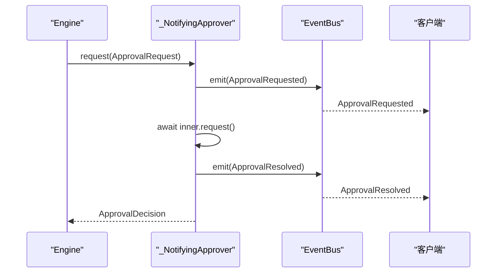
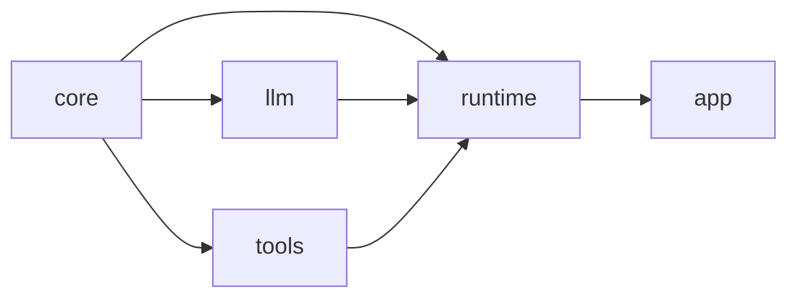

# 推理循环

<cite>
**本文引用的文件**   
- [README.md](file://README.md)
- [engine.py](file://src/agentkit/runtime/engine.py)
- [agent.py](file://src/agentkit/runtime/agent.py)
- [base.py](file://src/agentkit/tools/base.py)
- [registry.py](file://src/agentkit/tools/registry.py)
- [types.py](file://src/agentkit/core/types.py)
- [events.py](file://src/agentkit/core/events.py)
- [bus.py](file://src/agentkit/runtime/bus.py)
- [base.py](file://src/agentkit/llm/base.py)
</cite>

## 目录
1. [引言](#引言)
2. [项目结构](#项目结构)
3. [核心组件](#核心组件)
4. [架构总览](#架构总览)
5. [详细组件分析](#详细组件分析)
6. [依赖关系分析](#依赖关系分析)
7. [性能与优化](#性能与优化)
8. [故障排查指南](#故障排查指南)
9. [结论](#结论)

## 引言
AgentKit 的推理循环围绕“四步”展开：调用模型、解析工具调用、执行工具、把结果回灌给模型，然后回到第一步。它不依赖 LangChain 等上层框架，而是从零实现内核、流式处理、取消、预算、审批、工作记忆和评测能力。

与传统基于文本解析的工具调用方式相比，AgentKit 采用原生 tool calling：
- 传统方法通常从模型输出的文本中用正则或启发式规则抽取 JSON 工具调用，失败后静默降级，错误容易被吞掉；
- AgentKit 通过模型协议直接拿到 `tool_use` 块，参数由 Pydantic 校验，失败时以结构化错误回灌给模型，让模型自我修正；
- 同一轮并行工具调用的结果合并为一条 user 消息，避免多轮配对混乱；
- 引擎只产出类型化事件，CLI、SSE、可观测、评测共享同一条流，避免返回值与回调双真相源。

这些设计在 README 的设计取舍中被明确强调：内部消息使用内容块模型而非 provider 特定的 `tool_calls[]` + `role:"tool"`，原生 function calling 取代文本解析，引擎只 yield 类型化事件，工具参数失败回灌给模型，路径边界用 `realpath` + `commonpath`，命令安全用三分裁决，工具结果失败一律回灌而不中断 run，流式重试只在首个 chunk 之前允许。

**章节来源**
- [README.md:8-26](file://README.md#L8-L26)

## 项目结构
AgentKit 的核心代码位于 `src/agentkit/`，按职责分层组织：
- `core`：零依赖的消息模型、事件、错误、配置、用量；
- `llm`：Provider 抽象、流式归一化、重试；
- `tools`：工具协议、注册表、策略、内置工具；
- `memory`：工作记忆与持久化；
- `runtime`：引擎循环、事件总线、预算、取消、审批；
- `app`：CLI 与服务入口。

**图表来源**
- [engine.py:127-368](file://src/agentkit/runtime/engine.py#L127-L368)
- [base.py:213-250](file://src/agentkit/llm/base.py#L213-L250)
- [registry.py:33-174](file://src/agentkit/tools/registry.py#L33-L174)
- [types.py:29-157](file://src/agentkit/core/types.py#L29-L157)
- [events.py:37-169](file://src/agentkit/core/events.py#L37-L169)
- [bus.py:30-72](file://src/agentkit/runtime/bus.py#L30-L72)

**章节来源**
- [README.md:53-68](file://README.md#L53-L68)

## 核心组件
- **Engine**：驱动 tool-calling 循环，负责消息装配、模型调用、工具解析与执行、结果回灌、持久化、预算与取消。
- **Agent**：门面类，把模型、工具、引擎组装起来，提供 `stream` 和 `run` 两种入口。
- **ToolRegistry**：工具容器，负责注册、查询、生成 schema、校验参数并执行工具，所有失败转为 `is_error=True` 的结果块。
- **ToolSpec / ToolContext**：工具协议，从函数签名自动生成参数 schema，注入上下文，支持路径解析与审批。
- **Message / ContentBlock**：内部消息模型，统一 `TextBlock`、`ReasoningBlock`、`ToolUseBlock`、`ToolResultBlock`，强制配对不变量。
- **RunEvent**：运行时事件，CLI、SSE、可观测、评测共享的唯一真相源。
- **EventBus**：单次 run 内的事件队列，解耦生产者与消费者，保证审批事件在工具阻塞期间也能送达。
- **ChatModel / StreamAccumulator**：LLM Provider 抽象与流式增量归一化，把不同 provider 的流式响应统一成内部消息。

**章节来源**
- [engine.py:74-162](file://src/agentkit/runtime/engine.py#L74-L162)
- [agent.py:38-116](file://src/agentkit/runtime/agent.py#L38-L116)
- [registry.py:33-174](file://src/agentkit/tools/registry.py#L33-L174)
- [base.py:40-157](file://src/agentkit/tools/base.py#L40-L157)
- [types.py:29-157](file://src/agentkit/core/types.py#L29-L157)
- [events.py:37-169](file://src/agentkit/core/events.py#L37-L169)
- [bus.py:30-72](file://src/agentkit/runtime/bus.py#L30-L72)
- [base.py:90-210](file://src/agentkit/llm/base.py#L90-L210)

## 架构总览
Engine 是推理循环的核心。它接收用户输入和历史消息，装配系统提示词与工具 schema，调用模型的流式接口，把思维链、正文、工具调用增量转成事件，最终汇聚成 assistant 消息。如果 assistant 消息包含 `tool_use`，则逐个执行工具，把结果打包成 user 消息追加回去，再回到第一步。

**图表来源**
- [engine.py:166-368](file://src/agentkit/runtime/engine.py#L166-L368)
- [agent.py:72-112](file://src/agentkit/runtime/agent.py#L72-L112)
- [registry.py:113-174](file://src/agentkit/tools/registry.py#L113-L174)
- [base.py:220-250](file://src/agentkit/llm/base.py#L220-L250)

**章节来源**
- [engine.py:1-16](file://src/agentkit/runtime/engine.py#L1-L16)
- [engine.py:250-368](file://src/agentkit/runtime/engine.py#L250-L368)

## 详细组件分析

### 推理循环状态管理
Engine 的状态集中在 `_loop` 中：
- 每轮开始前检查取消令牌和预算；
- 记录当前 step，发出 `StepStarted`；
- 校验消息配对不变量；
- 调用模型并累积 usage；
- 追加 assistant 消息；
- 判断是否包含 `tool_use`；
- 如果没有 `tool_use`，持久化并结束；
- 如果有 `tool_use`，逐个执行工具，追加 user 消息，继续循环。

**图表来源**
- [engine.py:250-368](file://src/agentkit/runtime/engine.py#L250-L368)

**章节来源**
- [engine.py:250-368](file://src/agentkit/runtime/engine.py#L250-L368)

### 消息装配与持久化
Engine 的 `_build_context` 负责装配这一轮要发给模型的消息序列：
- 如果配置了记忆管理器，则由 memory 构建上下文窗口；
- 否则就地拼接 system、history、user；
- 输出形状固定为 `[system, ...历史, user]`。

持久化 `_persist` 在 run 完成或达到最大步数时调用：
- 先校验消息配对不变量，防止写入残缺的 assistant/user 配对；
- 再调用 memory.record 落盘；
- 存储失败不会让整个 run 失败，只记录日志。

**图表来源**
- [engine.py:438-493](file://src/agentkit/runtime/engine.py#L438-L493)
- [types.py:159-212](file://src/agentkit/core/types.py#L159-L212)

**章节来源**
- [engine.py:438-493](file://src/agentkit/runtime/engine.py#L438-L493)
- [types.py:159-212](file://src/agentkit/core/types.py#L159-L212)

### 流式响应处理
Engine 的 `_call_model` 使用 `StreamAccumulator` 消费模型的流式响应：
- 每个 chunk 可能包含 text、reasoning、tool_calls、finish_reason、usage；
- reasoning 和 text 增量立即通过 EventBus 发出 `ReasoningDelta` 和 `TextDelta`；
- 流结束后汇总成 `Completion`，包含完整的 assistant 消息；
- 取消通过 `race_cancellation` 确保流能立刻停止。

`StreamAccumulator` 需要处理 provider 行为差异：
- `id` / `name` 只在首个 tool_call 增量出现，后续只发 `arguments`；
- 并行调用靠 `index` 分组，不能按出现顺序简单拼接；
- usage 通常在最后一个 chunk 出现，也可能整条流都没有。

**图表来源**
- [base.py:65-210](file://src/agentkit/llm/base.py#L65-L210)

**章节来源**
- [engine.py:370-408](file://src/agentkit/runtime/engine.py#L370-L408)
- [base.py:115-210](file://src/agentkit/llm/base.py#L115-L210)

### 工具调用解析与执行
Engine 从 assistant 消息中提取 `tool_uses`，对每个 `tool_use`：
- 发出 `ToolCallStarted`；
- 调用 `tools.invoke`；
- 发出 `ToolResult`；
- 把所有结果打包成一条 user 消息追加回去。

`ToolRegistry.invoke` 的职责包括：
- 查找工具，不存在则返回错误结果；
- 用 `spec.validate` 校验参数，失败返回指名字段的错误信息；
- 复制上下文并填入本次调用的 `tool_use_id`；
- 执行工具函数，捕获策略错误、工具异常、通用异常，全部转为 `is_error=True` 的结果块；
- 检查返回值是否为字符串，不是则返回实现缺陷的错误。

**图表来源**
- [engine.py:342-368](file://src/agentkit/runtime/engine.py#L342-L368)
- [registry.py:113-174](file://src/agentkit/tools/registry.py#L113-L174)
- [base.py:159-176](file://src/agentkit/tools/base.py#L159-L176)

**章节来源**
- [engine.py:342-368](file://src/agentkit/runtime/engine.py#L342-L368)
- [registry.py:113-174](file://src/agentkit/tools/registry.py#L113-L174)
- [base.py:159-176](file://src/agentkit/tools/base.py#L159-L176)

### 原生 Tool Calling 与传统文本解析的区别
传统文本解析流程通常是：
- 模型输出文本；
- 用正则抽取 JSON 工具调用；
- 解析失败后用 `ast.literal_eval` 兜底；
- 再次失败就把原始输出当成 observation 塞回去；
- 整条路径有多个静默降级点，错误被吞掉。

AgentKit 的原生 tool calling 流程是：
- 模型直接返回 `tool_use` 块；
- 参数由 Pydantic 校验；
- 校验失败返回结构化错误，模型能自我修正；
- 并行工具调用通过 `index` 分组，不会混参；
- 坏 JSON 参数保留原文回灌，让模型重新调用。

**图表来源**
- [engine.py:1-16](file://src/agentkit/runtime/engine.py#L1-L16)
- [base.py:159-176](file://src/agentkit/tools/base.py#L159-L176)
- [base.py:181-194](file://src/agentkit/llm/base.py#L181-L194)

**章节来源**
- [engine.py:1-16](file://src/agentkit/runtime/engine.py#L1-L16)
- [base.py:159-176](file://src/agentkit/tools/base.py#L159-L176)
- [base.py:181-194](file://src/agentkit/llm/base.py#L181-L194)

### 事件总线与审批机制
Engine 不直接 yield 事件，而是通过 `EventBus` 把事件推入队列。这样做的关键原因是审批：
- SSE 场景下，客户端必须在工具还阻塞等待时就收到审批请求；
- 如果事件只能在 `await` 返回之后才 yield，审批逻辑就倒过来了；
- `EventBus.emit` 是同步的，避免在工具执行中途增加异步复杂度；
- `_NotifyingApprover` 把审批请求与决定都包装成事件，保证审批能在 SSE 上工作。

**图表来源**
- [engine.py:96-124](file://src/agentkit/runtime/engine.py#L96-L124)
- [bus.py:30-72](file://src/agentkit/runtime/bus.py#L30-L72)
- [events.py:130-148](file://src/agentkit/core/events.py#L130-L148)

**章节来源**
- [engine.py:96-124](file://src/agentkit/runtime/engine.py#L96-L124)
- [bus.py:30-72](file://src/agentkit/runtime/bus.py#L30-L72)
- [events.py:130-148](file://src/agentkit/core/events.py#L130-L148)

## 依赖关系分析
AgentKit 的依赖方向是单向的：
- `core` 零依赖；
- `llm` / `tools` / `observability` 只依赖 `core`；
- `runtime` 依赖全部；
- `app` 只依赖 `runtime`；
- `tools` 绝不 import `runtime`（审批接口由 runtime 注入实现）。

**图表来源**
- [README.md:68-68](file://README.md#L68-L68)

**章节来源**
- [README.md:68-68](file://README.md#L68-L68)

## 性能与优化
Engine 的性能优化策略包括：
- 流式调用模型，边生成边推送思维链和正文，避免用户盯着空白界面等待；
- 流式重试只在首个 chunk 之前允许，因为已经吐给调用方的内容收不回来，重来会重复输出且 token 已计费；
- 预算追踪在每个 step 后检查，避免超支继续烧 token；
- 取消通过 `race_cancellation` 让取消能立刻生效，工具可能正在等子进程跑完；
- 工具执行失败一律回灌而不中断 run，让模型自我修正；
- 持久化失败不致命，记不上历史总好过整个 run 失败；
- 消息配对不变量在每轮开始时校验，尽早发现孤儿 `tool_result`。

此外，Engine 的 `collect` 函数消费整条事件流，汇聚成 `RunResult`，包含 run_id、text、steps、usage、cost、currency、duration_ms、error、cancelled、messages。

**章节来源**
- [engine.py:370-408](file://src/agentkit/runtime/engine.py#L370-L408)
- [engine.py:513-536](file://src/agentkit/runtime/engine.py#L513-L536)
- [engine.py:410-434](file://src/agentkit/runtime/engine.py#L410-L434)
- [engine.py:465-493](file://src/agentkit/runtime/engine.py#L465-L493)

## 故障排查指南
Engine 的错误处理策略：
- `RunCancelled` 转为 `RunCancelledEvent`；
- `BudgetExceeded` 转为 `RunFailed(error_type="BudgetExceeded")`；
- `AgentKitError` 转为 `RunFailed(error_type=type(exc).__name__)`；
- `asyncio.CancelledError` 转为 `RunCancelledEvent(reason="调用方终止了这个 run")`；
- 其他未预期异常记录日志，并发出 `RunFailed`，但不在事件中放完整 traceback，避免撑爆 SSE 载荷。

工具执行错误：
- 工具不存在：返回“不存在名为 X 的工具。可用工具: Y”；
- 参数校验失败：返回 Pydantic 指名字段错误；
- 策略错误或工具异常：返回异常类型和消息；
- 返回值非字符串：返回实现缺陷错误；
- 取消是唯一例外，会向上抛出，表示整个 run 该停。

消息配对错误：
- `validate_conversation` 会检查每个 `tool_use` 是否在紧随其后的 user 消息中有对应的 `tool_result`；
- 不允许孤儿 `tool_result`；
- 并行调用的全部结果必须合并在同一条 user 消息里；
- 违反时给出具体下标和 id 的报错。

**章节来源**
- [engine.py:218-246](file://src/agentkit/runtime/engine.py#L218-L246)
- [registry.py:135-174](file://src/agentkit/tools/registry.py#L135-L174)
- [types.py:159-212](file://src/agentkit/core/types.py#L159-L212)

## 结论
AgentKit 的推理循环以“四步”为核心：调用模型、解析工具调用、执行工具、结果回灌。它通过原生 tool calling 替代传统文本解析，减少错误率并支持并行工具调用；通过内容块消息模型统一不同 provider 的消息形状；通过事件总线解耦生产者和消费者，使审批、SSE、可观测、评测共享同一条流；通过 Pydantic 校验和结构化错误回灌，让模型能自我修正参数错误。

Engine 的状态管理清晰：每轮检查取消、预算、步数上限，校验消息配对，累积 usage，追加 assistant/user 消息，直到得到最终答复或达到限制。错误处理策略稳健：工具失败不回滚 run，而是回灌错误；持久化失败不破坏 run；未预期异常记录日志并发出标准化失败事件。

对于开发者来说，理解 Engine 的四步循环、ToolRegistry 的参数校验与错误回灌、Message 的内容块配对不变量、EventBus 的审批事件时序，是正确使用 AgentKit 的关键。