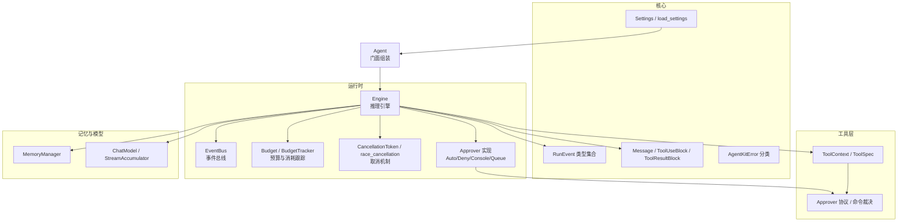
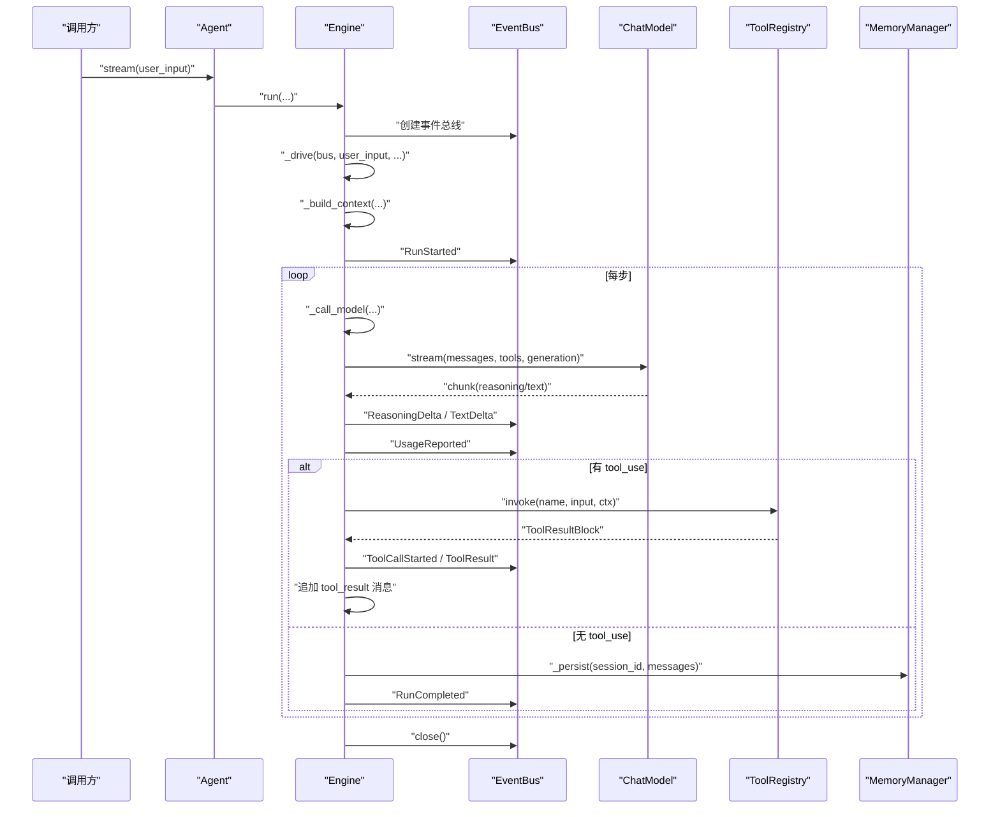
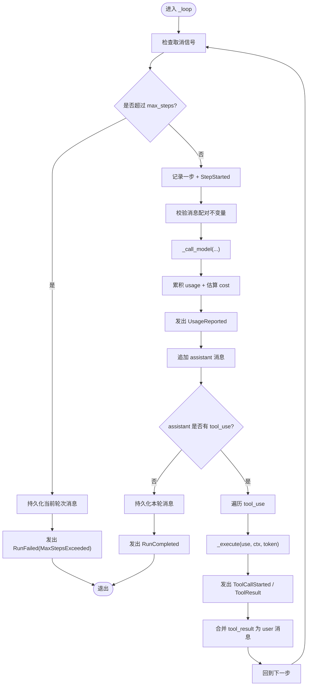
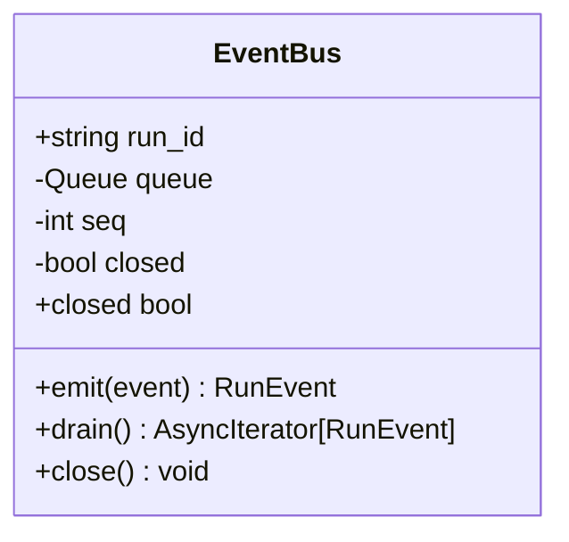
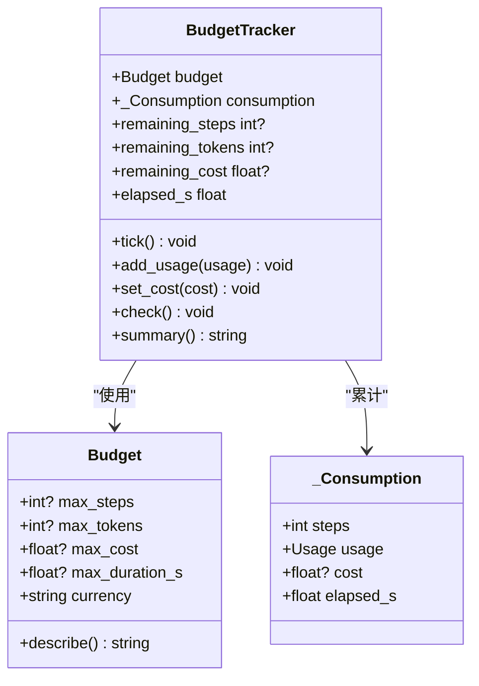
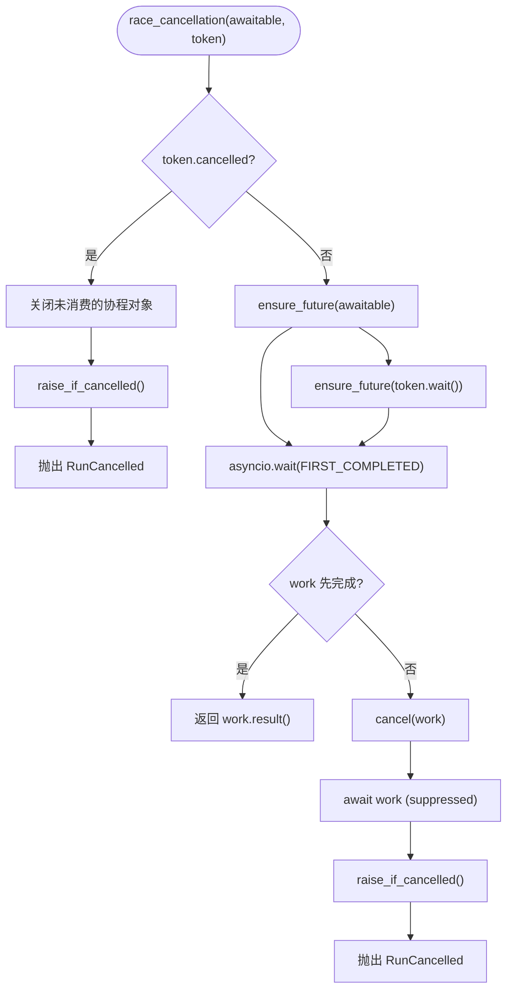
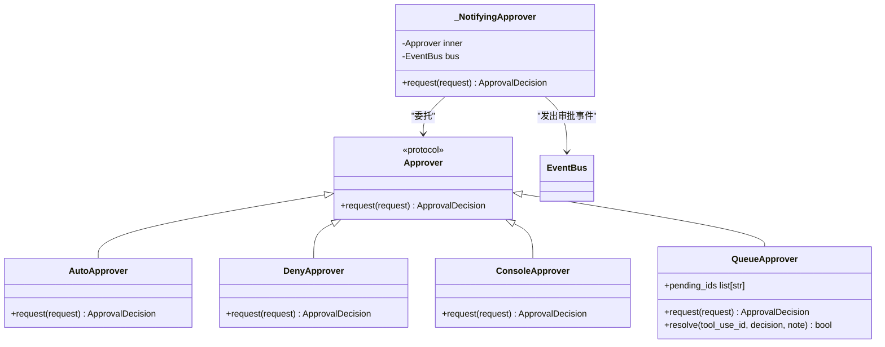
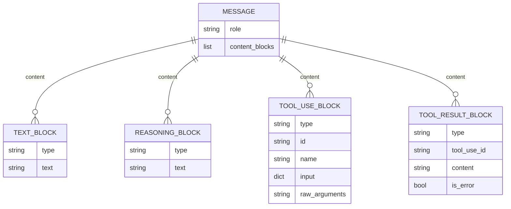
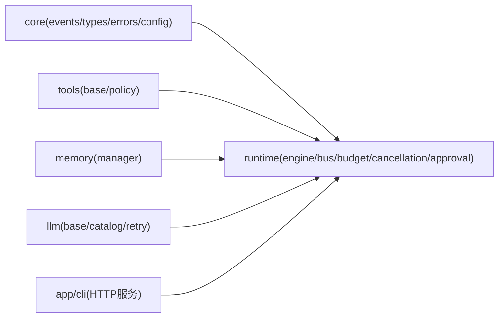
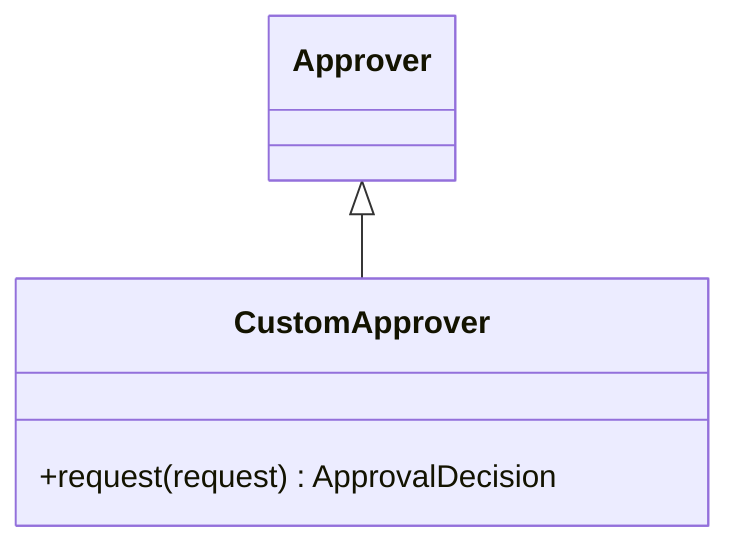

# 运行时引擎

<cite>
**本文引用的文件**   
- [engine.py](file://src/agentkit/runtime/engine.py)
- [bus.py](file://src/agentkit/runtime/bus.py)
- [budget.py](file://src/agentkit/runtime/budget.py)
- [cancellation.py](file://src/agentkit/runtime/cancellation.py)
- [approval.py](file://src/agentkit/runtime/approval.py)
- [events.py](file://src/agentkit/core/events.py)
- [types.py](file://src/agentkit/core/types.py)
- [config.py](file://src/agentkit/core/config.py)
- [errors.py](file://src/agentkit/core/errors.py)
- [agent.py](file://src/agentkit/runtime/agent.py)
- [base.py](file://src/agentkit/tools/base.py)
- [policy.py](file://src/agentkit/tools/policy.py)
- [README.md](file://README.md)
</cite>

## 目录
1. [引言](#引言)
2. [项目结构](#项目结构)
3. [核心组件](#核心组件)
4. [架构总览](#架构总览)
5. [详细组件分析](#详细组件分析)
6. [依赖关系分析](#依赖关系分析)
7. [性能与成本优化](#性能与成本优化)
8. [故障排查指南](#故障排查指南)
9. [结论](#结论)
10. [附录：配置、生命周期与扩展点](#附录配置生命周期与扩展点)

## 引言
AgentKit 的运行时引擎是一个围绕“原生工具调用”的四步推理循环构建的执行内核。它不解析模型文本，而是把消息历史连同工具 schema 发给模型，流式接收最终答复或一个或多个工具调用；随后执行工具、把结果回灌为对话消息，再回到第一步。整个运行过程以事件为中心：引擎只产出事件，由事件总线汇聚，供 CLI、SSE、可观测层和评测系统共享同一真相源。

本文件聚焦运行时引擎的实现细节，包括四步循环、事件总线设计、预算控制与成本监控、取消机制、审批流程决策逻辑，以及引擎配置、生命周期管理、错误处理和性能优化策略，并给出自定义审批策略与扩展点的实现思路。

## 项目结构
运行时相关代码集中在 `src/agentkit/runtime`，并与 `core`、`tools`、`memory`、`llm` 等模块协作：

**图表来源**
- [engine.py:127-548](file://src/agentkit/runtime/engine.py#L127-L548)
- [bus.py:30-73](file://src/agentkit/runtime/bus.py#L30-L73)
- [budget.py:26-156](file://src/agentkit/runtime/budget.py#L26-L156)
- [cancellation.py:30-145](file://src/agentkit/runtime/cancellation.py#L30-L145)
- [approval.py:35-179](file://src/agentkit/runtime/approval.py#L35-L179)
- [events.py:37-170](file://src/agentkit/core/events.py#L37-L170)
- [types.py:29-212](file://src/agentkit/core/types.py#L29-L212)
- [config.py:27-99](file://src/agentkit/core/config.py#L27-L99)
- [agent.py:38-175](file://src/agentkit/runtime/agent.py#L38-L175)

**章节来源**
- [README.md:53-68](file://README.md#L53-L68)
- [engine.py:1-16](file://src/agentkit/runtime/engine.py#L1-L16)

## 核心组件
- **Engine**：驱动 tool-calling 循环，负责装配上下文、调用模型、执行工具、持久化消息、汇总用量与成本、发出事件。
- **EventBus**：单次 run 内的事件队列，解耦生产者与消费者，保证异常不会让消费者挂住，并在关闭时发送终止信号。
- **Budget / BudgetTracker**：定义步数、token、成本、时长四类上限，累计实际消耗并在越界时抛出预算超限错误。
- **CancellationToken / race_cancellation**：显式取消信号，贯穿引擎、模型流、工具执行，确保取消能真正中断长耗时操作。
- **Approver 及实现**：定义审批协议，提供自动放行、默认拒绝、控制台提问、队列等待四种部署形态。
- **RunEvent 类型集合**：统一描述运行生命周期、模型输出、工具调用、审批请求与决议等事件。
- **Message 与内容块**：内部消息模型采用 Anthropic 风格的内容块，强制 tool_use 与 tool_result 配对不变量。
- **Agent 门面**：把模型、工具、引擎组装起来，暴露 stream/run 接口，并提供 build_agent/build_model 工厂方法。

**章节来源**
- [engine.py:74-163](file://src/agentkit/runtime/engine.py#L74-L163)
- [bus.py:30-73](file://src/agentkit/runtime/bus.py#L30-L73)
- [budget.py:26-156](file://src/agentkit/runtime/budget.py#L26-L156)
- [cancellation.py:30-145](file://src/agentkit/runtime/cancellation.py#L30-L145)
- [approval.py:35-179](file://src/agentkit/runtime/approval.py#L35-L179)
- [events.py:37-170](file://src/agentkit/core/events.py#L37-L170)
- [types.py:29-212](file://src/agentkit/core/types.py#L29-L212)
- [agent.py:38-175](file://src/agentkit/runtime/agent.py#L38-L175)

## 架构总览
Engine 是运行时引擎的核心类，对外暴露 `run` 异步迭代器，内部通过 `_drive` 启动生产任务，并通过 EventBus 向消费者推送事件。主循环 `_loop` 完成四步推理：

1. **调用模型**：构造消息序列与工具 schema，流式调用模型，边生成边推 ReasoningDelta 和 TextDelta。
2. **处理工具**：从 assistant 消息中提取 tool_use 列表，若无则视为最终答复。
3. **执行工具**：对每个 tool_use 执行工具，支持取消、审批、参数校验失败的特殊回灌。
4. **持久化**：在最终答复或达到最大步数时，将本轮新增消息落盘到记忆管理器。

**图表来源**
- [engine.py:166-248](file://src/agentkit/runtime/engine.py#L166-L248)
- [engine.py:250-434](file://src/agentkit/runtime/engine.py#L250-L434)
- [engine.py:438-494](file://src/agentkit/runtime/engine.py#L438-L494)
- [bus.py:30-73](file://src/agentkit/runtime/bus.py#L30-L73)

**章节来源**
- [engine.py:1-16](file://src/agentkit/runtime/engine.py#L1-L16)
- [engine.py:166-248](file://src/agentkit/runtime/engine.py#L166-L248)
- [engine.py:250-434](file://src/agentkit/runtime/engine.py#L250-L434)
- [engine.py:438-494](file://src/agentkit/runtime/engine.py#L438-L494)

## 详细组件分析

### 四步推理循环
Engine 的主循环 `_loop` 维护消息历史、步骤计数、预算跟踪器和工具上下文。每一步先检查取消与步数上限，然后调用模型，累积用量并估算成本，再根据 assistant 是否包含 tool_use 决定继续还是结束。若存在 tool_use，则逐个执行工具，并把结果合并成一条 user 消息追加回去。

**图表来源**
- [engine.py:250-369](file://src/agentkit/runtime/engine.py#L250-L369)
- [types.py:159-212](file://src/agentkit/core/types.py#L159-L212)

**章节来源**
- [engine.py:250-369](file://src/agentkit/runtime/engine.py#L250-L369)
- [types.py:159-212](file://src/agentkit/core/types.py#L159-L212)

### 事件总线设计与消息传递
EventBus 使用 asyncio.Queue 作为单次 run 的事件队列，所有事件同步入队并盖上 seq 与 run_id。消费者通过 drain 异步迭代直到收到关闭哨兵。这种设计让审批事件可以在工具仍然阻塞时立即送达客户端，避免“先出结果再问批准”的逻辑倒置。

**图表来源**
- [bus.py:30-73](file://src/agentkit/runtime/bus.py#L30-L73)

**章节来源**
- [bus.py:1-73](file://src/agentkit/runtime/bus.py#L1-L73)

### 预算控制与成本监控
Budget 定义四类上限：步数、token、成本、时长。BudgetTracker 在每个可能显著消耗资源的节点后调用 check，越界时抛出 BudgetExceeded。引擎在每次模型调用后更新累计用量并估算成本，再通过 UsageReported 事件上报。

**图表来源**
- [budget.py:26-156](file://src/agentkit/runtime/budget.py#L26-L156)

**章节来源**
- [budget.py:1-156](file://src/agentkit/runtime/budget.py#L1-L156)
- [engine.py:308-325](file://src/agentkit/runtime/engine.py#L308-L325)

### 取消机制的异步处理
CancellationToken 提供幂等的 cancel 与 raise_if_cancelled，race_cancellation 在执行 awaitable 的同时监听取消信号，若取消先触发则取消工作协程并抛出 RunCancelled。with_timeout 则在保留取消语义的前提下增加超时保护，超时转换为 BudgetExceeded。

**图表来源**
- [cancellation.py:83-119](file://src/agentkit/runtime/cancellation.py#L83-L119)

**章节来源**
- [cancellation.py:1-145](file://src/agentkit/runtime/cancellation.py#L1-L145)
- [engine.py:370-434](file://src/agentkit/runtime/engine.py#L370-L434)

### 审批流程的决策逻辑
Approver 协议定义 request 方法，runtime 提供 AutoApprover、DenyApprover、ConsoleApprover、QueueApprover 四种实现。Engine 用 _NotifyingApprover 包装 Approver，使 ApprovalRequested 和 ApprovalResolved 事件能在工具执行前后发出，从而支持 SSE 场景下的异步审批。

**图表来源**
- [approval.py:35-179](file://src/agentkit/runtime/approval.py#L35-L179)
- [engine.py:96-125](file://src/agentkit/runtime/engine.py#L96-L125)

**章节来源**
- [approval.py:1-179](file://src/agentkit/runtime/approval.py#L1-L179)
- [engine.py:96-125](file://src/agentkit/runtime/engine.py#L96-L125)

### 消息模型与配对不变量
Message 使用 content block 表示 text、reasoning、tool_use、tool_result，其中 tool_result 属于 user 消息，且同一轮并行调用的全部结果必须合并在同一条 user 消息中。validate_conversation 强制 tool_use 与紧随其后的 tool_result 配对，禁止孤儿 tool_result，并在违反时抛出 InvalidConversation。

**图表来源**
- [types.py:29-212](file://src/agentkit/core/types.py#L29-L212)

**章节来源**
- [types.py:29-212](file://src/agentkit/core/types.py#L29-L212)

## 依赖关系分析
运行时引擎依赖 core（事件、类型、错误、配置）、tools（工具协议与安全策略）、memory（会话记忆）、llm（模型抽象）。依赖方向单向：tools 不 import runtime，审批接口由 runtime 注入具体实现。

**图表来源**
- [engine.py:18-61](file://src/agentkit/runtime/engine.py#L18-L61)
- [agent.py:14-35](file://src/agentkit/runtime/agent.py#L14-L35)

**章节来源**
- [engine.py:18-61](file://src/agentkit/runtime/engine.py#L18-L61)
- [agent.py:14-35](file://src/agentkit/runtime/agent.py#L14-L35)

## 性能与成本优化
- **流式生成**：模型调用使用流式接口，边生成思维链和正文边推事件，避免用户长时间等待空白界面。
- **增量统计**：StreamAccumulator 聚合 chunk，按累计用量估算成本，避免逐次累加导致的缓存命中价格计算错误。
- **预算检查点**：每步结束时、每次模型调用后、每次工具执行后都调用 BudgetTracker.check，尽早发现超预算情况。
- **取消快速响应**：race_cancellation 让取消能立刻生效，避免工具仍在子进程或分块 IO 中占用资源。
- **持久化容错**：记忆落盘失败不致命，避免存储问题影响已经跑完的 run。

**章节来源**
- [engine.py:370-408](file://src/agentkit/runtime/engine.py#L370-L408)
- [engine.py:465-494](file://src/agentkit/runtime/engine.py#L465-L494)
- [budget.py:59-156](file://src/agentkit/runtime/budget.py#L59-L156)
- [cancellation.py:83-145](file://src/agentkit/runtime/cancellation.py#L83-L145)

## 故障排查指南
- **预算超限**：当步数、token、成本或时长超出 Budget 设置时，BudgetTracker.check 抛出 BudgetExceeded，引擎将其转为 RunFailed 事件。
- **取消运行**：CancellationToken 被触发时，race_cancellation 抛出 RunCancelled，引擎发出 RunCancelled 事件。
- **消息配对错误**：validate_conversation 检测到 tool_use 与 tool_result 不匹配时抛出 InvalidConversation，引擎在持久化前会跳过不完整消息。
- **工具参数非法**：ToolValidationError 会被回灌给模型，而不是中断 run；若模型返回原始参数字符串而非合法 JSON，引擎会直接返回错误提示让模型自我修正。
- **审批拒绝**：DenyApprover 或 QueueApprover 未决定时会拒绝动作，工具执行路径会收到拒绝结果。

**章节来源**
- [engine.py:218-248](file://src/agentkit/runtime/engine.py#L218-L248)
- [engine.py:410-434](file://src/agentkit/runtime/engine.py#L410-L434)
- [engine.py:465-494](file://src/agentkit/runtime/engine.py#L465-L494)
- [errors.py:14-132](file://src/agentkit/core/errors.py#L14-L132)

## 结论
AgentKit 运行时引擎以事件为中心、以原生工具调用为核心，实现了清晰可控的四步推理循环。通过 EventBus 解耦生产消费，通过 BudgetTracker 控制资源上限，通过 CancellationToken 保障取消语义，通过 Approver 协议支持多种审批部署形态。配合 Message 内容块与配对不变量，引擎在多 provider 环境下保持消息形状一致，便于扩展与评测。

## 附录：配置、生命周期与扩展点

### 引擎配置选项
Engine 构造函数接受 model、tools、workspace、name、system_prompt、max_steps、temperature、max_tokens、budget、memory 等参数。Agent 门面进一步封装这些参数，并提供 build_agent 工厂方法从 Settings 加载配置。

**章节来源**
- [engine.py:130-163](file://src/agentkit/runtime/engine.py#L130-L163)
- [agent.py:38-70](file://src/agentkit/runtime/agent.py#L38-L70)
- [config.py:27-99](file://src/agentkit/core/config.py#L27-L99)

### 生命周期管理
- **启动**：Agent.stream 调用 Engine.run，Engine._drive 创建 EventBus 并启动 _loop。
- **运行**：每步发出 StepStarted、UsageReported，工具调用发出 ToolCallStarted/ToolResult，模型输出发出 ReasoningDelta/TextDelta。
- **结束**：RunCompleted、RunFailed 或 RunCancelled 作为终止事件，EventBus.close 发送关闭哨兵。
- **清理**：finally 中关闭总线，消费者提前退出时取消生产者任务，防止后台继续烧 token。

**章节来源**
- [engine.py:166-248](file://src/agentkit/runtime/engine.py#L166-L248)
- [bus.py:55-73](file://src/agentkit/runtime/bus.py#L55-L73)

### 错误处理策略
- **已知错误**：BudgetExceeded、RunCancelled、AgentKitError 子类被捕获并转为相应事件。
- **意外异常**：记录日志并发出 RunFailed，避免 traceback 撑大 SSE 载荷。
- **工具失败**：参数校验失败或策略拒绝回灌为错误结果，让模型自我修正。

**章节来源**
- [engine.py:218-248](file://src/agentkit/runtime/engine.py#L218-L248)
- [errors.py:14-132](file://src/agentkit/core/errors.py#L14-L132)

### 自定义审批策略与扩展点
- **自定义 Approver**：实现 Approver 协议的 request 方法，返回 ApprovalDecision.allow/deny。例如基于数据库策略、外部 API 或业务规则进行审批。
- **集成到 Engine**：通过 Engine 构造函数的 approver 参数注入，或使用 _NotifyingApprover 包装以发出审批事件。
- **工具侧扩展**：ToolContext.request_approval 走审批通道，没有通道时默认拒绝；可在工具实现中调用该接口触发审批。

**图表来源**
- [approval.py:77-89](file://src/agentkit/runtime/approval.py#L77-L89)
- [base.py:40-67](file://src/agentkit/tools/base.py#L40-L67)

**章节来源**
- [approval.py:35-179](file://src/agentkit/runtime/approval.py#L35-L179)
- [base.py:40-67](file://src/agentkit/tools/base.py#L40-L67)