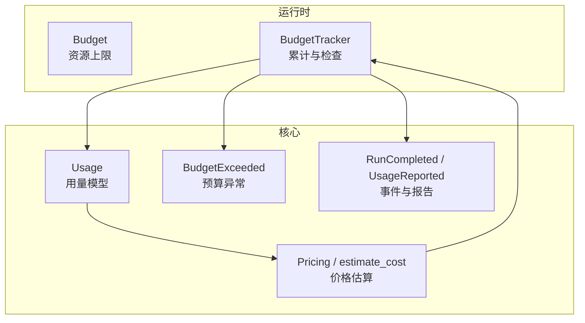
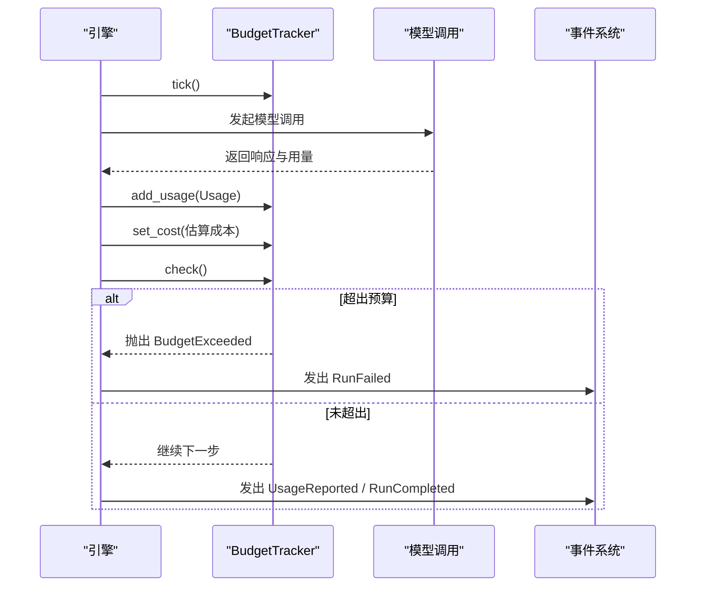
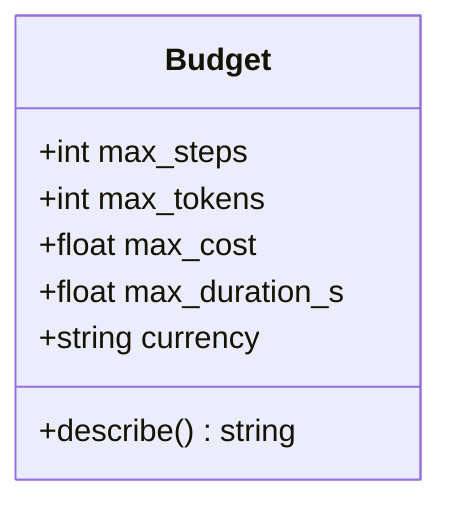
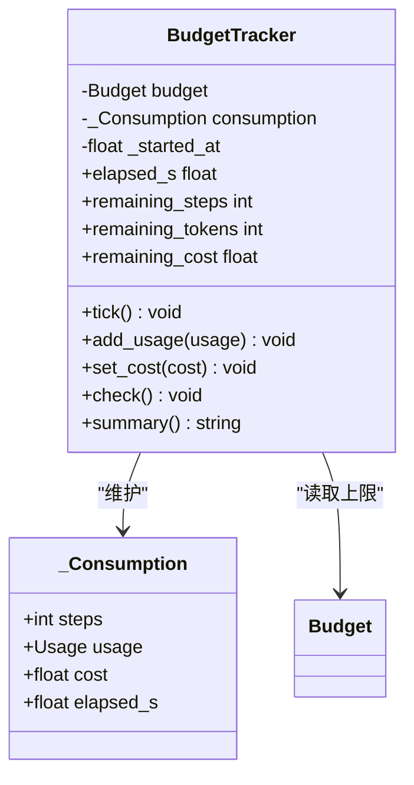
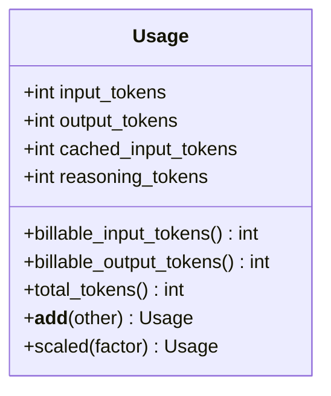
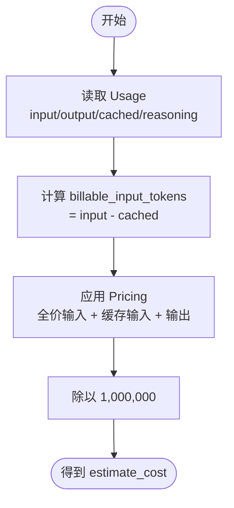
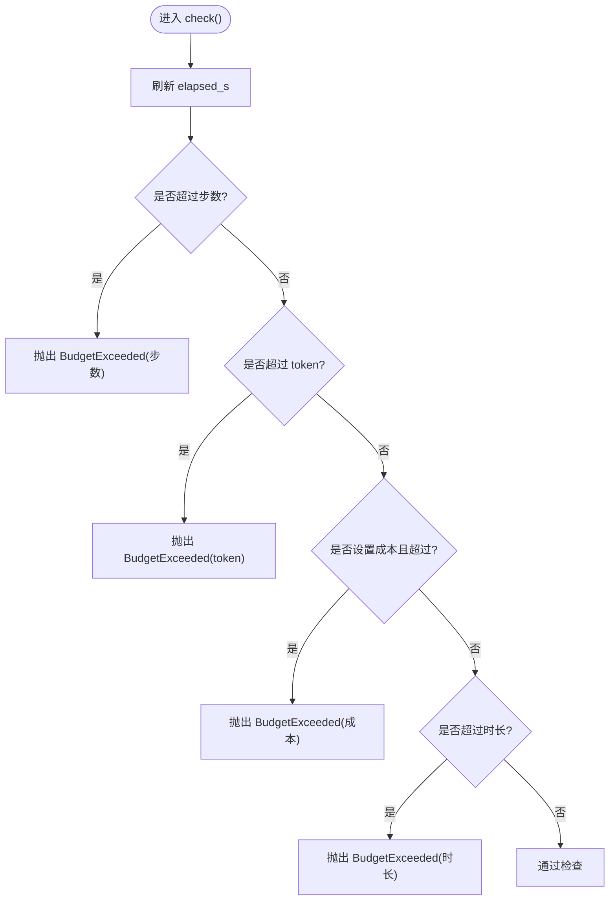
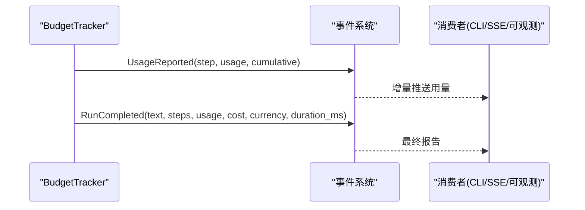
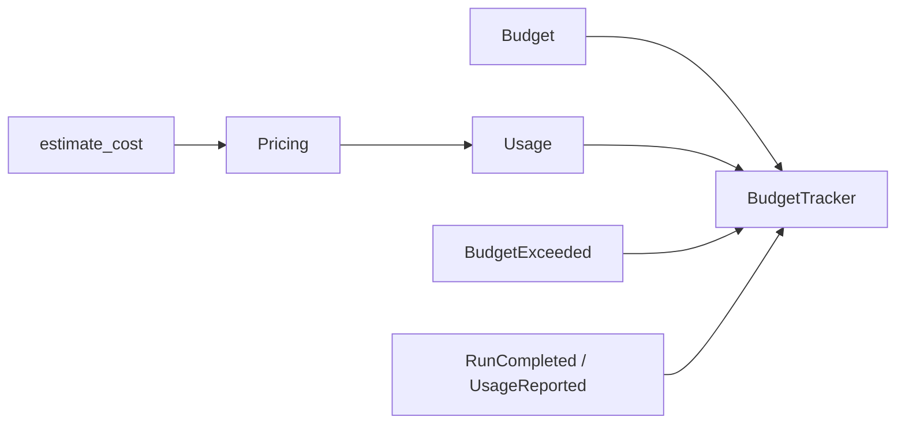

# 预算控制

<cite>
**本文引用的文件**   
- [budget.py](file://src/agentkit/runtime/budget.py)
- [usage.py](file://src/agentkit/core/usage.py)
- [errors.py](file://src/agentkit/core/errors.py)
- [events.py](file://src/agentkit/core/events.py)
- [test_runtime.py](file://tests/test_runtime.py)
</cite>

## 目录
1. [引言](#引言)
2. [项目结构中的预算模块](#项目结构中的预算模块)
3. [核心组件](#核心组件)
4. [架构总览](#架构总览)
5. [关键组件详解](#关键组件详解)
6. [依赖关系分析](#依赖关系分析)
7. [性能与成本特性](#性能与成本特性)
8. [故障排查指南](#故障排查指南)
9. [结论](#结论)
10. [附录：配置最佳实践](#附录配置最佳实践)

## 引言
本文件面向“预算控制和成本监控系统”，重点说明以下能力：
- `Budget` 和 `BudgetTracker` 的工作机制，包括步数、Token 数量、成本和时长四类上限。
- `Usage` 数据模型的统计口径、计费字段换算、价格估算逻辑和多货币支持。
- 预算超出的异常处理、实时监控事件输出与报告摘要生成。
- 在引擎运行时的集成方式、监控点以及可观测性设计。
- 预算配置的最佳实践与性能考虑。

该系统的核心思想是：**不截断上下文，而是检查后抛错**。这样避免模型基于不完整上下文给出看似确定但实际错误的回答；宁可让一次 run 失败并明确原因，也不产出不可信结果。

## 项目结构中的预算模块
预算相关代码分布在运行时层和核心层：
- 运行时层负责“累计消耗 + 越界判定”：`Budget`、`BudgetTracker`。
- 核心层负责“用量建模 + 价格估算 + 错误类型 + 事件模型”。

**图表来源**
- [budget.py:26-155](file://src/agentkit/runtime/budget.py#L26-L155)
- [usage.py:22-127](file://src/agentkit/core/usage.py#L22-L127)
- [errors.py:114-116](file://src/agentkit/core/errors.py#L114-L116)
- [events.py:60-105](file://src/agentkit/core/events.py#L60-L105)

**章节来源**
- [budget.py:1-23](file://src/agentkit/runtime/budget.py#L1-L23)
- [usage.py:1-15](file://src/agentkit/core/usage.py#L1-L15)

## 核心组件
本节聚焦三类核心对象：
- `Budget`：描述一次 run 的资源上限，包含步数、token、成本、时长和货币。
- `BudgetTracker`：维护实际消耗，提供记账方法、剩余量查询、越界检查和摘要输出。
- `Usage`：统一不同厂商的 token 语义，提供计费字段换算、总量计算、累加与缩放。

此外，`Pricing` 与 `estimate_cost` 提供价格估算，`BudgetExceeded` 提供预算异常类型，`RunCompleted` 与 `UsageReported` 提供事件化报告。

**章节来源**
- [budget.py:26-155](file://src/agentkit/runtime/budget.py#L26-L155)
- [usage.py:22-127](file://src/agentkit/core/usage.py#L22-L127)
- [errors.py:114-116](file://src/agentkit/core/errors.py#L114-L116)
- [events.py:60-105](file://src/agentkit/core/events.py#L60-L105)

## 架构总览
下图展示预算控制在一次 agent run 中的整体流程：引擎驱动步骤，每次模型调用后更新用量与成本，并在关键节点检查预算；最终通过事件输出完整报告。

**图表来源**
- [budget.py:73-142](file://src/agentkit/runtime/budget.py#L73-L142)
- [events.py:60-105](file://src/agentkit/core/events.py#L60-L105)
- [test_runtime.py:271-293](file://tests/test_runtime.py#L271-L293)

## 关键组件详解

### Budget：资源上限定义
`Budget` 是一个不可变的数据类，表示一次 run 的四类上限：
- `max_steps`：最大步数，防止工具调用不收敛。
- `max_tokens`：最大 token 总量，控制上下文与成本的主要来源。
- `max_cost`：最大成本，独立于 token，因为缓存命中按折扣价计费。
- `max_duration_s`：最大时长，作为外部依赖卡住时的兜底。
- `currency`：货币单位，默认人民币。

它还提供一个 `describe()` 方法，用于生成人类可读的上限描述。

**图表来源**
- [budget.py:26-46](file://src/agentkit/runtime/budget.py#L26-L46)

**章节来源**
- [budget.py:26-46](file://src/agentkit/runtime/budget.py#L26-L46)

### BudgetTracker：累计消耗与越界检查
`BudgetTracker` 维护 `_Consumption`，记录步数、累计 `Usage`、估算成本与已用时长。它提供：
- 记账方法：`tick()`、`add_usage()`、`set_cost()`。
- 剩余量属性：`remaining_steps`、`remaining_tokens`、`remaining_cost`。
- 检查方法：`check()`，任一维度越界即抛出 `BudgetExceeded`。
- 摘要方法：`summary()`，用于收尾事件与 CLI 输出。

**图表来源**
- [budget.py:49-155](file://src/agentkit/runtime/budget.py#L49-L155)

**章节来源**
- [budget.py:59-155](file://src/agentkit/runtime/budget.py#L59-L155)

### Usage：用量模型与统计口径
`Usage` 统一不同厂商的 token 语义，记录：
- `input_tokens`：输入 token 总数（含缓存命中）。
- `output_tokens`：输出 token 总数（含 reasoning）。
- `cached_input_tokens`：输入中缓存命中的子集。
- `reasoning_tokens`：输出中思维链的子集。

它提供：
- `billable_input_tokens`：全价计费输入 token，扣除缓存命中部分。
- `billable_output_tokens`：输出计费 token。
- `total_tokens`：上下文占用总量，不等于计费量。
- `__add__`：累加多个 `Usage`。
- `scaled(factor)`：按比例缩放用量。

**图表来源**
- [usage.py:22-70](file://src/agentkit/core/usage.py#L22-L70)

**章节来源**
- [usage.py:1-70](file://src/agentkit/core/usage.py#L1-L70)

### Pricing 与 estimate_cost：价格估算与多货币支持
`Pricing` 以每百万 token 的价格表达模型定价，包含：
- `input_per_mtok`：全价输入单价。
- `cached_input_per_mtok`：缓存命中输入单价。
- `output_per_mtok`：输出单价。
- `currency`：货币单位。

`estimate_cost` 根据 `Usage` 与 `Pricing` 计算花费，注意：
- 使用 `billable_input_tokens` 与 `cached_input_tokens` 分别计价，避免重复计费。
- 除以 1,000,000 将“每百万 token”转换为实际金额。

内置价格表 `DEFAULT_PRICING` 提供若干模型示例，`pricing_for(model)` 可按模型名查找价格，查不到时返回 `None`，宁可不报成本也不编造数字。

**图表来源**
- [usage.py:76-96](file://src/agentkit/core/usage.py#L76-L96)

**章节来源**
- [usage.py:76-127](file://src/agentkit/core/usage.py#L76-L127)

### 预算检查与异常处理
`BudgetTracker.check()` 依次检查：
- 步数：若超过 `max_steps`，抛出 `BudgetExceeded`。
- Token：若累计 `total_tokens` 超过 `max_tokens`，抛出 `BudgetExceeded`。
- 成本：若设置了 `max_cost` 且当前 `cost` 已知且超过上限，抛出 `BudgetExceeded`。
- 时长：若超过 `max_duration_s`，抛出 `BudgetExceeded`。

当预算被触发时，引擎会终止后续工作并以 `run_failed` 事件收尾，错误类型为 `BudgetExceeded`，消息中包含具体超限维度。

**图表来源**
- [budget.py:118-142](file://src/agentkit/runtime/budget.py#L118-L142)
- [errors.py:114-116](file://src/agentkit/core/errors.py#L114-L116)

**章节来源**
- [budget.py:118-142](file://src/agentkit/runtime/budget.py#L118-L142)
- [errors.py:114-116](file://src/agentkit/core/errors.py#L114-L116)

### 实时监控与报告生成
系统在运行过程中通过事件暴露用量与成本信息：
- `UsageReported`：包含单次用量与累计用量，便于实时消费方（CLI、SSE、可观测层）增量更新。
- `RunCompleted`：包含最终文本、步数、累计 `Usage`、成本、货币与耗时毫秒数。
- `BudgetTracker.summary()`：生成一行摘要，包含步数、耗时、入/出 token、缓存命中次数与约等成本。

**图表来源**
- [events.py:60-105](file://src/agentkit/core/events.py#L60-L105)
- [budget.py:144-155](file://src/agentkit/runtime/budget.py#L144-L155)

**章节来源**
- [events.py:60-105](file://src/agentkit/core/events.py#L60-L105)
- [budget.py:144-155](file://src/agentkit/runtime/budget.py#L144-L155)

## 依赖关系分析
预算模块的核心依赖如下：
- `BudgetTracker` 依赖 `Budget`（上限）、`Usage`（用量）、`BudgetExceeded`（异常）。
- `Usage` 依赖 `Pricing` 与 `estimate_cost`（价格估算）。
- 事件系统依赖 `Usage` 与 `RunCompleted`（报告）。
- 测试覆盖预算行为，验证步数、token、成本、时长限制与摘要输出。

**图表来源**
- [budget.py:20-23](file://src/agentkit/runtime/budget.py#L20-L23)
- [usage.py:76-127](file://src/agentkit/core/usage.py#L76-L127)
- [errors.py:114-116](file://src/agentkit/core/errors.py#L114-L116)
- [events.py:60-105](file://src/agentkit/core/events.py#L60-L105)

**章节来源**
- [budget.py:20-23](file://src/agentkit/runtime/budget.py#L20-L23)
- [usage.py:76-127](file://src/agentkit/core/usage.py#L76-L127)
- [errors.py:114-116](file://src/agentkit/core/errors.py#L114-L116)
- [events.py:60-105](file://src/agentkit/core/events.py#L60-L105)

## 性能与成本特性
- **步数限制**：主要用于防止模型反复调用工具不收敛；引擎循环条件保证步数边界，`check()` 作为兜底。
- **Token 限制**：控制上下文大小与主要成本来源；单步可能携带大量 token，仅看步数不够。
- **成本限制**：独立于 token，因为缓存命中按折扣价计费，逐次累加会失真；因此由引擎在每次模型调用后写入累计成本。
- **时长限制**：兜底保护，防止外部依赖卡住导致长时间占用资源。
- **事件开销**：`UsageReported` 与 `RunCompleted` 为可观测与消费方提供增量与终态数据，适合 SSE 与 CLI 逐步展示。
- **价格估算**：`estimate_cost` 使用计费字段避免重复计费；对未知模型返回 `None`，不编造成本。

**章节来源**
- [budget.py:1-13](file://src/agentkit/runtime/budget.py#L1-L13)
- [budget.py:82-89](file://src/agentkit/runtime/budget.py#L82-L89)
- [usage.py:1-15](file://src/agentkit/core/usage.py#L1-L15)
- [usage.py:90-96](file://src/agentkit/core/usage.py#L90-L96)

## 故障排查指南
常见问题与定位建议：
- **步数超限**：检查工具调用是否陷入循环或无法收敛；确认引擎循环条件与 `Budget.max_steps` 配置。
- **Token 超限**：检查单步上下文是否过大；考虑裁剪历史或拆分任务。
- **成本超限**：确认 `set_cost` 是否在每次模型调用后写入；检查 `Pricing` 是否正确映射到模型名。
- **时长超限**：检查外部依赖是否阻塞；考虑增加超时与取消机制。
- **成本未知**：若 `pricing_for` 返回 `None`，不会因成本而失败；需补充价格表或从配置注入。

测试用例覆盖了上述场景：
- 步数、token、成本、时长限制均能触发 `BudgetExceeded`。
- 成本未知时不会误判。
- 剩余量计算正确。
- 摘要输出包含关键指标。

**章节来源**
- [test_runtime.py:208-268](file://tests/test_runtime.py#L208-L268)
- [test_runtime.py:271-293](file://tests/test_runtime.py#L271-L293)
- [usage.py:118-127](file://src/agentkit/core/usage.py#L118-L127)

## 结论
预算控制系统通过 `Budget` 与 `BudgetTracker` 实现四层上限管理，结合 `Usage` 与 `Pricing` 完成用量统计与成本估算，并通过事件系统提供实时监控与报告。其设计强调“检查后抛错”，避免产生不可信结果；同时通过 `summary()` 与 `RunCompleted` 提供清晰的消费端输出。生产环境中应谨慎配置预算参数，确保价格表准确，并结合取消机制与可观测性完善运维体验。

## 附录：配置最佳实践
- **分维度设限**：同时设置步数、token、成本、时长，避免单一维度失效。
- **成本优先**：由于缓存命中折扣，成本是最贴近真实支出的指标，应优先关注。
- **货币一致**：`Budget.currency` 与 `Pricing.currency` 保持一致，避免跨货币混淆。
- **价格表维护**：定期核对官方定价页，必要时从配置注入而非硬编码。
- **监控与告警**：订阅 `UsageReported` 与 `RunCompleted`，在接近阈值时预警。
- **容错策略**：对未知模型不编造成本；对网络抖动与限流使用重试策略，但对认证失败等不可重试错误直接中断。

**章节来源**
- [budget.py:26-46](file://src/agentkit/runtime/budget.py#L26-L46)
- [usage.py:99-127](file://src/agentkit/core/usage.py#L99-L127)
- [events.py:60-105](file://src/agentkit/core/events.py#L60-L105)